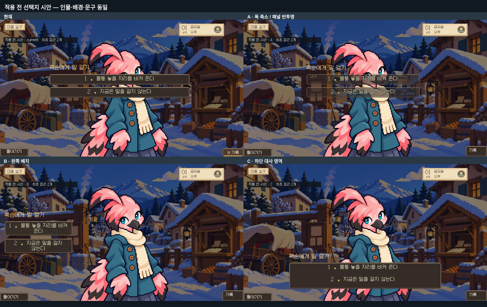
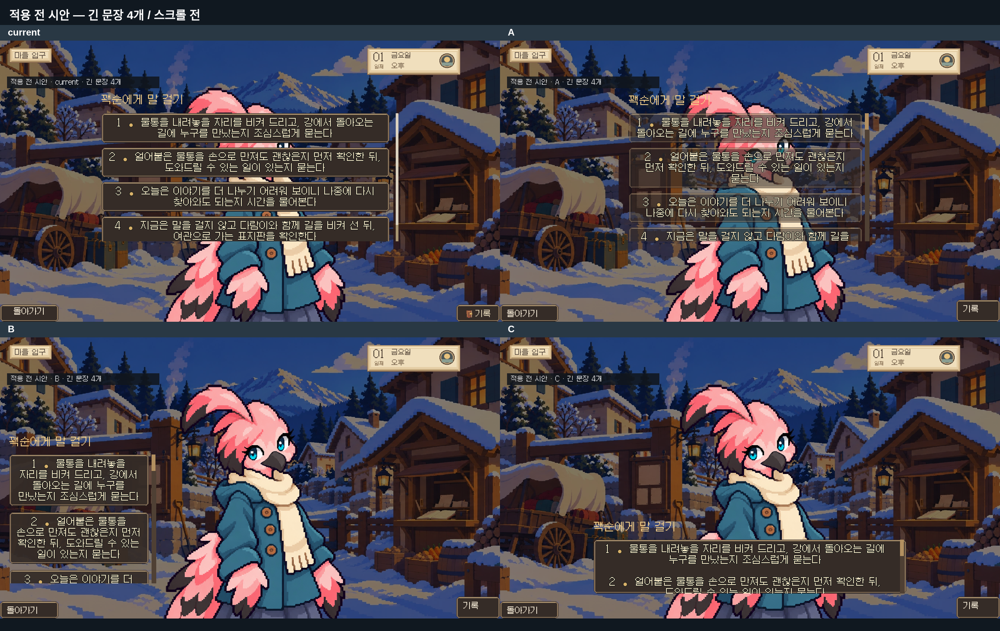
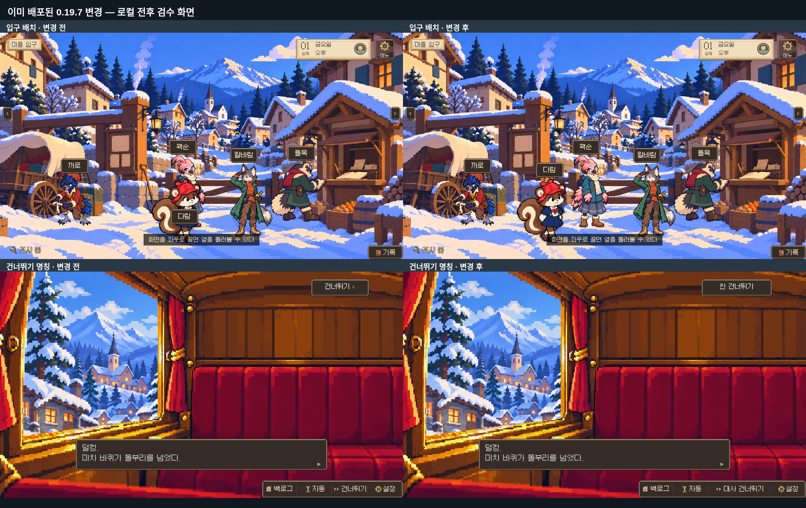

# 선택지 A/B/C — 적용 전 시안

**선택지 변경은 게임에 적용하지 않았습니다.** main 0.19.7 (`b772a2a0016279d0e9146b97dd5d6513a82bc6ed`)을 로컬 Chromium/Ren’Py에서 실행하고, 임시 메모리 화면으로 비교했습니다. 이 브랜치에는 문서와 검수 이미지·결과만 있습니다.

## 먼저 비교할 화면

| 화면 | 원본 PNG | 제안 / 한계 |
|---|---|---|
| 현재 | [current.png](current.png) | 실제 `r13_question_list` 화면. 얼굴에 불투명 선택지가 겹침. |
| A | [A.png](A.png) | 가운데 높이 유지, 폭 760→620, 패널 alpha 0.60. 글자는 불투명 유지. 얼굴은 비치지만 글자와 얼굴이 여전히 겹침. |
| B | [B.png](B.png) | 인물 고정, 선택지만 왼쪽 x24/y300/폭380, 간격16. 얼굴과 주요 손동작을 가리지 않음. 짧은 문장도 2줄이 되어 세로 길이가 늘어남. |
| C | [C.png](C.png) | 인물 고정, 하단 x240/y518/폭800/높이138에 기존 대사창 재질. 얼굴이 드러나고 2개 선택지는 한 번에 읽힘. 하단 손·몸은 가림. |

모두 1280×720, 같은 입구 배경·오후 상태, 동일한 꽥순 neutral 파일·크기·위치입니다. 배우 중심 x652/y119, 스케일은 `execution.json`에 기록했습니다. 원본 아트는 편집·생성하지 않았습니다. 글자 크기24, 기존 글꼴·외곽선, 전체 배경 dim도 동일합니다. 제안 A/B/C의 ‘기록’ 버튼은 동작 없는 임시 검수 UI입니다. 실제 질문 실행·키보드 조작·모바일 검수까지 완료한 구현물이 아닙니다.

비교 문구는 실제 최초 접근의 `물통 놓을 자리를 비켜 준다` / `지금은 말을 걸지 않는다` 두 개로 고정했습니다.

## 긴 문장 4개 시험

일부러 실제 선택지 길이 제한(24자)을 넘는 시험 문구를 사용했습니다. 게임 대사를 바꾼 것이 아닙니다. B는 줄바꿈이 많고 C는 영역이 낮아 아래 항목이 잘립니다. 임시 UI에 viewport를 두었지만 이번 휠 입력 검수에서는 아래 항목까지 이동하는 것을 확인하지 못했습니다. **4개 긴 문장을 모두 고를 수 있는 완성된 UI가 아니며**, 스크롤·영역 높이·페이지 전환 중 하나를 구현하고 검수해야 합니다. 이 한계를 숨기지 않고 잘린 상태 그대로 전달합니다.

| 현재 | A | B | C |
|---|---|---|---|
| [긴 문장 PNG](stress-current.png) | [긴 문장 PNG](stress-A.png) | [긴 문장 PNG](stress-B.png) | [긴 문장 PNG](stress-C.png) |

## 이미 배포한 0.19.7 변경 기록

- 입구의 다람만 발 기준 x880→760으로 이동. 크기·높이·자세는 유지하고 꽥순과의 가로 겹침105px를 간격15px로 분리했습니다. [이전](gate-before.png) / [이후](gate-after.png).
- 상단 `건너뛰기 ›`→`씬 건너뛰기`, 하단 `건너뛰기`→`대사 건너뛰기`. 기존 동작은 유지하고 긴 버튼 이름에 맞춰 해당 버튼 폭만 넓혔습니다. 같은 마차 첫 대사 [이전](skip-before.png) / [이후](skip-after.png), [큰 글씨 이후](skip-after-large.png).
- 이 전후 PNG는 0.19.6 기반 수정 후보를 **로컬에서 검수한 당시 원본 캡처**입니다. 입구 비교는 같은 실행 상태에서 배치 좌표를 전환했고, 명칭 비교는 같은 첫 대사입니다. 공개 서버를 전후로 캡처한 기록이라고 주장하지 않습니다.
- 해당 변경은 소스 `9c371c7cc42eb03990ac1a7eb9701bbada195c64`, 릴리스 `b772a2a0016279d0e9146b97dd5d6513a82bc6ed`에 포함되어 [0.19.7 Pages 배포](https://github.com/kkhkkh20-bit/daaegame/actions/runs/39014807998)가 성공했습니다. **A/B/C 선택지는 이 배포에 포함되지 않았습니다.**

## 원본 캡처 위치 / 재검토 자료

- 선택지 개별 원본: `/workspace/ui-choice-preview/{current,A,B,C,stress-…}.png`
- 선택지 임시 렌더 스크립트: `/workspace/ui-choice-preview/render.py` (저장소 게임 코드 밖; 현재 화면은 실제 Ren’Py screen, 제안은 메모리 screen)
- 입구 원본: `/workspace/gate-skip-review/gate-before.png`, `/workspace/gate-skip-review/gate-after.png`
- 명칭 이전 원본: `/workspace/room13-play-review/01-start.png`
- 명칭 이후 원본: `/workspace/gate-skip-review/buttons-normal.png`, `/workspace/gate-skip-review/buttons-large.png`
- 묶음 PNG·문서: `/workspace/daaegame/docs/ui-choice-proposals-20261017/`
- [실행 결과](execution.json): 화면별 예외 없음, 배우와 제안 영역 수치. 2×2 묶음은 PNG를 HTML grid로 배치하여 브라우저 캡처했으며 원본 이미지에 리터칭하지 않았습니다.
