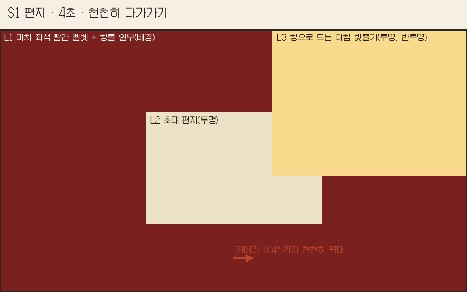
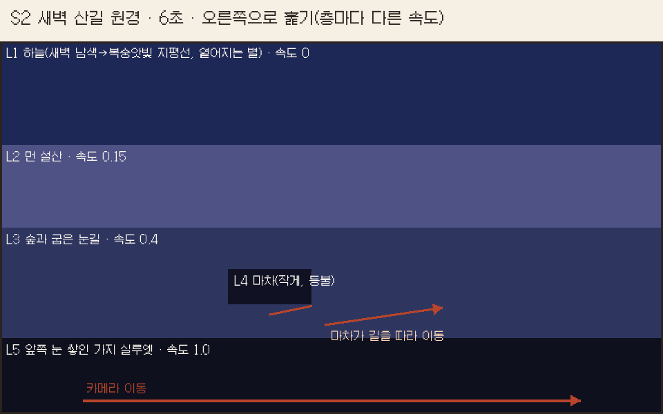
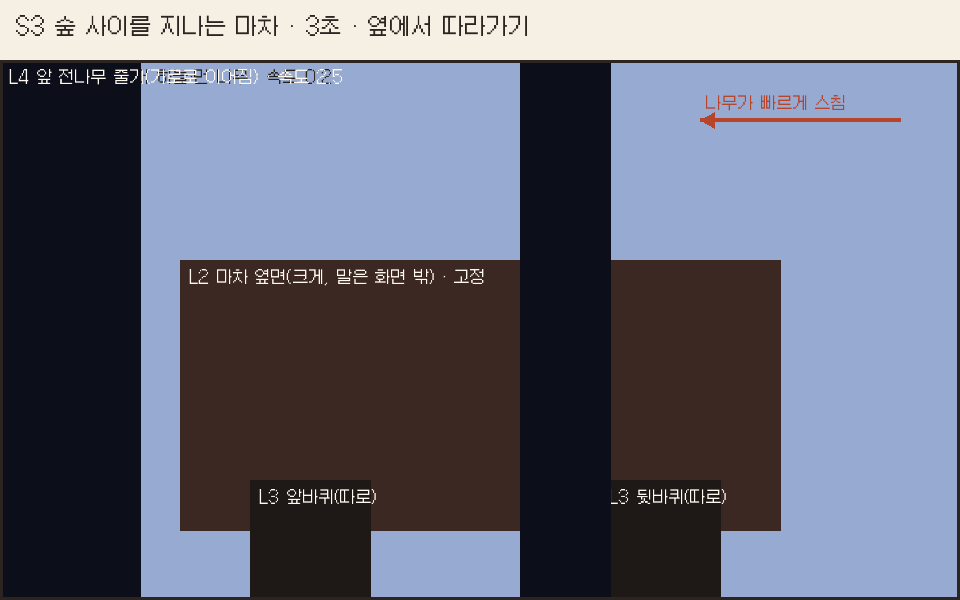
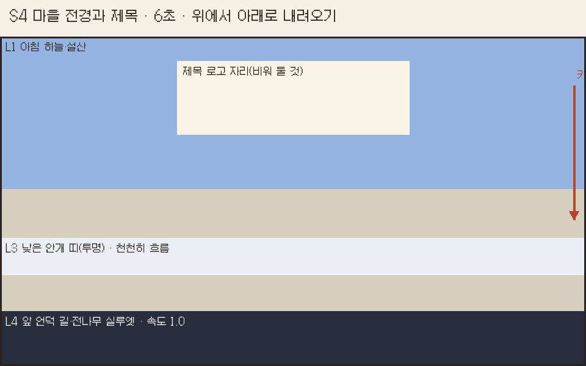

# 다람탐정 오프닝 원화 의뢰서

스토리보드와 층별 그림 요청 · 0.18.47 기준 · 2026-10-15

## 1. 무엇을 만들려는가

새 게임을 시작하면 마차 대화 전에 약 20초의 오프닝이 나온다. 지금은 기존 그림(편지 아이콘, 마을 지도, 입구 풍경)을 이어 붙인 임시 연출이다. 이 의뢰서는 오프닝 전용 그림을 새로 받아, 영화처럼 깊이감 있는 장면으로 바꾸기 위한 것이다.

연출 방식: 그림을 앞·중간·뒤 층으로 나눠 받는다. 게임에서 층마다 다른 속도로 움직이고, 빛·안개·눈발·카메라 이동을 코드로 더한다. 그래서 그림 한 장보다 층을 나눈 그림이 필요하다.

분위기: 은은한 동화, 그림책. 튀는 효과는 쓰지 않는다. 차가운 새벽 눈길에서 따뜻한 아침 마을로 가는 흐름이다.

## 2. 전체 흐름

| 컷 | 길이 | 장면 | 화면 글 | 새 그림 |
|---|---|---|---|---|
| S1 | 4초 | 마차 좌석 위 초대 편지. 창으로 아침 빛이 든다. | 여관에서 온 편지 한 통. | 필요 |
| S2 | 6초 | 새벽 산길 원경. 작은 마차가 등불을 켜고 굽은 눈길을 달린다. | 아내가 머물던 산마을로 간다. | 필요 |
| S3 | 3초 | 숲 사이를 지나는 마차 옆모습. 앞 전나무가 빠르게 스친다. | 없음 | 필요 |
| S4 | 6초 | 고개 위에서 내려다본 아침 골짜기 마을. 제목 로고가 떠오른다. | 제목 로고, 눈에 갇힌 마을 | 필요 |
| S5 | 3초 | 빈 마차 안(아빠 시점). 덜컹 → 기존 마차 대화로. | 없음 | 기존 그림 |

화면 글은 기존 대사에 있는 사실만 쓴다. 그림 안에는 글자를 넣지 않는다.

## 3. 공통 규격

- 그림체: 지금 게임 배경과 같은 고해상 도트 일러스트. 큰 색면, 계단형 외곽, 단순한 명암, 차가운 눈과 따뜻한 창 불빛의 대비.
- 참조 그림(함께 전달): game/assets/room13-pixel-ready-gate0173-morning.webp(입구), room13-pixel-carriage-empty-winter.webp(마차 안), room13-worldmap-v5.webp(마을 지도), room13-title-winter020.webp(타이틀).
- 기준 크기: 배경 한 장은 1672×941. 카메라가 움직이는 층은 아래 표의 더 큰 크기로 받는다.
- 층은 따로따로: 맨 뒤 층만 불투명, 나머지는 투명 PNG. 층끼리 겹치는 가장자리도 끝까지 그린다(뒤 층이 앞 층에 가려지는 부분도 비우지 않는다).
- 모든 층은 같은 광원, 같은 시간대, 같은 원근으로 맞춘다.
- 떨어지는 눈발은 그리지 않는다(게임에서 효과로 넣는다). 쌓인 눈은 그린다.
- 들어가면 안 되는 것: 글자·숫자, UI, 아빠, 다람이, 사람 얼굴. 마부는 S2에서 아주 작은 실루엣까지만.
- 시간대: S1·S4는 아침, S2는 새벽, S3는 해 뜰 무렵. 마차 안 그림(아침)과 입구 도착(오후) 사이에 맞는다.
- 받은 파일은 dev/import_art.py로 게임에 넣는다(투명 층은 무손실).

확인할 점(결정 필요): 입구 그림의 마차는 흰 포장을 씌운 짐마차이고, 마차 안 그림은 유리창과 빨간 벨벳 좌석이 있는 닫힌 객차다. 오프닝은 마차 안과 이어지도록 닫힌 객차(어두운 나무, 황동 장식, 빨간 커튼)로 요청한다. 입구의 짐마차와 같은 마차로 보여야 한다면 이 항목을 바꾼다.

## 4. 컷별 요청

### S1 편지 · 4초

의도: 이야기의 출발점. 여관 할머니가 보낸 초대 편지가 마차 좌석 위에 놓여 있다. 손이나 사람은 나오지 않는다.

| 파일 이름(제안) | 크기 | 내용 |
|---|---|---|
| op-s1-seat.png | 1672×941, 불투명 | 마차 안 빨간 벨벳 좌석 가까이. 오른쪽 위에 창틀 일부와 커튼. 기존 마차 안 그림과 같은 소재·색. |
| op-s1-letter.png | 약 600×420, 투명 | 봉투에 든 편지. 빨간 밀랍 봉인, 살짝 구겨진 모서리, 여러 번 펼쳐 본 접힌 자국. 글씨는 보이지 않는다. |
| op-s1-light.png | 1672×941, 투명 | 창으로 비스듬히 드는 아침 빛줄기(반투명 크림색). 먼지 알갱이는 그리지 않는다. |

연출(게임에서): 4초 동안 104%까지 천천히 다가간다. 빛줄기가 아주 조금 밝아졌다 흐려진다. 글이 한 줄 스며든다.

### S2 새벽 산길 원경 · 6초

의도: 먼 길을 왔다는 느낌. 넓은 설산 골짜기, 굽이진 눈길 위에 아주 작은 마차 하나. 마차 등불만 따뜻하다.

| 파일 이름(제안) | 크기 | 내용 |
|---|---|---|
| op-s2-sky.png | 1672×941, 불투명 | 새벽 하늘. 위는 짙은 남색, 지평선은 복숭앗빛. 옅어지는 별 몇 개. 달은 넣지 않는다. |
| op-s2-far.png | 2508×941, 투명 | 먼 설산 능선. 푸른 보랏빛, 봉우리 눈. 가로로 길게. |
| op-s2-mid.png | 2508×941, 투명 | 중간 숲과 산허리를 따라 굽어 오르는 눈길. 길은 왼쪽 아래에서 오른쪽 위로 이어진다. |
| op-s2-carriage.png | 약 320×200, 투명 | 닫힌 객차와 말 한 필을 옆에서 본 작은 그림. 마부석 위 작은 실루엣, 앞쪽 장대에 등불 하나, 창에 따뜻한 불빛. 진행 방향은 오른쪽. |
| op-s2-front.png | 3344×941, 투명 | 화면 아래쪽 앞에 걸친 눈 쌓인 전나무 가지 실루엣. 아주 어둡게, 가로로 길게. |

연출(게임에서): 카메라가 오른쪽으로 천천히 훑는다. 층마다 속도가 다르다(하늘 0, 먼 산 0.15, 숲 0.4, 앞 가지 1.0). 마차는 길을 따라 이동하고 등불이 흔들린다. 하늘이 6초 동안 조금씩 밝아진다.

### S3 숲 사이를 지나는 마차 · 3초

의도: 속도감. 마차 옆면이 화면 가운데를 차지하고, 앞으로 전나무 줄기가 빠르게 스친다. 나무 사이로 해가 막 뜬다.

| 파일 이름(제안) | 크기 | 내용 |
|---|---|---|
| op-s3-back.png | 2508×941, 불투명 | 해 뜨는 숲. 나무 사이로 낮은 햇빛, 눈 덮인 바닥. |
| op-s3-carriage.png | 약 1100×560, 투명 | 닫힌 객차의 옆면(말은 화면 밖, 왼쪽). 바퀴는 그리지 않는다. 창에는 커튼이 반쯤 쳐져 있고 안은 어둡게(사람이 보이지 않게). |
| op-s3-wheel-front.png / op-s3-wheel-back.png | 각 300×300, 투명 | 바퀴 두 개. 정면에서 본 둥근 바퀴, 바큇살 8개, 가운데 축이 그림 정중앙. 게임에서 돌린다. |
| op-s3-trunks.png | 3344×941, 투명, 좌우 이어짐 | 앞을 스치는 어두운 전나무 줄기 3~4그루. 오른쪽 끝과 왼쪽 끝이 이어지게. |

연출(게임에서): 마차는 거의 제자리에서 덜컹거리고, 바퀴가 돌고, 앞 줄기가 빠르게 지나간다. 끝에 크게 한 번 덜컹. 바퀴 축에 금이 가는 도착 장면의 복선이 된다.

### S4 마을 전경과 제목 · 6초

의도: 목적지. 고개 위에서 내려다본 아침 골짜기 마을. 지도에 있는 마을과 같은 곳이어야 한다(가운데 빨간 지붕 여관, 우물 있는 광장, 강과 돌다리, 오른쪽 절벽 폭포, 종탑).

| 파일 이름(제안) | 크기 | 내용 |
|---|---|---|
| op-s4-sky.png | 1672×1400, 불투명 | 위는 맑은 아침 하늘, 아래로 설산. 세로로 길게(카메라가 위에서 내려온다). |
| op-s4-village.png | 1672×1400, 투명 | 골짜기 마을. 굴뚝 연기는 그리지 않는다(효과로 넣는다). 창 불빛은 약하게. |
| op-s4-mist.png | 2508×300, 투명, 좌우 이어짐 | 마을 아래를 지나는 낮은 안개 띠. 반투명. |
| op-s4-front.png | 2508×941, 투명 | 화면 아래 앞쪽 고갯마루. 눈길과 전나무 실루엣. |

연출(게임에서): 카메라가 하늘에서 마을로 천천히 내려온다. 안개가 흐르고, 굴뚝 연기가 오른다. 마을이 다 보이면 위쪽 빈 하늘에 제목 로고가 스며든다. 로고 자리(화면 위 가운데)는 비워 둔다.

### S5 마차 안 · 3초

기존 그림(room13-pixel-carriage-empty-winter.webp)을 쓴다. 새 그림은 필요 없다.

## 5. GPT에 보낼 문장

공통 문장(모든 요청 앞에 붙인다):

> 첨부한 게임 배경과 같은 그림체로 그려 줘. 고해상 도트 일러스트, 큰 색면과 계단형 외곽, 단순한 명암, 겨울 산골 마을, 차가운 눈과 따뜻한 창 불빛의 대비, 그림책처럼 부드럽고 은은한 분위기. 글자·숫자·사람 얼굴은 넣지 말고, 떨어지는 눈발은 그리지 마. 배경 층이 아니면 투명 배경 PNG로 줘.

컷별 예시:

- S1 좌석: 마차 안 빨간 벨벳 좌석을 가까이서 본 장면, 오른쪽 위에 창틀과 빨간 커튼 일부, 아침 빛, 1672×941.
- S1 편지: 빨간 밀랍 봉인이 찍힌 크림색 봉투, 여러 번 접었다 편 자국, 글씨 없음, 투명 배경, 약 600×420.
- S2 먼 산: 새벽의 푸른 보랏빛 설산 능선만, 가로 2508×941, 투명 배경, 아래쪽은 끝까지 채운다.
- S2 마차: 옆에서 본 작은 닫힌 객차와 말 한 필, 오른쪽으로 달리는 중, 장대 끝 등불, 창에 따뜻한 불빛, 마부는 작은 실루엣, 투명 배경, 약 320×200.
- S3 바퀴: 정면에서 본 나무 마차 바퀴 하나, 바큇살 8개, 축이 정중앙, 투명 배경, 300×300.
- S4 마을: 고개 위에서 내려다본 아침 골짜기 마을, 첨부한 지도와 같은 배치(가운데 빨간 지붕 여관, 우물 광장, 강과 돌다리, 오른쪽 폭포), 세로 1672×1400, 투명 배경.

## 6. 받은 뒤 할 일(개발 메모)

- dev/import_art.py로 game/assets에 넣는다. 파일 이름 앞에 room13-를 붙인다.
- systems/room13_opening.rpy의 컷 구성을 S1~S5로 바꾼다. 지금의 지도 컷과 입구 제목 컷을 대신한다.
- 층별 속도와 카메라 이동은 이 의뢰서의 '연출' 항목을 따른다. 눈발·연기·빛 일렁임은 기존 효과(room13-dot-fx.json, room13_storybook.rpy)를 쓴다.
- 화면 테스트 opening_cut의 캡처 시점을 새 컷 길이에 맞춘다.
