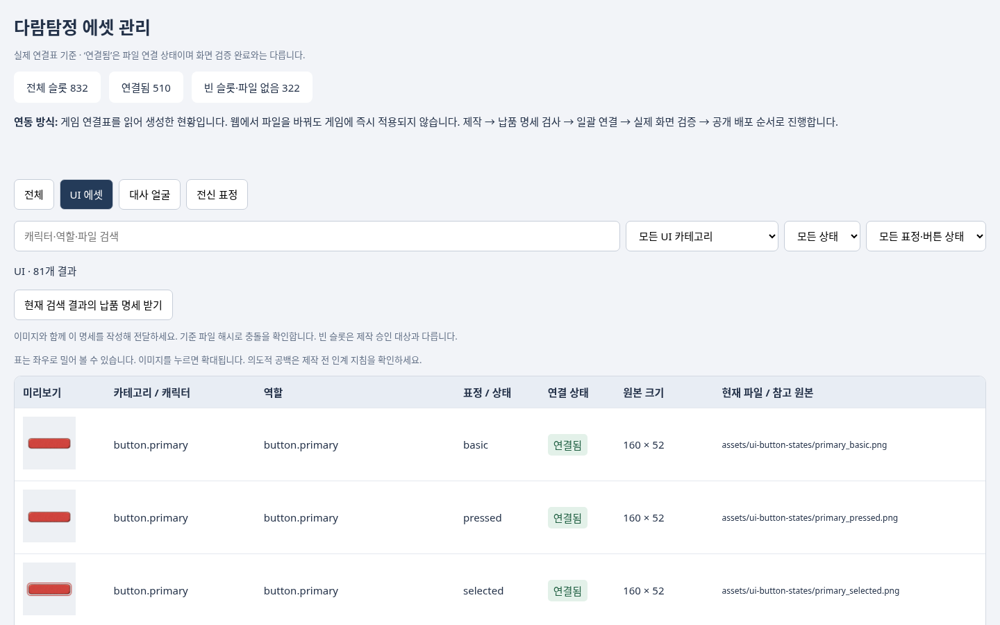

# 다른 채팅은 이 페이지에서 시작하세요

[현재 적용/빈 슬롯 전체](inventory.json) · [빈 슬롯 제작 요청서](requests.csv) · [제작자 완료 보고](deliveries.json) · [최근 변경](latest-changes.json) · [파일 채우기 안내](GUIDE.md)

아래 공개 현황판이 열리지 않아도 이 GitHub 문서와 위 연결표로 작업을 진행할 수 있습니다. 제작자는 deliveries.json에 캡처 경로를 기록하고, 사용자가 GitHub에서도 확인할 수 있도록 이 문서 끝에 완료된 슬롯·상태·캡처 Markdown 링크를 추가하세요.

저장소: https://github.com/kkhkkh20-bit/daaegame
작업 폴더: experiments/renpy-ch1
공개 현황판: https://kkhkkh20-bit.github.io/daaegame/experiments/renpy-ch1/docs/asset-modules/

1. 저장소 AGENTS.md와 작업 규칙을 읽고 최신 main을 받는다. 웹 페이지만으로 저장소에 쓸 수는 없다. 코드 작업 환경이 없는 채팅은 제작 파일과 슬롯별 납품 명세를 반환한다.
2. python3 dev/asset_toolbox.py modules를 실행해 현황을 갱신한다. inventory.json의 status/path/sha256과 requests.csv를 확인한다. 파일 존재는 실제 화면 검증과 다르다.
3. 빈 슬롯을 모두 그리지 않는다. 중립 얼굴·아빠 등 기존 의도적 공백은 유지하고, GUIDE.md와 기존 캐릭터 원본을 대조한다. 임의의 캐릭터/표정 대체와 대사·분기 변경은 하지 않는다.
4. UI는 기존 에셋 연결 도구(asset_toolbox.py serve)에서 역할·상태·태그를 매칭한다. 캐릭터는 GUIDE.md의 실제 JSON 연결표를 수정한다. 원본 비율·표정 키·crop/map·클릭 영역을 보존한다. 파일만 추가하고 적용 완료로 보고하지 않는다.
5. scan/validate 후 실제 게임의 PC/모바일에서 캡처한다. 슬롯별 결과를 deliveries.json에 추가한다: role, state, status(제작완료/연결완료/화면검증완료), path, capture(같은 저장소 안의 캡처 상대 URL), note. 각 상태는 실제로 완료한 단계만 기록한다. ‘사용자 승인’으로 표시하지 않는다.
6. modules를 다시 실행한다. latest-changes.json과 deliveries.json을 함께 커밋한다. 최신 main을 합치고 검증된 변경을 저장소 규칙에 따라 반영한다. 사용자는 동일한 공개 링크를 새로고침해 그림과 완료 보고를 확인한다.

산출물: 원본 파일 + 실제 연결 변경 + 슬롯별 완료 보고 + 실제 게임 캡처. 이미지는 현황판에, 캡처는 완료 보고에 표시된다. 이 링크를 받은 제작 채팅은 위 절차에 따라 빈 곳을 점검하고 채우며 적용 결과까지 남긴다.

## 일괄 게임 적용용 납품 규칙

웹의 ‘현재 검색 결과의 납품 명세 받기’로 대상 슬롯을 내려받는다. 실제 제작한 항목만 남긴 daram-delivery.json과 이미지 파일을 하나의 ZIP으로 전달한다.

각 항목의 role(슬롯 ID), state(표정/버튼 상태), person, baseline_sha256은 유지한다. file에는 ZIP 내부 상대 경로, size에는 실제 픽셀 크기를 쓴다. 상태는 제작완료로 기록하고 게임 적용 완료로 표기하지 않는다. 새 전신 표정은 crop/map 정렬 수치를 함께 설명한다.

적용 담당 Codex는 `python3 dev/asset_delivery.py 납품폴더/daram-delivery.json --output 적용계획.json`으로 슬롯·중복·원본 충돌·파일·크기를 먼저 검사한다. 통과해도 자동 적용/화면 검수 완료가 아니다. UI 그룹의 연결과 모든 상태, 캐릭터 JSON 및 전신 정렬을 검토해 일괄 적용한 뒤 scan/validate, PC/모바일 캡처를 남긴다. deliveries.json과 이 문서에 적용 결과를 기록하고 현황판을 갱신·공개한다.

현재 공유 웹은 정적 조회 화면이다. 납품 명세 내려받기는 브라우저 기능이며 업로드·실시간 게임 반영·공유 서버 저장 기능은 아니다. 개발 미리보기 실시간 연동은 아직 구현되지 않았다. 공개 게임은 검증된 묶음만 배포한다.
