# 실제 게임 화면 예시

실제 게임 캡처 · 0.20.48 · 로컬 UI 수정 포함 · 2026-10-25T09:26:28.479009+00:00

격리된 실제 게임 렌더입니다. QA 진행 상태/질문·선택 예시 문구를 사용하며 자연 플레이 검증은 아닙니다. 공개 게임과 로컬 변경 여부를 확인하세요.

## 메인

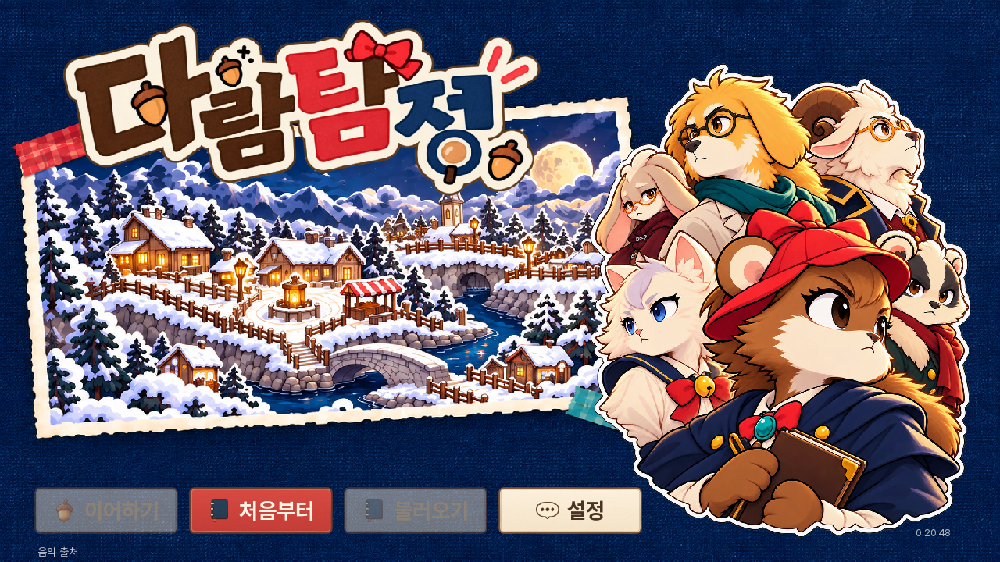

https://kkhkkh20-bit.github.io/daaegame/experiments/renpy-ch1/docs/asset-modules/screens/01-main.png?v=45344ce00cc1

## 대사

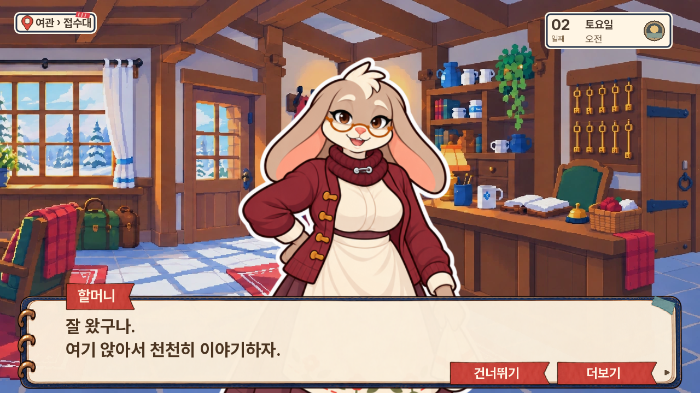

https://kkhkkh20-bit.github.io/daaegame/experiments/renpy-ch1/docs/asset-modules/screens/04-dialogue.png?v=c6b42d884a77

## 질문

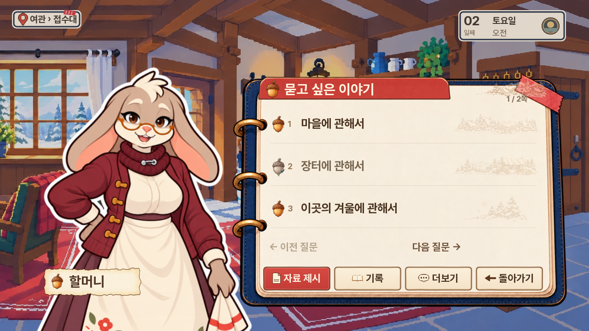

https://kkhkkh20-bit.github.io/daaegame/experiments/renpy-ch1/docs/asset-modules/screens/05-questions.png?v=21d61dab48e8

## 선택

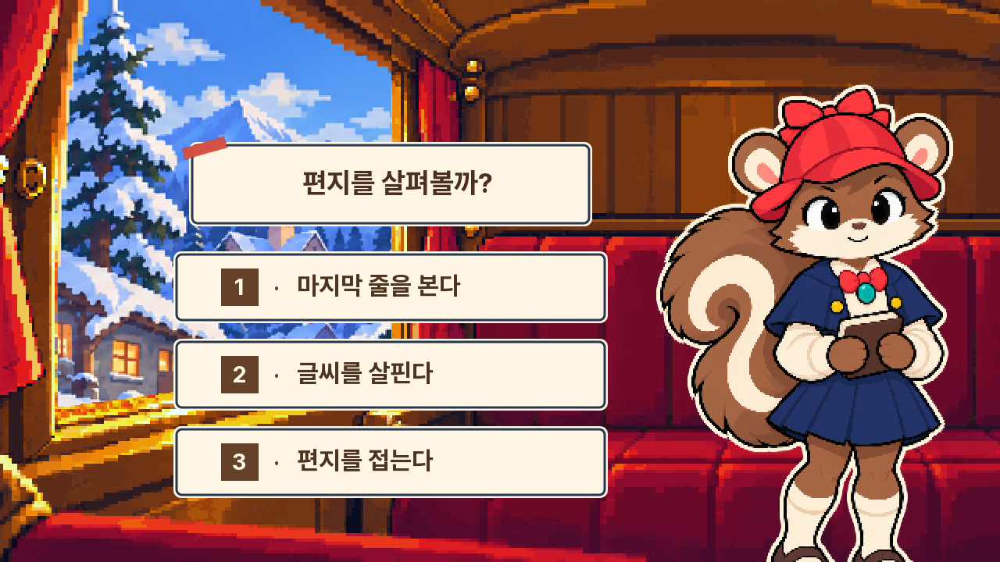

https://kkhkkh20-bit.github.io/daaegame/experiments/renpy-ch1/docs/asset-modules/screens/06-choice.png?v=c5387cdf7420

## 조사

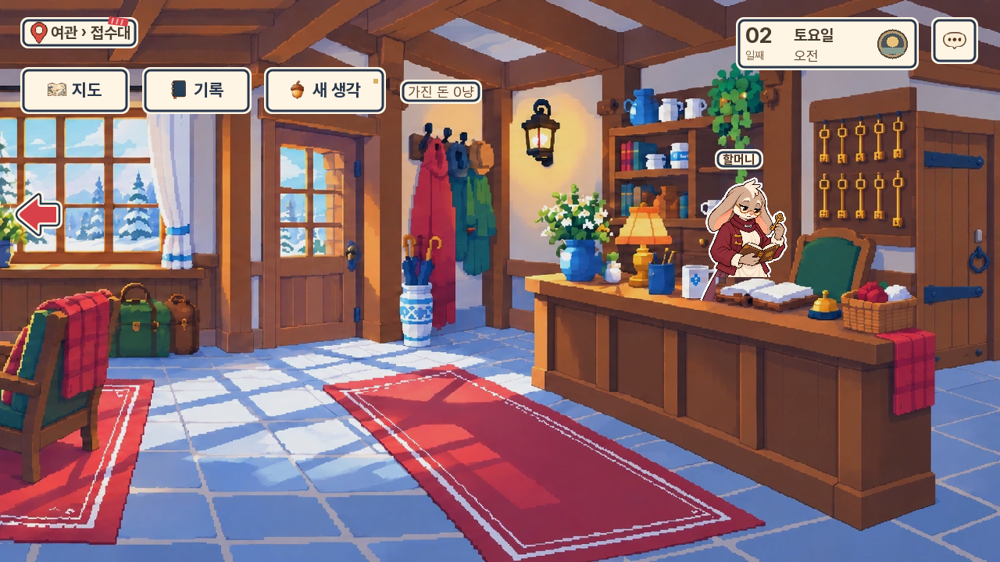

https://kkhkkh20-bit.github.io/daaegame/experiments/renpy-ch1/docs/asset-modules/screens/03-field.png?v=649f43f7a62a

## 마을 지도

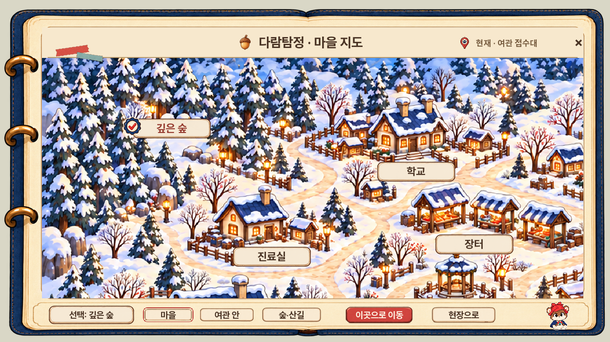

https://kkhkkh20-bit.github.io/daaegame/experiments/renpy-ch1/docs/asset-modules/screens/09-map-village.png?v=2edd49e8122a

## 여관 지도

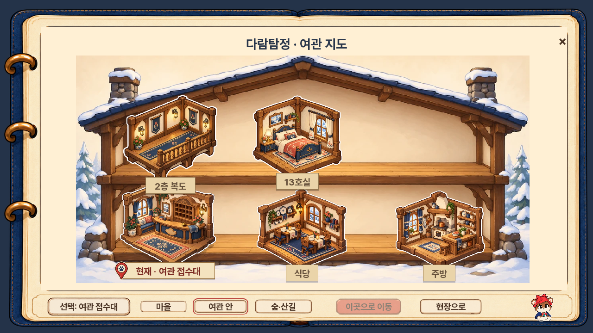

https://kkhkkh20-bit.github.io/daaegame/experiments/renpy-ch1/docs/asset-modules/screens/07-map-inn.png?v=dcce2a4edd9a

## 숲 지도

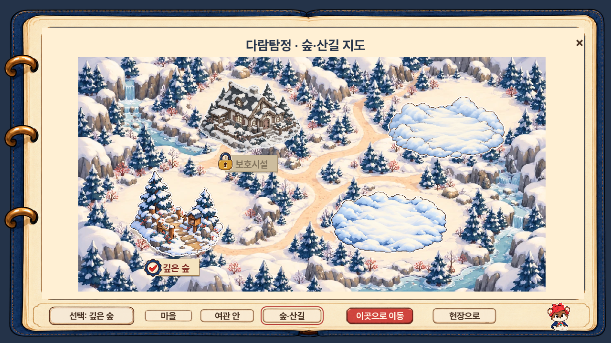

https://kkhkkh20-bit.github.io/daaegame/experiments/renpy-ch1/docs/asset-modules/screens/08-map-forest.png?v=e774659b227a

## 옵션 소리

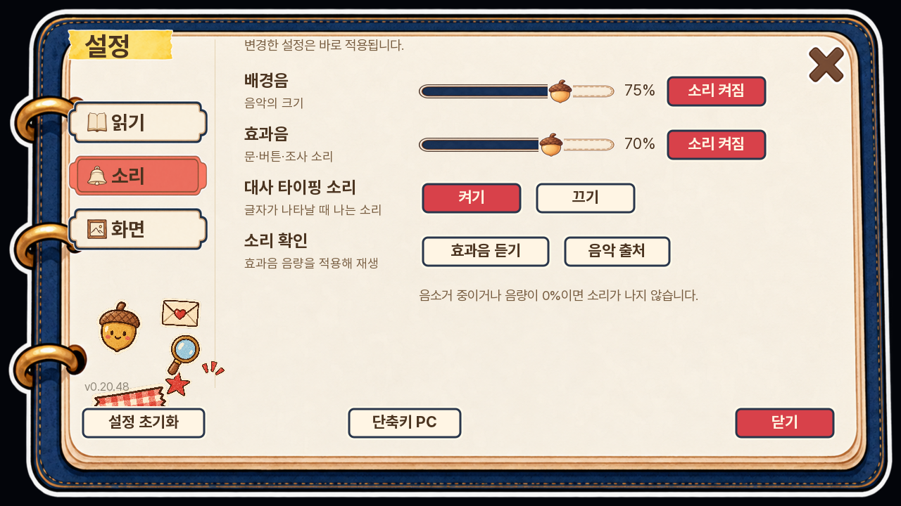

https://kkhkkh20-bit.github.io/daaegame/experiments/renpy-ch1/docs/asset-modules/screens/02-settings.png?v=0239c2d9c517

## 옵션 읽기

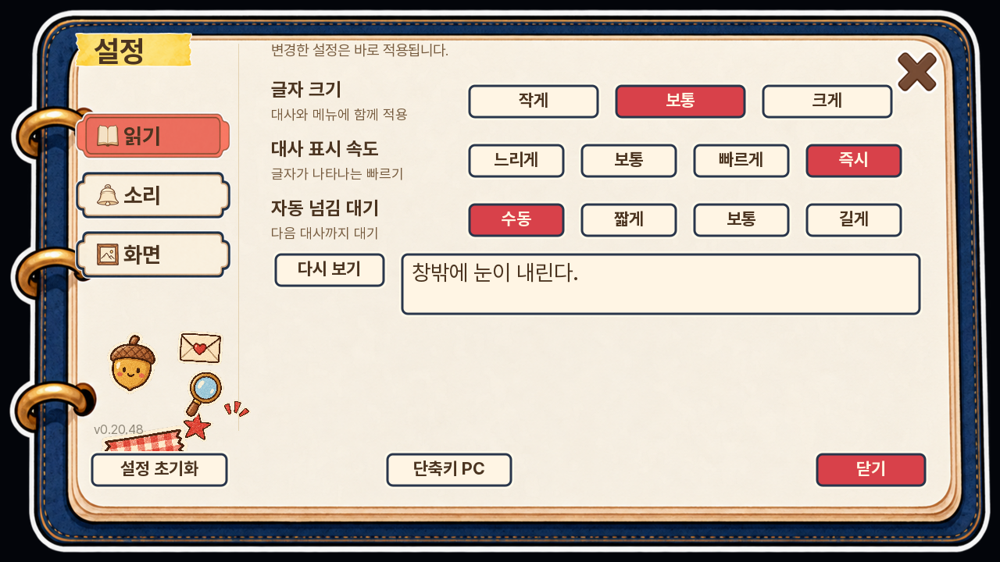

https://kkhkkh20-bit.github.io/daaegame/experiments/renpy-ch1/docs/asset-modules/screens/15-settings-reading.png?v=f4206c71210f

## 옵션 화면

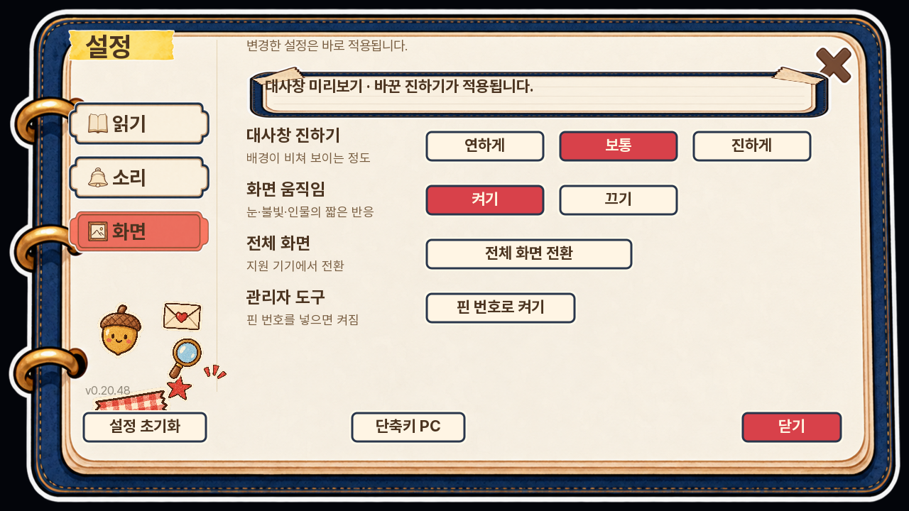

https://kkhkkh20-bit.github.io/daaegame/experiments/renpy-ch1/docs/asset-modules/screens/16-settings-display.png?v=26f0193338fd

## 회의 대사

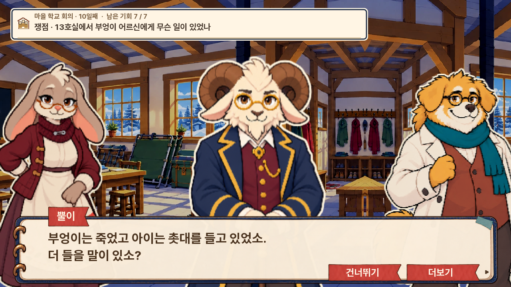

https://kkhkkh20-bit.github.io/daaegame/experiments/renpy-ch1/docs/asset-modules/screens/17-meeting-dialogue.png?v=57b5077293ce

## 회의 자료

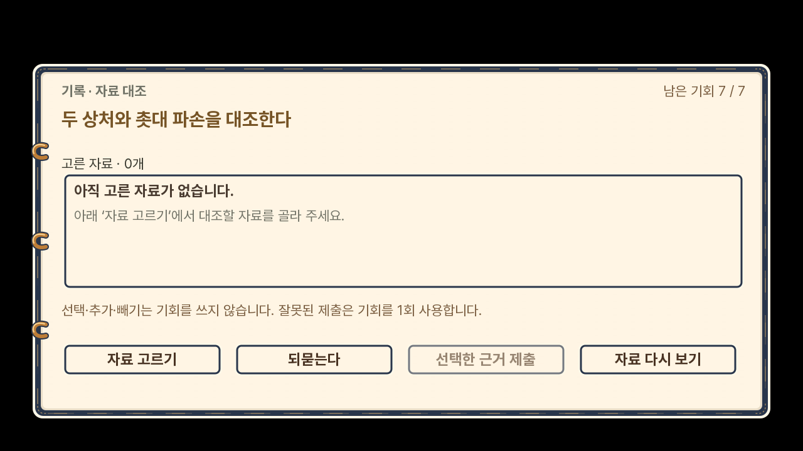

https://kkhkkh20-bit.github.io/daaegame/experiments/renpy-ch1/docs/asset-modules/screens/13-meeting.png?v=51eccae44c0b

## 기록

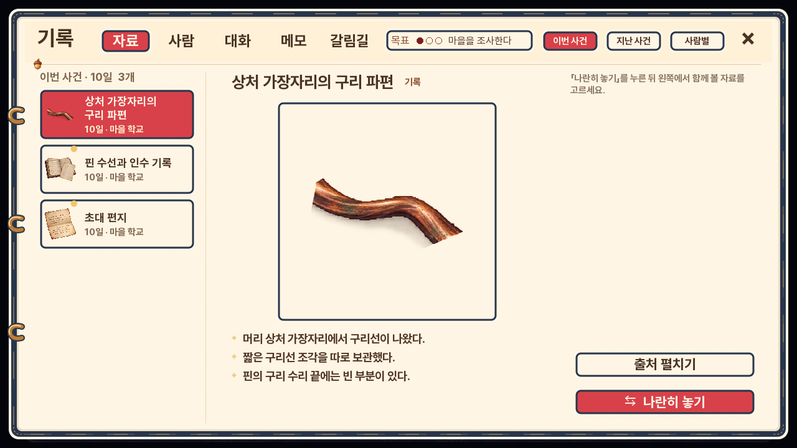

https://kkhkkh20-bit.github.io/daaegame/experiments/renpy-ch1/docs/asset-modules/screens/10-records.png?v=1ab71c1a28cd

## 갈림길

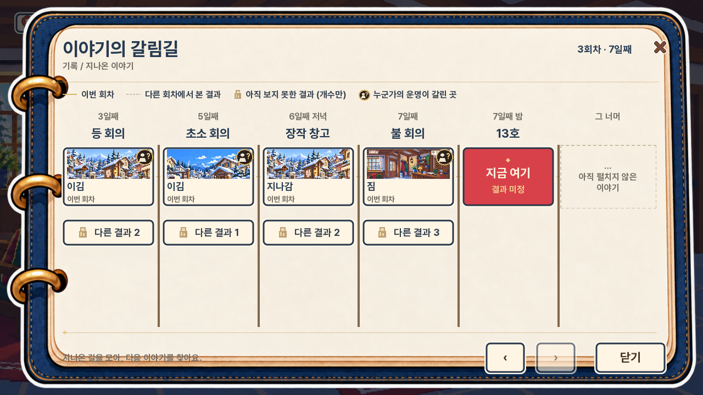

https://kkhkkh20-bit.github.io/daaegame/experiments/renpy-ch1/docs/asset-modules/screens/11-forks.png?v=ff52b5df77b5