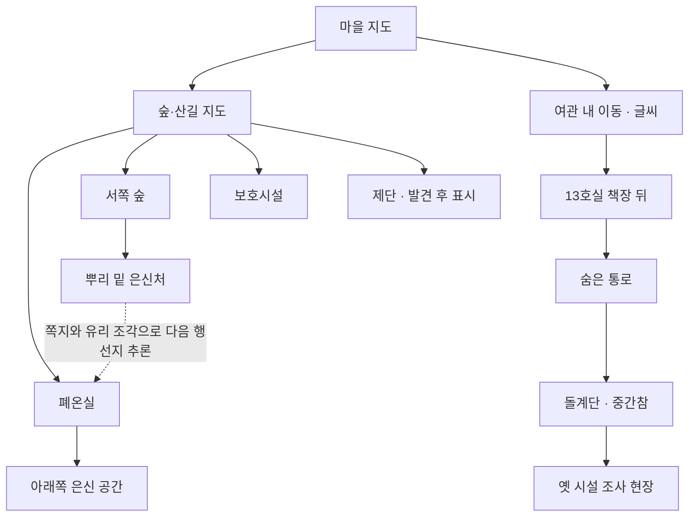

# 다람탐정 맵 기획안 — 에피소드 동선 기준

검토일: 2026-10-17 (한국 시간). 검토 기준: origin/main `aec505f`, 실행판 0.18.99. 이 문서는 설계 제안이다. 소스·진행 조건·공개판은 변경하지 않았다.

## 1. 먼저 확인한 이야기

- ① 등 도둑 → ② 다람 탐정단 → ③ 장작 창고의 불 → ④ 13호의 밤 → ⑤ 긴 밤과 겨울 수프 → ⑥ 끌려가는 수레 → 제단.
- `EPISODE_TABLE.md` 첫 표보다 뒤에 붙은 갱신, `STORY_EPISODES_FULL.md` 끝의 소유자 결정을 우선했다. 예: 수프 피해자는 초기 표의 노인들이 아니라 갱신안의 아이들이다. 노인들은 수레 쪽에 연결된다.
- 숲 뿌리 밑은 엄마의 이전 은신처, 폐온실 아래는 옮긴 은신처, 옛 시설은 여관 아래의 돌 제작 시설이다. 셋을 같은 동굴로 합치거나 지하 통로로 연결한다는 설정은 없다.
- ⑤에서 옛 시설은 명단 원본·조각·실험 기록을 조사하는 핵심 현장이다. 현재 실행 코드의 옛 시설은 관찰·대화 중심이므로 기획안 전체가 이미 구현됐다고 보지 않는다.
- 앞서 제안한 산길→고대 시설 비밀 출구는 기존 기획에 없는 추가 설정이다. 이번 기본 동선에는 넣지 않는다.

## 2. 지도 구성

**지역 지도는 2장. 여관은 글씨로 이동하고, 숨은 장소는 현장 안에서 발견한다.**

| 구분 | 역할 | 담을 장소 | 표현 |
| --- | --- | --- | --- |
| 마을 지도 | 주민의 일상과 사건이 겹치는 중심 | 입구, 광장, 여관·장터, 우체국, 수리점, 진료소, 학교, 공동 창고, 아랫길, 강가 | 승인 방향의 푸른 회색 겨울 마을. 집은 골목을 따라 모이고 주요 건물 앞에만 여유 |
| 숲·산길 지도 | 엄마 추적과 후반 수레 동선 | 서쪽 숲, 북쪽 보호시설, 폐온실, 제단으로 가는 길 | 같은 화풍. 서쪽 숲과 북쪽 산길을 구분하고 발견한 목적지만 표시 |
| 여관 내 이동 | 방과 층 사이의 간결한 이동 | 접수대, 식당, 주방, 복도, 13호실, 임시 객실, 발견한 통로·지하 | 실제 장면과 다른 평면도를 그리지 않고 장소 이름 목록 |
| 옛 시설 현장 | ⑤의 조사·실험과 결말 준비 | 입구·돌 가공 장치 / 유리관·실험 자리 / 기록 선반·벽 글자 | 가로로 이어진 조사 배경 1장, 최소 3구역. 별도 지역 지도는 만들지 않음 |

기존 숲 설명은 ‘마을 서쪽’이다. 외곽 지도를 전부 ‘북쪽 산길’이라고 부르면 방향이 어긋나므로 화면 이름은 **숲·산길**로 제안한다. 지명과 길의 배치는 아트 제작 전 고정한다.

## 3. 마을 배치 제안

- 앞쪽 강·다리·입구에서 골목을 따라 광장으로 들어온다. 여관과 장터는 광장 가까이 둔다.
- 학교와 뒤쪽 장작 창고는 같은 생활 구역. 원래 공동 창고와 화재가 나는 학교 뒤 장작 창고를 혼동하지 않게 구분한다.
- 우체국 안쪽에 기록실, 광장 주변에 종탑과 회관·순찰대 숙소를 묶는다. 이들은 각자 큰 지도 버튼을 추가하는 대신 해당 현장에서 들어가는 장소다.
- 아랫길은 중심 골목에서 이어지는 낮은 강변 구역으로 잡는다. 천막·빨래터·가까운 민가가 이어져, 마을의 따뜻한 중심과 배제된 생활 공간이 대비되게 한다. 세부 배치는 제안이며 확정된 지리 설정은 아니다.
- 솜이네 집은 발자국을 따라 알게 되는 특정 집이다. 지도에 처음부터 ‘사건 집’처럼 표시하지 않는다.
- 지붕 길은 ②의 다람 전용 경로, ④의 쪽지 전달에 재사용한다. 지붕에서 강 쪽 등불과 학교 쪽 화재를 볼 수 있는 시야를 확보한다.
- 숲 뿌리 밑 은신처에서는 여관 굴뚝을 볼 수 있어야 한다. 너무 먼 산 정상에 배치하지 않는다.
- 일반 민가와 골목은 유지한다. 기능 건물만 거대한 눈밭에 따로 띄워 놓지 않는다. 클릭 공간은 주요 장소 앞의 마당과 길로 만든다.

## 4. 큰 지도에 직접 올리지 않을 현장

| 들어가는 곳 | 안쪽에서 접근하는 현장 | 이유 |
| --- | --- | --- |
| 우체국 | 기록실 | 엄마 기록과 사서의 사건이 우편·기록 흐름에 연결됨 |
| 학교 | 뒤 장작 창고 / 대피소 상태 | 같은 장소를 화재 전후와 대피 때 다시 읽음 |
| 광장 | 종탑 아래 / 회관 / 순찰대 숙소·보호실 | 공공 구역으로 묶고 사건 때 필요한 입구만 활성화 |
| 아랫길 | 천막 / 빨래터 / 솜이네 집 주변 | ②③⑤의 이야기가 연결되며 지도 버튼 증가를 줄임 |
| 여관 외벽 | 처마 밑 / 다람의 지붕 길 | 아빠의 일반 이동과 다람 전용 이동을 구분 |
| 서쪽 숲 현장 | 뿌리 밑 은신처 | 쪽지·기록을 읽고 직접 발견하는 경험 유지 |
| 폐온실 현장 | 아래쪽 은신 공간 | 엄마 재회 장소를 도착 전에 지도에서 공개하지 않음 |
| 13호 책장 뒤 | 통로 → 갈라진 회벽 → 돌계단 → 옛 시설 | 기존 진입 설정과 ④의 통로 추리를 보존 |

이 표의 묶음은 장소 선택 메뉴를 한 겹 더 만들라는 뜻이 아니다. 현장에 들어간 뒤 실제 문·길·물건을 조사하거나 기존 연결 장소 이동으로 진입한다.

## 5. 비밀 동선

점선은 단서의 연결이며 통행 가능한 지하 길이 아니다. 주방 레버는 13호 뒤 통로 문의 개폐 장치다. 이 계획만으로 주방에 새로운 통행 입구를 만들지 않는다.

- 고대 문명의 길은 여관의 책장·갈라진 벽 뒤에 숨긴다. 산길의 거대한 동굴 입구로 먼저 소개하지 않는다.
- 돌계단·중간참은 비좁고 어둡게, 아래에서는 이상하게 따뜻한 공기가 올라오게 한다. 지도 선택 화면을 또 거치지 않고 내려가는 연결 장면으로 쓴다.
- 옛 시설 내부에서는 공간이 갑자기 넓어진다. 돌기둥·유리관·빛이 남은 조각이 고대 규모를 암시한다. 지금 대본에서 쓰지 않는 미로와 빈 방은 추가하지 않는다.
- 톡과 따닥의 도면으로 조각 운반을 앞당기는 경로는 ⑤ 대본에 있다. 먼저 기존 통로의 운반 동선으로 표현한다. 산길 출구를 새로 만들려면 이야기 담당과 별도로 확정해야 한다.

## 6. 에피소드별 지도 사용

| 단계 | 플레이어가 오가는 장소 | 지도가 해야 할 일 |
| --- | --- | --- |
| 시작 | 입구 → 광장 → 여관 | 첫날은 제한된 목적지만. 여관에서 방을 받은 뒤 실내 이동 가능 |
| ① 등 도둑 | 광장 ↔ 수리점 ↔ 진료소 ↔ 우체국 기록실 ↔ 창고 ↔ 아랫길 | 등 조각이 사라진 현장과 조각이 쌓인 장소를 비교하게 함. 기록실은 사서를 도울 수 있을 때부터 접근 가능해야 함 |
| ② 다람 탐정단 | 장터 → 입구 → 처마 밑 → 지붕 → 솜이네 집, 선택적으로 아랫길 | 다람 전용 동선. 발자국을 따라 목적지를 알아내고 같은 지붕에서 강과 학교의 두 불빛을 봄 |
| ③ 장작 창고의 불 | 빨래터 ↔ 여관 주방 ↔ 학교 뒤 창고 ↔ 학교 | 예방 단서는 4일 오후~저녁에도 접근 가능. 불 전·후 같은 창고의 흔적이 바뀜 |
| ④ 13호의 밤 | 보호실 앞 ↔ 여관 13호·주방·통로 ↔ 진료소 ↔ 우체국 ↔ 종탑 아래 | 다람의 보호실은 광장 뒤 순찰대 숙소. 책장 뒤 경로와 레버를 직접 조사하고 익숙한 여관을 다르게 읽음 |
| ⑤ 엄마 추적·긴 밤·수프 | 서쪽 숲 은신처 → 폐온실 아래 → 여관 아래 옛 시설 → 광장·아랫길·학교·진료소 | 세 은신·시설 공간을 구분. 조각·실험 기록을 제시해 구출 가능성을 만들고 같은 마을의 식어 가는 모습을 보여 줌 |
| ⑥ 수레 | 광장 ↔ 장터 ↔ 창고 주변 ↔ 회관·여관 → 북쪽 길 | 은신처 탐색과 다른 수레의 공적인 이동 동선. 끈·명령서·명단을 맞춰 본 뒤 주민 앞에서 결판 |
| 제단·후일담 | 산길 끝 제단 → 광장 이름 판 | 마지막 회의는 제단의 서 있는 돌판. 결말 뒤 익숙한 광장으로 돌아와 빈자리와 이름을 읽음 |

일정과 여정 비용은 에피소드가 이미 정한 조건을 따른다. 일반 지도 열람·이동에 새 시간 비용을 넣지 않는다. ②의 ‘해 지기 전 다섯 걸음’은 별도 에피소드 규칙이므로 지도 재배치 때문에 필요한 이동 단계가 늘어나지 않게 점검한다.

## 7. 발견과 재방문 규칙

- 발견 전 비밀 장소의 이름·물음표·잠긴 노드·길 전체 윤곽을 미리 보여 주지 않는다. 숲 뿌리는 처음에는 그냥 뿌리로 보인다.
- 장소 공개는 날짜만으로 하지 않는다. 기존 대화·자료·방문 조건에 맞춘다. 다람의 조작 여부와 구출 분기도 유지한다.
- 발견 이후에는 여관 내 이동이나 관련 지도에서 다시 찾아가기 쉽게 한다. 갈 때마다 비밀 벽 찾기를 반복시키지 않는다. 실제로 봉쇄된 구간은 기존 사건 조건을 따른다.
- 선택한 건물의 이름만 표시하고 별도 핀은 쓰지 않는다. PC는 마우스오버, 모바일은 탭으로 이름을 확인한다.
- 지역 지도는 화면을 넓게 쓰고 설명은 작은 선택 카드로 보여 준다. 선택과 이동을 분리하는 방식으로 오클릭을 줄이는 것을 권장한다. 반복 클릭 즉시 이동을 유지할지는 터치 검수에서 결정한다.
- 일반 길·주택과 숨은 길은 구분하지만 정답 단서만 빛나게 만들지 않는다. 지도를 보자마자 범행 경로가 드러나지 않아야 한다.
- 현장 안의 자료·증언은 얻은 뒤 기존 자료창과 관계도로 이어진다. 지도에 새 조합 기능이나 자동 추론선을 추가하지 않는다.

## 8. 사건이 지나간 뒤의 마을

기본 지형과 건물 위치는 유지하고 상태만 겹친다. 지도에서도 읽히는 큰 변화와 현장에서 살피는 작은 유품을 나눈다.

| 시점 | 지도에서 보이는 큰 변화 | 현장 안의 작은 흔적 |
| --- | --- | --- |
| ① 이후 | 광장의 등 일부가 식음, 기록실 창빛 변화 | 그림 판자·담요·꽃·엄마 기록 |
| ② 이후 | 조건에 따른 솜이네 집의 빈자리 | 강가 신발과 발자국 |
| ③ 이후 | 학교 뒤 창고가 그을린 상태로 남음 | 닫힌 등잔·그을린 도토리·문 쪽 흔적 |
| ④ 이후 | 여관 뒷벽 공사가 멈춘 상태 | 측량 도구·닫힌 문·젖은 편지 |
| 긴 밤 이후 | 아랫길 불이 줄고 학교에 빛이 모임 | 천막의 이름표·대피소 빈자리 |
| ⑥ | 광장에서 북쪽으로 이어지는 수레·바퀴 자국 | 결박 끈·명단·횃불 |
| 결말 | 선택에 맞춰 남은 불빛과 광장 이름 판 | 남은 주민·다람과 토실의 마지막 장면 |

죽음·생존·폐쇄는 실제 선택 상태를 읽는다. 조건 분기를 무시하고 항상 불을 끄거나 가게를 닫지 않는다. 시신 아이콘과 사망 핀은 쓰지 않는다.

## 9. 이미지 제작 범위와 순서

1. 마을 지도: 현재 선호한 ‘밀집한 목조 마을·골목·푸른 겨울’ 방향으로 장소 배치를 먼저 고정한다. 아랫길, 학교 뒤 창고, 종탑의 존재를 배치에 반영한다.
2. 숲·산길 지도: 서쪽 숲과 북쪽 수레 길이 구분되는 배치. 제단·폐온실은 발견 상태에 맞춰 드러내는 그림층을 따로 준비한다.
3. 옛 시설: 가로 조사 배경 1장 안에서 입구·유리관·기록 구역이 이어지게 만든다. 기존 원화에 기록 선반·벽 글자 등 필요한 조사 소품을 더할 수 있는지 먼저 확인한다.
4. 여관 숨은 길: 기존 통로와 돌계단·중간참 그림을 재검토하고, 별도 이동 지도는 만들지 않는다.
5. 기록실·학교 뒤 창고·지붕·아랫길 같은 현장은 기존 배경 재사용과 상태 겹치기를 먼저 검토한다. 에피소드 문서에도 신규 장면 수가 서로 달라, 신규 이미지 수는 배치 확정 뒤 산출한다.

필요한 새 조사 지점·증거 지급·구출 조건은 이야기 담당과 맞춘다. 이번 지도 기획만으로 기존 입증과 결말 로직을 바꾸지 않는다.

## 10. 구현 전에 맞출 문서 충돌

- ④ 회의: 기획안은 회관, 현행 회의 화면의 원탁 메타데이터는 식당이다. 새 지도에 회관 실내를 제작하기 전 장소를 하나로 맞춘다.
- 임시 객실: ④ 대본은 1층, 현행 이동 목록은 2층이다. 텍스트 방식이어도 층 표기가 틀리면 혼란이 생기므로 먼저 확정한다.
- 보호실 / 보호시설 / 보호소: ④의 보호실은 광장 뒤 순찰대 숙소 끝방이다. 현행 북쪽 보호시설과, ⑥에서 제단을 감춰 부르는 ‘보호소’를 같은 지도 이름으로 합치지 않는다. 각 장소의 역할은 이야기 담당과 맞춘다.
- 최신 갱신과 초기 표의 사건 날짜·수프 피해자·새 배경 개수가 일부 다르다. 실제 공개 조건은 현재 사건 플래그와 최종 대본을 기준으로 맞추고 문서 초안만 보고 날짜를 하드코딩하지 않는다.

## 읽은 자료

기준 커밋 고정 링크. `/tmp/room13-map-plan/sources/`에 검토 스냅샷도 저장했다.

- [에피소드 기준표와 후속 갱신](https://github.com/kkhkkh20-bit/daaegame/blob/aec505f/experiments/renpy-ch1/docs/EPISODE_TABLE.md)
- [전체 이야기·일정·최종 결정](https://github.com/kkhkkh20-bit/daaegame/blob/aec505f/experiments/renpy-ch1/docs/STORY_EPISODES_FULL.md)
- [④ 13호의 밤 상세 대본](https://github.com/kkhkkh20-bit/daaegame/blob/aec505f/experiments/renpy-ch1/docs/EPISODE4_SCRIPT_FULL.md)
- [⑤ 긴 밤과 겨울 수프 상세 대본](https://github.com/kkhkkh20-bit/daaegame/blob/aec505f/experiments/renpy-ch1/docs/EPISODE5_SCRIPT.md)
- [⑥ 수레·제단 대본](https://github.com/kkhkkh20-bit/daaegame/blob/aec505f/experiments/renpy-ch1/docs/EPISODE6_FINALE_SCRIPT.md)
- [기존 조사맵 확장 기준](https://github.com/kkhkkh20-bit/daaegame/blob/aec505f/experiments/renpy-ch1/docs/EXPLORATION_MAP_PLAN.md)
- 실행 교차 확인: `game/systems/room13_new_places.rpy`, `game/room13_navigation.rpy`, `game/room13_meeting_seating.rpy`, `game/room13_new_places.rpy`.

## 10. 적용 기록 — 0.19.3

적용 기준은 main `10506f8`(0.19.0). 위 본문은 승인 당시 제안이며, 실제 실행 코드를 다시 확인해 다음과 같이 구체화했다.

- 지역 그림은 마을 / 숲·산길 두 장. 건물·지형의 다각형이 클릭 대상이고, 별도 핀은 없다. 이름은 초점·터치 시에만 지도 위에 표시한다. 선택은 하단에 남으며 이동 버튼으로 확정한다. 두 번 탭해도 즉시 이동하지 않는다.
- 전체 그림 1248×702, 모서리의 작은 제목·현재 위치 표시와 하단 86px 선택 띠. 지역 전환도 하단에 모아 폐온실 지붕·제단 돌기둥을 가리지 않는다. 우측 큰 설명 패널을 없앴고 실제 클릭점은 표시창과 겹치지 않는다.
- 숲은 마을 서쪽 길과 외곽 지도에서 같은 목적지로 연결된다. 중복 이동 단계나 시간 비용은 없다. 기존 마을 목적지 11개와 후반 목적지는 유지한다.
- 폐온실·제단은 미발견 기본 그림에서 제거했다. 기존 발견/이동 조건을 만족하면 원래 그림의 해당 영역만 표시한다. 이름·잠금 아이콘으로 비밀을 먼저 노출하지 않는다.
- 여관은 층별 목록과 선택한 현장 사진이다. 기존 안내도 화면 이름은 이전 저장/호출 호환용으로 남기되 같은 목록을 쓰고, 지역 이동이 아닌 호출에서는 기존 인접 이동 검증과 travel 반환 규약을 유지한다. HUD의 중복 안내도 단추는 없앴다.
- 현행 임시 객실은 실행 데이터대로 2층이다. 문서 일부의 1층 표기와 임의로 맞바꾸지 않는다.
- 회의 ④는 현재 실행 중인 식당 원탁을 유지한다. 회관 등 신규 장소·경로는 이 디자인 작업에서 만들지 않는다. 장소 선택 시 실제 회의 유형을 하단 글씨로 설명한다.
- 빨래터는 현재 대본의 ‘여관 뒤’ 현장, 장작 창고는 ‘학교 뒤’ 장면으로 유지한다. 기록실·지붕·종탑 등 이미 사건 내부에서 열리는 장면을 독립적인 지도 단추로 추가하지 않는다. 다람의 다섯 걸음·날짜·증거 획득 로직은 그대로다.
- 옛 시설은 기존 가로 3:1 현장과 선반·유리관·벽 글자·실험/기록 이벤트를 재사용한다. ⑤의 Y05~Y08 획득은 현재 소스에 이미 구현돼 있어 새로 중복 지급하지 않는다. 산길에서 통하는 별도 동굴은 없다.
- 출처/좌표/발견 패치: `game/room13-cartography.json`, 생성기 `dev/make_cartography_layers.py`. 실제 웹 입력 검증: `dev/qa_cartography.py`.
