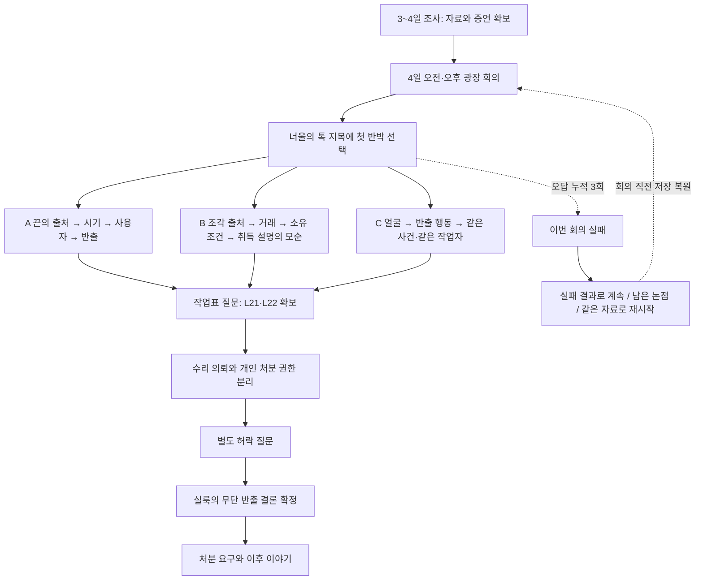

# 첫 회의 증거 매칭·반박 흐름과 난도 평가

기준: 0.19.60 / Q1 rules 3. 0.19.61의 확인창 디자인 변경은 아래 판정 규칙을 바꾸지 않는다. 제작자용 정답·스포일러 문서다.

## 지금 난도에 대한 판단

**이전보다 통과 조건은 엄격해졌다. 다만 ‘어느 경로도 충분히 어렵다’는 밸런스 검증까지 끝난 것은 아니다.**

증거를 소지하는 것만으로 통과하지 않는다. 현재 발언에 정확한 자료를 제시하고, 그 자료가 증명하는 범위를 해석한 뒤 확정해야 한다. 처음 내세운 논증을 끝까지 완성해야 하며 다른 경로의 성공을 섞어 빈 단계를 채울 수 없다. 잘못된 증거·확정 해석·근거 없는 최종 결론이 하나의 오답 예산을 공유하고, 세 번째에 실패한다.

기능적으로 확인한 것은 세 경로의 승리 조건, 오답 누적, 철회, 같은 자료 재시작과 논증 재선택이다. 처음 보는 플레이어의 성공률이나 체감 난도는 측정하지 않았다. 자유문장 추론 엔진이 아니라 작가가 정한 증거·발언·해석 조합을 검사하는 구조다.

## 전체 흐름

점선은 실패·재도전 흐름의 요약이다. 오답은 첫 선택만이 아니라 모든 정식 반박과 최종 결론에서 누적된다. 매 단계는 앞 단계의 입증이 있어야 열린다. 같은 시도에서 A/B/C 사이를 이동할 수 없다.

## 회의 전에 무엇을 확보하나

회의는 4일 오전·오후 광장에서 열린다. 4일 저녁 이후에는 기한 경과 처리가 있다. 새 증언 질문은 사건 시작 뒤, 4일 오후까지, 해당 자료를 아직 얻지 않았을 때 나온다. 이동·질문을 임의로 시간 소모로 바꾸지 않는다.

| 자료 | 획득 행동과 전제 | 역할 |
|---|---|---|
| L06 초롱의 말 | 3일 새벽 사건에서 확보 | 첫 순찰 질문의 계기. 잔열은 조각이 남아 있었다는 증거가 아님 |
| L04 뚜껑에 걸린 노끈 | 사건 시작 뒤 광장 3번 등 조사 → ‘뚜껑 틈을 본다’ | A 현장 끈 |
| L07 실룩의 짐 끈 | 4일 오전·오후 입구의 실룩 사건 → ‘노끈을 본다’ | A 대조할 끈 |
| L15 초롱의 첫 순찰 | L06 소지 → 초롱에게 ‘등 안도 직접 보셨습니까?’ | A 흔적이 남은 시점; L16 질문 계기 |
| L16 초롱이 본 반출 | L15 확보 → 초롱에게 ‘다음 순찰 때는 어땠습니까?’ | A/C 물건을 꺼낸 행동, 얼굴은 확인 못 함 |
| L17 부리의 밤 목격 | 톡 지목 사건을 봤거나 L16 소지 → 부리에게 ‘그날 밤에 무얼 봤니?’ | C 얼굴과 작업자 연속성, 손 안의 물건은 확인 못 함 |
| L19 실룩의 대금 쪽지 | 입구의 실룩 사건을 본 뒤 ‘빵값은 어디서 마련했습니까?’ | B 거래 27번·두 냥·자기 소유 조각 판매 조건 |
| L09 이름표 붙은 조각 | 4일 오전·오후 창고 방문. L04/L11/L19 중 하나가 창고 사건 계기 | B 광장 3번 등 조각의 출처 |
| L18 백 부인의 매입 원장 | L09를 백 부인에게 직접 제시 | B 쪽지와 대조할 거래 원장 |
| L20 실룩의 두 설명 | B 회의 중 취득 경위를 되묻기 | 조사 단계에서 선행 수집할 자료가 아님 |
| L21 덮개 작업표 / L22 자재 대장 | 선택 경로의 반출 입증 뒤 수리 해명을 되묻기 | 모든 경로의 공통 최종 방어에서 획득 |

A의 회의 핵심 자료는 L04·L07·L15·L16, B는 L09·L18·L19, C는 L16·L17이다. 이것은 회의에서 사용하는 최소 자료 집합이며, 조사 해금 과정에서 얻는 L06·L15 등의 계기를 생략해도 된다는 뜻은 아니다. 다른 경로의 모든 조사를 완료할 필요는 없다.

## 초반 반박 선택

너울: “등을 돌보는 톡이 조각을 가져간 것 아니오? 다르게 본다면 그 근거를 말해 보시오.”

- **A — 남은 끈의 주인부터 따지겠습니다.** 현장 끈의 출처와 남은 시점을 좁혀, 그 끈을 쓴 사람이 조각을 꺼냈다는 것을 밝히겠습니다.
- **B — 팔린 조각의 행방부터 따지겠습니다.** 조각의 거래에서 판매자를 확인하고, 그 사람이 조각을 어떻게 얻었는지 따져 반출을 밝히겠습니다.
- **C — 두 사람이 본 작업부터 맞춰보겠습니다.** 얼굴을 본 증언과 조각을 본 증언을 같은 작업으로 연결해, 누가 가져갔는지 밝히겠습니다.

확정 전 기록 열람과 다시 생각하기는 자유롭다. 확정 뒤 현재 논증이 회의 상단에 남는다. 다른 경로의 사실을 거짓으로 바꾸지는 않지만, 그것만으로 선택한 설명의 빈 고리를 대신할 수 없다. 회의 직전 재시작을 하면 다른 논증을 선택할 수 있다.

공통 첫 혐의 `v_accused`에는 L03/L04/L14로 톡 지목의 성급함을 반박할 수 있다. 이는 보조 반박이며 A/B/C 필수 연쇄를 대체하지 않고, 실룩의 무단 반출을 바로 입증하지 않는다.

## A — 끈의 사용 경로

| 순서·발언 | 정확한 입력 | 해석 정답·새로 확정되는 내용 |
|---|---|---|
| 1. `v_trace` 그건 누구나 쓰는 갈색 끈이오. | L04 뚜껑에 걸린 노끈 + L07 실룩의 짐 끈 | 1. 뜯긴 끝의 모양이 맞습니다. |
| 2. `v_recent` 내 끈이라도 전에 수리를 돕다가 남겼을 수 있소. | L15 초롱의 첫 순찰 | 1. 첫 순찰의 내부 확인 뒤입니다. 2. 내부 확인과 잔열은 다릅니다. |
| 3. `v_user` 끈을 다른 사람이 빌려 썼을 수도 있지 않소? | 되묻기 (자료 제시 아님) | 실룩이 그날 수레를 도움받은 뒤 그 끈을 직접 썼다고 답한다. |
| 4. `v_action` 등에 손을 댔다고 조각까지 가져간 건 아니오. | L16 초롱이 본 반출 | 1. 조각은 봤지만 얼굴은 못 봤습니다. |

## B — 거래와 취득 경위

| 순서·발언 | 정확한 입력 | 해석 정답·새로 확정되는 내용 |
|---|---|---|
| 1. `v_origin` 제 창고의 조각은 제가 정당하게 산 거예요. | L09 이름표 붙은 조각 | 1. 3번 등의 조각이 창고에 있습니다. |
| 2. `v_trade` 백 부인 원장의 표시만 보고 나라고 할 수 있소? | L18 백 부인의 매입 원장 + L19 실룩의 대금 쪽지 | 1. 날짜·번호·품목·대금이 같습니다. |
| 3. `v_own` 나는 돈을 받아 주는 심부름만 했소. | L19 실룩의 대금 쪽지 | 1. 자기 소유 조각을 판다는 조건입니다. 2. 판매는 확인됐고 취득 경위는 남습니다. |
| 4. `v_where` 톡이 버린다는 조각을 받았소. | 되묻기 (자료 제시 아님) | 수리점에서 받았다는 말과 등 받침에서 꺼냈다는 말이 함께 나온다. L20 획득. |
| 5. `v_slip` 나는 수리점에서 손에 쥐여 준 걸 받아 왔소. | L20 실룩의 두 설명 | 1. 수리점에서 받았나, 등에서 꺼냈나입니다. |

## C — 두 목격의 연결

| 순서·발언 | 정확한 입력 | 해석 정답·새로 확정되는 내용 |
|---|---|---|
| 1. `v_identity` 어두웠는데 누가 내 얼굴을 보았다는 거요? | L17 부리의 밤 목격 | 1. 도움받고 작업한 사람이 실룩입니다. |
| 2. `v_action` 등에 손을 댔다고 조각까지 가져간 건 아니오. | L16 초롱이 본 반출 | 1. 조각은 봤지만 얼굴은 못 봤습니다. |
| 3. `v_link` 두 사람이 서로 다른 때를 본 것일 수도 있소. | L16 초롱이 본 반출 + L17 부리의 밤 목격 | 1. 부리가 수레를 도운 직후입니다. 2. 내려올 때까지 작업자가 같았습니다. |

## 공통 최종 방어 — 맡긴 수리와 무단 처분

| 순서·발언 | 정확한 입력 | 해석 정답·새로 확정되는 내용 |
|---|---|---|
| 1. `h_work` 등에 손댄 건 톡이 맡긴 수리였소. 작업표도 있소. | 되묻기 (자료 제시 아님) | 서명된 수리 작업표와 자재 대장 L21·L22 획득. 아직 권한을 입증한 것은 아니다. |
| 2. `h_scope` 서명한 작업표가 있으니 조각을 가져간 것도 맡긴 일 안에 들어가오. | L21 덮개 작업표 + L22 3번 등의 자재 대장 | 1. 덮개 수리와 조각 처분은 별개입니다. 2. 반출은 입증했습니다. 허락도 확인하죠. |
| 3. `v_permission` 식은 조각인 줄 알았소. 버리는 거라고 생각했소. | 되묻기 (자료 제시 아님) | 톡은 별도 반출·폐기 허락을 부인하고, 실룩은 허락 없이 꺼내 팔았음을 인정한다. |

짝 자료는 같은 발언에 서로 다른 두 자료를 내야 한다. 첫 자료는 대조 대기 상태가 되며, 두 번째 자료까지 맞아야 해석 선택으로 넘어간다. 같은 자료를 두 번 내도 짝이 완성되지 않는다. L16처럼 여러 단계에서 쓰는 자료도 ‘지금 무슨 주장을 증명하는가’가 달라 정확한 발언을 선택해야 한다.

두 단계 해석은 중간 정답 피드백 없이 모두 고른 뒤 한 번 확정한다. 둘 중 하나라도 틀리면 그 반박 전체가 실패하고 부분 입증은 남기지 않는다. 실패 설명은 틀린 연결을 반박하지만 자료 수집 정답 목록을 자동으로 주지는 않는다.

## 마지막 결론과 이후 결과

선택한 경로 전체와 공통 허락 쟁점을 마친 뒤 ‘실룩이 허락 없이 가져갔습니다’를 확정해야 통과한다. 정답 이름을 미리 알아도 입증이 비면 오답 1회다. ‘실룩은 사람을 죽이려 했습니다’는 의도까지 증명하지 못한 과잉 주장이고, ‘온도를 잰 우박의 책임입니다’도 통과하지 않는다.

성공 뒤에는 기존 처분 요구와 이후 이야기가 이어진다. A/B/C는 같은 사실에 대한 서로 다른 입증 방법이며, 경로만으로 범인이나 사건 사실을 바꾸지 않는다. 실패 결과를 유지하면 톡의 구금과 이후 증언·결말에 미치는 기존 영향이 남는다. 재시작은 그 실패를 유지한 채 보상을 받는 것이 아니라 회의 직전 상태로 되돌리는 선택이다.

## 오답 3회와 복원 계약

| 행동 | 처리 |
|---|---|
| 기록 열람·질문·증거창 취소·해석 확정 전 철회 | 오답 없음 |
| 유효한 짝 자료의 첫 제시 / 같은 첫 자료 재확인 | 대조 대기, 오답 없음 |
| 현재 발언에 틀린 증거 제시 | 오답 1회 |
| 잘못된 해석을 최종 확정 | 반박 전체 무효, 오답 1회 |
| 근거 없는 최종 결론 | 같은 예산에서 오답 1회 |
| 정답 반박 성공 | 입증은 남지만 이전 오답은 줄지 않음 |
| 세 번째 오답 | 이번 회의 즉시 종료 |
| 같은 자료로 회의를 다시 한다 | 실제 회의 직전 저장 복원. 조사 자료·돈·이전 선택 유지, 회의 중 새 문서·입증·오답·논증·결과는 초기화 |

이미 입증된 발언과 질문 전용 발언에 자료를 보이는 것은 새로운 반박으로 세지 않는다. 논증 확정·정식 반박·오답에는 되감기 경계가 있다. 일반 저장·불러오기까지 막는 것은 아니다. 기존 rules 1/2 저장은 이전 규칙이며, 새 규칙은 새 게임에서 적용된다.

## 경로별 난도 비교 — 판단과 남은 약점

| 경로 | 해석 확정 묶음 / 개별 판단 | 핵심 난점 | 아직 쉬워질 수 있는 부분 |
|---|---|---|---|
| A 물증 | 4묶음 / 6판단 | 끈 일치 → 첫 순찰 이후 → 실제 사용자 → 반출 | 사용자는 질문 한 번으로 인정한다. 같은 색과 절단면 구별은 비교적 명확하다 |
| B 거래 | 5묶음 / 7판단 | 동일 거래 → 소유 주장과 취득 권리 분리 → 취득 설명의 모순 | 조사 대사에서 이미 ‘물건을 팔았다’고 말해 심부름 방어의 긴장이 약해질 수 있다 |
| C 증언 | 4묶음 / 6판단 | 얼굴과 물건을 별개로 본 관찰을 수레 사건·연속성으로 연결 | 자료 본문에 연속 관찰이 명확히 있어 익숙해지면 빠르게 읽힌다 |

개별 판단 수에는 공통 권한 판단 두 개가 포함된다. 질문 전용 단계와 마지막 결론은 위 수에 포함하지 않는다. 문항 수가 곧 난도라는 뜻은 아니다.

내 판단은 **무작위 자료 제시로 쉽게 통과하는 구조는 줄었고, 고난도 추리로서의 완성도는 아직 보강 여지가 있다**는 것이다. 노골적인 과잉 추론을 피하는 사람이 선택지만 읽고 풀 수 있는 구간이 있다. 논증 고정은 책임 있는 선택을 만들지만 동시에 다른 경로 발언을 감춰 탐색 범위를 줄이는 효과도 있다. 증거를 내기 전의 긴장이 늘어난 것과 논리 자체가 어려워진 것을 구분해야 한다.

### 다음 조정 제안 — 아직 미적용

1. 거래 조사에서 실룩이 어디까지 인정하는지 먼저 정리한다. 쪽지 확보의 공정한 계기는 남기되, 회의의 심부름 방어와 앞 대사가 자연스럽게 이어지게 한다. 의도적인 말 바꾸기라면 주민이 그 차이를 짚게 해야 한다.
2. 오답을 모두 터무니없는 단정으로 만들지 않는다. 사건 기록의 서로 다른 부분을 근거로 한 그럴듯한 설명을 마련하고, 정확히 한 사실과 충돌하도록 설계한다. 새 단서는 필요한 관찰을 실제 조사에서 확보할 수 있을 때만 추가한다.
3. 같은 장면의 재출제 횟수를 늘리기보다 인물·시각·행위·권한 중 무엇을 증명 중인지 분리한다. 이미 통과한 논점을 반복해서 길이만 늘리지 않는다.
4. 처음 보는 플레이어에게 경로별 첫 시도 성공률, 틀린 발언/증거/해석, 재시작 횟수, 포기 지점, 확인창 피로도를 기록한다. 특정 경로가 유난히 쉬우면 3회 한도부터 줄이지 말고 그 경로의 논리와 정보 공개 순서를 수정한다.
5. 재시작에서 다른 논증을 고를 수 있다는 점을 유지한다. 조사 재시작을 강요하지 않고 플레이어가 알아낸 사실을 다음 시도에서 활용하게 한다.

## 검증 근거와 자료

0.19.60에서 단위 467개와 lint 통과. 정확한 조합·불완전 논증·오답 공유·고정 논증·복원 검사 포함. 실제 웹 조작으로 A/B/C 완주와 오답 3회, 확정 전 철회, 회의 직전 재시작, 재시작 후 다른 논증 선택을 확인했다. 준비된 조사 상태에서 출발한 제작자 검수이며, 새 게임 전체를 처음 보는 사람처럼 플레이한 블라인드 평가가 아니다.

- [현행 난도·논증 고정·해석 정답 코드](https://github.com/kkhkkh20-bit/daaegame/blob/373fce52997edff219d80f2080e29e2d328a95de/experiments/renpy-ch1/game/systems/room13_q1_difficulty.rpy)
- [증언 획득·발언 연결·최종 결론 코드](https://github.com/kkhkkh20-bit/daaegame/blob/373fce52997edff219d80f2080e29e2d328a95de/experiments/renpy-ch1/game/systems/room13_q1_arguments.rpy)
- [조사 날짜·현장 단서·사건 흐름](https://github.com/kkhkkh20-bit/daaegame/blob/373fce52997edff219d80f2080e29e2d328a95de/experiments/renpy-ch1/game/systems/room13_ep1_lamp_thief.rpy)
- [확정 설계](https://github.com/kkhkkh20-bit/daaegame/blob/373fce52997edff219d80f2080e29e2d328a95de/experiments/renpy-ch1/docs/design/Q1_HARD_ARGUMENTS.md)
- [사진 78장·관찰 대사 427페이지 전체 검수](https://github.com/kkhkkh20-bit/daaegame/blob/373fce52997edff219d80f2080e29e2d328a95de/experiments/renpy-ch1/docs/reviews/q1-hard-arguments-20261018/README.md)

기존 기획실 문서에는 과거 버전·다른 첫 사건안도 섞여 있다. 이 문서는 현재 Room13 광장 3번 등 Q1 구현만을 설명하며, 이전 시나리오의 미확정 설정을 새로 승인한 문서가 아니다.

노션 개인 초안: https://app.notion.com/p/3fd2745ceb9c81fea355f1be43a412c1
