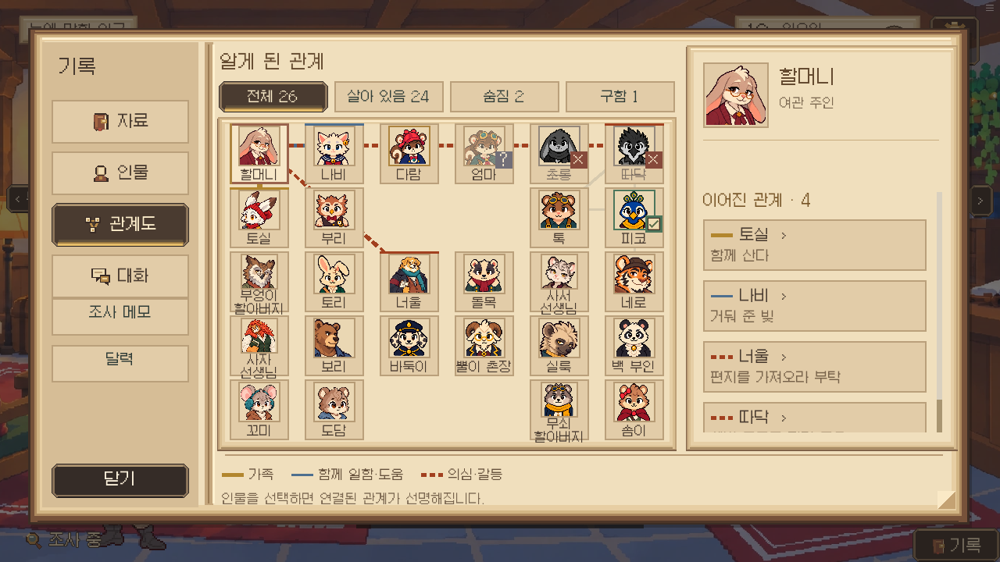
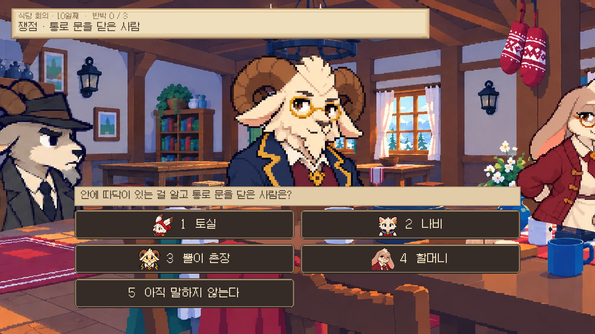

# 0.18.95 — 회의·관계도 디자인 정리

클로드가 추가한 관계도와 증거 회의 흐름을 기존 양피지·잉크 UI에 맞춰 정리했다. 관계를 알게 되는 조건, 사망·구조 상태 판정, 주장·증거·지목 정답, 투표·시간 흐름은 바꾸지 않았다.

- 관계도: 이름을 받치는 종이 카드, 선택 표시, 선택 인물의 연결선 강조, 작은 상태 배지. 날짜와 긴 설명은 오른쪽 상세에 모았다. 선의 색과 실선/점선 구분을 유지했다.
- 오른쪽 관계 목록에서 상대 이름을 누르면 해당 인물을 선택한다. 인물·필터를 닫기 전 상태로 복원한다. 큰 글씨는 상세와 필터에 적용한다.
- ‘인물’과 구별되는 관계도 전용 도트 아이콘을 추가했다. 새 그림·질감 파일은 없다.
- 회의 머리글에 반박한 발언 수와 얇은 진행선을 표시한다.
- 두 자료 엮기는 실제 제시한 첫 자료와 `1 / 2`만 보여 준다. 아직 제시하지 않은 정답 자료는 표시하지 않는다.
- 네 명을 지목하는 선택창을 두 열로 정리하고 작은 얼굴을 붙였다. 다섯 번째 ‘아직 말하지 않는다’까지 화면 안에 보인다. 기존 번호 키와 취소 동작은 유지한다.

## 검증

- `dev/check.sh`: 단위 테스트와 Ren’Py lint 통과.
- 실제 Ren’Py 화면 테스트: `relations_tab`, `ep4_after_trial`, `ep5_soup_meeting`, `ep6_altar` 통과. 기존 지목·두 자료·회의 결론 흐름을 그대로 실행했다.
- `dev/qa_relations_design.py`: 브라우저에서 26명 관계도, 실제 인물·관계 카드 클릭, 상태 필터, 닫기/복귀 기억, 숨겨진 관계 미노출, 이야기 상태 불변, 두 자료 표시, 실제 지목 선택·취소를 확인한다. 844×390 큰 글씨·움직임 끄기 화면까지 통과했다.
- 아래 캡처는 명시적으로 구성한 상태에서 실제 게임을 렌더한 것이다. 전체 캠페인을 처음부터 완주한 결과는 아니다.

