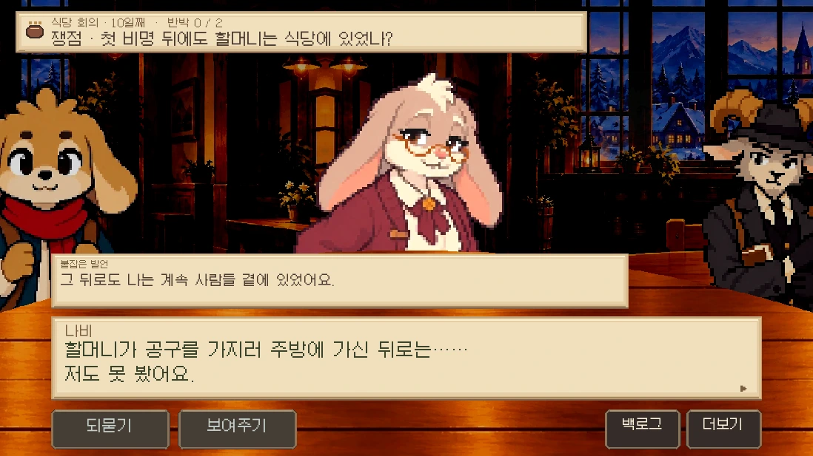
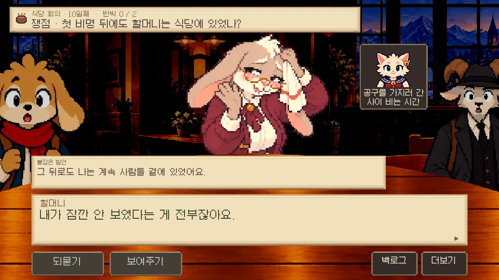

# 0.19.20 — 설명 뒤의 반응과 카메라 렌더링

「잠깐만요!」는 발언을 끊는 순간이다. 이때 놀람을 미리 보여 주지 않는다. 기존 입증 대사에서 플레이어·증인의 설명을 모두 듣고, 반박당한 인물이 답하는 첫 순간에 큰 표정과 움찔을 연결한다. 상대 답변 뒤 주변 참석자가 반응한다. 상대의 답변이 없는 경우에는 설명 전체가 끝난 뒤 반응한다. 증거 설명 중에는 카메라가 상대에게 고정된다. 기존 대사·자료·입증·역질문·패배 조건은 바꾸지 않았다.

카메라는 매 프레임 만들던 인물 변환과 탁상/마스크를 한 구도에서 재사용하고, 등장할 그림을 예측 목록에 미리 포함한다. 가까운 탁상과 먼 배경의 시차는 유지한다. 위치를 소수점으로 투영하고, 16ms 타이머 뒤에 다시 그리던 방식 대신 다음 가능한 프레임에 갱신한다. 도트 자산과 최근접 샘플링은 유지한다. 기기 전체에서 60fps를 보장하는 변경은 아니다.

검증(표정 추가 병합 전): 단위 검사 294개 및 lint 통과. 관련 네이티브 검사 `meeting_direction`, `meeting_granny_startle`, `meeting_pairs`, `trial_counter` 통과. 최종 고정 시선 수정 후 `meeting_granny_startle`을 재실행해 설명 중에는 놀람이 없고, 설명이 끝난 다음에만 중앙의 상대가 놀라는 순서를 확인했다.

동일한 소프트웨어 Chromium에서 한 좌석을 가로지르는 45회 강제 장면 렌더링을 비교했다. 첫 회를 제외한 중앙값 3.10→2.60ms, 95백분위 5.10→3.30ms, 최대 8.10→3.70ms. CPU 장면 렌더링 비용이며 GPU 표시 프레임률 측정은 아니다. [이전](../reviews/01919/performance-before.json)·[수정 후](../reviews/01919/performance-after.json).

최종 빌드 SHA-256: `79c862828eefc70293ab3aa5b5065f5bc6a04034cd99575273d22b69a39a9bf1`.

실제 웹 RHYTHM에서 컷인/설명 중 놀람 없음, 설명 후 당사자 반응, 자료 취소·중첩 저장 복원·모바일·움직임 끄기를 확인했다. 다른 채팅의 0.19.19 원본 표정 추가를 보존해 0.19.20으로 통합한다.

통합 후 단위 검사·lint 및 `meeting_direction`·`meeting_granny_startle` 통과. 전체 회의 연출과 별개로 0.19.19의 승인된 일반 대화 그림 40명을 유지했다.

최종 웹 통합본의 오프닝·원탁·최종 회의 관문과 F3의 자료만으로 준비를 대체할 수 없는 조건도 재확인했다.
