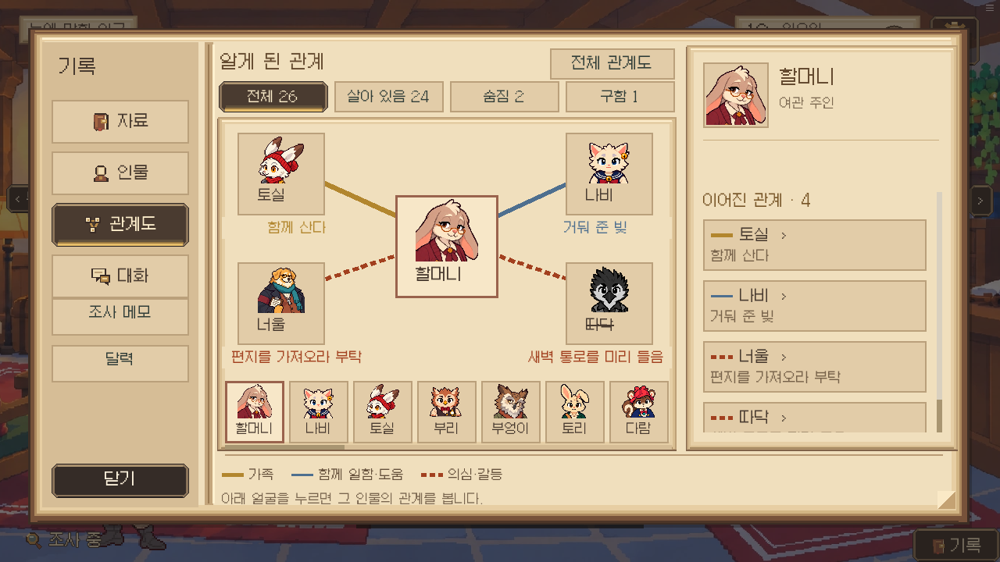
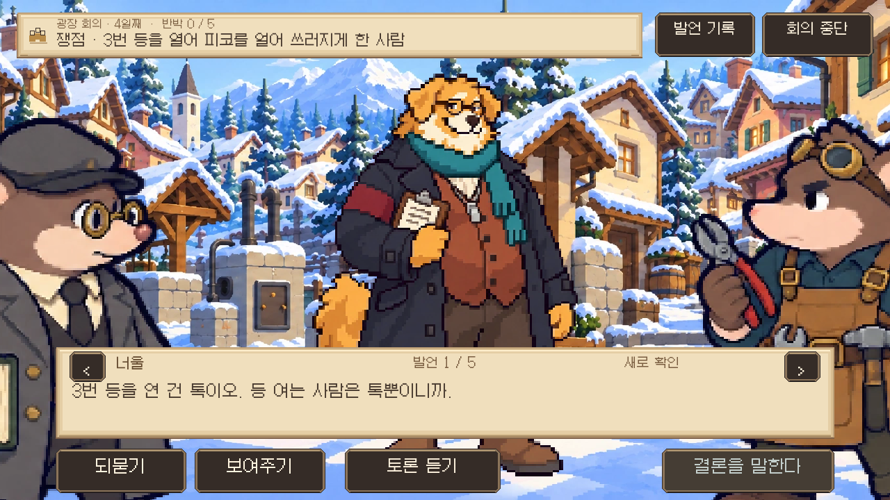
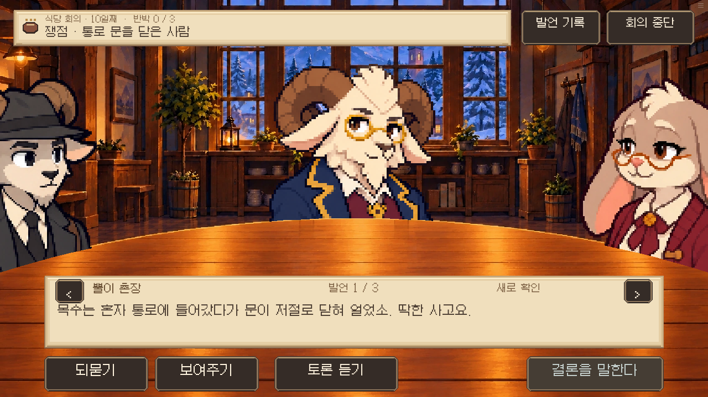
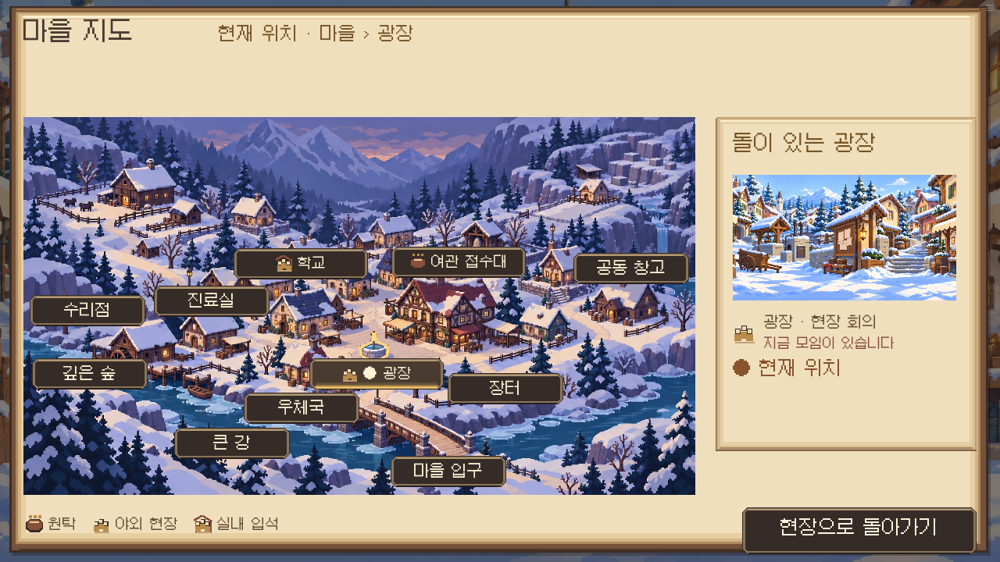
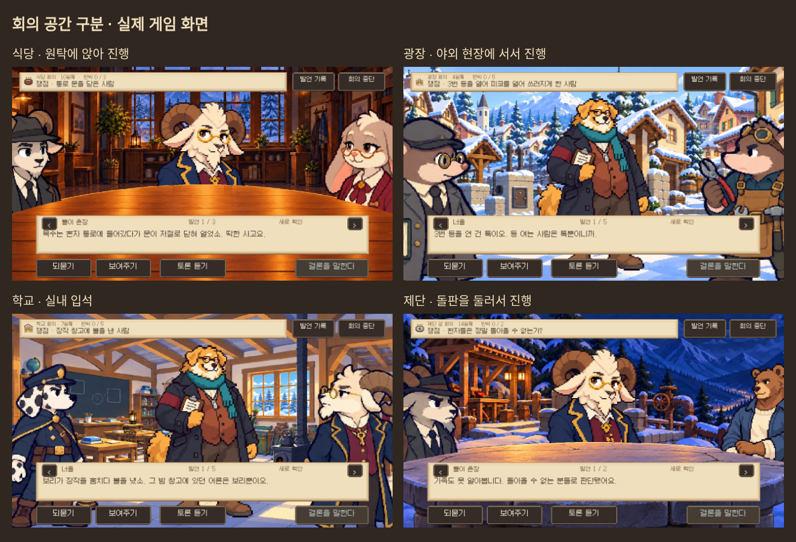

# 관계도·회의 공간 조사와 적용 — 0.18.96

2026-10-17. 공개 소개·도움말과 화면 자료를 조사했다. 게임 화면의 배치를 관찰한 내용과 우리 게임에 적용한 판단을 구분해 기록한다. 레퍼런스의 그림·텍스처·폰트는 게임 자산으로 복사하지 않았다.

| 자료 | 조사한 점 | 다람탐정에 적용한 판단 |
| --- | --- | --- |
| [The Roottrees are Dead 공식 소개](https://roottrees.com/en/) · [관계도 화면이 실린 PC Gamer 리뷰](https://www.pcgamer.com/games/puzzle/the-roottrees-are-dead-review/) | 공식 소개는 발견한 가족 관계로 가계도를 채우는 추리 구조를 설명한다. 공개 화면에서는 인물 카드와 연결을 일정한 기준으로 배치한다. | 전체 자리표의 위치는 유지하되, 기본 화면은 선택 인물과 직접 연결된 주민만 크게 배치한다. 아직 알지 못한 연결이나 빈 정답 자리는 미리 공개하지 않는다. |
| [The Case of the Golden Idol 공식 소개](https://store.steampowered.com/app/1677770/The_Case_of_the_Golden_Idol/) · [Thinking 화면 자료](https://www.videogamesgood.com/post/review-the-case-of-the-golden-idol-is-one-of-the-truest-detective-games) | 인물 식별과 사건 추론을 패널로 정리한 화면을 관찰했다. | 회의에서 화자·발언 순서·검토 상태를 분리하고, 첫 근거가 제시됐을 때만 그 자료와 1/2 상태를 표시한다. 정답 채우기·자동 반박 시스템은 가져오지 않는다. |
| [Penpoint 관계도 공식 도움말](https://penpoint.app/help/character-relationship-map) | 선택 인물의 연결 탐색, 관계 라벨, 전체 구조와 상세 정보의 역할을 설명한다. | 선택 인물을 가운데 두고 관계 설명은 상대 카드 가까이에 둔다. 긴 목록과 상태 날짜는 오른쪽에 유지한다. 관계가 없는 주민도 아래 인물 색인에서 찾는다. |

## 공간 점검에서 발견한 문제

에피소드 배경을 바꾸는 후속 함수가 원탁 배경을 일반 배경으로 바꾼 뒤에도, 회의 화면은 탁자용 전경 마스크를 적용했다. 그 결과 탁자가 없는 장소에서 인물이 배경에 가려지고, 식당 후속 회의는 원탁 없이 서 있는 배치가 됐다.

| 회의 | 실제 이야기 장소 | 화면 방식 | 지도·머리글 아이콘 |
| --- | --- | --- | --- |
| 본 재판, Q4 | 여관 공동 식당 | 기존 원탁 배경·앉은 인물·원탁 전경 | 원탁 |
| Q1, Q2, Q6 | 광장 | 해당 시간대의 현장 배경·입석·탁자 마스크 없음 | 야외 현장 |
| Q3, Q5A, Q5 | 학교 교실·대피소 | 학교 배경·입석·탁자 마스크 없음 | 실내 입석 |
| F1~F4 | 산속 제단 | 기존 제단 배경·서서 둘러싼 돌판 | 제단 돌판 |

장소를 현재 이동 위치로 추정하지 않고, 기존 회의의 장소 지정에 맞춘 표현 정보로 구분한다. 장소 이동·회의 날짜·소집·정답·입증·투표는 바꾸지 않는다.

지도 아이콘은 회의 가능한 공간의 유형이다. 실제 모임 표시는 기존 `offers`에 현재 날짜·시간·장소가 일치하는 회의 안내가 있는 경우에만 표시한다. 지도 범례도 현재 지도에서 이미 볼 수 있는 장소 유형만 보여 준다. 발견하지 않은 제단이나 끝난 회의를 미리 표시하지 않는다.

## 실제 화면

아래 검증 파일과 릴리스 기록에 실제 실행 결과를 기록한다. 화면 확인은 명시적인 상태로 구성한 검수 장면이며 전체 캠페인 완주를 뜻하지 않는다.
