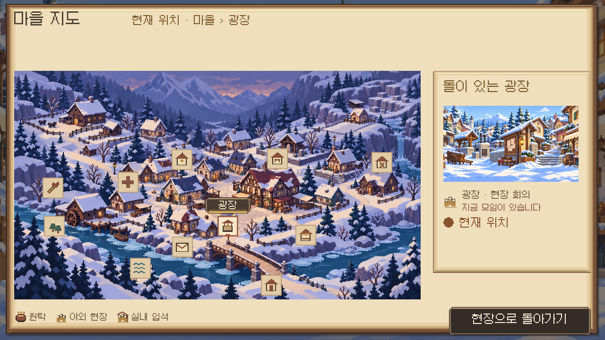
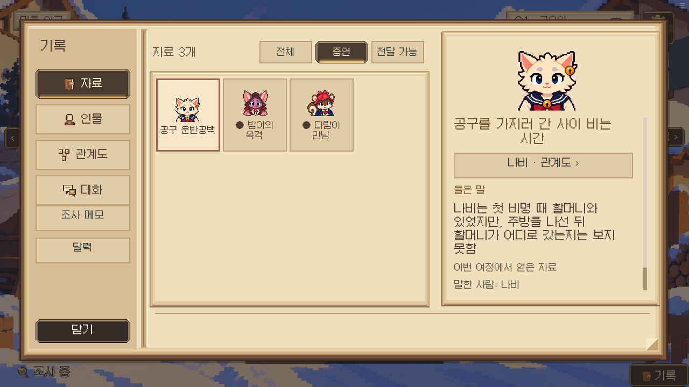
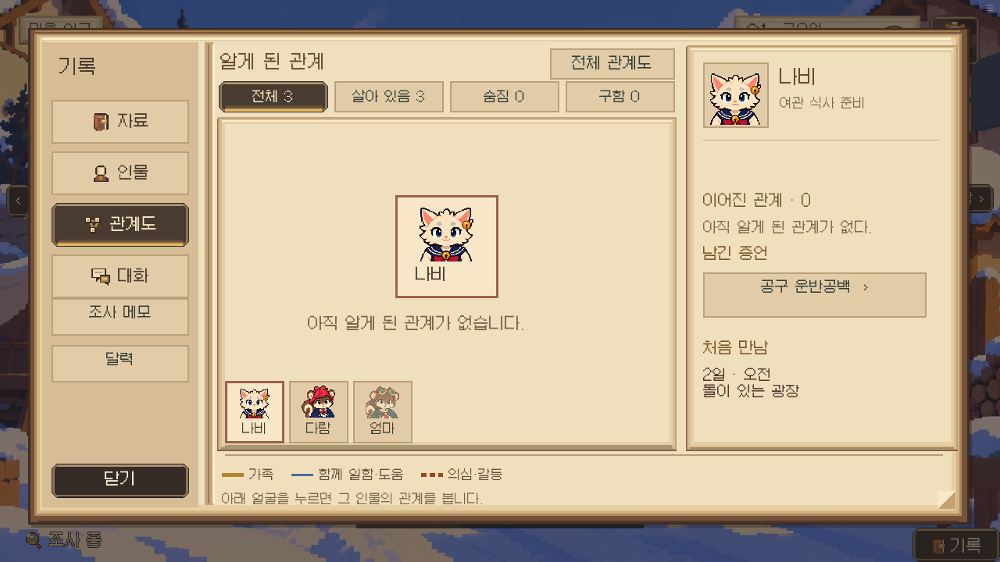
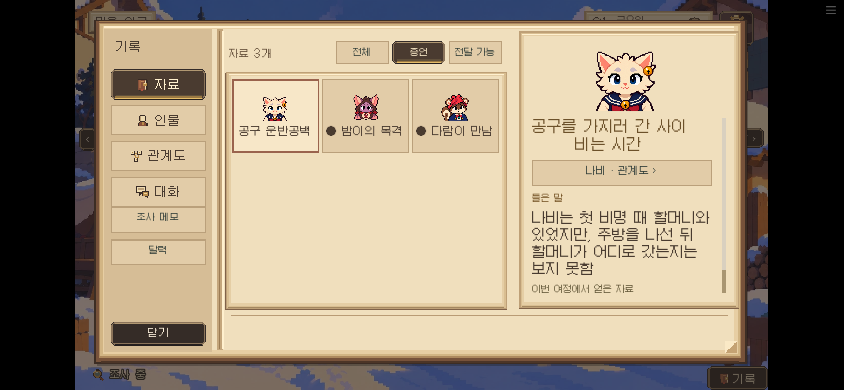
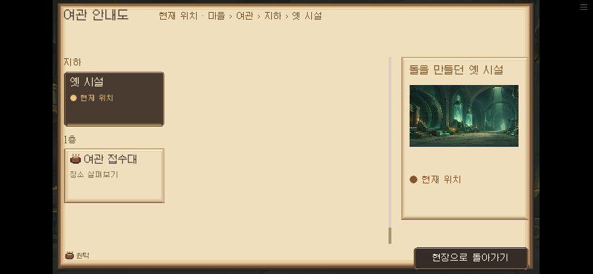

# 지도와 자료 탐색 정리 — 0.18.98

2026-10-17. 지도 그림을 줄이기 전에 글씨가 가리는 면적을 줄이고, 자료와 인물 관계 사이의 탐색을 짧게 만든다. 사건 판정·대사·자료 획득 조건은 수정하지 않는다.

## 레퍼런스와 판단

- [The Roottrees are Dead 공식 소개](https://roottrees.com/en/)와 [관계도 화면이 실린 PC Gamer 리뷰](https://www.pcgamer.com/games/puzzle/the-roottrees-are-dead-review/): 공식 소개는 자료를 찾아 가족 관계를 추론하는 구조를 설명한다. 이전 [관계도 조사](../01897/RESEARCH.md)의 인물 중심/전체 보기 위에, 이번에는 실제 출처가 있는 증언만 인물과 연결한다. 자동 정답 연결이나 미발견 빈칸은 추가하지 않는다.
- [Overboard! 제작자 Jon Ingold의 대화 설계 글](https://www.gamedeveloper.com/design/patching-conversations-to-pin-the-blame): 인물이 아는 정보와 사건 상태를 기반으로 발언을 구성하고, 도중에 갈라진 대화도 원래 흐름에 복귀하는 구조를 설명한다. 이를 UI에 적용한 판단은 자료를 보고 돌아와도 선택·필터·읽던 위치를 잃지 않게 하는 것이다. 해당 글이 이 UI 배치를 권장한다는 뜻은 아니다.

공개 게임의 자산·텍스처·폰트를 복사하지 않았다. 지도 픽토그램은 기존 팔레트로 직접 그렸다.

## 적용

- 마을의 11개 상시 이름표를 작은 장소 픽토그램으로 바꾸고, 선택/마우스가 올라간 장소 하나에만 이름을 표시한다. 학교·여관·진료실·우체국·강·숲·수리점·시장 등을 다른 그림으로 구분한다.
- 보이는 표식은 44×44, 실제 누르는 영역은 64×64다. 기존 건물 윤곽을 누르는 동작도 유지한다. 장소 상세와 이동은 오른쪽 카드에서 확인한다.
- 지도 이름표만 비교하면 기존 11개 사각형의 총면적은 68,000px²였고, 새 11개 표식과 선택 이름 하나는 최대 28,096px²다. 지도의 약 16%에서 최대 7%로 줄어든다. 그림/건물 하이라이트는 별도이며, 표식의 투명한 터치 여백은 가림 면적에 포함하지 않는다.
- 자료는 한 창에 둔다. `전체 / 증언 / 전달 가능`은 같은 소장 자료를 좁혀 보는 필터다. 물증과 소지품을 별도 메뉴로 다시 나누지 않는다. 회의와 지난 플레이 자료에는 전달 가능 필터를 표시하지 않는다.
- 증언 출처는 `evidence_sources`에 명시되고 이번 여정에서 직접 만난 사람만 관계도로 연결한다. 관계도에는 이번 여정에서 실제 얻은 해당 인물의 증언만 표시한다. 이름 검색이나 문장 추측으로 연결하지 않는다.
- 증언을 열 때 해당 페이지로 이동하고, 관계도 탭에 돌아가면 이전 인물 선택을 유지한다. 필터·자료 선택은 창을 닫아도 유지한다. 자료마다 읽던 스크롤 위치를 유지하는 기존 기능도 검증한다.
- 긴 자료명은 본문과 같은 스크롤 안에 배치해 모바일 큰 글씨에서 버튼과 겹치지 않게 했다.
- 옛 시설은 실제 발견 조건을 읽어 여관 안내도의 지하 구역에 표시한다. 현재 위치가 지하일 때 마을 지도로 열리던 누락을 고치고 지하 구역을 먼저 보여 준다.
- 빈 슬롯 버튼을 그리지 않고, 한 페이지뿐일 때는 이전/다음 버튼도 숨긴다. 빈 필터는 “이 분류에 해당하는 자료가 없습니다.”라고 표시한다.
- 관계선·인물 상태·회의 장소 아이콘·발견 조건은 유지한다.

## 새 지도 그림은 비교용 시안

기존 지도 그림을 참고해 시점을 멀리 잡고 강·숲·마을 사이의 여백을 늘린 생성 이미지다. **실행 게임의 지도 배경으로 교체하지 않았다.** 제작자가 선택한 뒤 장소별 위치·건물 윤곽·클릭 영역을 새 그림에 맞춰 다시 지정해야 한다. 현재 지도 위에 이 그림만 덮으면 장소가 틀어진다.

옛 시설은 여관 아래에서 비밀 통로로 이어지는 설정이다. 지상에 별도 동굴 목적지로 노출하지 않았다. 지하 시설/통로 지도는 발견한 뒤 표시하는 별도 층으로 다루는 편이 맞다.

## 검증

화면은 실제 렌더러에서 명시적으로 구성한 검수 상태다. 캠페인 전체 완주를 의미하지 않는다. 아래 이미지와 JSON에 결과를 보관한다.

