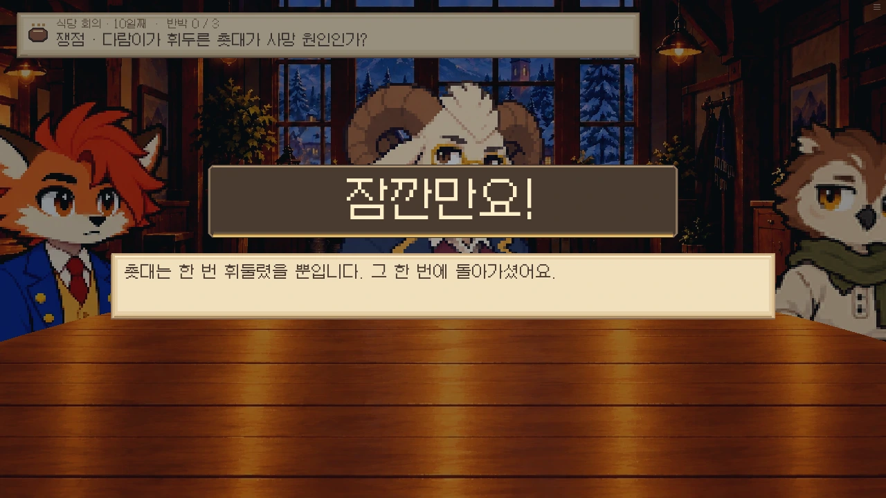
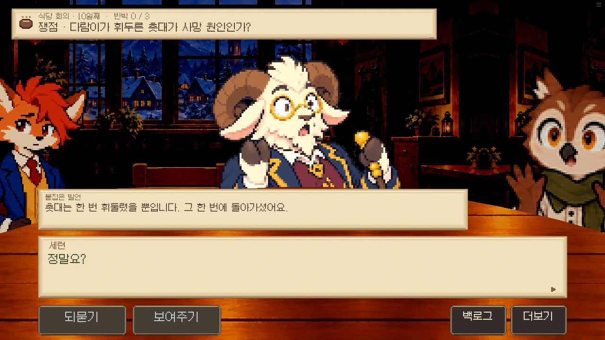
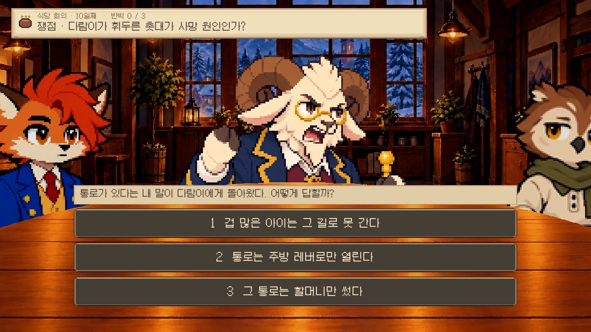
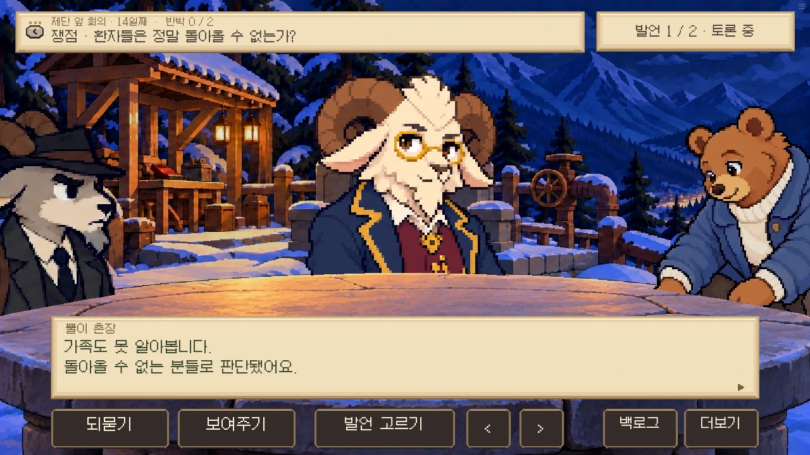

# 0.19.17 회의 공방 연출

사용자 승인: 정확한 발언에 근거를 내면 ‘잠깐만요!’로 끊고, 정지 화면에서 차분히 입증한다. 상대가 당황한 뒤 다시 항변하거나 역공할 수 있고, 플레이어가 이기지 못하는 기존 결과도 유지한다. 참석자의 짧은 잡담을 포함해 전체 회의에 공통 적용한다.

## 구현 범위

- `room13_meeting_direction.rpy`: 토론 / 주민 반응 / 되묻기 / 자료 확인 / 끊기 / 입증 / 당황 / 재정비 / 역공 / 부분 근거 / 반박 성립 / 의견 정리 / 마지막 항변 / 패배의 공통 연출 상태.
- `r13_lines`가 회의 중인 경우에만 연결한다. `r13_debate_run`을 쓰는 C1–C4, F1–F4, Q1–Q6 및 Q5A 모두 적용된다. Q는 실제 장소를 그대로 쓴다.
- 근거가 맞으면 0.42초 컷인(움직임 끄기 0.18초), 음악 여백, 제시음 한 번. 이어서 자료 아이콘·붙잡은 발언·사용자 진행 대사. 입증하는 동안 카메라 정지.
- 기존 역질문이 있으면 그 답까지 확인한 뒤 성공음과 반박 완료를 처리한다. 역질문 실패에는 성공음/완료 표시가 없다. 정답·역질문·동의·준비 관문과 판결 규칙을 변경하지 않는다.
- 일반 전환 0.22초, 반응·역공 0.12초, 답변 0.16초. 큰 화면 전체 슬라이드 대신 280px 방향성 이동과 교차 페이드. 읽는 동안 반복 이동 없음. 움직임 끄기는 즉시 구도 전환.
- 배경은 식당의 따뜻한 빛/제단의 차가운 빛을 구분한다. 배경과 옆 사람의 대비를 낮추되 얼굴과 UI는 읽힌다. 원탁·돌판만 전경 마스크를 쓰고 야외·학교에 탁상을 만들지 않는다.
- 이미 입증된 같은 회의군의 모순만 표정 압박에 반영한다. 침착한 인물은 다음 주장 때 추스르고, 역질문에서는 재정비한다. 기존 작가 지정 표정·포즈 우선. 처음부터 범인만 다른 조명을 주지 않는다. 새로 일그러진 그림을 생성한 변경은 아니며 기존 표정 자산을 연결한 것이다.
- 기존 council/pressure/altar와 환경음·제시/성공/실패음을 활용. 자료 선택은 음악 0.50, 설명은 0.58로 낮추며 곡의 위치 유지. 회의 종료 시 이전 곡/채널 음량/일시정지를 복구한다. 사용자 믹서·음악 끄기 유지.
- 실제 참석자 한 명의 중립적 짧은 반응을 결과당 최초 1회 추가한다. 진실·범인·관계를 새로 확정하지 않는다. 같은 실패를 반복하며 잡담을 계속 보지 않는다. Q 회의에도 첫 주장 뒤 중립적 짧은 반응을 제공한다.
- 중첩 자료창 취소/불러오기에서 외부 발언·페이지·화자와 연출 상태를 복원한다. 설명 카드가 외부 대사 위에 남지 않도록 정리한다.

## 레퍼런스와 검토 근거

[Notion 조사 및 재기획](https://app.notion.com/p/3fc2745ceb9c818d9d17d9d4b1b17030): 단간론파의 공방 구도, 대역전재판의 관련 주민 반응, GNOSIA의 토론/의견 정리 구분, The Council의 얼굴·조명 집중, RAIN CODE의 자료 제시 맥락을 우리 겨울 동화/도트 스타일로 옮겼다. 수치·음악 연결은 우리 작품의 제안/구현값이며 원작 실측이 아니다.

## 검증

- 단위 검사와 Ren’Py lint.
- 추가 단위 검사: 사례 데이터 불변, C/F/Q 발언 역할, 음량 감쇠/음악 재시작 억제, 제단곡/바람, 작가 표정 우선, 압박 누적과 재정비, 참석자 잡담 중복 억제, 저장 복원, 비회의 음량 보존.
- `meeting_direction`: 같은 근거를 내고 역질문 오답 → 미입증/성공음 없음 → 재도전 정답 → 입증/성공음, 종료 정리. 명시적 상태 fixture이며 자연 진행 완주가 아니다.
- `meeting_pairs`, `trial_missing`, `trial_partial`: 기존 부분 근거·자료 부족 패배·부분 입증 패배 보존.
- 웹 RHYTHM: 실제 토론/주민 반응, 자료 취소·중첩 저장 복원, 음량 감쇠, 반박 후 발언 연결, 모션 감소, 모바일 가로.
- 광장/학교/식당/제단 회의와 표준 화면 회귀 결과는 실행 로그와 최종 릴리스 기록에 기재한다. 영상은 브라우저 화면 녹화이며 오디오 녹음이 아니다. 소리는 런타임 재생 상태·효과음 호출 순서로 확인한다.

## 실제 실행 화면

[실제 웹판 동작 녹화 — 무음](council-motion.mp4). 명시적 회의 fixture로 기록한 화면이며 자연 진행 완주 영상이 아니다. 자료 목록을 넘기는 구간만 잘라냈고 실제 전환 속도는 유지했다.
