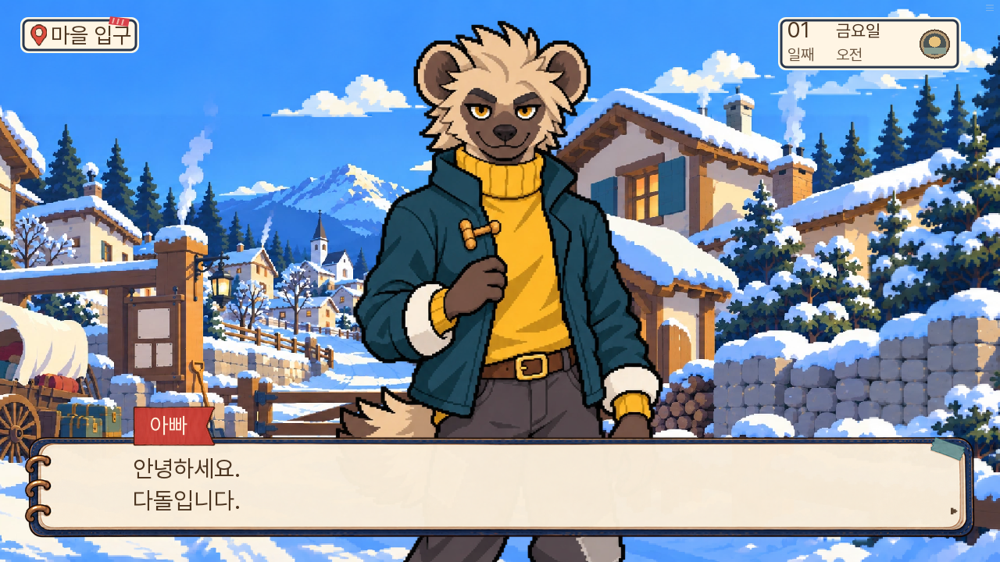
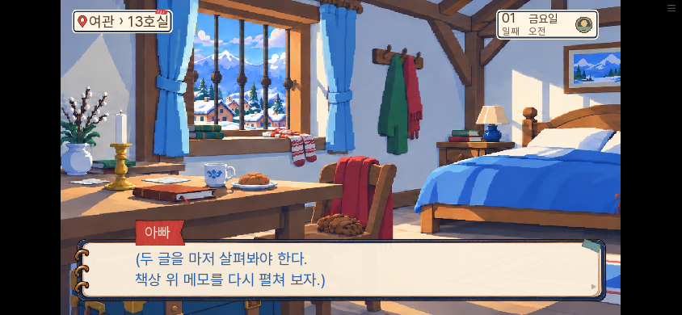
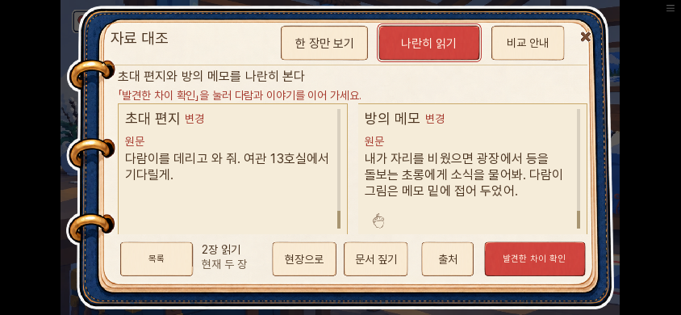
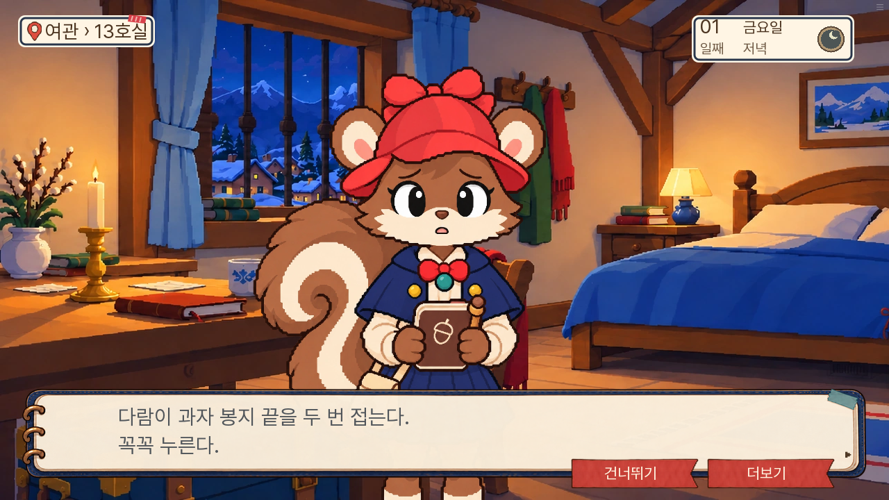

# 0.20.136 입구·첫 방·주민 말투 수정

2026-11-09. 사용자가 실제 플레이에서 지적한 오류를 같은 수정판에 적용했다. 이전 검수에서 공통 첫 인사의 숙박 선행 확정과 비활성 침대의 낱말 출력을 놓쳤다.

| 문제 | 원인·수정 |
|---|---|
| 입구에서 '13호에 묵는 사람'이라고 소개 | 공통 초면 인사에 숙박이 하드코딩돼 있었다. 성인·아동 모두 이름만 소개한다. |
| 침대를 누르면 '(침대)'만 표시 | 옛 캠페인의 special 물건 이름을 대사로 전달했다. 1일 메모 대기·비교 복귀에는 실제 다음 행동을 알려 준다. 잠자기 선택은 유지한다. |
| 도토리 차이를 찾고도 다음 조작이 불분명 | 첫 방에서만 관찰 전 '차이 살펴보기', 관찰 후 '발견한 차이 확인'과 다음 대화 안내를 표시한다. |
| 단순한 과자 봉투를 큰 컷으로 확대 | Pillow 도형 작도본이었다. 내용이 다른 스티커로 대체하지 않고 대형 컷을 제거했다. 옛 저장의 같은 컷도 빈 표시로 처리한다. |
| 주민들이 같은 하오체를 씀 | 1부 본문 198줄과 공통 인사·반응49줄을 현대화하고 회의의 재인용도 같은 문장으로 맞췄다. |

## 말투 범위와 보존

돌목은 짧고 단정한 존댓말, 너울은 사무적인 존댓말, 보리는 편한 해요체를 쓴다. 아동 상대 반말과 노인의 하게체를 하오체로 잘못 묶지 않았다. 원본 `records.json`은 보존하고 실제 출력 층에만 반영했다. 숫자·태그·화자·조건·표정·자료·정답·기회·생사·결말은 유지한다. 8~14일 개별 본문 전체의 말투를 바꿨다고 보고하지 않는다.

[1~3일 전후](voice123-changes.json) · [4~7일 전후](voice4567-changes.json) · [공통 인사·반응](공통말투검수.json) · [첫 만남 독립 검수](독립검수.json) · [과자 원화 출처](과자컷검수.json) · [비교 조작 검수](첫방조작검수.json)

slop-rewrite는 기존 프로젝트 설정인 '가이드 없음'으로 실행해 문장을 검토했다. 자동 검사 통과를 재미나 문맥의 보증으로 쓰지 않았다. 미확인 숙박과 그림의 사실관계는 사람이 진행·원화와 대조했다. 비공개 취향·bundle 원문은 이 공개 기록에 넣지 않는다.

## 검사 기록

관련 단위198개 통과. 초기 검사에서는 옛 말투를 요구하던 문구 검사와 비출력 원본에 추가한 불필요한 덮어쓰기, 본문과 달라진 회의 인용이 잡혔다. 실제 출력에 맞춰 수정했고 다른 분기에서도 성립하는 공통 인용을 확인했다. 첫 시도부터 전부 통과했다고 기록하지 않는다.

SDK6개가 통과했다: 실제 첫 인사, 첫 방 목록/옛 반환 관찰, 휴대폰 끝부분 직접 관찰, 완료 구 저장 호환, 지도로 여관에 먼저 간 경로의 너울 소개, 입구 실패 시 정정 없는 등록. 너울 소개의 초기 검사는 옛 하오체 문자열 기대 때문에 대기 제한에 걸렸고 새 문구로 재검증했다. [SDK 결과](native-results.json) · [단위198개](unit-final.txt) · [대사 A/B/C0건](dialogue-check.txt) · [lint](lint.txt)

메타데이터 생성 뒤 대사 binding18개와 덮어쓰기 지도3개 검사도 통과했다. 전체 1~7일 재완주를 반복한 검사로 보고하지 않는다.

너울이 반복하던 '규칙이오'는 어미뿐 아니라 표현도 정리했다. 특히 주소를 알리지 않으면 장부가 찾지 못한다는 비유는 숙박 주소를 등록해야 한다는 이유 설명으로 바꿨다. 이 부분을 단순 어미 교체라고만 설명하지 않는다. [최종 독립 대조](최종독립검수.json)

## 실제 웹 진행

동일한 최종 빌드에서 새 게임→입구 조사·등록 성공→실룩 초면→여관 입실→메모와 그림→비교 취소→침대 안내→책상 복귀→끝부분 관찰→발견한 차이 확인→할머니에게 초롱 행방 확인→첫날 밤→2일 아침 진입까지 화면 입력으로 진행했다. 정답 계획을 참고한 자동화이며, 서사 값이나 증거를 직접 지급하지 않았다. PC1280×720과 휴대폰 가로844×390에서 촬영했다. [최종 상태](최종상태.json) · [빌드 해시·범위](web-results.json)

초기 드라이버가 화면 갱신 직후 버튼 문구를 너무 일찍 검사해 멈췄다. 같은 세션에서 실제 버튼과 관찰 상태를 읽어 확인하고 대기를 보완해 계속 진행했다. 게임 상태를 준비해서 성공으로 바꾼 검사가 아니다. 브라우저 pageerror와 Ren'Py 예외 화면은 없었다.

공개 사이트 자체의 화면은 네트워크 허용 범위 밖이므로 직접 열었다고 기록하지 않는다. 같은 최종 빌드는 로컬 웹에서 확인했으며, 공개 후 커밋의 빌드 해시와 Pages 배포 결과를 별도로 대조한다.
