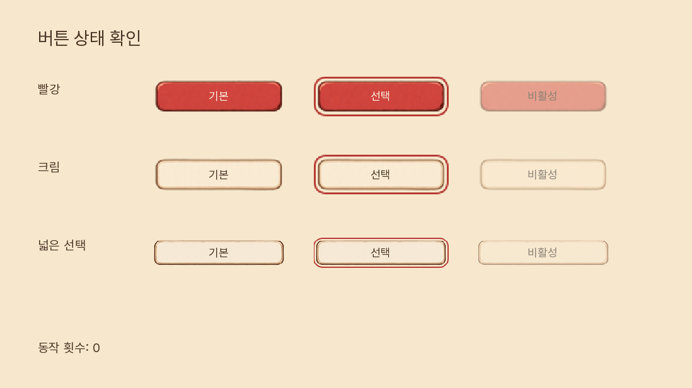
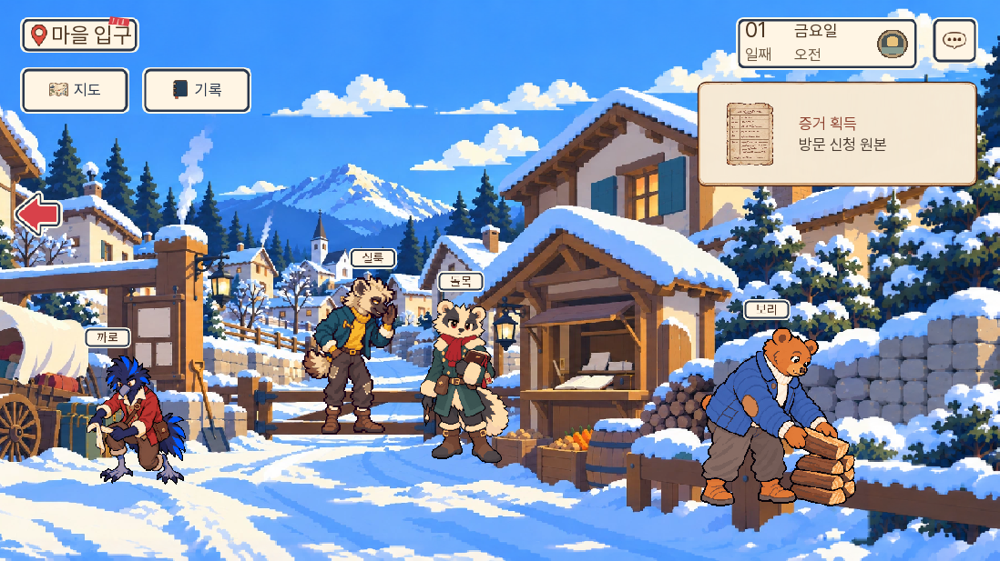
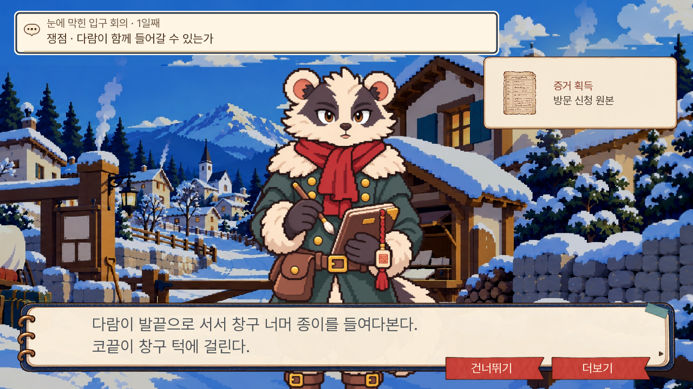
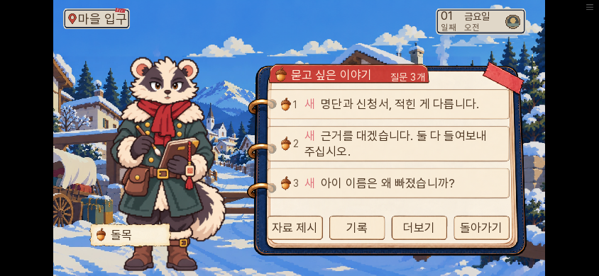
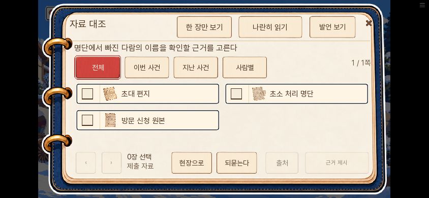
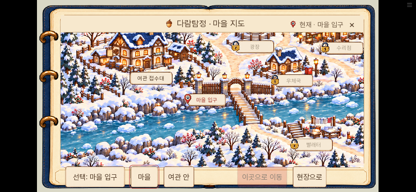

# 0.20.135 보유 에셋으로 UI 통일

2026-11-09. 자체 제작한 그림을 최대한 줄이고 에셋을 써서 통일하라는 요청을 반영했다. 새로운 그림은 만들지 않았다.

| 사용처 | 변경 |
|---|---|
| 공통 아이콘 16종 | Canvas로 그리던 책·지도·말풍선·자료·돋보기·잠금 등을 납품된 B 아이콘으로 연결 |
| 메인 메뉴·질문·지도 버튼 | 크기별 자체 SVG 그림 대신 납품된 B 버튼 상태 세트에 기존 역할을 연결 |
| 질문·자료·지도 공통 판 | 코드로 그리던 사각형 대신 같은 납품 버튼을 별도 Frame 계약으로 연결 |
| 증거 큰 그림·획득 카드 | 별도 놋쇠 Solid 테두리를 B 종이 판으로 통일, 글자는 종이에 맞는 짙은 잉크색 |
| 전용 아이콘이 없는 장식 | 새 그림을 추가하지 않고 기존 행동 글자만 표시 |

작은 버튼은 비율을 유지해 축소한다. 큰 공통 판은 `surface.supplied.button.standard/primary`의 명시적 Frame 계약을 쓴다. 기존 `button.*`의 Frame 금지·역할 재매칭 전파는 유지했다. 정사각 버튼에는 같은 규격의 납품본이 없어 기존 원본을 남겼다. 과거 파일을 일괄 삭제해 저장 경로를 깨지 않았다.

[버튼 출처·연결 검수](버튼검수.json) · [아이콘 경로·Crop](아이콘재사용.json) · [인물·배경·소품 출처와 잔여 항목](인물소품출처검수.json)

현재 보유한 파일을 외부 구매 에셋으로 잘못 기록하지 않는다. 원화에는 기존 image_gen 납품본도 있다. 인물·배경의 별도 기성 팩은 검색 범위에서 확인하지 못했으며 전부 교체했다고 보고하지 않는다. 도토리 서명·가족 그림·걸쇠 도식은 그림의 특정 내용이 단서이므로 같은 사실을 담지 않은 범용 그림으로 바꾸지 않았다. 피코 4일 스케치에는 임시 Pillow 작도가 남아 있고 동일 역할의 대체 납품은 찾지 못했다.

## 확인

관련 단위158개 통과. SDK5개에서는 버튼 눌림·선택·비활성, 연속 증거 알림·창 뒤 숨김, 자료 대조 선택 유지, 도구함 역할 재매칭·복원을 확인했다. 메인 메뉴의 저장 유무별 활성 항목 이동과 설정 열기도 확인했다. [단위](unit.txt) · [SDK5개](native-results.json)

스토리·소지 자료·정답·기회·생사·결말은 바꾸지 않았다. 이번에는 에셋 적용과 관련 UI 경로 검증이며 전체 1~7일 완주 반복은 아니다.

에셋 연결 검증과 대사 A/B/C 검사 통과. lint는 기존 도달 불가 문장 안내만 남았다. [에셋 계약](assets-check.txt) · [대사](dialogue-check.txt) · [lint](lint.txt) · [독립 검수](독립검수.json)

초기 메인 키보드 검사는 저장이 없을 때만 맞는 기대값 때문에 실패했다([초기 결과](title-initial.txt), [수정 후 결과](title-final.txt)). 저장이 있는 경우의 이어하기·불러오기도 검증하도록 고친 뒤 통과했다. 실제 게임의 키보드 명령이나 포커스 순서는 바꾸지 않았다.

## 최종 웹 화면

메인 메뉴의 마지막 변경까지 포함한 동일 최종 빌드에서 새 게임→선반 첫 조사→명단/원본 획득→돌목 질문→자료 대조→두 자료 제시→등록 성공/정정 명단→지도까지 화면을 직접 눌렀다. PC1280×720과 휴대폰 가로844×390에서 촬영했다. 브라우저 pageerror·Ren'Py 예외 화면은 없었다. [최종 빌드 해시·범위](web-results.json) · [실제 진행 로그](web-final.txt) · [등록 최종 상태](최종상태.json)

공개 사이트 자체의 화면은 네트워크 허용 범위 밖이므로 직접 열었다고 기록하지 않는다. 동일한 최종 빌드는 로컬 웹에서 확인했으며, 공개 후 커밋의 빌드 해시와 Pages 배포 결과를 별도로 대조한다.
