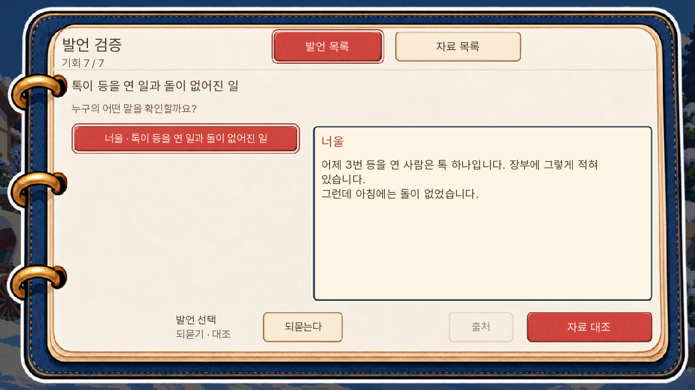
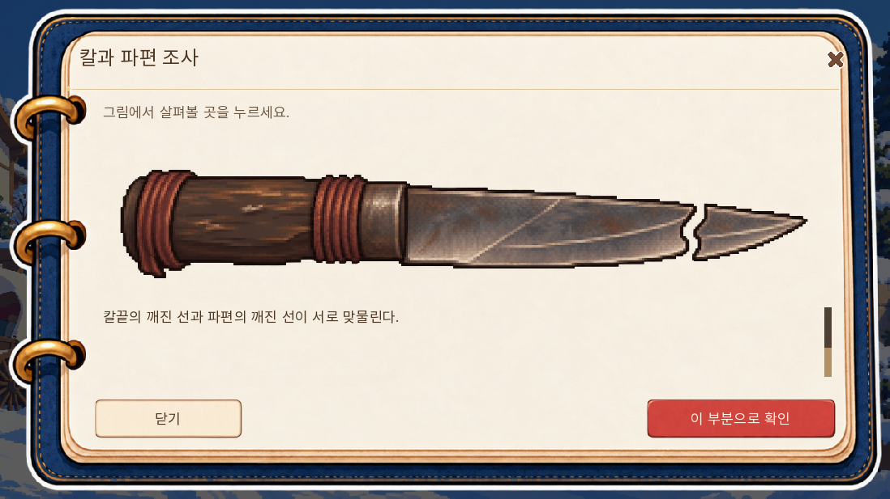
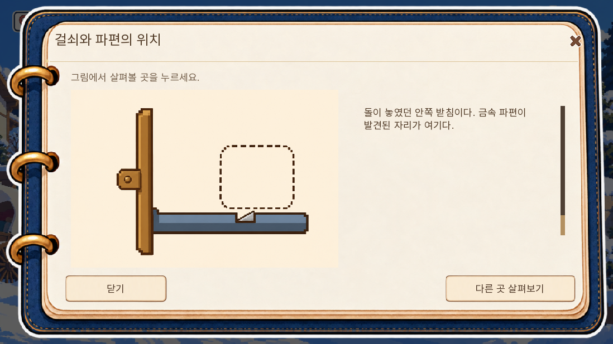
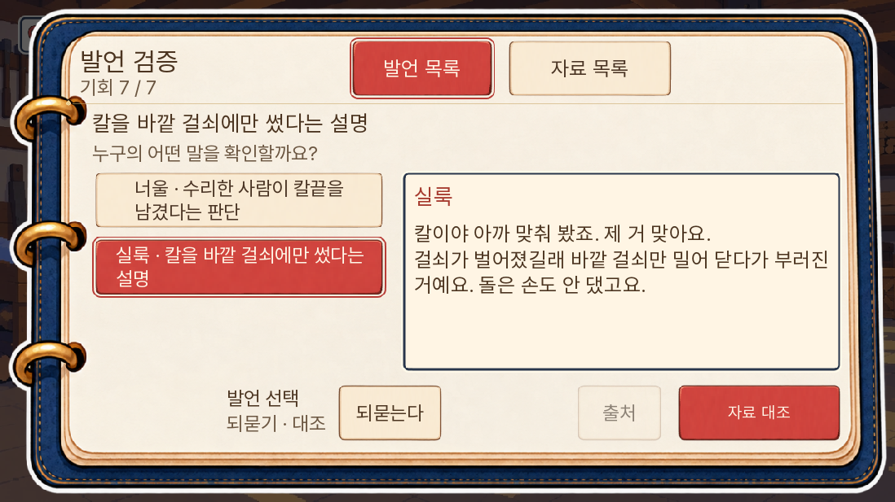
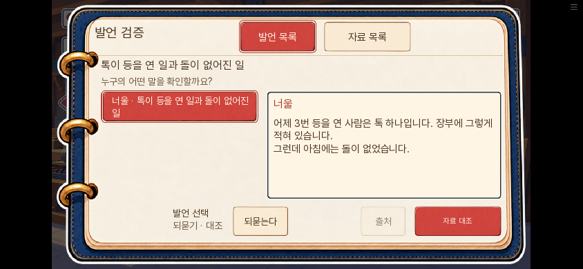
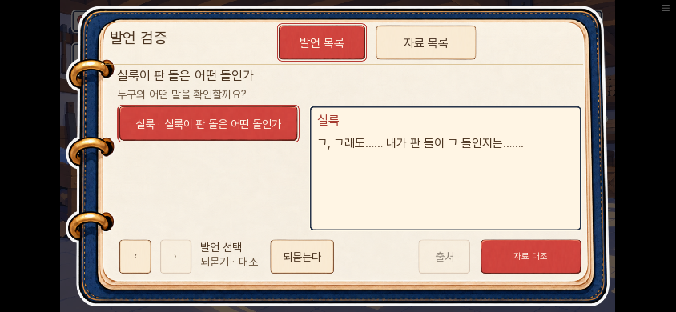

# 0.20.140 사건별 발언 검증 시범

소유자가 승인한 추리 기획의 첫 적용은 3일차 등 사건이다. 사건별 자료를 모으고, 실제 들은 말의 어느 부분을 검증할지 골라 자료를 제시한다. 도난과 사전 예방에 따른 미수는 다른 사건 내용이므로 발언과 자료를 섞지 않는다.

## 이번 구현

- 일반 도난: 개봉 기록과 반출, 돌의 행방, 바깥 걸쇠 설명, 주웠다는 돌의 출처를 네 발언으로 구분한다. 실제 말한 화자와 최종 표시 문구를 저장해 인용한다. 대체 대사도 그대로 반영한다.
- 미수: 수리 뒤 생긴 파손과 칼 사용 위치의 두 발언을 다룬다. 팔린 돌의 자료를 미리 주지 않는다.
- 발언 목록에서 되묻거나 자료 대조로 간다. 자료 화면의 위에는 고른 발언, 아래에는 그 말에 제시하는 버튼이 있다. 이번 사건 자료를 먼저 열며 전체·지난 사건 자료도 남겨 대체 정답을 보존한다.
- 칼을 내달라는 문답 뒤 기존 원화에서 깨진 접점을 직접 짚는다. 확인한 뒤 기존 대조 대사와 E33·E17 획득으로 이어진다. 단순히 손잡이나 칼날을 보는 행동은 무료다.
- 걸쇠 도식의 바깥 판과 안쪽 받침을 각각 눌러 위치를 확인할 수 있다. 관찰만으로 범인·논증 성공을 정하지 않는다.
- 현재 발언에 제출할 때만 기존 정답·대체 조합·기회 규칙을 쓴다. 이미 들은 다른 발언에 대한 제출은 무료 검토이며 현재 논증을 자동 성공시키지 않는다.

## 저장과 건너뛰기

청취한 줄은 기존 room13 저장 안에 담는다. 아직 듣지 않은 발언은 목록에 나타나지 않는다. 대사 중간 건너뛰기는 안 본 뒷부분을 청취한 것으로 만들지 않는다. 현재 발언을 건너뛰었거나 옛 저장에 캐시가 없으면 기존 자료 제시 화면으로 진행한다. 빈 발언 목록에서 막히지 않게 기억된 화면·표적도 정규화한다.

## 유지한 내용과 범위

정답 묶음·대체 정답·기회 총수·승리/부분 성공/실패·보호 선택·생사·결말은 유지한다. 읽기·되묻기·실물 관찰에는 새 시간 제한을 두지 않는다. 새로운 그림·증거 ID·진상을 추가하지 않았다. 미수 너울의 화면에 남은 하오체 세 줄은 기존 의미 그대로 현대 존댓말로 정리했다.

이번에 입구·첫 방·5일·7일 전체를 새 시스템으로 바꾼 것은 아니다. 3일차 시범의 읽기·제시 흐름을 기준으로 이후 사건마다 적용한다. 첫 방의 도토리 부재를 위조의 확정 증거로 만들지 않는다.

## 참조

[Capcom의 역전검사 소개](https://news.capcomusa.com/lets/browse/tgs-2009-ace-attorney-investigations-miles-edgeworth)의 수집 사실 연결, [역전재판 증거·증언 검증 설명](https://news.capcomusa.com/zeroobjections/blog/2019/03/09/pointing-your-way-to-victory)의 발언 대조와 수정된 설명을 구조 참고로 삼았다. 원작의 그림·음성·대사를 복제하지 않았다.

## 확인 결과

전체 단위 1,610개 통과. 추가 대사 검사 A/B/C 0건, 관련 텍스트 단위 28개 통과. SDK·웹 결과와 실제 화면은 아래 최종 기록에 추가한다. 전체 1~7일 또는14일 연속 완주는 이번 검사 범위가 아니다.

### 최종 실행 확인

- 최종 소스의 전체 단위1,610개 통과. lint에서 새 문법·호출 오류가 없으며 공개 버전 검사0.20.140 통과.
- SDK10개 모두 통과. 정상 도난의 발언4개를 실제 문답·체크·제시·칼 접점·걸쇠 위치 클릭으로 지나 승리까지 진행했다. 다른 과거 발언에 맞는 자료를 낸 경우 현재 쟁점·기회가 유지됨을 확인했다.
- 미수의 실제 추가 대사를 읽어 별도 발언2개가 나타나고, 큰 글자·터치 배치에서 저장·불러오기 뒤 체크 묶음과 자료 화면이 그대로 남고 최종 승리로 이어짐을 확인했다. 도난 자료 E15/E16은 주지 않았다.
- 실제 오답은 기존 기회1회를 쓰고, 다음 발언을 건너뛴 경우에는 미청취 원문을 노출하지 않은 기존 화면에서 계속 제출할 수 있었다. 기존 일반 승리·부분 성공·실패, 미수 부분 성공·실패와 회의 중 칼 요청 경로도 통과했다.
- 최종 웹 묶음은 준비한3일차 상태에서PC1280×720·휴대폰844×390의 발언·자료 화면과 실제 체크 입력을 확인했다. 저장 버튼·페이지 새로고침·불러오기로 청취값과 체크 묶음 데이터가 같음을 비교했다. 이 웹 준비 상태는 실제 본편 호출로 진입한 연속 플레이가 아니며, 대조 중인 호출 화면 자체의 복원은 위 SDK에서 별도로 확인했다.
- 휴대폰에서 네 번째 발언으로 쪽을 넘겨 직접 선택했다. 브라우저 pageerror0건. 원화 추가0개, 초기 다운로드36,712,835바이트로 전판보다18,897바이트 증가. 실행 프레임 속도를 새로 측정한 결과는 아니다.

저장 검수 중 자료 체크 소실을 발견해 기존 자료 설정 함수에 현재 변경 보존을 추가했다. 읽던 방식·고른 발언은 interaction이 시작할 때 값이 바뀐 경우에만 기록한다. 별도 프레임 반복 검사나 새 이미지 처리는 추가하지 않았다. 독립 코드 검토에서도 판정·기회 오염을 발견하지 못했다. 펼친 쪽 번호 자체는 저장하지 않아 재개 시 자료 첫 쪽 또는 선택 발언 쪽으로 돌아올 수 있다.

SDK는 새 게임을 연 뒤3일차 회의 직전 상태를 준비한 집중 시험이다. 새 게임부터3일차까지의 무중단 플레이 또는 전체1~7일·14일 완주로 집계하지 않는다.

### 실제 화면

일반 도난의 첫 발언(SDK 준비 상태).

기존 칼 원화에서 깨진 접점을 짚은 뒤 확인한다.

바깥 걸쇠와 별개인 안쪽 받침의 파편 위치를 읽는다.

미수 분기는 실제 미수 대사와 자료로 진행한다(큰 글자·터치 배치).

최종 웹판의 휴대폰 발언 선택과 네 번째 발언 쪽 넘김.

