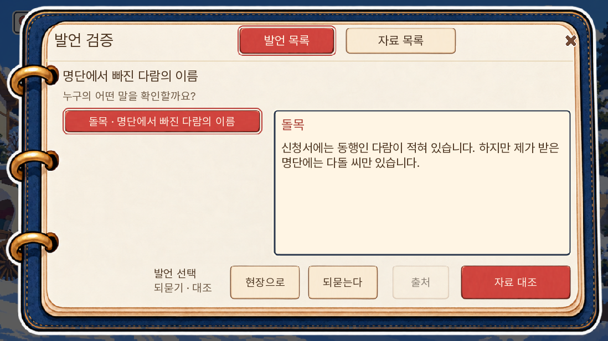
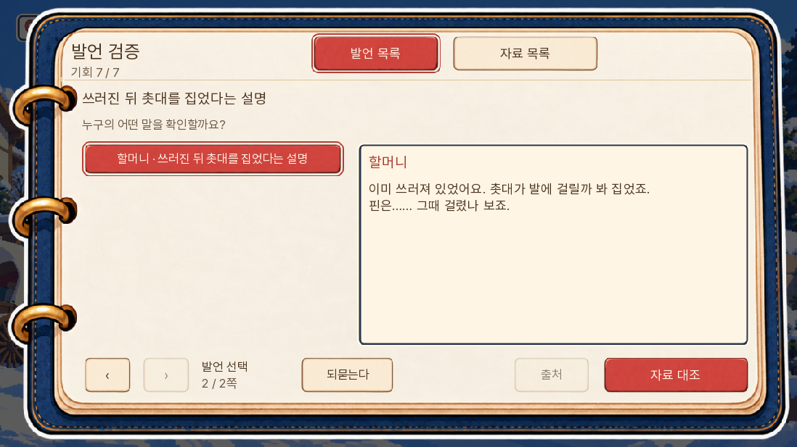
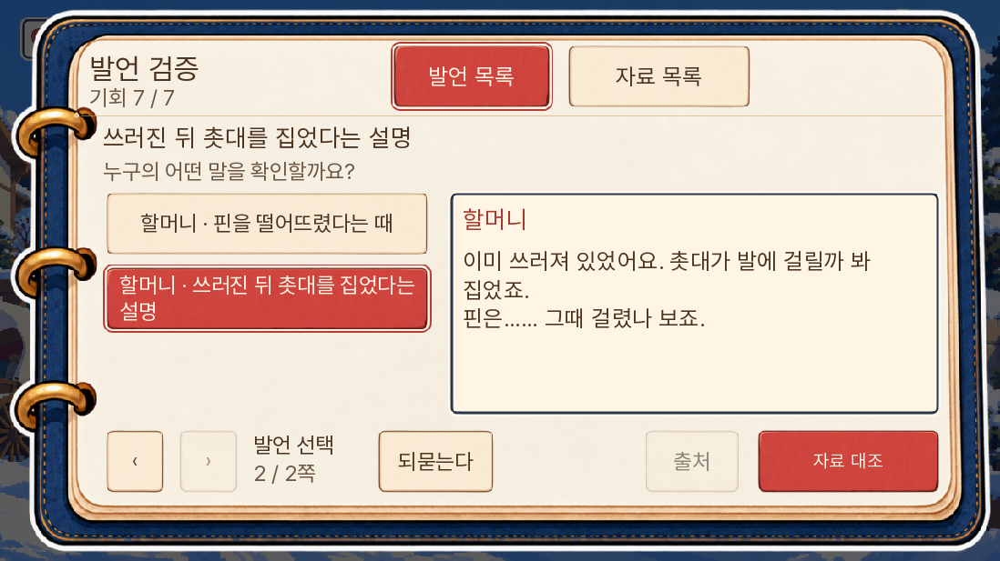
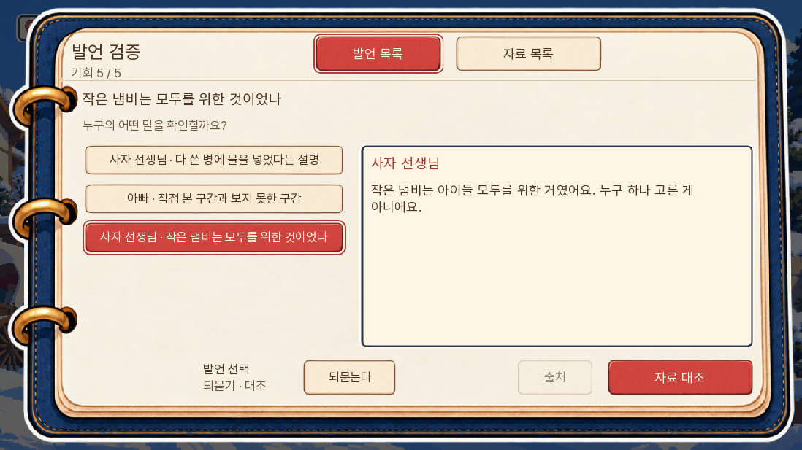
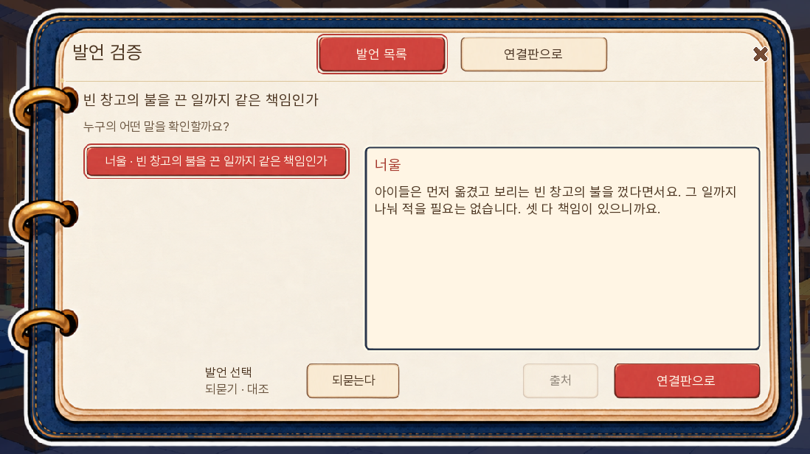
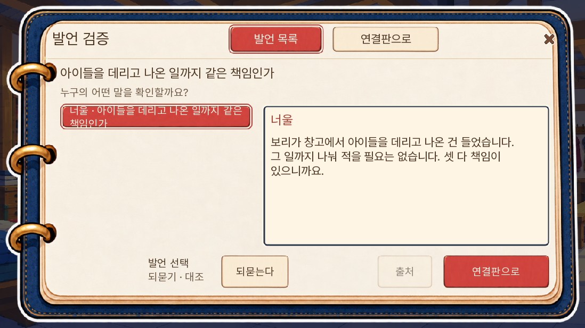
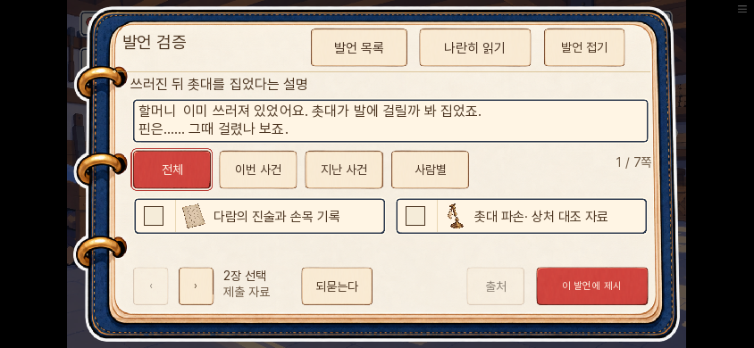
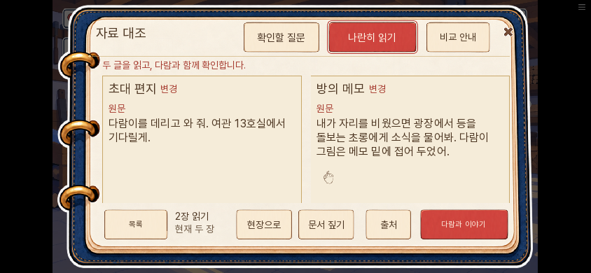

# 0.20.141 — 본편 전체 사건의 발언·질문 검증

3일차 시범을 본편의 증거 제시 지점38개 전체로 확장했다. 메타데이터는 사건·분기17묶음이며, 화재 원인과 피코의 그림에 관한 공통 쟁점이 각 분기에 있어40개 stage다. 새 범죄나 진상을40개 만들었다는 뜻은 아니다.

| 구간 | 고유 논증 수 | 적용 |
|---|---:|---|
| 입구 |1|명단에서 빠진 다람, 신청서 확인 뒤 실제로 바뀐 돌목의 답|
| 첫 방 |1|아빠의 의문과 두 문서의 직접 읽기|
|3일 진료소 |1|돌을 돌려놓았다는 우박의 말|
|3일 등 사건 |6|도난4단계·미수2단계|
|5일 |2|밤이 지목 근거·초대 편지와 경고|
|7일 화재 |3|화재 원인·빈 창고 진압·아이 구조|
|10일 |7|13호실5단계·예방판 기록 전달2단계|
|11일 |5|실제로 주고받는 다섯 가설 질문|
|12일 |3|재사용·봉인·취급 구간·명단|
|13일 |5|담요 시점·촌장 행방·도난/미수 값·피코의 그림|
|14일 |4|제단의 주장과 기존 기록|

## 플레이 흐름

주민의 주장이 있는 곳은 실제 들은 발언을 골라 되묻고, 그 말을 보며 자료를 제시한다. 혼자 기록을 검토하거나 상대 질문에 답하는 곳은 ‘질문 검토’와 ‘질문에 답하기’로 구분한다. 새 선택형 확인 대화32블록을 추가했으며, 자료 이름·정답 조합을 미리 말하지 않는다.

첫 방과5일 편지는 기존 compare 화면의 두 실물 읽기를 먼저 유지한다. 첫 방의 도토리 부재를 위조 확정으로 바꾸거나 새로 필수 정답 찾기를 요구하지 않는다.2일 초롱처럼 proof 호출이 없는 조사는 기존 직접 자료 제시·후속 질문을 유지한다. 조사일마다 가짜 회의를 추가하지 않았다.

화재는 원래 관찰 연결→질문→실제 증언 획득→책임의 세 자리 연결을 사용한다. ‘들은 말 읽기’에서 공통 발언창으로 들어가 되물은 뒤 연결판으로 돌아올 수 있다. 발언창에서 원인·책임 논증을 우회해 정답 처리하지 않는다. 창고에서 구조한 아이들과 보리의 아이 도담을 같은 인물로 단정하지 않는다.

## 분기와 저장

실제 출력이 완료된 RID/source_id만 기존 room13 저장 안에 기록한다. 사건은 현재 proof key로 찾고, 도난/미수·사전 대피/구조의 조건을 함께 확인한다. 다른 사건이나 비활성 분기의 캐시를 목록에 섞지 않는다. 입구는 실제로 신청서 확인 답을 들은 뒤에만 최초 거절 인용이 새 답으로 교체된다.

읽기·되묻기·과거 발언 무료 검토는 현재 논증의 성공·기회·결과를 바꾸지 않는다. 선택한 다른 과거 질문에 자료가 맞더라도 과거 실패를 성공으로 다시 계산하지 않는다. 현재 발언의 실제 제출만 원래 기본 정답·대체 조합·기회·결과를 따른다.

대사를 건너뛰거나 옛 저장에 청취 캐시가 없으면 기존 자료 제시로 계속 진행한다. 저장 복원은 읽던 방식·선택 발언·자료 체크를 보존한다. 쪽 번호 자체는 선택 발언 기준으로 다시 열릴 수 있다.

## 성능·그림·공개 범위

등록된 대사 ID의 불변 인덱스를 시작 때 한 번 만든다. 해당하지 않는 대사는 방 상태 조회·전체 사건 순회·복사 전에 즉시 반환한다. UI 기억도 interaction에서 값이 바뀔 때만 기록한다. 새 그림·음성·매 프레임 검사·전체 미디어 선로딩을 추가하지 않았다.

정답·대체 조합·증거 획득 효과·생사·결말과 공개1부7일 경계는 유지했다.8~14일은 구현·준비 상태 검증의 범위이며, 이번 작업이2부 공개를 뜻하지 않는다.

## 검증

- 전체 단위1,628개 통과. 등록 proof38개와 메타 key 집합 일치, 실제 대상·화자·참조·분기 격리, 미등록 대사의 빠른 반환을 검사했다.
- SDK13개 통과. 신규4묶음에서 준비된30개 stage를 실제 줄 출력→되묻기→기존 기본 자료 제시로 검사했다.3일 도난·미수의 기존 실제 흐름과 화재 양쪽 책임·발언창 왕복을 합쳐 메타40개 stage의 표시·연결을 확인했다.
- 긴10일 회의의 다섯 발언을 PC/큰 글자 터치 배치에서 쪽 넘김하고, 저장 복원 후 이어서 제시했다. 화재 발언창의 저장·복원·연결판 복귀도 확인했다.
- 새 게임 입구부터 원본 직접 제시→바뀐 발언→등록, 첫 방의 읽기→가족 대화, 기존 화재의 잘못된 질문→새 질문→증언 획득,14일 실패 결과를 별도 실제 호출 경로로 확인했다.
- 대사 논리 검사 A/B/C0건. 독립 문안 검토에서 추가된 ‘아이 발’이 아이 위치 인지로 오해될 수 있어 원래 ‘발’로 수정했다. 슬롭 검토는 가이드 없음, 최종 검출0건.

SDK 신규 묶음은 회의 직전·쟁점 직전 상태를 준비한 집중 시험이다. 전체1~14일 또는1부1~7일 연속 자연 플레이를 새로 완주한 결과가 아니다. 웹 빌드·브라우저·공개 상태는 최종 확인 뒤 추가한다.

## 화면

입구에서 신청서를 본 뒤의 실제 답.

10일 다섯 발언의 PC·큰 글자 터치 배치.

수프 사건의 질문·설명 검증.

화재의 사전 대피와 구조 분기.

## 최종 웹 확인

최종 묶음 해시 `e7f1b0906cfb9a0bf6724ac02b0282b8e1d81f7fe9cc8af4bd205d1b88833210`, 버전0.20.141을 로컬 웹에서 확인했다. 준비한10일차의 발언5개를 PC1280×720·휴대폰844×390에서 넘겨 읽고, 실제 체크 버튼으로 자료를 선택했다. 저장 버튼→페이지 새로고침→불러오기 뒤 청취값·자료 묶음이 같았다. 새 화재 임시 값이 없던 모양의 기존 저장에도 기본값 False가 초기화되는 것을 확인했다.

첫 방은 두 원문이 바로 보이는 pair·compare 상태와 question 타입을 함께 확인했다. 최종 빌드에서 다시 캡처했으며 브라우저 pageerror0건이다. 이 웹 검사는 준비 상태의 표시·입력·직렬화 검증이며, 실제 사건 호출과 장면 전환은 SDK 집중 시험으로 구분했다.

최종 초기 다운로드36,755,389바이트, 전판 대비42,554바이트 증가다. 초기 미디어33개·원격 미디어4,848개로 추가 그림·음성은 없다. 프레임 속도나 모든 인물·모든 배경을 새로 측정한 결과는 아니다.

