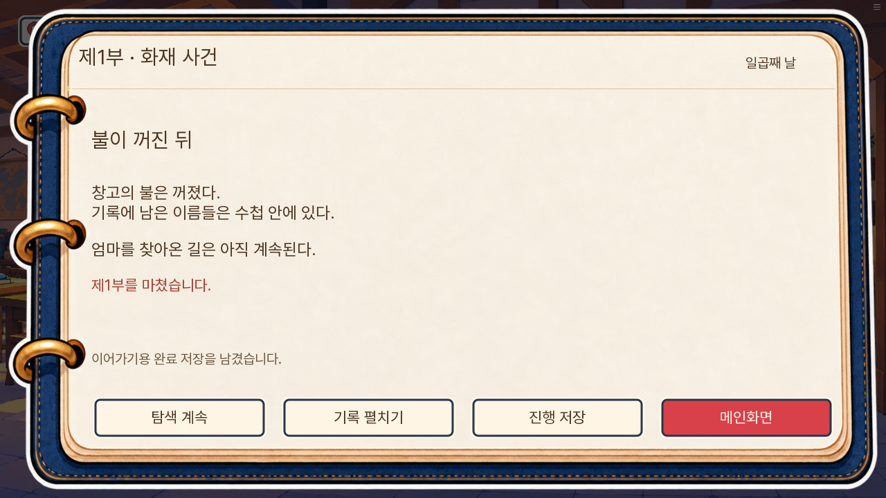
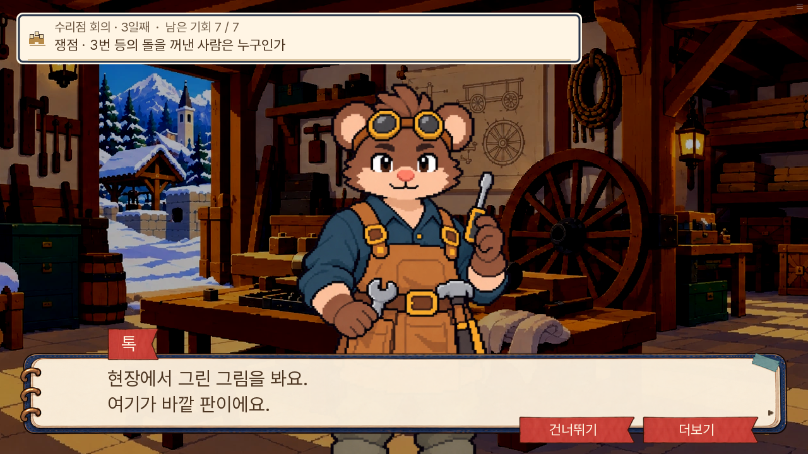
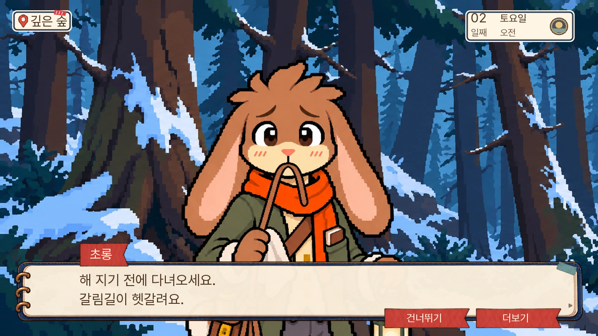

# 0.20.131 · 새 게임부터 제1부 완주 확인

2026-11-08, 실행 원본 커밋 `29ddf8147e89c38f48a30409a73f8c828019fbeb`.

**새 게임 → 7일 화재 사건 → 제1부 종료 → 완료 저장 → 브라우저 새로고침 후 같은 완료 저장 복원까지 통과했다.** 검수한 한 경로에서 게임 예외 화면이나 진행 불능은 없었다. 새 확정 서사 모순은 찾지 못했지만, 추리 설명 그림 부재·인수 확인 대사의 반복·인물 그림 매칭과 선명도 차이는 남아 있다.

## 실제 확인 방식과 한계

- 공개본과 동일한 0.20.131 웹 묶음을 로컬 Chromium의 새 프로필로 실행했다. `archive_sha256=168382d7fee3ea89bfb83506a931ffa0119842aeff1d0598c5de8250c990ac71`.
- 마차 대사부터 한 화면씩 넘기며 **대사 화면 1,924개**와 조작/검수 기록 284건을 남겼다. [실제 읽은 대사](읽은대사.txt) · [대사 상태/원본 로그 행 번호](읽은대사.json) · [조작 기록](실제조작.json).
- 이동·현장 물건·인물·질문·자료 선택·문서 관찰·화재 연결은 실제 마우스 입력으로 진행했다. 날짜·소지 자료·기회·관계 값을 직접 쓰거나 장면을 점프하지 않았다. 표시 글자 속도만 0으로 조정했다.
- **기존 정답 코드와 현장 바인딩을 참고한 자동화 한 경로**다. 처음 보는 사람이 도움 없이 정답을 찾는 난이도 검증으로 세지 않는다. 서로 다른 날짜의 준비 상태를 이어 붙인 완주도 아니다.
- 처음 시도는 실행 도구의 부모 프로세스 종료에 따라 브라우저도 종료되어 제외했다. 실행 수명 관리를 고친 뒤 새 프로필에서 처음부터 다시 시작한 최종 경로만 집계했다. 이후 자동화의 문구/화면 준비 대기/화면 밖 인물 찾기를 보완하며 같은 게임 페이지에 재연결했다. 이 중단을 게임 진행 불능으로 세지 않았고, 무중단 실행이라고도 표현하지 않는다.
- PC 1280×720으로 1~7일을 진행했다. 종료 화면만 모바일 크기 844×390으로 추가 확인했다. 실제 휴대폰 연속 완주·저사양 성능 계측·실기기 오디오 청음은 수행하지 않았다.
- 패배·부분 성공·피코 생존·창고에서 아이들을 구조하는 다른 분기 및 8~14일은 이번 완주 범위가 아니다. 직전 단위/SDK 검사를 이번에 다시 실행한 것처럼 합산하지 않았다.
- 게임 구현과 공개 묶음은 바꾸지 않았다. 이번 변경은 검수 문서와 실제 화면 기록이다.

## 날짜별 확인

| 날짜 | 실제 진행 | 확인 결과 | 대사 화면 |
|---|---|---|---:|
| 1일 | 마차 → 장부·신청 원본·규칙 → 입구 논증 → 여관 → 엄마 메모·가족 그림 → 문서 끝부분 관찰 → 취침 | 다람 등록, 첫 방 비교 완료, 2일 진입 | 229 |
| 2일 | 초롱 작업 → 교환함 → 우체국 봉투 제시 → 피코 초상 → 등 조사 → 네로 돕기 → 취침 | 침구 예약, 피코 잠자리 미확보, 3일 진입 | 314 |
| 3일 | 피코 발견·현장 세 질문 → 등·점검·집게·측정·운반·매입 조사 → 회의 → 등 복구·침구 수령 | 톡 혐의 해소·실룩 다음날 출석 의무, 회의 성공, 4일 진입 | 416 |
| 4일 | 솜이네 초상 제시 → 돌목 부상 → 흔적 조사 → 밤이·콩이·바둑이 진술 → 저녁 | 소문과 직접 목격을 구분하며 5일 진입 | 226 |
| 5일 | 옷·목격·알리바이 조사 → 직접 증인과 회의 → 무쇠 돌봄 → 엄마 답장 | 밤이 혐의 해소, 경고를 받은 뒤 여관에서 정보 숨김, 6일 진입 | 302 |
| 6일 | 학교 자리 → 창고 아이들 → 깡통 살피기·회수 → 실제 네 아이 이동 → 인수·물·담요 → 밤 화재 흔적 | 꼬미 생존·사전 대피, 7일 진입 | 256 |
| 7일 | 누비·보리 진술 → 누비 아이 셋 학교 확인 → 화재 관찰/질문 → 되묻기 → 원인/진압 책임 구분 → 밤 돌봄 명단·쪽지 → 마지막 가족 대화 | 일반 화재 승리, 인수·전언 완료, 제1부 종료 | 181 |

이번 분기 결과는 **피코 사망 / 톡 혐의 해소 / 실룩 출석 의무 / 돌 원위치 / 밤이 혐의 해소 / 창고 아이들 사전 대피 / 화재 일반 승리**다. 모든 분기를 성공시켰다는 뜻은 아니다.

## 완료 저장도 실제로 복원했다

완료 당시 `day=7`, `part1_completed=true`, `D07_S02_handover_completed=true`, `D07_S02_message_completed=true`다. 입구·등·초소·화재의 네 회의 결과는 모두 `win`이었다.

자동 완료 저장 `part1-clear`의 버전·7일·1부 완료 메타데이터와 저장 실패 없음, 불러오기 가능 여부를 확인했다. 메인화면으로 나가 브라우저를 새로고침한 뒤 **불러오기 → 1부 완료**를 실제로 눌렀다. 종료 화면과 동일 `run_token`이 복원됐다.

[완주·저장 검증 수치](완주확인.json) · [불러오기 화면](102-새로고침후-불러오기.png) · [복원된 종료 화면](103-새로고침후-완료저장복원.png) · [완주 기록 펼침](104-완주결과-기록.png) · [모바일 크기 종료 화면](101-완료화면-모바일.png).

## 남은 문제

### P1 · 3일차: 설명에서 가리키는 걸쇠 구조 그림이 없다

`MS14_D03_S05_L0021`에서 톡은 “현장에서 그린 그림을 봐요. 여기가 바깥 판이에요”라고 말하고, 뒤이어 “그 뒤의 안쪽 받침”을 설명한다. 이번 연속 경로에서도 실제 화면에는 톡과 수리점만 나왔다. 앞선 준비 장면 검수와 같은 문제다.

실무 의견으로는 가장 먼저 고칠 부분이다. 바깥 판·안쪽 받침·칼끝 위치를 같은 구조 그림으로 보여 주어 사용자가 직접 근거를 확인할 수 있어야 한다. 정답 제출이 가능한 것과 추리 설명이 충분한 것은 구분한다.

### P2 · 7일차: 학교 인수와 밤 돌봄 확인이 같은 말로 반복된다

실제 로그 2046~2050행에서는 누비의 아이 셋이 이름을 불리고 교실에 들어간다. 회의 후 `MS14_D07_S02_L0010`(로그 2123행)에서 아빠는 다시 “선생님과 나비 씨에게 맡기는 것까지 보고 오겠습니다”라고 한다.

상태 오류는 아니다. 앞은 학교 임시 대기, 뒤는 **낮=선생님 / 밤=나비와 잠자리**까지 확인하는 단계다. 다만 앞에서도 “넘겨받는 것까지 보고 오겠다”고 했기 때문에 플레이어에게 같은 일을 다시 하는 말로 들린다.

실무 의견으로는 후반을 “아이들은 학교에 가 있습니다. 오늘 밤 누가 곁에 있을지와 잠자리도 확인하고 오겠습니다”처럼 밤 돌봄 확인임을 명시하면 된다. 정답·생사·인수 상태를 바꿀 필요는 없다. [독립 논리 검수 근거](독립논리검수.json).

### P2 · 초롱: 광장 작업 자세가 숲 안내에도 나온다

`MS14_D02_S01_L0041`의 초롱은 숲에서 “해 지기 전에 다녀오세요. 갈림길이 헷갈려요”라고 말하면서도 끈을 입에 물고 천·등을 든 작업 자세다.

활성 일반 `neutral/anxious` 원화 자체가 작업 소품을 포함한다. 이벤트 자세가 정리되지 않은 것과는 다르다. 실무 의견으로는 평상시 대화용 표정과 광장 작업 컷을 구분하는 교정이 필요하다.

### P2 · 일부 조연: 도트 밀도·확대 품질이 다르다

[백 부인](03-3-store_visit-백부인.png)은 확대 윤곽이 흐리고, [진료 담당자](05-5-travel-진료담당자.png)는 큰 블록으로 뭉친다. [누비의 큰아이](07-7-school_names7-누비의큰아이.png)는 같은 날 다람·도담보다 선과 명암이 매끈하다. 활성 대화 화면에서 확인한 차이다.

실무 의견으로는 최근 교정한 주연만으로 전체 인물 작화 통일이 끝났다고 판단할 수 없다. 일반 대화용 원화의 픽셀 밀도와 표시 배율을 함께 맞춰야 한다. [독립 화면 검수](독립화면검수.json).

## 정상으로 확인한 핵심

- 마차 대화는 과자→엄마 몫→편지/잠자리→도착으로 이어졌다. 이전의 동문서답 대화는 이번 경로에서 나오지 않았다.
- 입구 장부 직접 클릭으로 명단을 받았다. 첫 방은 실제 끝부분을 누른 후 차이를 말하고 비교를 완료했다.
- [피코 현장 그림과 세 질문](피코현장-0.png)이 실제로 열렸다. 아빠가 발견 때의 자세를 묻고, [미완성 초상](확대-03-travel.png)을 다시 보고, 다람과 죽음·오늘 밤 잠자리에 관해 대화했다. 피코 사망 장면에서 평온하게 조사만 하는 흐름으로 재현되지 않았다.
- 피코 현장 CG의 작은 초상이 코까지 그려진 것처럼 보인 의심은 원본·E09 확대를 대조한 뒤 제외했다. 실제 코 자리는 비어 있다.
- 4일 소문/목격, 5일 옷의 주인/착용자·직접 증인, 6일 자리 허가/실제 이동/인수를 구분했다. 새 확정 지식·생사·위치 모순은 이번 경로에서 찾지 못했다.
- [6일 네 아이 인수](06-6-handoff6-사자선생님.png), [화재의 두 관찰 그림](확대-06-fire_evidence6.png), [관찰과 첫 질문 연결](화재-연결완성-첫질문.png), [방화/진압 책임 구분](화재-연결완성-책임구분.png)이 실제로 작동했다.
- 일반 승리에서도 너울의 약속을 회의 기록에 옮기는 대사가 실제 출력되므로 마지막 대화의 회수와 맞는다. 배급표까지 증명하는 다른 승리 경로와 섞어 오류로 세지 않았다.
- 캡처한 핵심 PC 조사·자료·화재·종료 화면에서 버튼/글자의 지속적인 잘림은 확인하지 못했다. 자료 획득 토스트의 순간 겹침은 빠른 자동 입력의 일시 장면으로 분리했다.

실무 의견으로는 **완주 가능한 1부이며 가족과 사건을 잇는 흐름은 읽힌다.** 다음 개선은 사건 추가보다 걸쇠 구조를 실제로 보여 주는 일, 학교 인수 문구의 구분, 남은 조연 원화의 통일이 먼저다. 이 한 경로의 통과를 전체 분기·모든 기기의 완성으로 확대하지 않는다.
