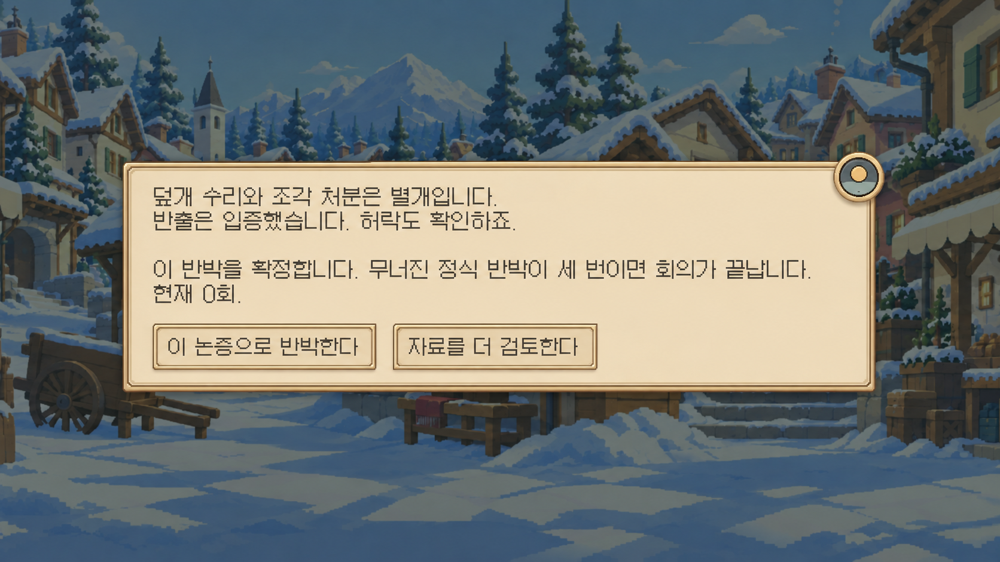
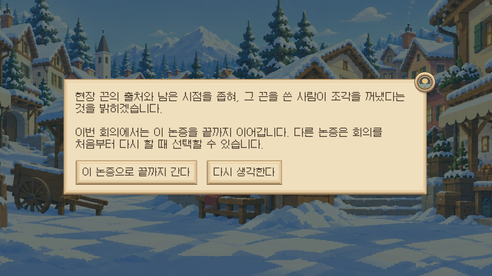
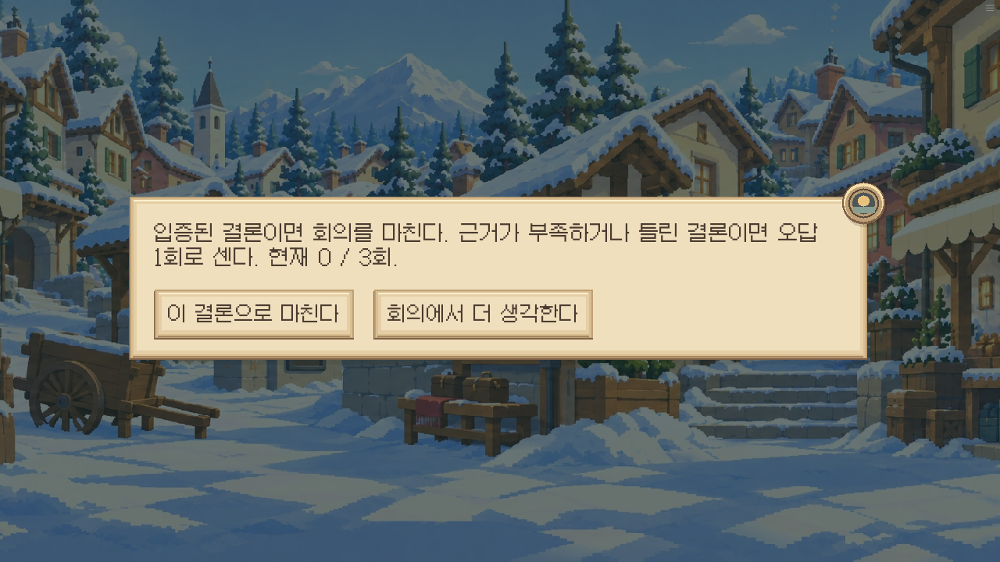
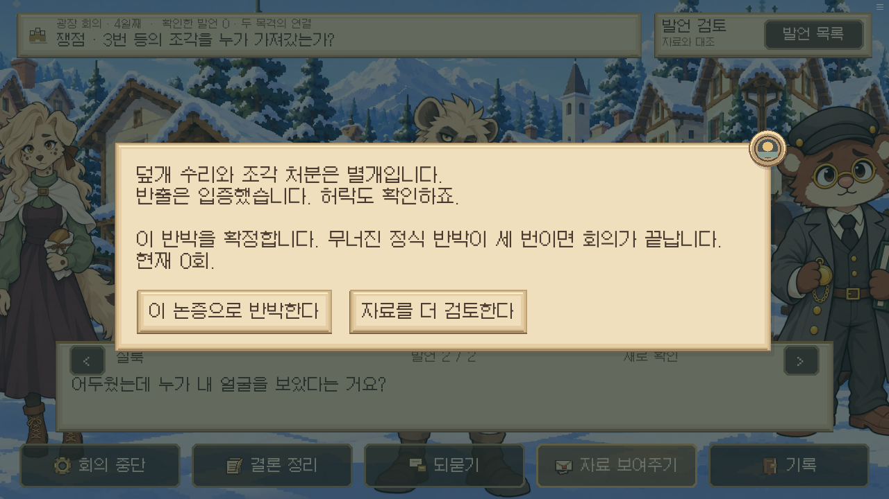
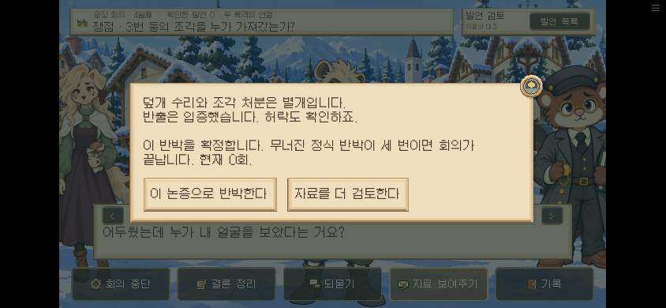
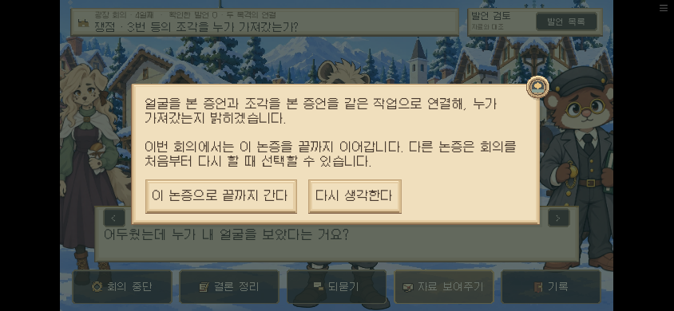
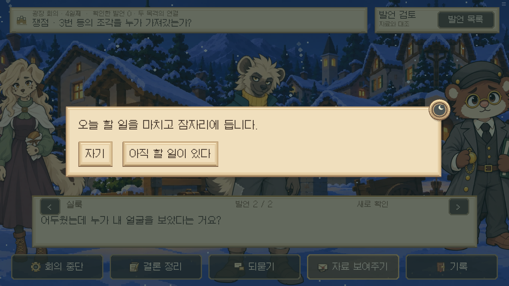

# 승인된 공통 확인창 — 구현·검수 기록

2026-10-18 · 0.19.61. 사용자가 이전 시안의 이중 테두리·모서리 돌출 장식·얕은 그림자를 승인했다.

날짜창의 R13PaperFrame과 R13TimeDial을 재사용해 공통 r13_confirm에 적용했다. 장식은 낮에는 해, 밤에는 달이며 본문 밖에 배치한다. 패널은 내용 높이에 맞춰 중앙 정렬한다. 기존 입력 지연·Enter/돌아가기·Return 결과는 유지한다. 큰 글씨와 작은 화면에서는 공통 높이 규칙을 적용한다.

회의의 실제 논증 확정창에서 취소 후 재선택·확정을 수행했고, 결론 확정창에서 취소하면 오답·결과가 생기지 않는 것을 확인했다. 아래 반박 장문·모바일·잠자기 문구는 공통 화면을 직접 띄운 렌더 검수다. 밤 잠자기 캡처의 뒤쪽 회의 장면은 이 검수용 상태이며, 실제 수면 장면의 스토리 검수가 아니다.

단위 검사·lint 통과. 브라우저에서 버튼의 화면 이탈과 상호 겹침이 없음을 검사하고 캡처를 육안 확인했다. 이번 변경은 Q1의 증거·정답·오답 규칙을 바꾸지 않는다. 기존 전체 논증 검수는 [Q1 전체 기록](../q1-hard-arguments-20261018/README.md)에 있다.

## 승인된 생성형 시안

## 실제 웹 캡처 전체

### 01-thesis-confirm

[화면 상태](01-thesis-confirm.json)

### 02-conclusion-confirm

[화면 상태](02-conclusion-confirm.json)

### 03-rebuttal-desktop

[화면 상태](03-rebuttal-desktop.json)

### 04-rebuttal-mobile-large

[화면 상태](04-rebuttal-mobile-large.json)

### 05-thesis-mobile-large

[화면 상태](05-thesis-mobile-large.json)

### 06-sleep-night

[화면 상태](06-sleep-night.json)

[브라우저 결과](result.json) · [검사 로그](checks.log)

최종 검수 아카이브 SHA256: `c851a030f1fd04e980bc5553013e2364eef704243dd4868d0996ecb36f0507c6`. [빌드 로그](build.log). 공개와 동일한 8MiB 분할 파일을 로컬 HTTP로 실행했다. 공개 호스트 직접 접속은 실행 환경 네트워크 정책으로 제한되어, 게시 상태는 GitHub Pages 배포 결과로 확인한다.
