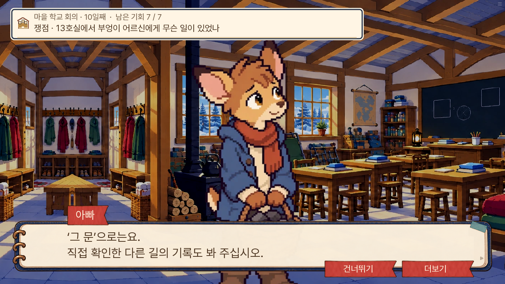

# 본편 10~12일차 논리 검수 · 0.20.93

소유자의 ‘그다음 3일’ 요청으로 기존 본편 10~12일차를 검수했다. 실제 0.20.92의 9일차 저장에서 이어 대사·자료·판정·인물 위치를 대조했다. 새 판 v2와 13~14일 전체 진행은 이번 작업 대상이 아니다.

| 장면 | 문제 | 수정 |
|---|---|---|
| 10일 통로 반박 | 전날 직접 왕복·실측한 길을 ‘아직 아무도 안 봤다’고 말함 | 실제로 확인한 다른 길의 기록도 보자는 말로 변경 |
| 10일 손 인계와 패배 요약 | 문을 열 때까지 손을 잡았다고 하여 7~8일 인계 시점과 어긋남 | 아빠가 손을 잡아 넘겨받은 시점으로 통일 |
| 10일 학교의 비공개 확인 | 우체국 이동 없이 우체국 앞 벤치라고 함 | 남들 눈이 닿지 않는 자리로 표현 |
| 10일 병 전달 관찰 | 살인 경로에서는 첫 관찰인데 ‘오늘도’라고 함 | 반복을 뜻하는 말 제거. 예방 9일·살인 10일 모두 실제 관찰이 있어 12일 회상은 유지 |
| 10일 비공개 편지 제출 | 선택한 초대장 부인 외에 사적 경고까지 상대가 읽음 | 부인 한 줄만 읽고 편지를 접음. 제출 허용·판정은 유지 |
| 11일 재회하러 가는 길 | 아직 만나지 못한 엄마가 출발 동행자에 들어감 | 다람과 이동하고 도착 뒤 엄마 합류 |
| 11일 가족의 학교 자리 확인 | 대사에서는 엄마와 다람이 기다린다는데 실제로는 같이 이동 | 함께 학교에 간다는 대사로 일치 |
| 11일 단추 수선 | 단추가 떨어지는 계기가 비표시 행동에만 있음 | 이미 원본에 있는 계기를 첫 수선 대사 앞에 표시 |
| 11일 회의 뒤 생각 | 끝난 회의를 앞으로 해야 한다고 함 | 회의에서 한 말을 되짚는 생각으로 변경 |
| 11일 밤의 장갑 | 다른 구조 분기에서만 말린 장갑을 다시 낀다고 회상 | 장갑을 단단히 끼는 현재 행동만 서술 |
| 11일 돌의 위험성 | 기록에 없는 강도·진행 속도를 단정 | 불을 켜지 않았다고 안전하다고 할 수 없다는 관찰 범위로 제한 |
| 11일 구조 인계 | 나비가 수신자일 수 있는데 선생님으로 고정 | 학교에서 아이들을 맡은 어른이 확인하는 공통 서술 |
| 11일 장작 인수 자료 | 모든 경로에 보장되지 않는 까로 동반·선생님 인수를 고정 | 실제 학교 운반·인계 사실을 본문과 요약에 공통으로 기록 |
| 12일 봉인 논리 | 봉인만으로 병의 최초 개봉 여부까지 단정 | 관찰 후 언제 비우고 물을 담았는지 물은 뒤 목격 증언과 대조 |
| 12일 의료진 도착 | 서리가 먼저 말하고 나서야 실제 인물 배치에 합류 | 보리와 함께 도착한 뒤 첫 발화 |

반박할 상대의 거짓 주장과 서술·주인공 지식의 모순은 구분했다. 정답 자료 조합과 생사·진상·결말은 바꾸지 않았다. 병 전달 관찰은 예방 9일과 살인 10일에 각각 있으므로, 12일 회상을 한쪽에서 숨기는 조건은 추가하지 않았다.

## 검증 방법

브라우저 주행은 실제 저장을 불러와 현장·지도·대화·자료 버튼을 누르는 자동화다. 각 대사 쪽을 넘기며 기록하고 기존 실행 코드의 정답 목록을 참고한다. 처음 보는 사람의 눈가림 시험과 구별한다. 글자 속도·조회·검사 저장 외에 줄거리 값이나 자료를 주입하지 않는다.

네이티브 화면 시험은 장면 직전 상태를 기존 설정 함수로 준비하고 실제 이야기 라벨·지도·대사를 진행한다. 모든 선택 순열과 13~14일 전체 진행은 미실행 범위다. 공개 도메인은 환경 네트워크 정책으로 직접 접속하지 못하므로 로컬 공개 묶음에서 검증하고 원격 파일 해시와 Pages 작업으로 배포를 확인한다.

## 검사 결과

- 단위 1,169개·Ren’Py lint 통과. 대사 자동 검사 A 소개 전 이름, B 사망 가능 화자의 무조건 대사, C 결과 지문 중복 모두 0건.
- 관련 네이티브 화면 시험 5개 통과: 재회 전 동행과 도착 후 엄마 합류, 가족의 실제 학교 이동과 장작 자료의 두 상태, 늦은 발견·배식 전 발견 각각의 의료진 도착, 돌 자료의 기존 가설 판정.
- 장작 자료는 본문·요약뿐 아니라 ‘원문 펼치기’에 쓰는 런타임 설명도 확인했다. 운반자·인수자를 고정하는 예전 설명이 다시 덮어쓰이지 않고, 난방 연결 후 실제 사용·잔량 확인 사실은 유지한다.
- 초기 의료진 화면 시험은 장면 준비에 필요한 파편 관찰 값을 누락해 중단됐다. 검사 도우미의 준비 값을 보완해 재실행했으며, 이를 게임 오류로 세지 않았다.
- 최종 공개 묶음의 수정 원본·생성 자료 8개가 원본과 바이트 단위로 일치한다. QA 파일은 공개 묶음에서 제외됐다.

수정 전 0.20.92와 수정 후 0.20.93 모두 실제 9일차 저장에서 이어 진행했다. 수정 후 두 주행은 12일차 취침 전까지 연속 진행했으며 브라우저 페이지 오류는 0건이다.

| 실제 주행 | 확인한 결과 |
|---|---|
| 살인 사건 경로 → 가족 자리 확인 → 배식 전 발견 | 10일 회의 뒤 다람의 구금이 해제되고 엄마와 재회한다. 12일 작은 냄비 배식 전에 멈추며 꼬미·도담 생존과 기존 감독 결과를 유지한다. |
| 도토 다짐 예방 경로 → 비공개 편지 대체 제출 → 약장 확인 → 뒤늦은 발견 | E01·E27·E09_MAIL을 실제 자료 UI로 제출해 기존 허용 조합이 통과했다. 12일에는 다람을 나비 곁에 두고 다녀온다. 기존대로 도담·꼬미 사망, 새미 생존으로 이어지고 나비의 보호 상태는 귀환 뒤 해제된다. |

최종 12일차 저장은 PC·휴대폰에서 실제 메뉴로 저장한 뒤 새로고침·불러오기를 했다. 날짜·장소·관문·자료·진행 값이 일치했고 페이지 오류는 0건이다. 실제 소지 장작 자료의 런타임 원문 설명도 최종 웹에서 확인했다. 경로·상태·묶음 해시는 [검증 결과](검증결과.json)에 기록한다.

## 실제 수정 화면

10일: 전날 확인한 통로를 다시 ‘아무도 보지 않았다’고 하지 않는다.

비공개 편지를 직접 제출한 경우에는 초대장을 쓰지 않았다는 한 줄만 읽고 접는다.

11일: 엄마와 다람이 함께 학교로 가는 실제 행동에 대사를 맞췄다.

돌의 강도나 진행 속도를 새로 단정하지 않고 실제 관찰로 말한다.

12일: 봉인만으로 최초 개봉 여부를 단정하지 않는다. 관찰 뒤의 재사용 시점을 질문하고, 이후 나비의 증언과 대조한다.

서리가 말하기 전에 도착 지문과 실제 인물 위치를 반영한다.

[휴대폰 저장 복원 화면](mobile-restored.png).
