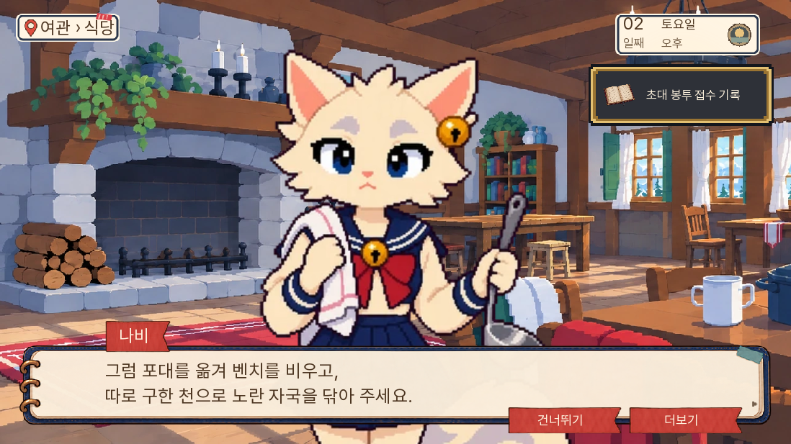
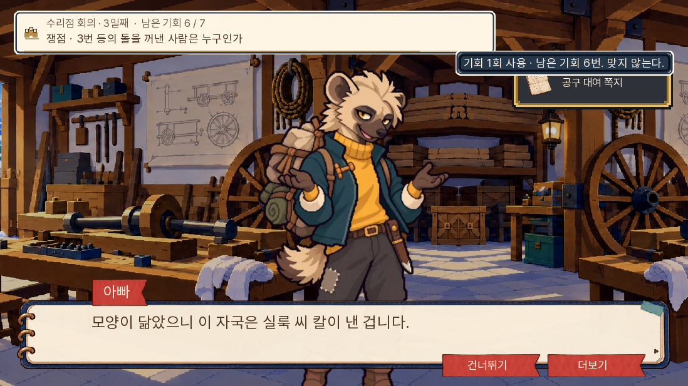
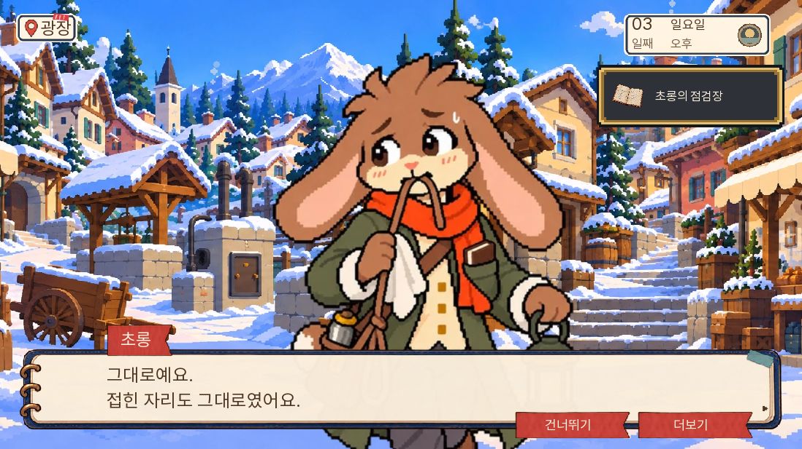

# 본편 1~3일차 논리 검수 · 0.20.90

소유자 지정 범위는 기존 본편의 1~3일차다. 새 판 v2를 늘리지 않았다. 초소 문제는 최종 결정인 ‘다람 이름 누락’으로 통일한다.

| 장면 | 확인한 문제 | 반영 |
|---|---|---|
| 1일 초소 | 신청 인원, 일꾼 등록, 아동 모집 제외가 한 거절에 섞임 | 원본에는 다람 이름이 있고 처리 명단에는 없는 누락 한 문제 |
| 1일 자료 제시 | 선택 자료 본문과 별도 요약·돌목 인용문에 옛 설정이 남음 | 본문·요약·인용문·반응·후속 질문까지 함께 수정 |
| 1일 오답 | E02·E03으로 풀 수 있는데 선택 자료 E04를 안 읽었다고 탐색 부족 안내 | 필수 원본 미확인과 조합 실수를 구별 |
| 1일 문서 비교 | 도토리 습관을 알기 전에 그 습관으로 추론함. 문서에 없는 날짜를 관찰함 | 다람이 비교 전에 습관을 말함. 실제 머리글·본문을 관찰 |
| 2일 식당 | 천을 깔아야 한다고 했는데 실제 행동은 빌린 천으로 물감 닦기 | 약속한 조건을 실제 행동과 일치시킴 |
| 2일 교환함·초상 | 진행 처리는 됐지만 빈 칸 관찰·수령 약속이 표시되지 않음 | 실제 표시되는 줄의 앞뒤에 연결 |
| 2일 선물·시간 | 수리 품삯과 아이 답례를 혼동함. 네로 만남과 출발 시각이 흐림 | 별도 답례로 표현. 해 지기 전 출발·등 점화 때 만남을 구별 |
| 3일 첫 공방 쟁점 | 우박의 직접 개봉 진술과 전후 시간 자료가 있는데 대여 쪽지가 없으면 실패 | E11+E13 허용. 기존 세 장도 허용 |
| 3일 매입·마지막 돌 | 운송 자료를 더 내면 실패. 앞서 입증한 매입을 다시 안 내면 실패 | E14 보강 허용. 마지막에는 E11+E15로 동일성 연결 가능 |
| 3일 칼 | 유사성 ‘관찰’을 고르면 단정한 것으로 벌점 | 메뉴와 실제 발언 모두 성급한 단정임을 명시 |
| 3일 장부·톡·엄마 | 보관 중인 장부를 가져온 지문, 단독 혐의 해소를 절대 무혐의처럼 표현, 접힌 쪽지로 엄마 미방문을 단정 | 수첩에 적은 내역, 단독 개봉 혐의 해소, 답 없음으로 각각 범위를 제한 |

우박이 등을 열고 돌을 꺼냈다가 넣었다는 것은 진료소에서 듣는 직접 진술이다. E13 문서 자체는 측정 번호와 시각 기록이며, 개봉 장면의 기록으로 바꾸지 않았다. 마지막 돌 쟁점은 앞선 매입 쟁점을 통과한 뒤에만 도달한다. 판매 사실은 이미 인정된 상태여서, 다시 장부를 내지 않았다는 이유로 같은 사실을 모르는 것으로 처리하지 않는다. 새벽 점검이나 창고 돌의 식별을 빠뜨린 제출까지 받지는 않는다.

결말·생사·회의 기회·돌 반환·실룩 인계의 선택 결과는 유지했다. 구세이브의 이름 미기재 분기도 유지했다. 구현 담당과 별도 검수 담당을 나누었고, 독립 검수에서 추가로 발견한 칼의 실제 발언 불일치도 반영했다.

## 검사 방법

브라우저 진행은 현장·지도·질문·자료 버튼을 누르는 자동화다. 각 대사 쪽을 넘기며 기록했다. 자료 선택에는 실행 라벨의 정답 목록과 기존 경로 도우미를 사용하므로, 처음 보는 사람의 눈가림 사용자 시험으로 보지 않는다. 글자 속도 변경·상태 조회·검사 체크포인트 저장 외에 줄거리 플래그나 보유 자료를 주입하지 않았다. 별도 네이티브 화면 시험은 각 분기 시작 상태를 준비하는 검사이며 자연 주행과 구별한다.

수정 전 0.20.89는 실제 1일차부터 3일차 취침 전까지 진행했다. 오래된 자동화의 요일 선택·새 자료 대조 화면·자료함 탭 이름을 현재 UI에 맞추느라 검사 저장에서 재개한 구간이 있다. 이것을 게임 진행 불가로 집계하지 않았다. 수정본에서는 새 게임과 실제 기존 저장에서 시작한 경로를 따로 검사한다.

- 전체 단위 검사 1,163개 통과, Ren’Py lint 통과.
- 대사 자동 검사 A 소개 전 이름, B 사망 가능 화자 무조건 대사, C 결과 지문 중복 모두 0건.
- 분기 화면 시험 6개 통과: 식당 준비, 일부 준비 후 네로 이동, 3일 회의 패배·부분 성공·승리, 칼 오답 재시도.
- 마지막 문서 명칭 수정 뒤 화면 시험 1개와 관련 검사 46개 통과. 큰 글자·휴대폰 배치에서도 문서 종류를 구별할 수 있다.
- 회귀 검사에서 충분한 대체 조합, 관련 추가 자료, 빠진 핵심 자료의 거부, 예방판으로의 잘못된 대체 확장 방지, E04 없는 오답 안내를 확인했다.

브라우저 최종 결과와 공개 묶음 해시는 `검증결과.json`에 기록한다.

## 확인 범위의 한계

4~14일 전체 자연 플레이, 1~3일의 모든 조작 순열, 등 예방판 전체 자연 주행은 이번 검수에 포함하지 않는다. 자연 주행 후 문서 명칭 세 곳만 추가로 통일하고 관련 검사 46개를 다시 통과했다. 최종 명칭은 별도 화면 시험과 공개 묶음의 소스로 대조했다. 다시 빌드한 컴파일 산출물의 바이트 차이는 별도로 구별했다. 공개 사이트 도메인은 현재 환경의 네트워크 정책으로 직접 접속하지 못하므로, 실제 브라우저 검사는 로컬 웹 빌드에서 하고 공개 여부는 Pages 작업 결과와 원격 파일 해시로 확인한다.

## 화면

- [초소: 일꾼 설정 없는 주장과 오답 제출](초소_재시도.png)
- [식당 준비 뒤 분기](식당_준비.png)

- [수정본 새 게임의 3일차 도착](본편_3일차_도착.png)
- [휴대폰 저장 복원](휴대폰_저장복원.png)

- [최종 문서 명칭·큰 글자 배치](문서명칭_큰글자.png)

## 소유자 요청: 수정 대사 화면 보고

2026-11-04 추가 요청에 따라, 진행 완료 화면과 별개로 수정 대사가 보이는 캡처를 추가했다. 아래 세 화면은 0.20.90의 기존 대사를 장면별 QA 상태에서 재현한 것이다. 자료 획득 알림 등 준비 상태가 함께 보일 수 있으며, 별도의 자연 주행 결과는 앞선 검증 결과와 구별한다. 게임 코드는 추가로 변경하지 않았다.

- 식당 조건: 기존의 ‘천을 깐다’는 요구를 없애고 실제 행동인 ‘포대를 옮겨 벤치를 비우고, 따로 구한 천으로 물감을 닦기’로 맞췄다.

- 칼 오답: ‘자국에 견준다’는 관찰을 고르고 벌점을 받던 불일치를 고쳤다. 선택지는 ‘자국이 닮았으니 실룩의 칼이라고 단정한다’, 실제 발언은 ‘모양이 닮았으니 이 자국은 실룩 씨 칼이 낸 겁니다’다. 깨진 칼끝을 안쪽 조각에 맞대는 선택과 구별된다.

- 엄마의 방문: 접힌 쪽지가 그대로라는 관찰만으로 ‘엄마가 함에 안 들렀다’고 결론 내리지 않는다. 초롱은 접힌 상태가 그대로였다는 관찰만 말하고, 아빠도 아직 답이 없다고만 정리한다.

