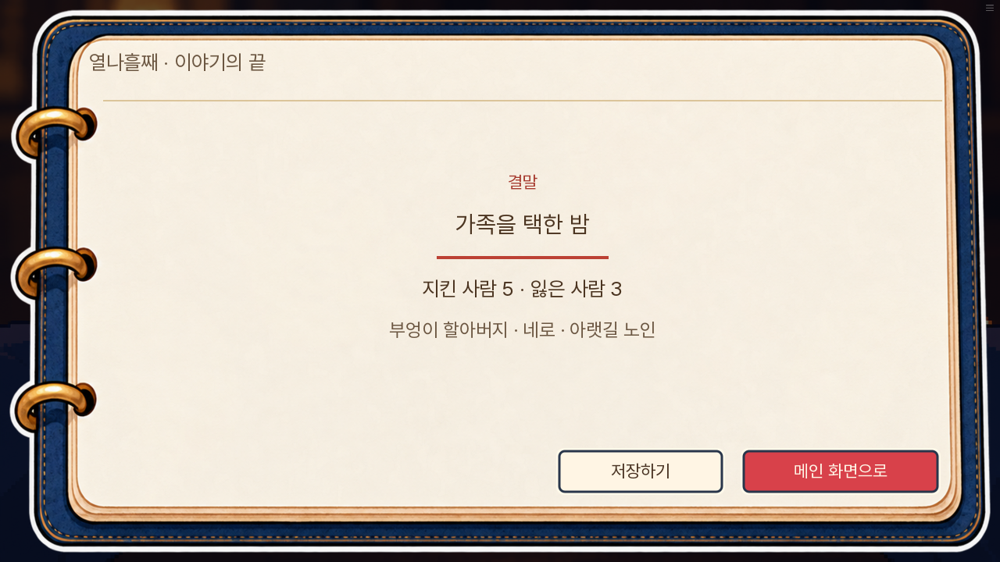
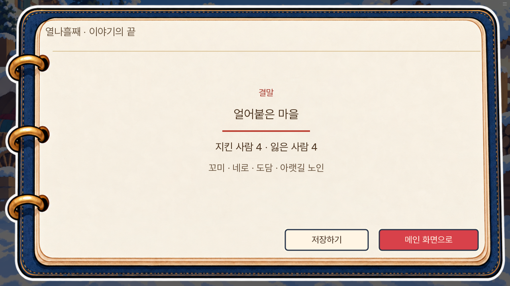
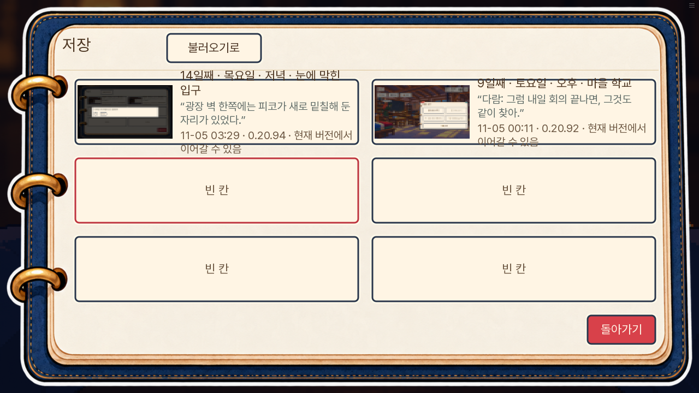
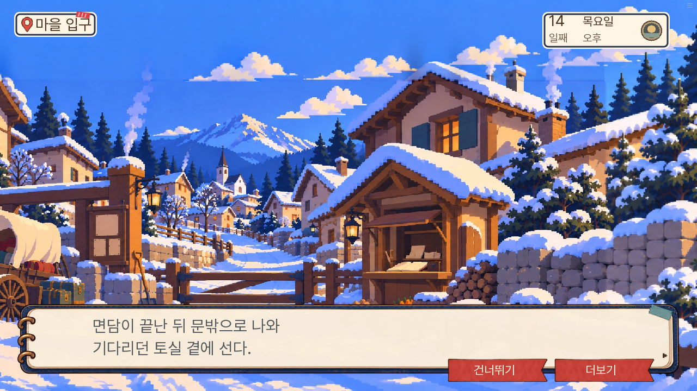
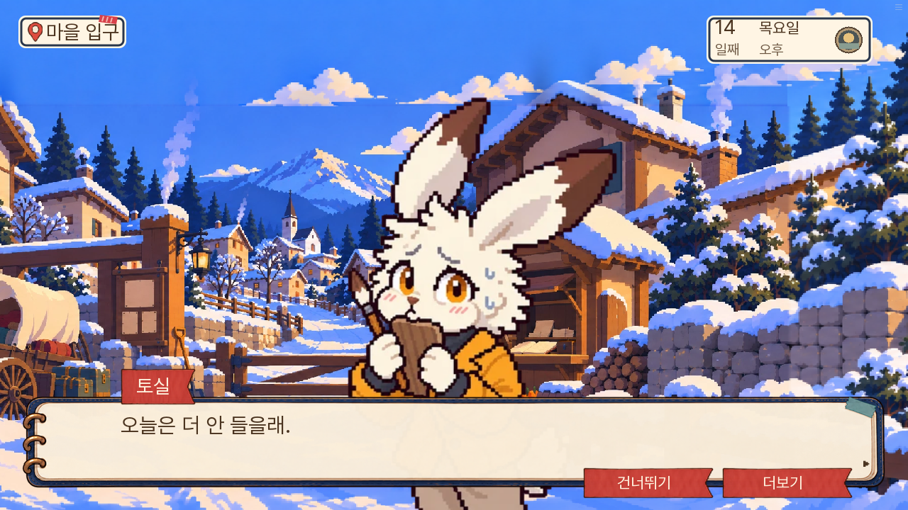
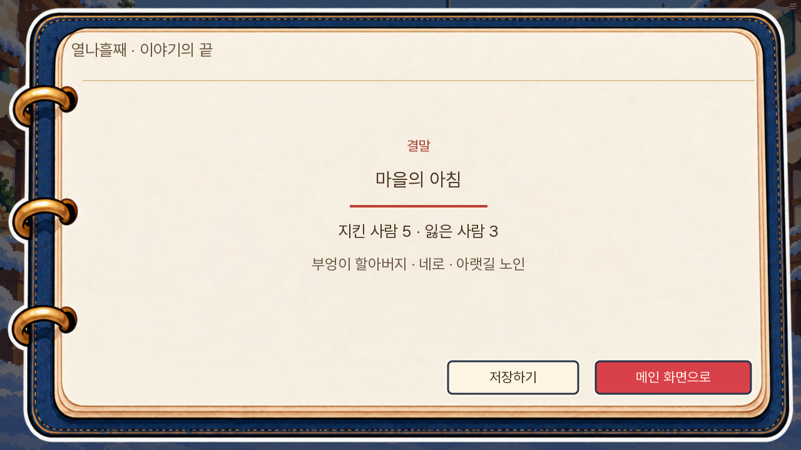
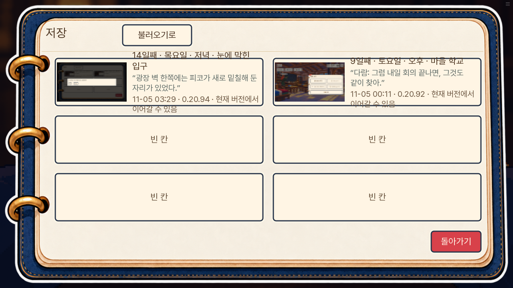
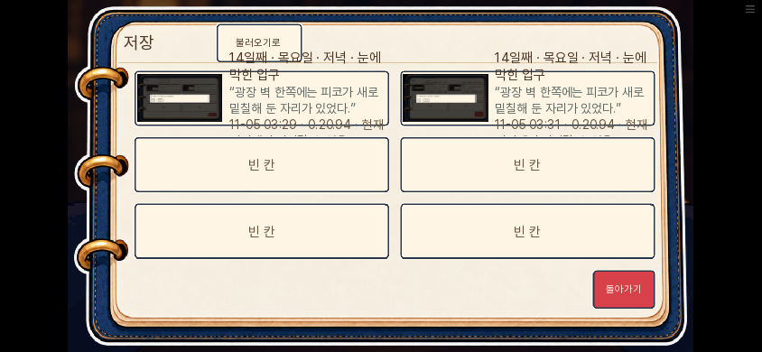

# 본편 13~14일차와 결말 연결 검수 · 0.20.94

소유자의 ‘나머지 마무리’ 요청으로 기존 본편의 마지막 13~14일차와 결말 연결을 검수했다. 실제 0.20.93의 12일차 저장에서 이어 대사·자료·행동·인물 위치와 결말 진입을 대조했다. 새 판 v2는 작업 대상이 아니다.

| 구간 | 확인한 문제 | 수정 |
|---|---|---|
| 13일 가족 잔류 | 광장에 남는 선택인데 학교에서 기다린다고 말함 | ‘여기서’ 기다린다는 말로 일치 |
| 13일 선생님 감독 | 실제 감독은 너울인데 돌목이 자신이 감독한다고 말함 | 실제 감독자가 확인한다는 말로 정리 |
| 13일 최종 광장 기록 | 학교에 있는 나비가 광장 인계표를 작성한다고 함 | 현장에 없는 나비의 행동 제거 |
| 13일 부분 대기 | 곧 학교로 떠날 아빠가 수레 옆에 계속 있겠다고 약속 | 현장의 담당자에게 계속 지켜 달라고 요청 |
| 14일 장부 대조 | 공개된 장부에 없는 신규 발병 0명·돌 감소량을 집계 사실로 인용 | 실제 돌 배급량과 돌·장작 잔량만 인용 |
| 14일 장작 인계 | 경로에 따라 달라지는 인수자를 선생님으로 고정 | 학교에 실제 인계한 사실로 통일 |
| 14일 토실 면담 | 문밖에 둔 상태로 대답을 듣고 실제 재합류가 없음 | 면담 뒤 문밖에서 다시 합류한 다음 대화 |
| 14일 일부 인계 결말 | 광장에서 학교 명단과 나비의 행동을 바로 서술 | 광장 지문 뒤 실제 학교 이동·인물 합류 |
| 14일 추모 | 8~9일 재조사한 13호 문이 다시 열리지 않았다고 함 | 창틀에 남은 안경의 관찰만 유지 |
| 14일 장부 낱장 | 엄마만 숫자를 읽을 수 있다고 단정 | 엄마가 남은 숫자를 살피는 행동만 서술 |
| 14일 밤 대화 | 밤인데 ‘이 아침’을 함께 못 맞았다고 말함 | 여기까지 함께 오지 못한 사람으로 시점 정리 |
| 얼어붙은 마을 | 며칠의 경과 뒤 다시 14일 아침으로 되돌아감 | 뒤 지문의 날짜 한정 제거 |
| 남겨진 이름 | 아빠가 아는 다람의 이름을 확인 못 했다고 함 | 확인하지 못한 것은 다람의 행방·상태임을 명시 |

장부의 물자 수량·배급·이송 기록과 건강 집계는 구분했다. 건강 통계나 새 단서를 만들어 넣지 않았다. 기존 정답 묶음, 결말 우선순위와 승격 조건, 생사와 진상은 유지한다.

## 검증 방법과 범위

브라우저 주행은 기존 실제 저장에서 현장·지도·대화·자료 버튼을 누르는 자동화다. 기존 실행 코드의 정답 목록을 참고하므로 처음 보는 사람의 눈가림 시험과 구별한다. 글자 속도·조회·검사 저장 외에 줄거리 값이나 자료를 주입하지 않는다.

네이티브 화면 시험은 장면 직전 상태를 기존 함수로 준비하고 실제 라벨·대화·이동·결말 화면을 실행한다. 모든 결말을 1일차부터 자연 주행한 검사와 구별한다. 모든 선택 순열과 1~14일 전체 재주행은 이번에 다시 실행하지 않는다.

공개 도메인은 환경 네트워크 정책으로 직접 접속할 수 없어 로컬 공개 묶음에서 검증하고 원격 파일 해시와 Pages 작업으로 배포를 확인한다.

## 실제 화면

13일 가족이 광장에 남는 선택에서는 ‘여기서 기다리겠다’고 말한다.

제단에서는 장부에 실제 기록된 돌 배급량과 돌·장작 잔량을 인용한다. 장부에 없는 건강 통계를 만들어 인용하지 않는다.

피해 누적 경로는 앞선 꼬미·도담의 사망과 새미의 생존을 유지하고 ‘얼어붙은 마을’로 마친다. 며칠이 지난 지문 뒤에 날짜가 다시 14일 아침으로 돌아가지 않는다.

## 별도로 남긴 화면 문제

결말의 저장하기 버튼으로 여는 기존 저장 화면에서 긴 위치·마지막 대사·버전 설명이 슬롯 높이를 넘는다. 저장·불러오기 상태 복원과는 별개인 표시 문제다. 이번 본편 대사·논리 수정에서 저장 화면 디자인을 변경하지 않았으며, 아래 실측 화면을 후속 UI 수정 대상으로 남긴다.

## 최종 실행 결과

- 단위 검사 1,169개, lint, 대사 정적 검사 A/B/C 각 0건 통과.
- 관련 네이티브 화면 시험 7개 통과: 토실 문밖 대기·재합류, 학교 명단의 실제 지도 이동, 일부 인계 결말 완주, 남겨진 이름·얼어붙은 마을·진엔딩·불타는 밤 가족 셋.
- 기존 실제 12일 저장 두 종류를 복사해 세 경로로 13~14일을 진행했다. 구조 성공 경로는 ‘눈을 뜬 아침’, 가족 우선 경로는 ‘가족을 택한 밤’, 피해 누적 경로는 ‘얼어붙은 마을’로 완료했다. 경로별 상태와 읽은 대사 수는 [검증결과](검증결과.json)에 보관했다.
- 마지막 결과를 수집할 때 웹판에 없는 `renpy.get_screen`을 검사 코드에서 호출했다. 게임은 이미 결말 화면에 도달한 상태였다. 검사 조회 경로를 고친 뒤 실제 결말 저장을 다시 열었고, 보정 전후 날짜·장소·자료·v111 전체 상태가 동일함을 확인했다. 최초 주행 전체의 pageerror 수치가 별도 보존되지 않아 이를 0건으로 세지 않는다. 주행 중 Ren’Py 예외 화면이 없는지는 매 반복 확인했다.
- 가족 우선 결말에서 PC 1280×720과 휴대폰 844×390의 실제 저장 버튼 → 수동 슬롯 저장 → 새로고침 → 불러오기를 통과했다. 날짜·장소·관문·자료·v111 전체 값이 동일하게 복원됐다. 결말 복원과 PC·휴대폰 저장 검사에서 수집한 pageerror는 0건이다. 슬롯을 불러오면 저장 당시의 저장 화면으로 복귀한다.
- 웹판 0.20.94, 변경된 실행 원본 4파일과 공개 zip 내용 일치, 검사 파일 공개 제외, `check_release.py` 통과.

토실은 문밖 면담이 끝난 뒤 합류 지문과 실제 위치 갱신을 거쳐 대답한다.

