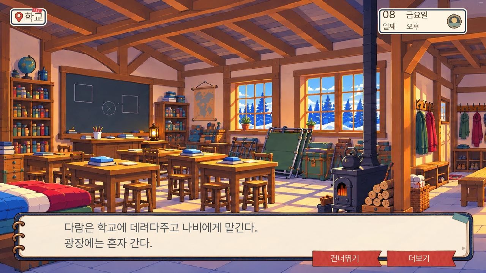
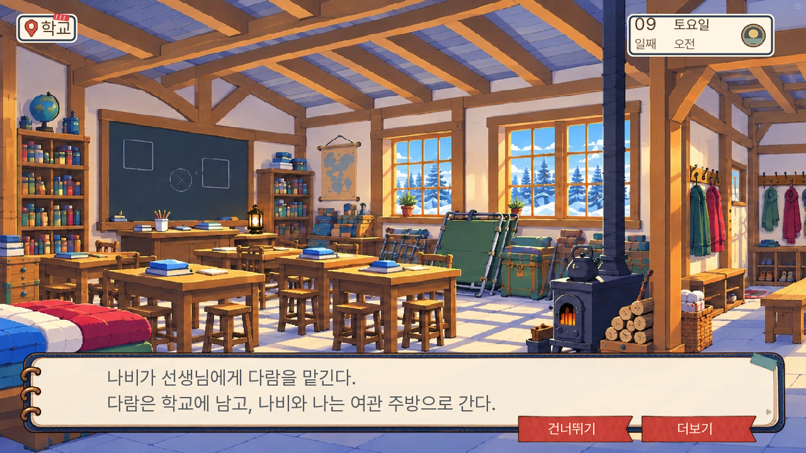
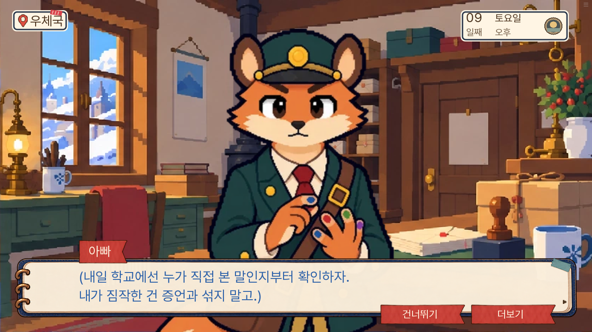

# 본편 7~9일차 논리 검수 · 0.20.92

소유자의 ‘다음 3일’ 요청으로 기존 본편 7~9일차를 검수했다. 실제 0.20.91의 6일차 저장에서 이어 대사·증거·이동·선택 결과를 확인했다. 새 판 v2는 이번 작업 대상이 아니다.

| 장면 | 확인한 문제 | 수정 |
|---|---|---|
| 7일 화재 질문 | 전날 나비가 뒀다는 등잔을 누비가 자기가 뒀다고 말함 | 누비는 등잔과 문 앞의 불을 구분하는 질문에 반응함 |
| 7일 아이들을 곁에 두는 분기 | 아직 있는 아이들이 이미 나갔다고 서술함 | ‘아이들 쪽’으로 시점 통일 |
| 8일 다람 진술 | 촛대가 떨어졌다면서 계속 들고 있었다고 말함 | 깨지는 소리 뒤 손에 아랫부분이 남았다는 관찰로 통일 |
| 8일 도토 진술 | 아빠에게 손을 인계한 7일 구조 뒤에도 계속 잡고 있었다고 말함 | 아빠가 잡은 걸 확인하고서야 놓았다는 순서로 통일 |
| 8일 공개 길 동행 | 예방 경로에도 동행 완료를 기록하지만 실제 동행하는 행동이 보이지 않음 | 초롱의 마지막 대사·등 정리 뒤 바둑이와 큰길로 출발하는 공통 지문 추가 |
| 8일 학교 인계 | 13호에 있는 상태에서 나비의 현재 위치를 검사해 인계 지문이 생략될 수 있고, 다람의 학교 위치도 반영하지 않음 | 비구금일 때 실제 학교 이동·다람과 나비 배치·보호 상태를 기록한 뒤 광장으로 혼자 이동 |
| 9일 예방 서류 대조 | 할머니가 주방 위치에 남은 채 13호에서 서류에 관해 대답함 | 도착 직후 부엉이와 할머니의 13호 배치 갱신 |
| 9일 나비의 이동 | 8일 학교 보호 상태가 나비의 주방 이동 뒤에도 남음 | 학교 선생님에게 다람을 인계한 뒤 나비의 보호 상태를 해제하고 주방으로 이동 |
| 9일 내일 회의 준비 | 직접 목격자 증언을 모아 놓고 ‘들은 말은 근거가 못 된다’고 배제함 | 증언의 출처와 자신의 추측을 구분하는 말로 변경 |

상대의 거짓 주장과 서술 자체의 모순은 구분했다. 누비의 방화와 보리의 장작 절취·진압 책임을 섞는 주장은 반박할 주장으로 남긴다. 다람이 손목을 친 일과 부엉이의 사망 원인, 핀을 다시 채운 시점과 그 이후 빈 시간도 기존 수사 대상으로 유지한다. 새로운 범인·진상·생사·정답 자료 조합을 만들지 않았다.

## 검증 방법

브라우저 주행은 기존 저장을 불러온 뒤 실제 현장·지도·대화·자료 버튼을 누르는 자동화다. 각 대사 쪽을 넘기며 기록하고 실행 코드의 기존 정답 목록을 참고한다. 처음 보는 사람의 눈가림 시험과는 구별한다. 글자 속도·조회·검사 저장 외에 줄거리 값이나 보유 자료를 주입하지 않았다.

네이티브 화면 시험은 장면 직전 상태를 기존 설정 함수로 준비한 뒤 실제 이동·장면 라벨을 실행하는 회귀 검사다. 전체 자연 주행과 구별한다. 모든 조작 순열과 10~14일 전체 진행은 이번 검수 범위에 포함하지 않는다.

공개 도메인은 환경의 네트워크 정책으로 직접 접속할 수 없다. 로컬 공개 묶음에서 브라우저 검증을 수행하고, 원격 파일 해시와 Pages 작업 결과로 배포를 확인한다.

## 검사 결과

- 단위 1,169개와 Ren’Py lint 통과. 대사 자동 검사 A 소개 전 이름, B 사망 가능 화자의 무조건 대사, C 결과 지문 중복 모두 0건.
- 관련 네이티브 화면 시험 5개 통과: 화재 회의 패배·부분 성공, 8일 실제 학교 왕복과 다람 잔류, 구금 경로 보존, 9일 선생님 인계·나비의 보호 상태 해제 후 주방과 13호 이동 및 두 인물의 실제 대화 위치.
- 독립 검수에서 구금·비구금의 후속 이동과 인물 대화 가능 상태를 재확인했다. 생사·결말·정답 자료 조합의 변경은 없다.
- 새 화면 시험의 최초 지도·물건 클릭 실패는 시험 자동화의 가정 오류였다. 실제 지도 구역 선택과 물건 좌표 클릭으로 고쳐 재실행했다. 이를 게임 오류로 집계하지 않았다.
- 0.20.92 공개 묶음의 수정 파일과 생성된 자료 자리표 6개가 원본과 바이트 단위로 일치하며, 검사 전용 파일은 묶음에 포함되지 않음을 확인했다.

브라우저 도우미가 읽은 질문을 반복한 문제도 제품과 분리해 수정했다. 도우미를 재시작하며 주 경로의 실제 8일 조사 저장과 예방 경로의 실제 7일 저장에서 이어 갔다. 단일 무중단 실행으로 보고하지 않는다. 7일의 아이들을 곁에 두는 선택과 등잔 질문은 실제 선택 직전 저장으로 별도 확인했다.

주 경로와 도토의 다짐을 받은 예방 경로 모두 9일차 취침 전까지 도달했다. 주 경로는 기존대로 부엉이 사망·다람 구금, 예방 경로는 부엉이 생존·다람 학교 잔류를 유지한다. 9일 선생님 인계를 보정한 최종 묶음에서는 실제 8일차 취침 저장에서 예방 경로의 9일 전체를 다시 진행했다. 나비는 주방으로 이동하고 보호 상태는 해제되며, 다람과 선생님은 학교에 남는다. 완료된 실행과 등잔 질문 확인의 브라우저 페이지 오류는 0건이다.

최종 묶음의 주 경로 9일차 저장을 PC와 휴대폰에서 실제 저장 메뉴로 저장하고 새로고침·불러오기를 했다. 날짜·장소·관문·자료·진행 값이 같았고 페이지 오류는 0건이었다. [검증 결과](검증결과.json)에 경로와 상태·묶음 해시를 기록했다.

## 실제 수정 화면

7일 누비는 나비가 놓은 등잔을 자기가 뒀다고 말하지 않는다. 등잔과 문 앞의 불을 구분하는 질문에 반응한다.

8일 인계 지문이 나오는 실제 장소는 학교이며, 다람과 나비의 위치도 학교로 기록된다.

9일에는 나비가 선생님에게 인계한 뒤 주방으로 간다. 학교 보호와 주방 증언이 동시에 진행 중인 상태로 남지 않는다.

목격자의 증언을 배제하지 않고, 누가 직접 본 말인지와 아빠의 추측을 구별한다.

추가 화면: [7일 아이들이 아직 있는 분기](day7-children-here.png), [9일 할머니의 13호 대답](day9-papers-people.png), [휴대폰 저장 복원](mobile-restored.png).
