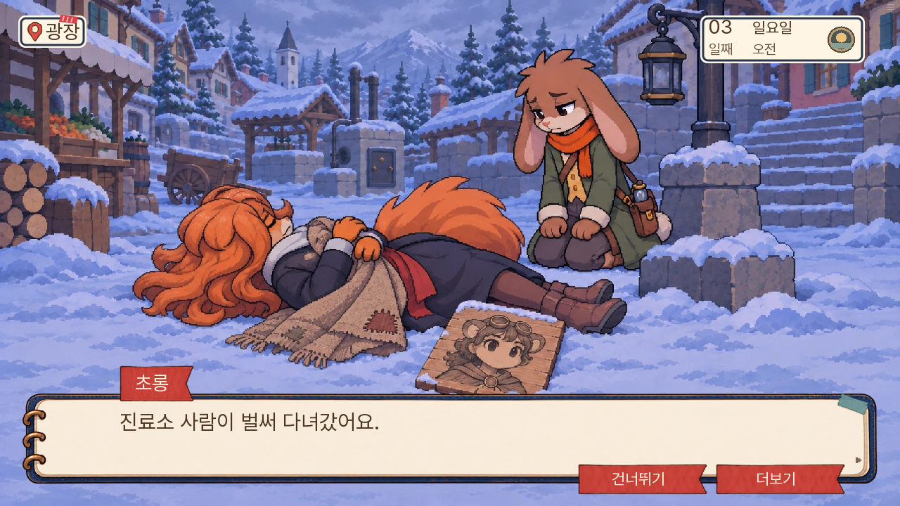
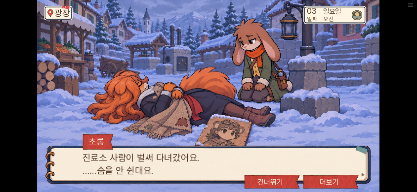
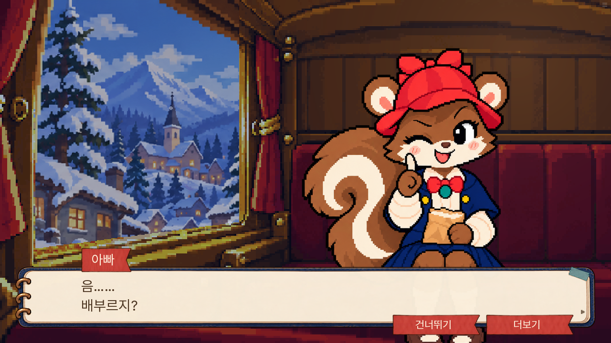
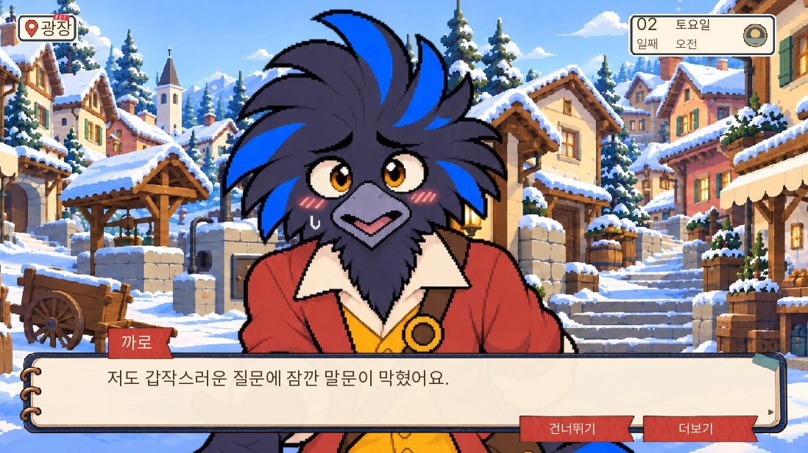

# 사망 현장·대화 시선·마차 에셋 정리

2026-11-05, 0.20.96. 기존 본편에 적용하며 v2에는 적용하지 않는다.

피코가 사망한 경우 실제로 누운 현장 그림을 보며 확인 대화를 나눈다. 미완 초상에는 코가 없고, 피코는 얇은 담요를 끌어안고 꺼진 등 쪽으로 돌아누워 있다. 기존 본문에 없는 상처·사인·흉기·새 증거는 넣지 않았다. 생사·범인·회의 정답은 바꾸지 않는다.

첫 확인 대화 끝까지 컷을 유지하고 다음 등 조사에서는 내려간다. 사망 확인 뒤 광장 일반 대화도 불안·애도 반응을 사용하며, 등 점검 기록을 묻는 후속 질문에서는 기록을 가리지 않는다. 생존한 경로에는 사망 그림·애도 문장이 나오지 않는다.

## 대화 시선

피코·보리·까로·도토·너울·실룩·서리·세련 8명의 일반 대화와 1인 근접 회의에 승인된 정면 원본을 연결했다. 기존 5감정 원본을 재사용하고 빠진 당황 표정 8장만 추가 제작했다. 세 크기의 여섯 감정이 모두 준비된 묶음만 활성화한다. 명시적 작업·자료 읽기 자세와 별도 연출 반응은 기존 연결을 유지한다.

실제 SDK 대화 경로에서 8명×중립/당황 16컷의 크기·발 기준·시선을 확인했다. 모든 인물·모든 자세를 새로 그린 작업은 아니다.

## 마차와 사용 대장

마차 다람이는 720×1100 승인 원본을 제작 단계에서 149×227로 줄인 뒤 런타임에서 3배 확대하고 있었다. 원본 8장을 그대로 실행 경로에 복사하고 표시 높이 681에 맞춰 한 번 축소하도록 고쳤다. 좌표·착석·표정 선택은 유지한다. 웹 첫 대화 전에 이 파일을 준비한다.

- [마차 원본·실행·구버전·미연결 후보 목록](carriage-asset-audit.json)
- [새 당황 표정 납품 기록](flustered-delivery.json)
- [이번 변경 에셋의 크기·해시·역할](에셋사용대장.json)

구버전 그림은 이전 저장 참조 때문에 보존한다. 최신 A안 마차는 중립 한 장뿐이며 나머지 7표정이 없어 적용하지 않았다. 이번 대장은 변경한 에셋 범위이며 게임 전체 에셋 정리가 끝났다는 뜻은 아니다.

## 검증 범위

관련 네이티브 검사: 사망 컷 유지·종료, 생존 분리, 사망 직후 일반 대화, 기록 후속 질문/읽음의 4개. 추가로 stage 전용 검수에서 시선16컷과 실제 첫 마차4표정을 확인했다. 시험용 상태 준비와 자연 플레이는 구분한다. stage의 임시 캡처 라벨은 공개하지 않는다.

전체 단위 1,199개·lint·대사 로직 A/B/C 0을 통과했다. 이후 발견한 인용 화자 두 곳을 수정하고 관련 14개를 재검사했다. 전체 14일 자연 플레이 및 인간의 초면 재미 검사는 이번 범위에 포함하지 않는다.

실제 웹에서는 이전 공개판의 정상1일차 취침 전 저장을 불러와2일차 네로 경로를 선택하고3일차 사망 확인과 첫등조사까지 진행했다. 사망 대화4지점에서 컷을 유지하고 다음 장면에서 종료했다. PC1280×720·휴대폰844×390을 확인했고 페이지 오류는0건이었다. 첫 마차도 새 게임에서 실제7표정을 지나 내리는 장면까지 확인했다. SDK에서는 사망 컷 도중 저장→진행→불러오기 후 컷·대사ID·생사상태 복원과 이후 정상 종료를 확인했다. [검증결과](검증결과.json).

자료 대조 화면의 실제 화자 두 곳은 본문 너울에 맞췄다. 문장과 제출 판정은 그대로다. 공개 주소는 현 환경 네트워크 정책상 직접 열 수 없어, 로컬 실제 브라우저와 GitHub 배포 완료·파일 해시로 공개 상태를 확인한다.
