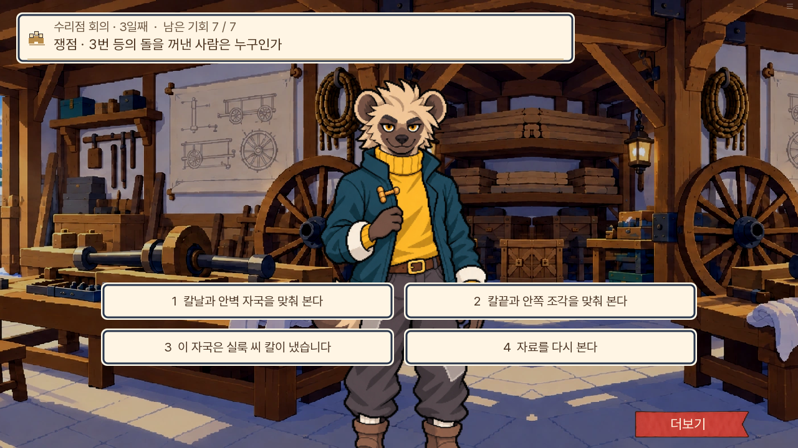
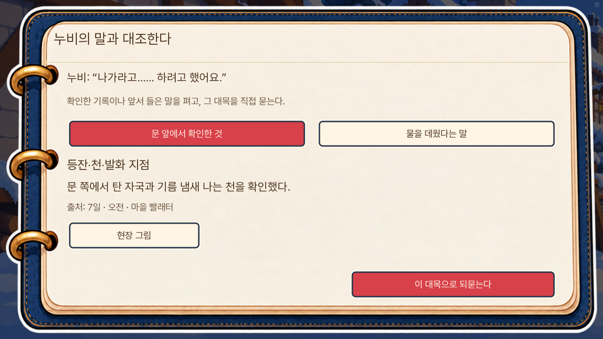
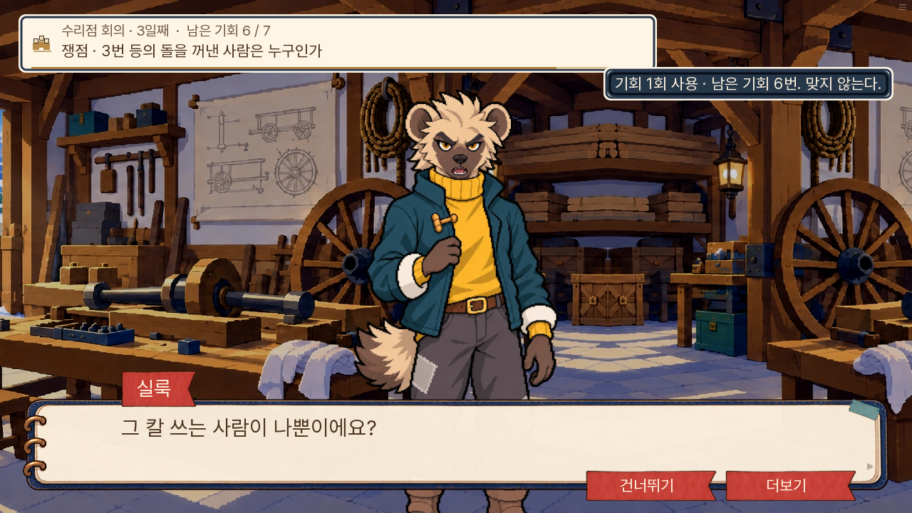
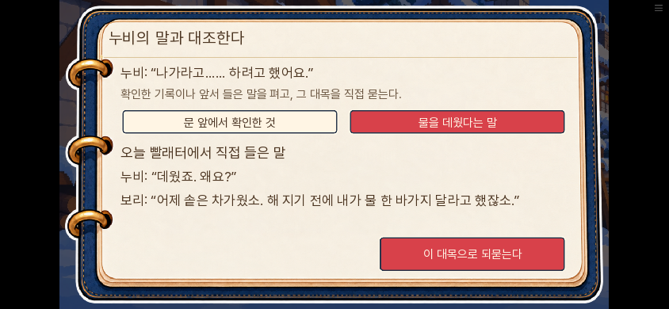

# 추리 재미 개선과 실제 문답 검수

2026-11-08 · 0.20.123. 소유자가 승인한 추리 재미 리뷰의 세 가지를 개선했다.

|문제|개선|지킬 것|
|---|---|---|
|자국을 보려던 선택이 특정 칼 주장으로 바뀌며 기회 소모|무벌점 관찰과 아빠의 명시적 주장 분리|기존 선택값0/1/2·칼끝 정답·부분성공·기회 총수|
|화재의 잘못된 관찰/질문을 UI가 먼저 거절|실제 누비 문답으로 검증하고 확인 질문은 복귀|기존 자료 판정·기회·생사·원인/구조 책임 구분|
|한 질문 뒤 동기·등유·약속·자백을 자동 폭로|기존 흔적/기존 진술로 다음 말 재검증|새 자료·새 진상·새 범인 없음|

화면 검수는 실제 누르는 입력과 전후 상태를 함께 확인한다. 새 게임 전체 무중단 완주와 상태 준비 장면은 구분해서 기록한다. 이번에는 3일차와 7일차의 시작 상태를 준비한 뒤 실제 엔진 화면을 눌러 검수했다. 1~7일 전체를 새 게임에서 무중단으로 다시 진행한 결과는 아니다.

## 실제로 달라진 문답

- **칼**: 이전에는 “칼날과 안벽 자국을 맞춰 본다”를 고르면 아빠가 특정 칼이라고 단정하고 기회를 썼다. 이제 그 선택은 실룩에게 잠깐 보겠다고 청하고 모양을 본 뒤 돌아온다. 별도의 “이 자국은 실룩 씨 칼이 냈습니다”를 고르면 실룩의 “그 칼 쓰는 사람이 나뿐이에요?”라는 기존 반박과 차감을 받는다.
- **화재 첫 질문**: UI가 ‘이 연결은 잘못됐다’고 알려 주는 대신, 장작 질문이면 보리가 장작을 가져간 일을 답하고 누비가 그 일을 화제로 돌린다. 등잔 질문이면 등잔을 놓은 사실과 불이 시작된 장소를 구분하는 문답이 나온다. 문 앞에 있었다는 사실만으로 불을 놓았다고 주장할 수 없는 연결에는 누비가 실제로 반박한다.
- **자백 전**: “나가라고 하려고 했다”는 말 뒤 바로 전체 폭로를 재생하지 않고, 소유한 현장 기록이나 앞서 실제로 들은 솥 이야기를 읽는다. 직접 되묻는 버튼을 눌러야 다음 대화가 나온다. 원래 듣지 않은 솥 문답은 선택할 수 없다.
- **시간 논리**: ‘해 지기 전 솥이 차가웠다’와 ‘저녁에 물을 데웠다’는 함께 참일 수 있다. 독립 검토에서 이를 찾아, 등유 사용을 확인하는 질문으로 고쳤다. 차가운 솥만으로 거짓말을 확정하지 않는다.

## 검사 결과

전체 단위 **1,448개**, Ren’Py lint, 대사 논리 검사 A/B/C **0건**을 확인했다. 인자를 받는 새 라벨도 무대 등록 검사가 읽도록 기존 검사 파서를 보완했고, 파생 증거 자리표·대사 바인딩·이야기 추출문을 갱신했다.

|엔진 화면 시험|확인한 결과|
|---|---|
|v111_rules_knife_no_consent|무동의 상태에서 무료 조사·자료 닫기 보존, 칼끝 대조와 걸쇠 질문으로 진행|
|v111_wrong_thoughts_knife|무료 관찰을 사이에 넣어도 차감 없음, 명시적 주장 1·2·3회 차감과 각 속말|
|fire7_hypothesis_rebut_and_submit|장작·등잔 확인과 부적절 연결은 실제 문답 후 무료 복귀, 유효 연결·현장 흔적 재질문·기존 자백|
|fire7_investigate_retry|조사 복귀 초안 보존, 유효 논증의 틀린 자료는 기존대로 1회 차감, 수정 제출 가능|
|fire7_old_success_entry|이미 수락된 제출 기록이 있는 구저장은 재제출 없이 이어짐, 들은 솥 이야기 선택→저장→다른 탭→불러오기 선택 복원→재질문|
|fire7_unproven_direct_entry_cannot_admit|자료만 가진 채 자백 라벨에 직접 들어가도 성공·자백 자료가 생기지 않음|
|fire7_sources_no_reselect_and_restore|출처 읽기와 선택 상태의 저장·불러오기, 휴대폰 크기·큰 글씨|

화면 시험 중 두 초기 실패는 시험의 대사/메뉴 대기 조건 문제였다. 마지막 대사가 나온 뒤 메뉴로 넘기지 않고 기다리거나, 선택 문구와 동일한 아빠의 발언에서 기다리기를 끝내고 있었다. 실제 선택 화면까지 입력하도록 고친 뒤 통과했다.

웹 저장 시험에서 새 재확인 화면의 탭이 첫 탭으로 돌아가는 결함을 발견했다. 화면 내부 변수만 쓰던 선택을 기존 저장 방식과 같이 저장 가능한 상태로 옮기고, 불러오기 직후 유지하도록 했다. 엔진 시험에도 실제 탭 변경·저장·복원을 추가했다. 재촬영 중 획득 알림의 표시 시점이 달라 발생한 임시 화면 비교 실패는 이미지를 직접 확인한 뒤 분리했고, 본편 상태·대화 문제와 혼동하지 않았다.

## 변경 화면

아래는 시작 상태를 준비한 장면의 실제 웹 입력 캡처다. 칼 관찰 뒤 회의로 돌아온 화면, 누비 문답, 자백 전 읽기와 휴대폰의 큰 글씨를 비교할 수 있다.

|칼: 조사·주장 분리|자백 전: 기록을 읽고 직접 되묻기|
|---|---|
|||

최종 배포용 웹 빌드에서도 준비한 3일차 칼·7일차 화재를 실제로 눌렀다. 무료 조사·확인 질문·부적절 연결 복귀, 기존 칼끝과 걸쇠 질문, 자백 전 현장 그림 열기·닫기, 844×390 큰 글씨, 건너뛰기·자동 읽기 정지, 실제 설정의 저장칸→다른 탭 선택→불러오기→선택 복원→명시적 재질문→기존 자백까지 통과했다. 브라우저 pageerror와 Ren’Py 예외 화면은 없었다. [검사 요약과 빌드 해시](웹검수.json).

자료 획득 상태도 검수 위치에서 준비했으므로, 이 캡처의 획득 장소·시각을 본편의 실제 수집 동선으로 해석하지 않는다. 본편의 자료 획득 시점은 변경하지 않았다. 직접 공개 URL을 여는 검사는 환경의 네트워크 제한으로 하지 못했으며, 같은 배포 파일을 로컬 브라우저에서 검증했다.
