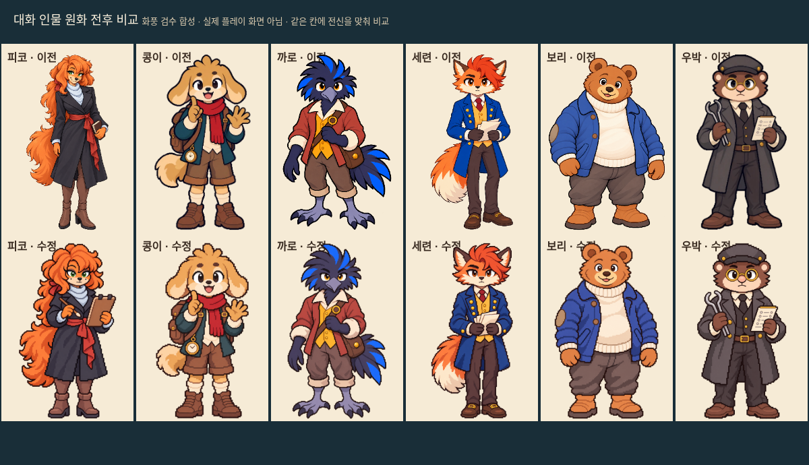
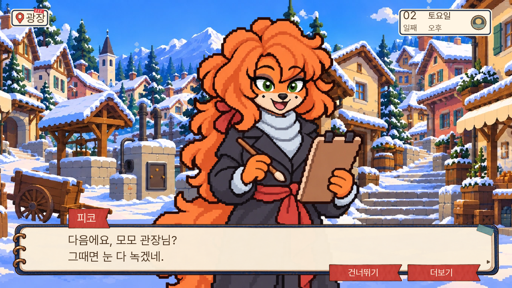
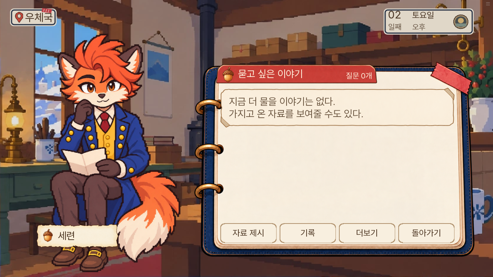

# 대화 인물 도트 화풍 교정 — 0.20.128

2026-11-08. 소유자가 지적한 대상은 대화 중 등장하는 인물 그림이었다. 대화창 UI는 수정하지 않는다. [실제 1부 호출 목록](active-cast-before.json)은 직접 레코드 호출38명과 추가 블록 전용3명을 구분한 정적 조사이며, 모든 경로를 플레이했다는 의미가 아니다.

## 전후 원화 비교

위 그림은 같은 크기의 칸에 전신을 맞춘 **화풍 검수용 합성**이다. 실제 플레이 화면이나 여섯 명이 함께 나오는 장면이 아니다. 피코는 긴 인체 비율과 세밀한 붓 음영, 다른 다섯 명은 매끈한 선·음영이 기존 다람의 작은 도트 표현과 달랐다. 여섯 명의 기본6표정을 다람·127돌목과 같은 참조로 제작했다. 콩이는 아동 체형, 나머지는 기존 성인 정체성과 의상을 유지한다.

피코의 손에는 대본과 승인 현장 그림에 있는 붓·초상 판자를 들려준다. 판자 뒷면을 보여 엄마 초상 등 모르는 정보를 추가하지 않는다. 콩이의 손가락 세기·두 주먹·검지 맞대기·깜짝 펼친 손, 까로의 내민 손·팔짱, 보리의 손목 잡기 등 감정별 몸짓을 보존한다.

## 같은 인물이 다른 그림으로 바뀌는 경로

- 세련: 우체국 오후 질문의 `chair_listen`은 일반6표정과 별개의 예전 원화였다. 앉아서 듣기와 읽기2종도 함께 교체했다. 읽기는 편지를 내려다보고, 듣기는 플레이어를 바라본다. 기존 앉은 자세의 표시 높이·가운데·발 위치를 보존한다.
- 우박: `MS14_D03_S03_L0023`의 특수 분노와 기존 특수 불안은 회중시계·초록 장부로 소품까지 바뀌었다. 본편 대사의 온도 집게·측정 종이로 통일한다. 분노 직전 대사에 있는 집게를 등 뒤로 당기는 동작도 보존한다. 기존 특수 대사 바인딩은 그대로 둔다.
- 돌목·누비: 현재 일반/질문/회의는127도트 원화를 선택하고 있었다. 이번 조사에서 두 인물의 실제 1부 경로가 다시 옛 그림으로 돌아가는 결함은 확인하지 못했다.

일반6표정36장과 별도4장, 총40원본을 PNG로 보존하고 q95 WebP로 연결한다. 새 작화에 맞춘 원본 SHA·캔버스·발선·질문 크기표를 재생성한다. 특히 콩이 질문용 전신은373.333px로 기존 아동 크기를 유지한다. 옛 원본과 실행 파일은 삭제하지 않는다.

## 검증 범위

[전체 단위1475개](unit-checks.txt)와 [lint](lint.txt)가 통과했다. [엔진6경로](native-results.json)는 마차 건너뛰기, 콩이 회의 얼굴 배치, 진료소 이동, 우체국 취소·오답·정답, 피코 초상화 대화·시간,7일 보리·선생님 반응을 확인했다. 콩이의 옛 큰 투명 여백을 하드코딩하던 검사 대신 여백 회귀 조건과 실제 머리·발 위치를 검사하도록 보완했다. 게임의 배치 함수는 바꾸지 않았다. [콩이 실제 엔진 화면](screenshots/kongi-native-meeting.png)을 남겼다. [로컬 웹 검사](web-results.json)는 PC1280×720/휴대폰 가로844×390에서 여섯 명의 실제 대사와 별도 질문 UI를 확인했다. 우박의 실제 특수 분노 대사와 세련의 오후 앉은 질문도 확인했다.127 저장을128에서 불러왔고, 피코 대사에서128 새 저장→새로고침→이어하기 복원을 확인했다. 검수용5일 상태를 처음S02로 잘못 준비해 장면 진입 검증 예외가 발생했으며, 실제 회의S03과 기본 자료를 준비한 재시험은 통과했다. 제품의 진입 조건은 수정하지 않았다. 재시험의 JavaScript pageerror는0이다. 첫 로딩은36,645,317바이트로127보다28,280바이트 증가했다. 새40원화는 지연 로딩한다. 준비한 장면의 실제 대사 재생과 별도 질문 UI 표시 검사를 구분한다. 새 게임부터7일까지 연속완주나 모든 주민·분기 검수는 이번 범위가 아니다.

대사·자료·정답·생사·진상·결말·1부 경계는 변경하지 않는다. 이번에 교정한 여섯 명 외의 레거시 원화가 모두 통일됐다고 판단하지 않는다. 너울·할머니 등 다른 원화는 추가 비교 대상이다.

## 재현

`python3 dev/import_dialogue_cast128.py --apply`로 원본 해시를 검사하고 새 연결과 크기표를 갱신한다. 납품은 [원본 폴더](../../../art/dialogue-cast-unify-20261108/)의 인물별 manifest에 기록한다. 기계적인 픽셀 필터·전역 확대 필터 변경·낮은 해상도 단순 확대는 하지 않는다.

## 실제 웹 화면

| 인물 | 실제 대사 | 별도 질문 UI |
|---|---|---|
| 피코 | [PC](screenshots/piko-dialogue-pc.png) · [휴대폰](screenshots/piko-dialogue-mobile.png) | [PC](screenshots/piko-question-pc.png) · [휴대폰](screenshots/piko-question-mobile.png) |
| 콩이 | [PC](screenshots/kongi-dialogue-pc.png) · [휴대폰](screenshots/kongi-dialogue-mobile.png) | [PC](screenshots/kongi-question-pc.png) · [휴대폰](screenshots/kongi-question-mobile.png) |
| 까로 | [PC](screenshots/karo-dialogue-pc.png) · [휴대폰](screenshots/karo-dialogue-mobile.png) | [PC](screenshots/karo-question-pc.png) · [휴대폰](screenshots/karo-question-mobile.png) |
| 세련 | [PC](screenshots/seryeon-dialogue-pc.png) · [휴대폰](screenshots/seryeon-dialogue-mobile.png) | [PC](screenshots/seryeon-question-pc.png) · [휴대폰](screenshots/seryeon-question-mobile.png) |
| 보리 | [PC](screenshots/bori-dialogue-pc.png) · [휴대폰](screenshots/bori-dialogue-mobile.png) | [PC](screenshots/bori-question-pc.png) · [휴대폰](screenshots/bori-question-mobile.png) |
| 우박 | [PC](screenshots/ubak-dialogue-pc.png) · [휴대폰](screenshots/ubak-dialogue-mobile.png) | [PC](screenshots/ubak-question-pc.png) · [휴대폰](screenshots/ubak-question-mobile.png) |

특수 분노 — [우박PC](screenshots/ubak-context-angry-pc.png)·[휴대폰](screenshots/ubak-context-angry-mobile.png). 저장 — [127저장 복원](screenshots/old-save127-pc.png)·[128피코 새 저장 복원](screenshots/new-save128-pc.png).

일반6표정과 특수4원본은 서로 다른 담당자가 독립 검수했다. 실제 웹에서 별도 재생한 특수는 우박 분노와 세련 듣기이며, 우박 특수 불안·세련 읽기는 원본·등록·크기 검사 범위다. 질문 그림은 대사 무대를 내린 뒤 기존 UI를 별도로 띄워 검사했으므로 자연스러운 전체 대화 진행 경로로 세지 않는다.
