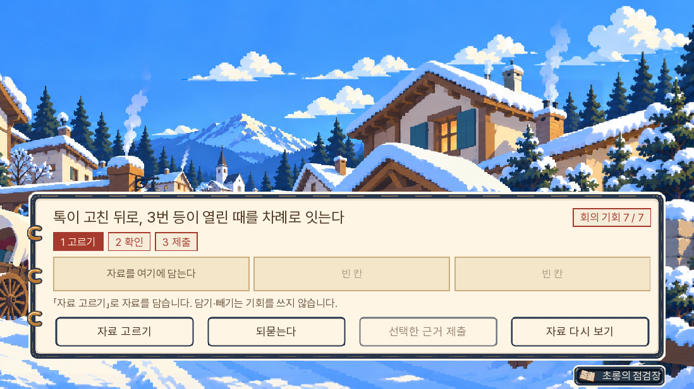
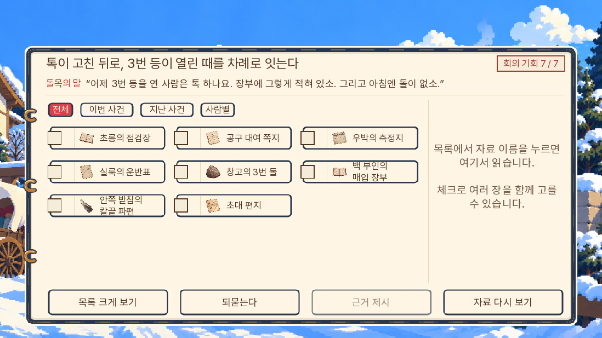
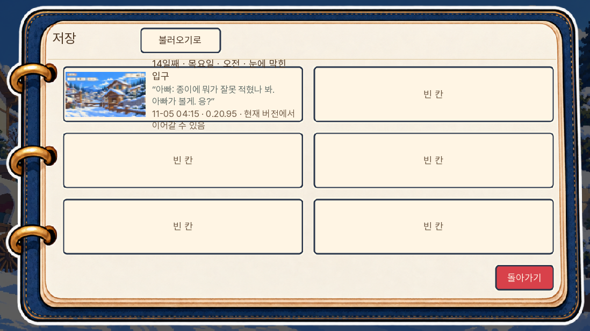
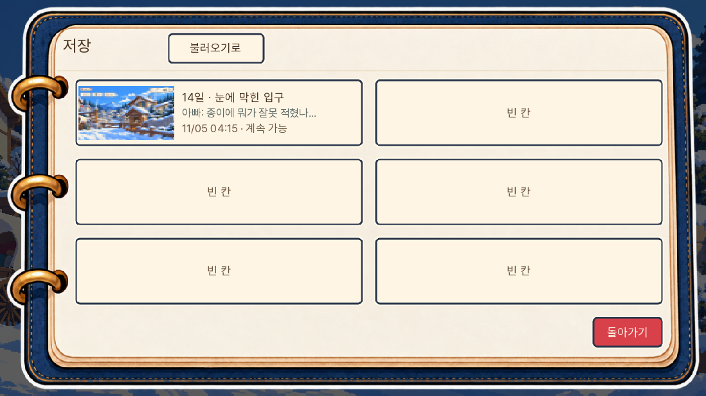
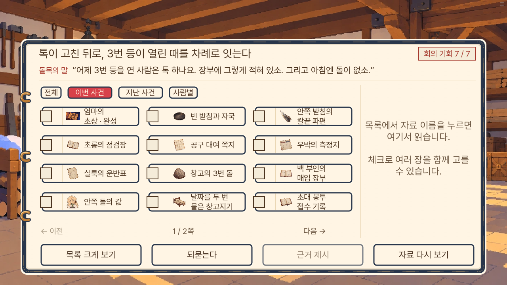
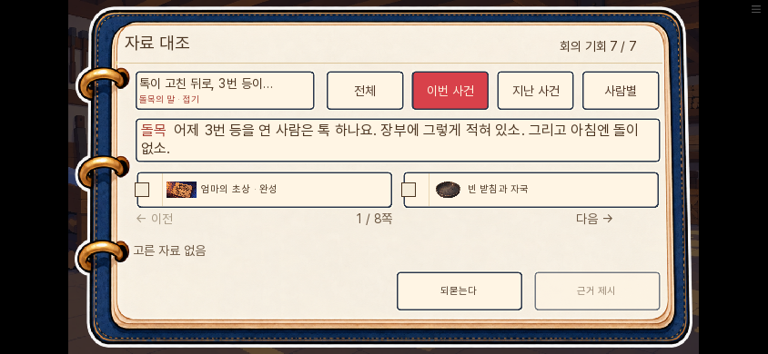
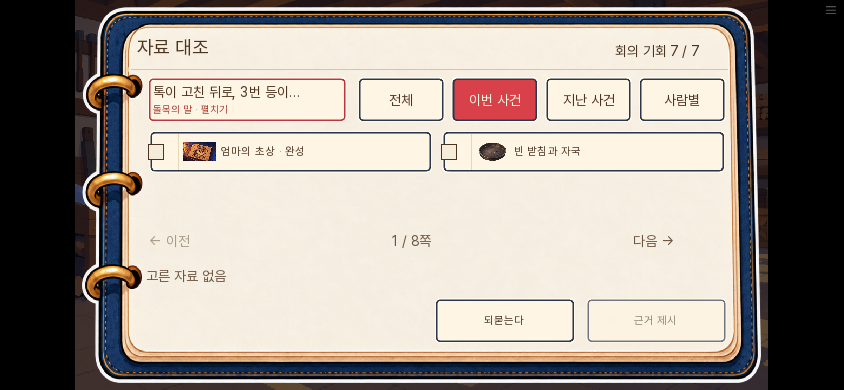
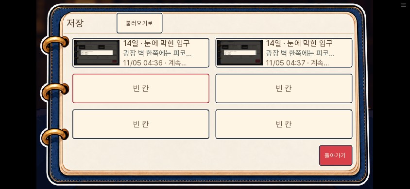
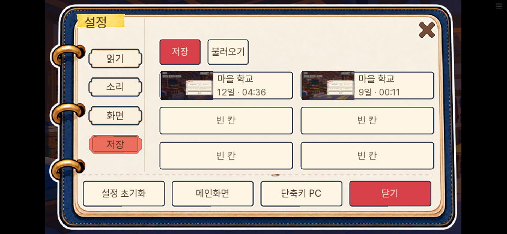
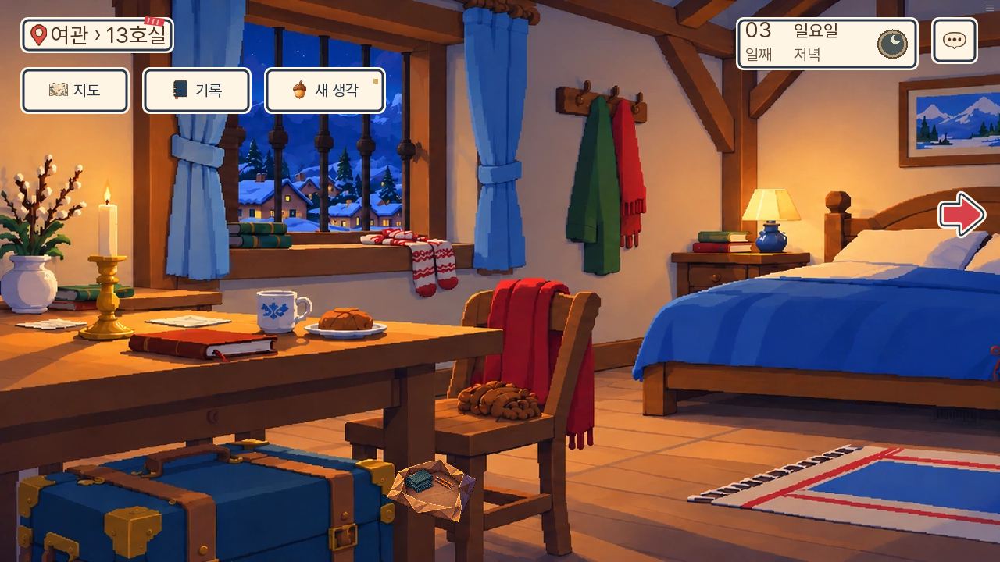

# 본편 1~3일차 첫 플레이 경험 개선 · 0.20.95

소유자가 추리·디자인·UI 평가 뒤 개선을 승인했다. 대상은 기존 본편이며 v2는 수정하지 않는다. 2026-11-05 자료 대조·저장칸의 실제 렌더 시안을 제시했고, 소유자가 ‘두 시안 모두 적용’을 선택했다.

## 확인과 반영

| 구간 | 현재 상태에서 확인한 점 | 반영 |
|---|---|---|
| 1일 초소 | 이미 다람 이름 누락 한 문제로 정리됐고 쟁점 제목도 질문형이다 | 기존 논리와 대사 유지 |
| 2일 우체국 | 질문이 0개인데 빈 질문 화면에서 자료 제시 버튼을 더 눌러야 한다 | 이 관문·인물·장소·실제 질문 수를 확인해 기존 자료함으로 바로 연결 |
| 2일 초상 부탁 | 첫 대화 뒤 피코를 누르고 유일한 질문을 다시 선택한다 | 실제 단일 질문의 원래 반환값만 이어 공통 읽음·시간 처리를 재사용 |
| 3일 측정지 오답 반응 | 기록에 없는 ‘돌려놨다’를 문서 인용으로 말한다 | 우박의 반환 증언과 문서의 측정 종료 시각을 구분 |
| 3일 자료 제출 | 1일에 익힌 통합 대조와 달리 별도 자료함을 반복해서 연다 | 진료소 대조와 등 회의의 네 쟁점, 총 5개에서 같은 통합 화면 사용 |
| 저장·불러오기 | 위치·마지막 대사·버전 설명이 저장칸 높이를 넘는다 | 날짜·장소와 마지막 대사, 시각·이어하기 상태를 짧게 표시. 설정 안의 더 좁은 칸은 장소와 게임 날짜·시각 두 줄로 표시하며 확인이 필요한 저장은 그 상태를 우선 표시 |

다른 질문이나 선택이 생긴 저장, 다른 대상·장소·반환값에는 단일 질문 생략을 적용하지 않는다. 우체국 자료 선택은 플레이어가 직접 한다. 빈 화면 생략으로 자료가 자동 제시되거나 E07이 자동 획득되지 않는다. 취소는 현장으로 돌아가며, 오답 반응과 실제 수신자 확인은 기존 경로를 쓴다.

자료 대조 화면은 보유한 자료만 보여 준다. 발언은 각 쟁점 직전에 실제로 들은 문장의 전부 또는 일부이며, 진료소에는 확인할 질문 제목만 둔다. 정답 수량·중요 자료·미획득 자료·미래 발언은 표시하지 않는다. 기존 증거 조합, 승패·기회·생사·결말·예방판 조건은 유지한다.

저장 원문의 `r13_where`, `r13_stage`, `r13_last`, 버전·호환 정보는 보존한다. 칸의 제목에서는 요일·시간대를 덜고 날짜와 장소를 보여 주며 긴 문구는 말줄임한다. 전체 호환 판정과 이전 저장 확인 창은 바꾸지 않는다.

## 유지한 선택과 검증 한계

검토 에이전트 둘과 구현 담당의 코드·문장·실행 화면 검토다. 처음 보는 인간 참가자의 눈가림 사용성 실험은 아니다. 브라우저 자동화는 알려진 정답과 실제 UI 버튼으로 진행하므로, 추리 난이도나 재미를 사람에게 실측한 수치로 보고하지 않는다.

실무 의견으로는 이번 개선은 빈 질문 화면과 자료함 왕복을 줄이는 작업이다. 재미의 최종 평가는 새 참가자가 핵심 의문과 증거 선택 이유를 자기 말로 설명하고, 계속하고 싶어 하는지 확인해야 한다. 수정 건수를 늘리기 위한 대사 개작은 하지 않았다.

등의 네 부분을 직접 골라 살피는 선택은 관찰 행위이므로 유지했다. 실제로 이미 네 부분을 보면 다음 장면으로 자동 전환된다. 진료소 측정지를 직접 눌러 읽는 단계도 유지했다. 단서를 직접 확인하는 행동까지 일괄 삭제하지 않는다.

## 승인 시안

아래는 장면 직전 검사 상태에서 기존 렌더로 캡처한 시안이다. 자연 주행 화면과 구별한다.

## 실행 결과

- 전체 단위 1,176개, 최종 표시 조정 관련 검사 28개, 최종 lint와 대사 정적 검사 A/B/C 각 0건 통과.
- 관련 네이티브 화면 5개 통과. 우체국의 취소·오답·정답 수신, 피코 첫 대화·질문 읽음·10분, 새 대조에서 오답 후 선택 초기화와 E11+E13 대체 제출, 칼 대조 동의가 없는 경로, 모바일 발언의 실제 렌더 높이를 확인했다.
- 변경 전 0.20.94는 새 게임에서 1일차 취침 전까지, 0.20.95는 새 게임에서 3일차 취침 전까지 진행했다. 1일 규칙판을 읽지 않은 경로에서 충분한 자료로 통과하고, 오답 뒤 재시도도 확인했다. 3일 다섯 쟁점이 통합 화면으로 진행되고 등 회의 승리까지 도달했다. 새 게임 주행의 pageerror는 0건이다.
- 일반 저장 화면: 0.20.94의 실제 가족 결말 저장에서 0.20.95로 이어 실제 저장 버튼 → 수동 슬롯 저장 → 새로고침 → 불러오기를 PC·휴대폰에서 통과했다. 날짜·장소·자료·관문·v111 전체 값이 동일했다. 보통·큰 글씨를 각각 캡처했다.
- 설정 안 저장: 실제 0.20.93의 12일 저장을 열어 설정 → 저장 → 슬롯 저장을 PC·휴대폰에서 진행했다. 보통·큰 글씨와 상태 불변을 확인했다. 휴대폰 큰 글씨에서 발견한 넘침은 장소와 게임 날짜·시각 두 줄로 고친 뒤 재검증했다.
- 자료 대조: 새 게임 도중 만든 실제 3일 회의 저장을 복원해 PC 1280×720·휴대폰 844×390의 보통·큰 글씨를 확인했다. 모바일에서 화자 이름을 포함한 실제 문장 높이와 상하 패딩이 발언칸 안에 들어간다. 글씨·뷰포트·발언 접기를 바꿔도 자료·선택·이야기 값은 동일했고 pageerror는 0건이다.
- 전체 검사와 새 게임 주행 뒤의 두 표시 조정은 관련 단위·최종 lint·A/B/C·해당 실제 화면으로 다시 검증했다. 새 게임의 대사·자료·정답·시간·승패 흐름은 유지했다.
- 최종 공개 zip의 변경 실행 원본 6파일이 소스와 일치한다. 검사·시안 전용 파일은 공개 묶음에 포함되지 않으며 `check_release.py`를 통과했다.

결과와 경로별 상태는 [검증결과](검증결과.json)에 보관한다. 공개 사이트 직접 재생은 환경 정책으로 실행하지 못하므로 원격 파일 해시와 Pages 배포 작업을 확인한다.

## 실제 웹 화면

## 사람에게 확인할 다음 기준

게임이 정답을 알려 주거나 특정 자료를 강조하지 않은 상태에서, 처음 하는 사람이 ‘지금 풀려는 문제가 무엇인지’, ‘고른 자료로 어떤 말을 고칠 수 있는지’, ‘다음 장면을 보고 싶은지와 그 이유’를 자기 말로 설명하는지 확인하는 것이 다음 기준이다. 이번 자동 주행을 그 검증의 대용으로 세지 않는다. 자료가 쌓였을 때의 쪽 넘김은 남아 있으므로 목록 밀도와 분류의 체감도 함께 확인할 항목이다.
