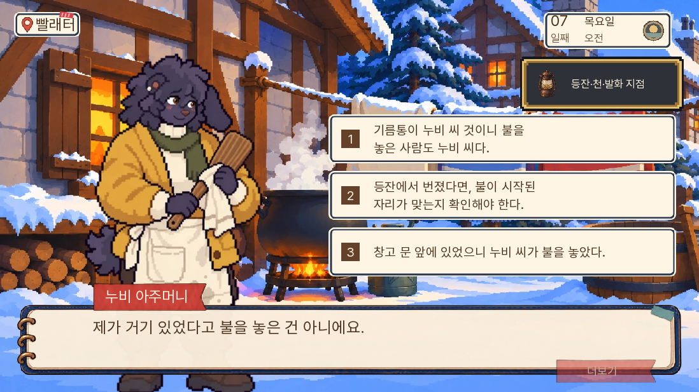
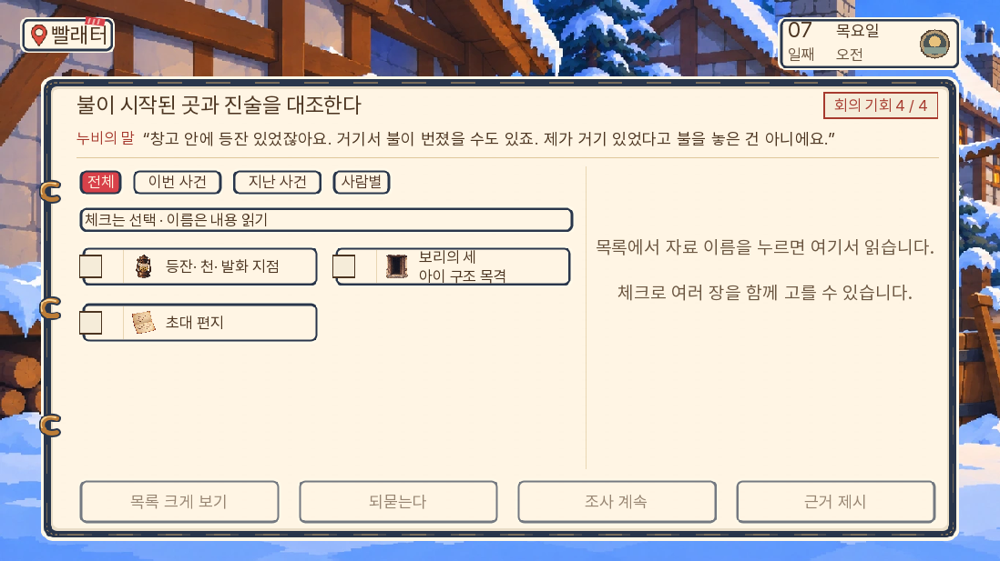
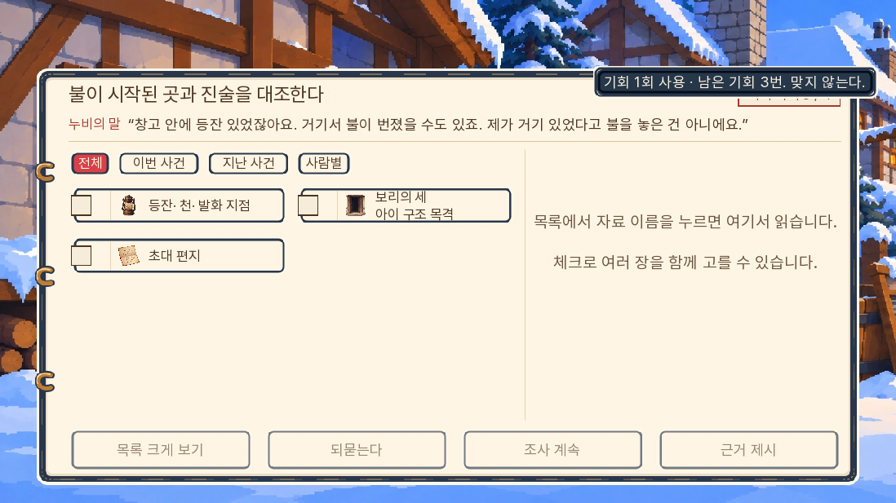
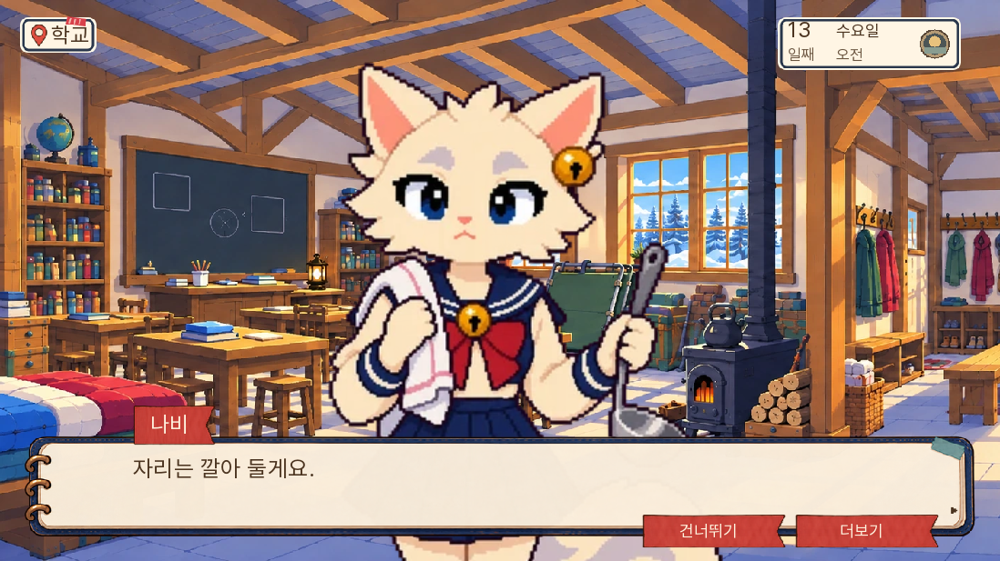

# 0.20.111 — 7일 화재 논증과 마지막 별편 편집

2026-11-06. 종합 리뷰 뒤 소유자의 ‘해보자’에 따라 7일 화재 사건을 추리 순서 개편의 기준 사례로 적용하고, 마지막 별편 여섯 편을 압축했다.

## 게임의 변화

이전 흐름은 E06_FIRE 제출 뒤 어느 질문을 골라도 바로 자백했다. 자료 대조 인용은 ‘물을 데웠다’인데 정답 자료는 등잔과 문 쪽 흔적이어서 반박 대상도 어긋났다.

현재는 보리의 문 앞 목격을 들은 뒤 누비가 ‘등잔에서 번졌을 수도 있다’고 가능성을 방어로 삼는다. 플레이어는 통의 소유·현장 목격만으로 방화했다고 단정하는 것과 발화 위치를 확인하는 것을 구별한다. 앞의 단정에는 누비가 반박하고 같은 선택으로 돌아간다. 가설 선택은 기회를 쓰지 않는다. 등잔 설명을 선택하면 기존 자료 대조 화면에서 기존 E06_FIRE를 제출한다.

성공해도 곧바로 방화범·살의 확정으로 건너뛰지 않는다. 아빠는 뒷벽의 닫힌 등잔과 문 쪽 천·탄 자국이 다른 자리에 있음을 말하고 당시 행동을 묻는다. 누비가 기존 문답에서 기름·불·이유를 직접 진술한 뒤에만 기존 commit으로 E07_NUBI를 얻는다. 너울의 약속은 이후 기존 두 번째 쟁점의 입증 범위를 따른다.

재조사 복귀에는 이미 고른 가설을 다시 묻지 않고 선택 자료를 유지한다. 기존 자료 제출 이후 라벨로 진입하는 저장은 새 방어 문답만 보완하며 재제출을 요구하지 않는다. 이는 진입점 호환 검사이며 모든 과거 저장의 모든 대사 중간 지점을 검사한 것은 아니다.

## 별편의 변화

판돌·나비·까로·토실·백 부인·초롱의 여섯 편에서 행동 뒤 같은 의미를 풀이하던 문장을 덜었다. 판돌의 한 장 담요, 까로의 고삐 반환, 토실의 마르지 않은 이름, 백 부인의 내일 빈칸, 초롱의 학교 문까지 보이는 등은 남겼다. 나비는 담요를 펴고 직접 문 곁에 서서 돌아올 수레를 기다리는 장면으로 줄였다.

게임의 나비 추가 운반 질문 세 행은 삭제했다. 실제 출석 조건 안의 기존 NW_D13_BR01 인수 약속을 유지한다. 원고 전문은 별편이며 게임은 그보다 짧다. 기존 14일 본편·분기·인수·반환·생사를 바꾸지 않는다. 마지막 책의 기본 여섯 편·이름 쓰기 미룸 다섯 편·이송 중지 미완료 다섯 편·가족 우선 한 편을 다시 내보냈다.

실무 의견으로는, 이번 수정은 근거의 한계를 구별하는 입력을 하나 만들고 읽는 호흡을 줄이는 개선이다. 아직 모든 사건이 깊은 추리 문제로 바뀐 것은 아니며, 새 메뉴 역시 초급 수준이다. 인간 초견 독자의 재미 검증은 진행하지 않았다.

## 검증

검사 결과와 대표 화면은 아래에 기록한다. 전체 14일을 새 게임부터 다시 연속 플레이하는 범위는 포함하지 않는다.

- 전체 단위 1,319개 및 최종 관련 단위 80개, lint 통과. 대사 A/B/C 0/0/0.
- 관련 네이티브 화면 검사 8개 통과. 새 가설의 두 오답과 무페널티 재선택, E06_FIRE 제출, 재조사 후 가설·자료 유지, 자료 오답의 기존 기회 소모, 구성공 라벨 진입, 기존 실패·부분·일반·대성공, 나비 준비/실제 인수 경계를 확인했다. [화면 결과](화면결과.json).
- 네이티브 초기 준비 코드의 자료 지급 순서와 긴 선택지의 줄바꿈을 고려하지 못한 시험 클릭을 수정한 뒤 새 검사 세 개를 다시 통과했다. 이 준비 오류를 본편 진행 결함으로 세지 않는다.
- 새 Chromium에서 코어 두 부분 HTTP 200, 0.20.111 메뉴, 주민 추가 반응 15행, 브라우저 오류 없음. [첫 로딩](웹_첫로딩.json).
- 기존 실제 7일차 웹 저장에서 7일 전체를 거쳐 8일 아침 진입을 확인했다. 상태·증거를 주입하지 않았고 이동·선택·제출은 화면 조작, 대사는 건너뛰기, 조합은 알려진 정답표를 사용했다. E07_NUBI와 방화 자백을 얻고 살의는 unproven, 불 회의 win·대성공을 유지했다. 피코 사망·꼬미 생존·부엉이 예방 경로다. pageerrors는 없다. [이어가기 요약](웹_이어가기.json), [실행 기록](웹_이어가기.txt).
- 마지막 책은 기본·전체 비교본 각각 7쪽, 이름 쓰기 미룸·이송 미완료 각각 6쪽, 가족 우선 공통 장면은 2쪽이다. 경로별 장면 순서·Word 장 번호·PDF 페이지와 글자 추출을 검사했다. 인쇄본의 문단·줄 간격도 조정해 마지막 문단 몇 줄만 다음 쪽에 남던 것을 줄였다. [문서 검사](문서검증.json).

새 모바일 화면 검사, 14일 전체 새 게임 연속 플레이, 인간 초견 독자 실험은 이번 범위에 포함하지 않는다. 공개 github.io 주소는 환경의 네트워크 허용 대상에 없어 직접 브라우저로 검사하지 않는다. 로컬 공개 묶음 검사와 원격 커밋 파일 일치·Pages 배포 결과를 구별한다.

[원본 대조](원본보존.json)에서 records·11~14일 실행 라벨·규칙·회의 복원은 바이트가 같다. d13은 나비 추가 세 행을 제거한 것 외에 구조가 같다. [빌드 검사](빌드검증.json)에서 묶음의 변경 원본 일치·QA 제외·판 번호를 확인했다. 초기 로딩은 36,370,350바이트로 전판보다 836바이트 증가했고 새 에셋은 없다. 경량화 성과를 새로 주장하지 않는다.

## 대표 화면

## 게시 묶음 범위 수정

첫 게시 커밋 031b012의 게임·자료 파일 일치는 확인했지만 Pages 배포는 파일 동기화 중 10분 제한으로 실패했다. 실제 게시 아티팩트는 4,420,047,866바이트였고 로그에 Pages 1GB 한도 초과 경고가 있었다. 게임 첫 로딩 용량과 저장소 전체를 올리는 게시 용량은 다른 값이다.

루트 `_config.yml`에서 작업 원본·소스·과거 검수 폴더를 정적 사이트 대상에서 제외했다. 실행용 preview 전체와 루트 docs/reading은 남겼다. 원본 파일은 저장소에서 삭제하지 않았다. 공개 대상은 추적 파일 기준 약 930MB이며 게임 실행 경로 4,628개를 모두 확인했다. [게시 범위](게시범위.json).

리소스 보기의 원본·과거 캡처 URL 4,042개는 해당 카탈로그의 기존 게임 커밋을 고정한 raw 저장소 URL로 옮겼다. 기존 인물·썸네일·사실 판정은 유지했고 캐시 버전에는 경로 생성기의 변경을 반영했다. 앞으로 생성되는 카탈로그도 같은 URL 규칙을 쓴다. 공개 읽기 안내의 작업 원고 링크도 저장소로 연결했다. 과거 작업·검수 자료는 저장소에서 열람하며, 정적 사이트에서 작업 폴더를 직접 서빙하는 주소는 제외된다.

관련 생성기 검사 9개 통과. 작업 폴더를 404로 처리하는 로컬 서버에서 실제 Chromium으로 리소스 원본 확대·과거 캡처 확대를 열어 raw 이미지가 표시되고 pageerror가 없는 것을 확인했다. 게임 묶음·버전·대사·승패·첫 로딩 파일은 이번 게시 설정 변경으로 바뀌지 않았다. 최종 Pages 결과는 게시 커밋과 별도로 확인한다.
