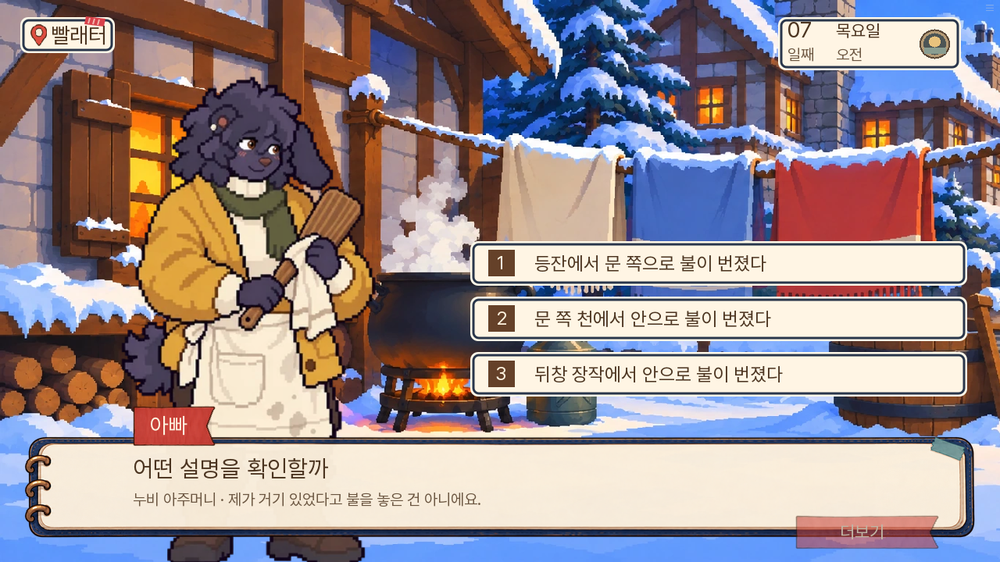
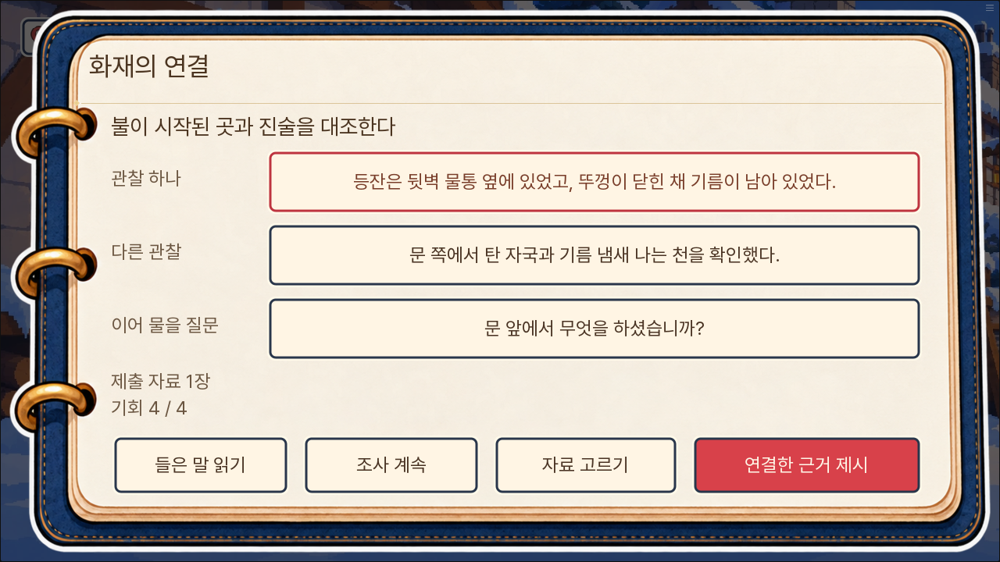
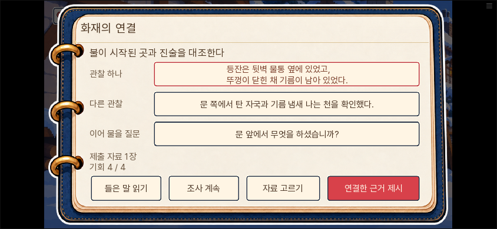
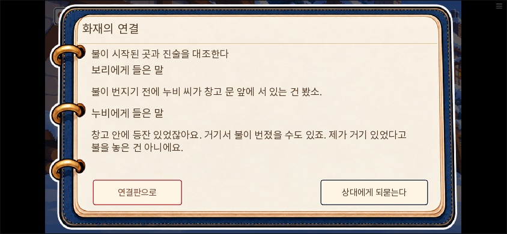
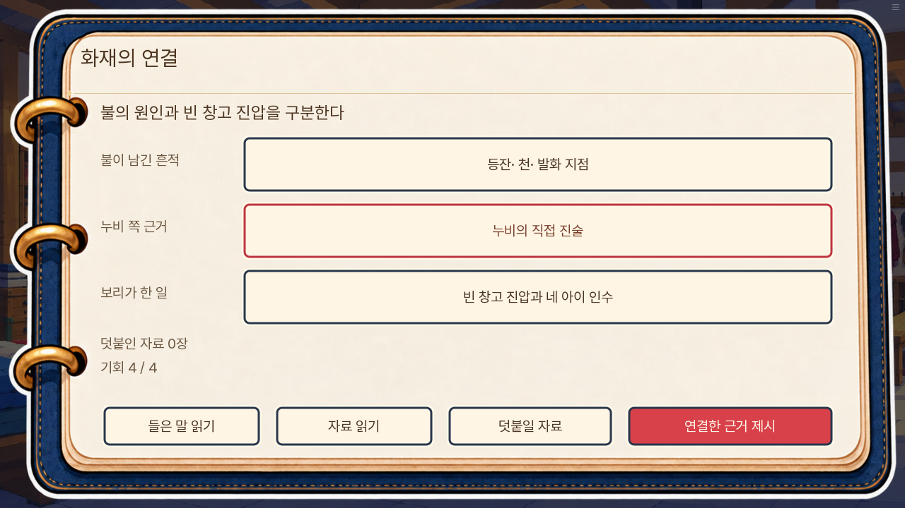
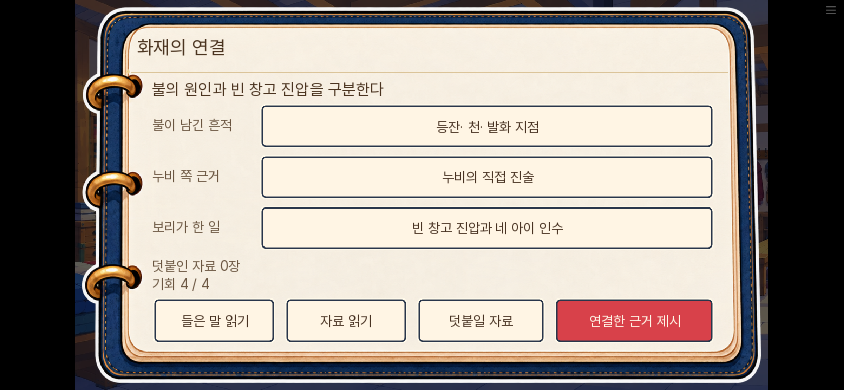

# 화재 근거 연결 · 0.20.117

사용자 요청: 0.20.116 게임 리뷰에서 제시한 화재 추리 개선을 진행한다.

## 개선과 보존 경계

기존 자백 전 추리는 세 가설 중 오답을 누르면 즉시 같은 세 보기를 다시 보여 줬다. 새 판은 관찰 두 개와 다음 질문을 함께 구성한다. 개별 칸의 정답 여부를 미리 강조하지 않으며, 전체 연결을 제출해 설명이 맞는지 확인한다.

현장 기록은 등잔의 위치·닫힌 뚜껑·남은 기름과 문 쪽 탄 자국·기름 냄새 나는 천을 구분한다. 이 사실만으로 최종 발화 원인을 확정하지 않는다. 보리는 불이 번지기 전 누비가 문 앞에 있는 것을 봤으며, 불을 붙이는 모습은 보지 않았다. 따라서 첫 연결의 결론은 누비에게 문 앞 행동을 다시 묻는 것이다. 누비가 스스로 말한 뒤에만 기존 직접 진술을 얻는다.

두 번째 연결은 같은 밤의 방화와 보리의 행동을 나눈다. 네 아이를 미리 학교로 옮긴 판의 빈 창고 진압을 아이 구조 목격으로 바꾸지 않는다. 배급표는 실제 얻고 제시한 판에서만 너울의 약속 입증에 사용한다. 기존 자료 제출의 정답·대체 근거·기회·판정과 생사를 유지한다.

## 확인 기준

- 미소유 자료와 미청취 목격은 연결 후보로 보여 주지 않는다.
- 보드의 읽기·교체·재조사·저장 복원은 증거·기회·생사·판정을 바꾸지 않는다.
- 자백 전에 직접 진술이나 살해 의도 입증을 만들지 않는다.
- 기본 성공·부분 성공·실패·대승리와 대피/구조 두 경로를 구분한다.
- 기존 가설 완료 저장과 첫 제출 성공 지점의 저장을 이어갈 수 있다.
- PC와 휴대폰 가로 화면, 일반·큰 글자에서 자료와 버튼을 읽고 누를 수 있다.

장면을 준비한 시험과 자연 진행을 구분하며, 자동 검사를 초견 이용자의 재미 평가로 표현하지 않는다.

## 실행 결과

전체 단위1,388개 통과(94.397초). 관련 모델20개는 보유·청취 경계, 유효한 복수 연결, 오배치·대체 배급표·덧붙임·부족한 자료 제출·기회 보존과 사본·지우기를 검사한다. 대사 검사 A/B/C 각0건이며, lint의 구문·참조 오류는 없다. 기존 미도달 문장17곳 및 속성 검사 설정 권고는 남는다.

고유 엔진 시험10개를 통과했다. 관찰과 질문의 전체 오연결, 잘못된 자료 제출과 재조사, 첫 제출 성공 지점의 구 저장, 중간 저장 복원, 일반·대승리·부분·실패, 대피/구조 자료 읽기와 모바일 큰 글씨를 포함한다. 장면 시작 상태를 준비한 시험이며 새 게임부터7일까지의 자연 진행을 뜻하지 않는다.

중간 연결 저장 검사에서 call screen 시작으로 되돌아가던 문제를 발견했다. UI 상태 변경을 저장 복원 시 유지하도록 수정했고, 실제 저장·변경·불러오기 후 관찰·제출 자료가 복원됨을 확인했다. 그 뒤 비교 기준을 시험의 일시 지역 변수에 두었던 fixture도 저장 밖 검수 모듈로 고쳐 재검증했다. 변경된 화면을 이전 픽셀 기준과 비교해 실패한 캡처도 새 임시 출력에서 다시 확인했다.

최종 핵심 묶음17,341,734바이트, 시작 자료36,475,152바이트(엔진 제외), 직전판 대비16,320바이트 증가. 새 이미지·음향은 추가하지 않았고 지연 파일4731개·시작 선로딩33개·예열107개는 유지한다. 묶음 SHA256: 90735f59dd636c4ab54793ad8b78800534fb73190ba0b623a700e79314ef1608.

독립 최종 검수에서 연결 직전 아빠가 이미 같은 문 앞 질문을 하고 있음을 확인했다. 시작 대사를 ‘불은 어디서 시작됐다고 보십니까?’로 바꿔 누비의 설명을 먼저 듣고, 문 앞 행동을 다시 물을 질문은 플레이어의 연결 뒤에 나오게 했다. 이 마지막 문구 수정 뒤 관련69개와 대사 검사·lint·웹 묶음 검사를 다시 통과했다.

## 최종 웹 확인

이전 실제6일말 진행 저장을 복사한 브라우저에서 화재의 첫 연결·자백·책임 구분과 학교 인수 뒤7일 오후까지 확인했다. 실제 설정창의 저장·불러오기를 눌러 중간 관찰과 제출 자료도 복원했다. PC1280×720, 휴대폰844×390과 큰 글씨에서 두 단계의 문장·버튼을 확인했다. 최종 실행의 페이지 오류0건.

자동화의 SDK·웹 API 차이와 새 화면 감지, 크기 전환 직후의 입력 대기를 보완하면서 같은 진행 저장에서 구간을 이어 검사했다. 이를 새 게임부터7일 연속 자연 플레이로 표현하지 않는다. 웹에서는 사전 대피 판의 일반 승리, 엔진에서는 구조·대피의 읽기와 승리·부분·실패·대승리 경계를 확인했다. [웹 요약](웹검수.json), [연결 저장 복원](연결저장복원.json).

## 수정 전후 화면

이전의 세 보기:

관찰 두 개와 이어 물을 질문을 한 번에 연결한다:

이미 들은 말만 다시 읽는다:

불의 흔적·누비 쪽 근거·보리의 행동을 나눈다:

