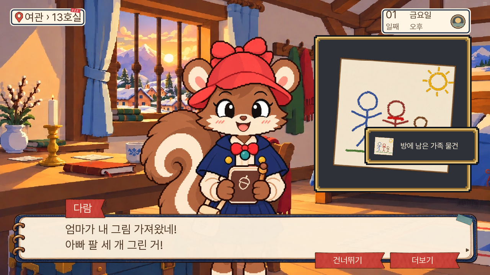
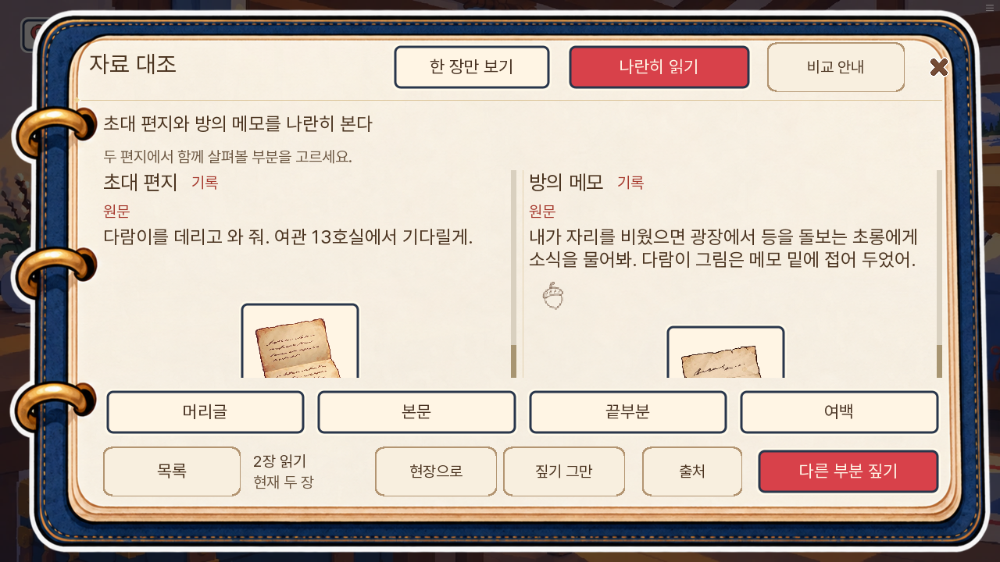
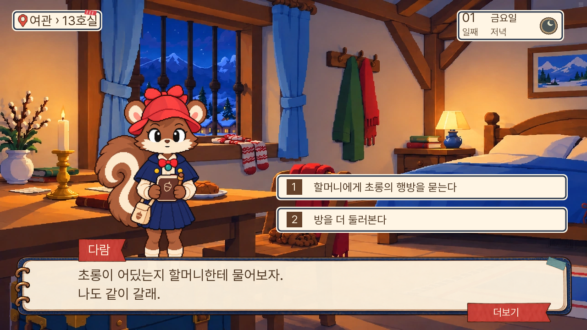
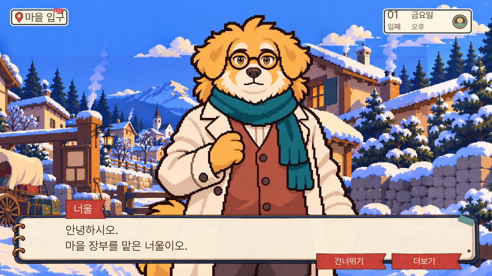

# 0.20.131 수정과 후속 플레이 검수

2026-11-08. [직전 실 플레이 검수](../play-review-20261108-130/검수.md)의 다섯 항목을 소유자 승인에 따라 적용했다.

## 적용 결과

| 항목 | 변경 | 확인 |
|---|---|---|
| 입구 장부 | 겹친 큰 서류보다 장부 클릭을 우선하고, 돌목이 명단을 건네주는 대화로 연결 | 오른쪽 구역으로 이동 후 실제 중앙 `(752,491)` 클릭 → 명단 E02 획득 |
| 가족 그림 | 큰 파란 아빠 팔 세 개, 작은 다람 팔 두 개로 원화 교정 | 발견 컷·E30 자료가 같은 새 파일 사용 |
| 첫 방 비교 | 서로 다른 부분을 관찰하기 전 완료를 막고 문서 짚기로 연결 | 무관찰 제출·머리글 오답에 감점 없음, 끝부분 관찰 후 정상 완료 |
| 보조 버튼 | 자료·화재의 읽기·출처·복귀를 질문창의 갈색 종이 표현으로 통일 | 주요 제출의 빨강과 선택 탭은 유지 |
| 너울 | 여섯 표정을 현행 다람 기준의 계단 윤곽·단계 명암으로 교정 | 활성 대화 PC·모바일 확인, 기존 키·발선·의상·시선 유지 |

기존 증거 ID·정답 문서 조합·생사·결말·공개 1부 경계를 바꾸지 않았다. 이미 첫 방 비교를 마친 옛 저장에는 관찰을 소급하지 않는다.

획득 알림이 잠깐 그림 일부에 겹치는 순간의 캡처다. 그림 파일에는 세 가족이 모두 있다.

[장부 클릭 결과](02-장부클릭-명단획득.png) · [모바일 문서 관찰](07-첫방-모바일조사.png) · [모바일 너울](09-너울-모바일.png) · [이전 버전 저장 이어하기](01-구저장-2일차재개.png)

## 검사 범위

- 관련 단위 **165개 통과**. [결과](unit.txt)
- Ren’Py 실제 화면 검사 **10개 통과**. 장부 좌표, 관찰 없이 목록/구 반환 제출, 직접 끝부분 터치, 완료 저장 호환, 취소·재개, 오답 쌍, 문서 관찰 배치, 가족 소품, 화재 연결을 포함한다. [사례별 결과](실행검사.json)
- lint 완료. 기존 도달 불가 문장 경고는 남아 있다. [로그](lint.txt)
- 대사 논리 정적 검사 A/B/C **0건**. 전체 이야기의 모순이 없다는 보증은 아니다. [로그](dialogue-check.txt)
- 웹 빌드·원본/묶음 버전 확인 통과. [빌드](build.txt) · [버전 확인](release-check.txt)
- 같은 웹 빌드를 로컬 브라우저에서 PC 1280×720, 모바일 크기 844×390으로 확인했다. 0.20.130의 2일차 저장을 0.20.131에서 이어 했다. 실제 휴대폰 전체 터치·전체 기종 성능 검사는 아니다.
- 모바일 문서 관찰은 본문이 길어 끝부분을 보려면 스크롤이 필요하다. 실무 의견으로는 확대 원문이나 문서 높이를 더 확보하는 개선 여지가 있다. 끝부분 버튼과 직접 원문 클릭은 유지했다.
- 이번 검수는 다섯 수정과 후속 핵심 장면에 한정한다. 7일 전체 연속 완주·모든 분기 검증·성능 최적화 완료로 해석하지 않는다.

## 이어서 읽고 누른 구간

2일차 시작 상태를 준비한 뒤, 까로와의 대화 → 지도로 광장 이동 → 돌 앞 기도 → 초롱의 끈 작업 → 끈을 잡는 조사 대기까지 진행했다. 3일차는 수리점 회의의 걸쇠 설명 성공 상태를 별도로 준비해 다음 논증까지 읽었다. 두 구간은 새 게임부터 연결한 전체 완주가 아니다.

### 2일차: 대화의 목적과 작업 그림이 맞는다

아빠가 귀환 마차를 묻고, 까로가 축과 고갯길 문제를 답한다. 아빠는 톡에게 고칠 수 있는지 되묻고, 아내를 찾으면 세 사람이 떠나겠다고 말한다. 광장에서는 아내 메모를 보여 주려다 초롱의 작업을 돕게 된다. 검토한 이 범위에서 질문과 답변이 서로 엇갈리는 문제는 확인하지 못했다.

초롱은 실제로 끈을 입에 물고 있는 대화 그림을 사용한다. 일반 기본 표정일 것이라는 파일명 기반 추정을 실제 화면으로 정정한다. [대사와 작업 모습](11-초롱-끈작업대사.png) · [조사 대기](10-2일차-초롱의작업.png).

### 새 발견: 3일차 걸쇠 설명에 가리킬 구조 그림이 없다

톡의 실제 대사:

> 현장에서 그린 그림을 봐요. 여기가 바깥 판이에요.
> 걸쇠를 닫는 칼끝은 이 판에 막힙니다.
> 조각이 있던 틈은 그 뒤의 안쪽 받침이에요. 거기엔 돌 밑으로 날을 넣어야 닿아요.

[해당 대사 화면](12-3일차-걸쇠설명.png)에서 톡과 수리점 배경만 나오며, 바깥 판·안쪽 받침의 관계를 보여 주는 그림은 없다. 당시 활성 회의의 `slots={}`, `comparison=null`도 확인했다. [화면 상태](12-3일차-걸쇠설명.json). 캡처 우측의 자료 획득 알림은 준비 과정의 효과이며, 구조 그림을 대신하지 않는다.

실무 의견으로는 **우선순위 높음**이다. 추리의 핵심은 칼끝이 닿을 수 있는 위치의 차이인데, 말로 “여기/그 뒤”만 가리키면 사용자가 직접 검증하기 어렵다. 기존 자료 E17/E32/E33의 사실에 맞춘 구조 그림을 보이고 대사 순서대로 바깥 판 → 안쪽 받침을 강조하는 후속 작업이 필요하다. 이번 다섯 수정의 범위를 늘려 새 구조나 정답을 임의로 만들지는 않았다.

실무 의견으로는 이번 수정으로 첫 조사의 신뢰도와 첫 방 참여는 좋아졌다. 그러나 이 3일차 장면 때문에 추리 화면이 완성됐다고 평가하기는 이르다. 다음 개선은 새 사건 추가보다 **말이 가리키는 근거를 실제로 보여 주는 것**이 먼저다.
