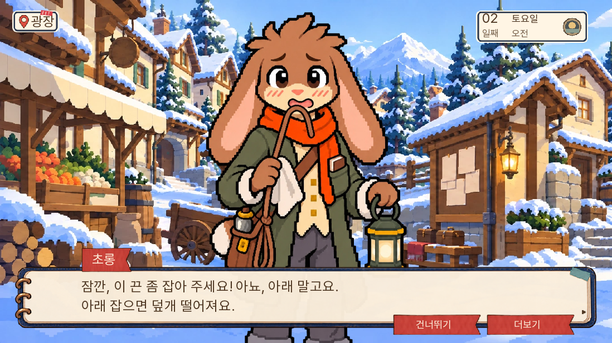
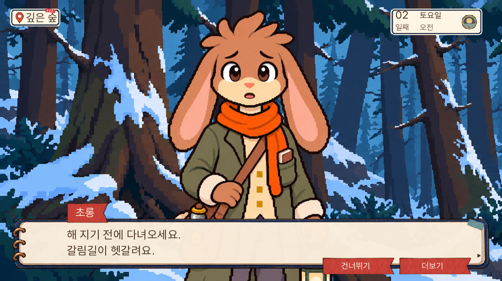
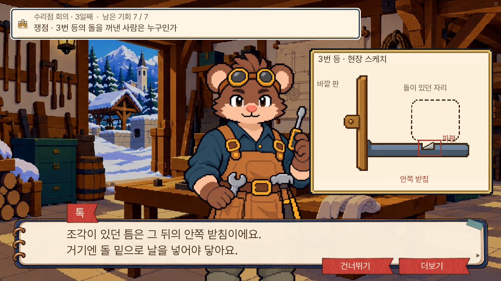
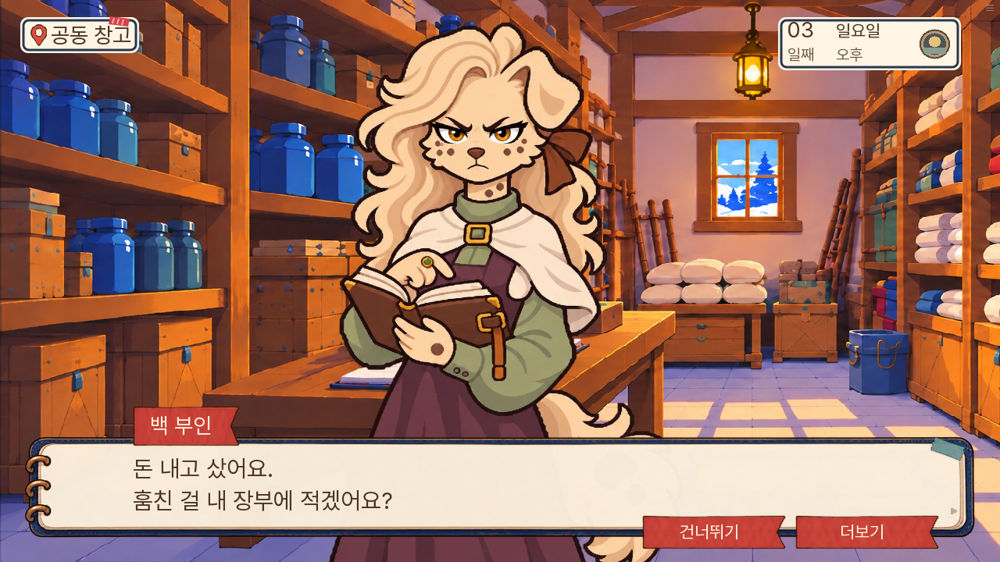

# 0.20.132 완주 검수 후 네 항목 교정

2026-11-08. [0.20.131 실제 1부 완주](../complete-part1-20261108-131/검수.md)에서 지적한 네 항목을 소유자의 “오케이 수정”에 따라 적용했다.

| 지적 | 적용 |
|---|---|
| 톡이 그림을 가리키지만 그림이 없음 | 3일차 성공 설명에서 바깥 판과 안쪽 받침을 같은 현장 스케치로 보여 주고, 해당 위치를 차례로 강조한다. 다음 쟁점 전에 내린다. |
| 학교에 데려간 뒤 다시 맡긴다는 반복 | “아이들은 학교에 가 있습니다. 오늘 밤 누가 곁에 있을지와 잠자리도 확인하고 오겠습니다.”로 바꿨다. 도착과 밤 돌봄을 구분한다. |
| 초롱이 숲에서도 입에 끈을 뭄 | 평상 대화용 여섯 표정을 새로 만들고, 광장에서 끈을 잡아 달라는 한 대사에만 기존 작업 그림을 연결했다. |
| 백 부인·진료 담당자·누비 큰아이의 화풍 차이 | 각 여섯 표정의 계단 윤곽·단계 명암을 교정했다. 기존 키·발선·의상·소품을 보존했다. |

그림은 기존 E17의 바깥 걸쇠 진술과 E32의 안쪽 칼끝 관찰 관계를 설명한다. 사전 관찰 자료 전체를 새 도식으로 교체한 작업은 아니다. 증거 ID·정답 조합·기회·생사·결말·공개 1부 경계는 바꾸지 않았다.

## 검증 범위

이번에는 바뀐 장면을 준비해 SDK와 웹에서 확인했다. 1~7일을 새로 연속 완주한 결과로 세지 않는다. 실제 연속 완주는 위 0.20.131 기록이다.

- 관련 단위 검사 147개 통과. [로그](unit.txt)
- SDK 핵심 4개 통과: 구조 그림 표시·종료·옛 packet 복원, 초롱 작업/평상 분리, 조연 세 명 실제 대사, 1부 완료 체크포인트 복원. [결과](native-results.json)
- 대사 논리 검사 A/B/C 0건. [로그](dialogue-check.txt)
- Ren’Py lint에 새 구문 오류 없음. 기존 도달 불가 문장 안내는 남아 있다. [로그](lint.txt)

검수 중 획득 알림이 도식을 가리는 문제를 고쳤다. 알림 숨김 조건만 추가했으며 자료 획득과 타이머는 그대로다. 또한 초롱 작업 metadata가 최종 화자 렌더에서 일반 그림으로 바뀌는 문제를 발견해, 등록된 초롱 작업 자세만 그대로 통과하도록 고쳤다. 실제 화면에서 입의 끈·손의 천·등이 함께 나오는 것을 다시 확인했다.

## 납품 원본

- [걸쇠 도식](../../../art/latch-diagram132-20261108/README.md)
- [초롱 평상 여섯 표정과 작업 분리](../../../art/chorong-calm132-20261108/README.md)
- [백 부인](../../../art/madam-pixel132-20261108/README.md)
- [진료 담당자·누비 큰아이](../../../art/support-pixel132-20261108/README.md)

이번 인물 교정은 네 사람의 일반 24표정이다. 모든 주민·모든 별도 자세의 화풍 통일 완료를 뜻하지 않는다.

## 실제 웹 화면

최종 0.20.132 묶음을 로컬 HTTP로 실행한 화면이다. PC 1280×720 / 휴대폰 844×390에서 확인했다. 장면은 시작 상태를 준비했고 실제 대사·이동·버튼으로 재생했다. 준비 상태를 바꾸며 남아 있던 앞선 장면 알림은 시험 준비 단계에서 닫고 다시 촬영했다. 백 부인 역시 대기 화면 캡처를 제외하고 실제 대화 진입과 화자 packet을 확인한 사진으로 교체했다.

| 확인 | 실제 캡처 |
|---|---|
| 걸쇠 바깥 판 / 안쪽 받침 | [PC 바깥](03-걸쇠-바깥판-PC.png) · [휴대폰 바깥](04-걸쇠-바깥판-모바일.png) · [PC 안쪽](05-걸쇠-안쪽받침-PC.png) · [휴대폰 안쪽](06-걸쇠-안쪽받침-모바일.png) |
| 다음 쟁점에서 도식 제거 | [화면](07-걸쇠-설명종료-정리.png) |
| 초롱 작업 / 평상 | [작업 PC](08-초롱-광장작업.png) · [작업 휴대폰](09-초롱-광장작업-모바일.png) · [숲 PC](10-초롱-숲안내-평상.png) · [숲 휴대폰](11-초롱-숲안내-모바일.png) |
| 백 부인 | [PC](12-백부인-대화.png) · [휴대폰](13-백부인-모바일.png) |
| 진료 담당자 | [PC](14-진료담당-대화.png) · [휴대폰](15-진료담당-모바일.png) |
| 누비 큰아이 | [PC](16-누비큰아이-대화.png) · [휴대폰](17-누비큰아이-모바일.png) |
| 학교 도착과 밤 돌봄 구분 | [대사](18-학교도착-밤돌봄구분.png) |
| 실제 0.20.131 완료 저장 → 0.20.132 | [PC](01-131완료저장-132복원.png) · [휴대폰](02-131완료저장-모바일.png) |

새 런타임 그림 25개(인물24·도식1)는 에셋 도구함에도 등록했다. [연결 검사](asset-check.txt)와 [제작 요청 상태 검사](art-requests.txt)를 통과했다. 네 사람의 새 일반 그림은 해당 장면에서 불러오며 첫 로딩 용량은 직전 판보다 26,511바이트 증가했다. 전체 첫 로딩은 36,687,667바이트다. 이는 용량 비교이며 프레임 성능 개선 측정은 아니다. [최종 빌드](build.txt)

[독립 검수](독립검수.json)와 SDK·웹 화면은 따로 기록했다. 배포 URL의 시각 검수는 현재 네트워크 정책상 실행하지 못한다. 동일한 최종 공개 묶음으로 로컬 웹 화면을 확인하고 원격에는 커밋·배포 결과·묶음 해시를 대조한다. 최종 장면 검사에서 JavaScript pageerror와 Ren’Py 예외 화면은 없었다. [저장 호환 메타데이터](저장호환.json).
