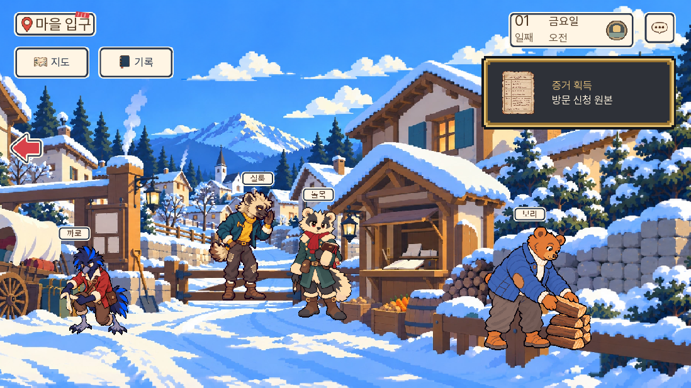
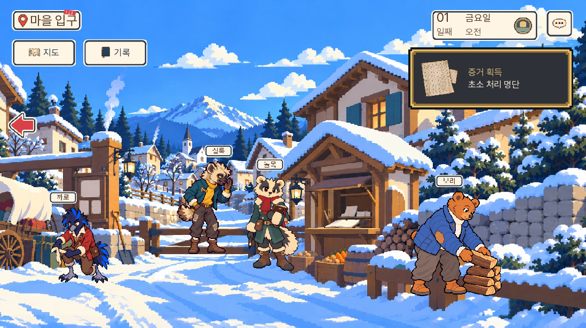
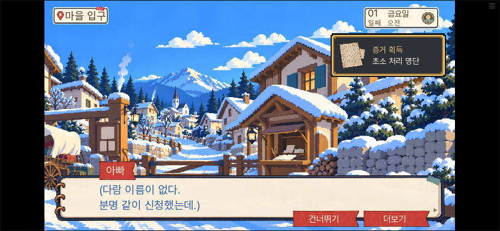
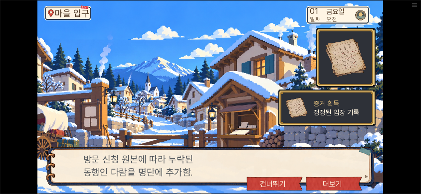

# 0.20.134 입구 재클릭과 증거 획득 알림 수정

2026-11-09. 소유자가 입구의 책·서류를 두세 번 눌러야 증거가 나오고, 오른쪽 증거 사진 아이콘도 보이지 않는다고 지적했다.

## 확인한 원인과 수정

| 항목 | 원인 | 수정 |
|---|---|---|
| 신청 원본을 다시 눌러야 얻음 | 맞는 요일의 신청서를 찾은 뒤 읽기 없이 조사 화면으로 돌아감 | 찾은 자리에서 기존 원본 읽기·E03획득까지 이어짐 |
| 먼저 선반을 누르면 되돌려 보냄 | 명단을 먼저 읽어야 한다는 생각만 보이고 같은 선반 조사를 끊음 | 돌목에게 명단을 요청·확인한 뒤 같은 조사에서 요일 칸으로 이어짐 |
| 가려진 알림이 사라짐 | 자료·지도·설정 뒤에서도 알림 만료 시간이 흐름 | 실제 표시될 때만 카드별3.2초 시계 동작 |
| 연속 획득 중 앞 자료가 빠짐 | 새 알림이 기존 목록을 덮거나, 첫 렌더 전 매개변수가 아직 바인딩되지 않음 | 현재 화면의 대기 목록과 최초 인자를 함께 보존해 순서대로 추가 |
| 두 번째 카드에서 멈춤 | 같은 한 번짜리 타이머 상태를 다음 카드도 재사용 | 카드 index별 시계로 분리, 현재 카드에 추가될 때는 시계 유지 |
| 얻었는지 알아보기 어려움 | 작고 짧은 그림·이름 표시뿐 | 획득 알림에 실제 증거 그림·“증거 획득”·자료 이름을 표시 |

장부를 먼저 읽는 경로, 편지를 제시하는 경로, 틀린 요일 뒤 재선택, 이미 보유한 자료의 재독은 유지했다. 기존 문서 ID와 읽기/획득 함수를 사용하며 정답·기회·등록 결과·생사·결말은 바꾸지 않았다. 자료 제시·마차 편지의 기존 카드는 이번 획득 카드 변경 대상에서 제외했다.

## 검증 범위

- 기존 관련 단위228개 통과. 알림 최종 보완 뒤9개를 다시 확인했다. [기존 관련 검사](unit.txt) · [최종 알림 검사](notice-unit-final.txt)
- SDK3개 통과: 장부부터 조사, 선반부터 조사(목요일 오답→금요일), 숨김/연속/동일 callback획득. [결과](native-results.json)
- 선반 첫 클릭부터 경비의 요청/답변·E02명단·요일 선택·E03원본까지 이어지고, 원본 획득 전 현장으로 돌아가지 않는 것을 확인했다.
- 알림은 같은 callback의 E02→E03→E05개별 획득, 표시 중 설정창4초 숨김 후 복귀, 두 번째 카드에 E04추가, 중복 E02미재생, 마지막 카드 종료를 확인했다. 화면 알림은 서사값을 바꾸지 않았다.
- 대사 논리 A/B/C0건. 새 lint 구문 오류 없음. 기존 도달 불가 문장 안내는 남아 있다. [논리](dialogue-check.txt) · [lint](lint.txt)

최초 알림 검사는 세 번째 카드로 넘어가지 않아 실패했고, 카드별 타이머로 고친 재검사에서 통과했다. 이후 첫 렌더 전 개별 획득까지 강화한 같은 SDK 검사도 통과했다. 처음부터 모든 시도가 통과한 결과로 기록하지 않는다.

[독립 검수](독립검수.json)는 코드 경로와 SDK 실물 사진을 확인했으며, 코드 대조와 실제 플레이 범위를 구분한다. 이번 작업은 입구와 획득 알림의 관련 경로 시험이다. 전체1~7일 완주나 전분기 검증을 반복하지 않았다.

## 최종 웹 확인

최종 빌드 0.20.134에서 실제 화면 좌표와 선택지·체크박스를 눌러 진행했다. 증거 지급 함수를 웹 검사에서 직접 호출하지 않았다. PC1280×720과 휴대폰 가로844×390에서 E02·E03·E05의 그림·이름·획득 문구를 촬영했다. [웹 결과와 빌드 해시](web-results.json) · [진행 로그](web-after.txt) · [등록 최종 상태](최종상태.json)

| 경로 | 결과 |
|---|---|
| 0.20.133에서 신청서를 찾고도 얻지 못한 상태 | 기존 저장을 0.20.134에서 불러와 원본 읽기·획득까지 진행 |
| 새 게임에서 명단보다 선반을 먼저 누름 | 현장 물건 추가 클릭 없이 명단 요청→E02→요일 선택→E03까지 진행 |
| E02와 E03을 선택해 돌목에게 제시 | 등록 성공, E05 정정된 입장 기록 획득 |
| PC·휴대폰 | 각 증거 카드가 화면 안에 들어오고 그림·이름·획득 문구가 읽힘 |

브라우저 pageerror와 Ren'Py 예외 화면은 없었다. 이전 저장은 Ren'Py 저장 시점의 대사부터 재개되며, 명단 읽기의 기존 호출 구조를 유지했다. [구저장 메타데이터](old-save-meta.json) · [복원 후 원본 획득](03-134-구저장-V111-E03-PC.png)

공개 사이트 자체의 화면은 네트워크 허용 범위 밖이므로 직접 열었다고 기록하지 않는다. 동일한 최종 빌드는 로컬 웹에서 확인했으며, 공개 후 커밋의 빌드 해시와 Pages 배포 결과를 별도로 대조한다.
