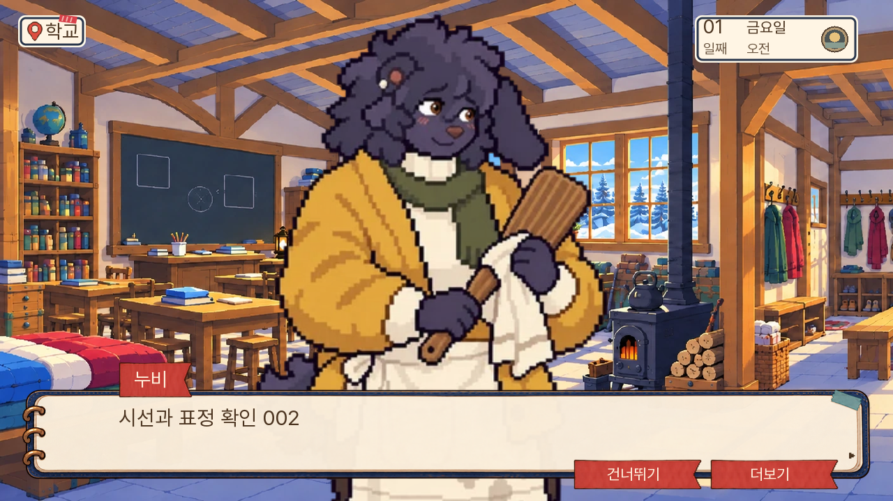
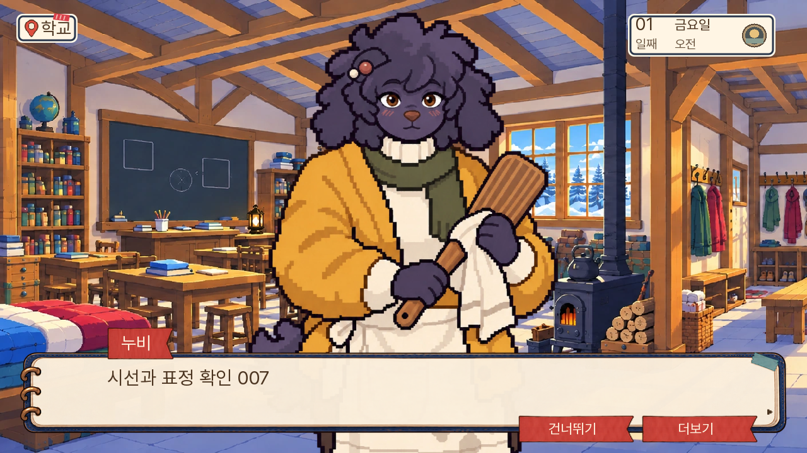
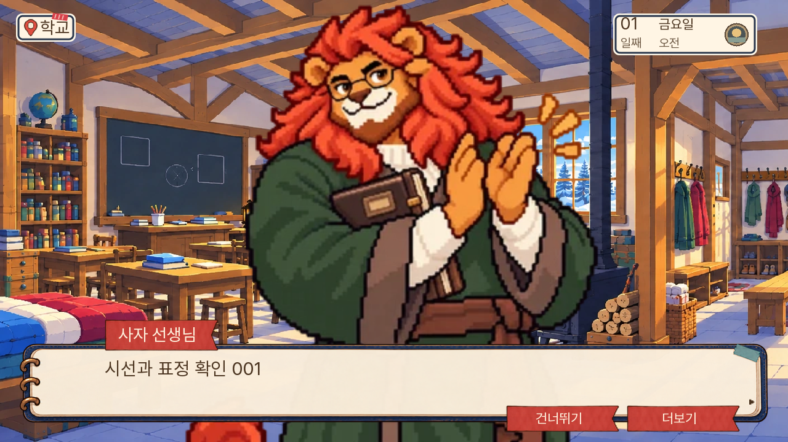
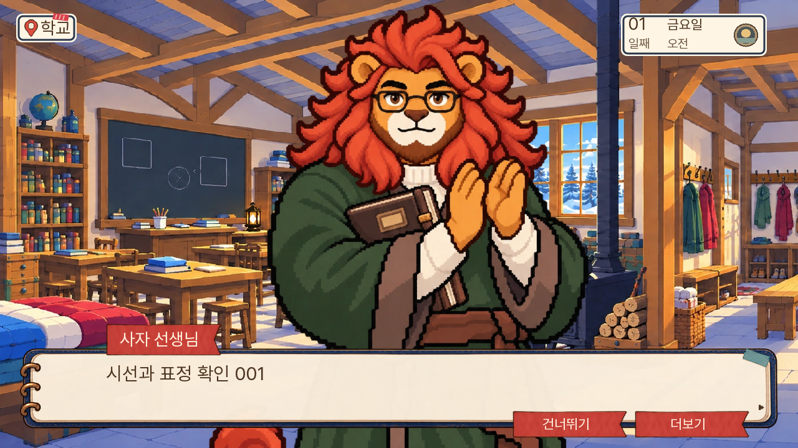
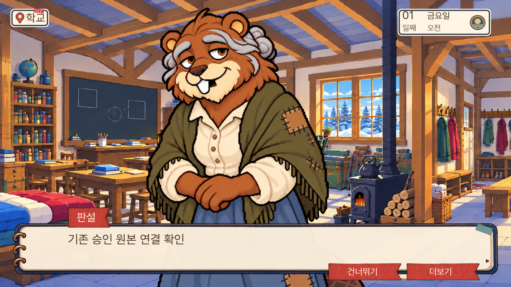
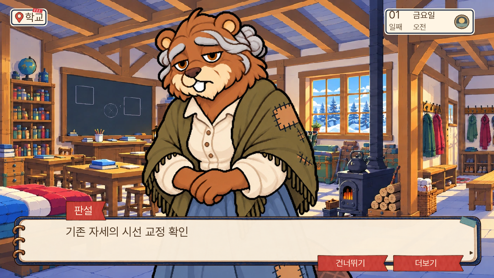
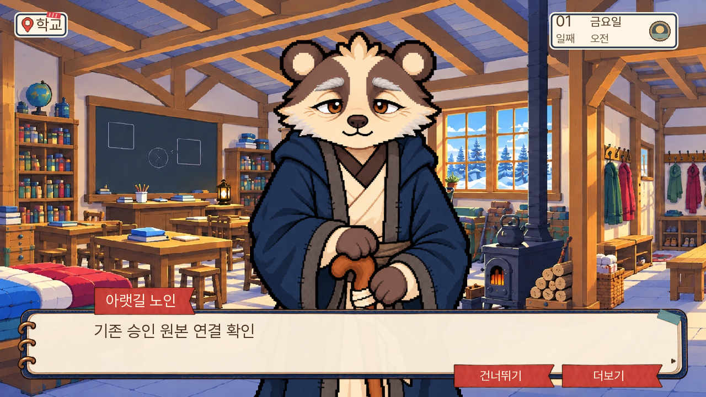
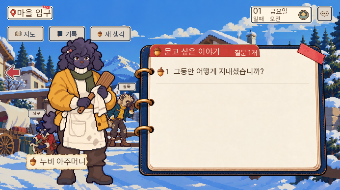
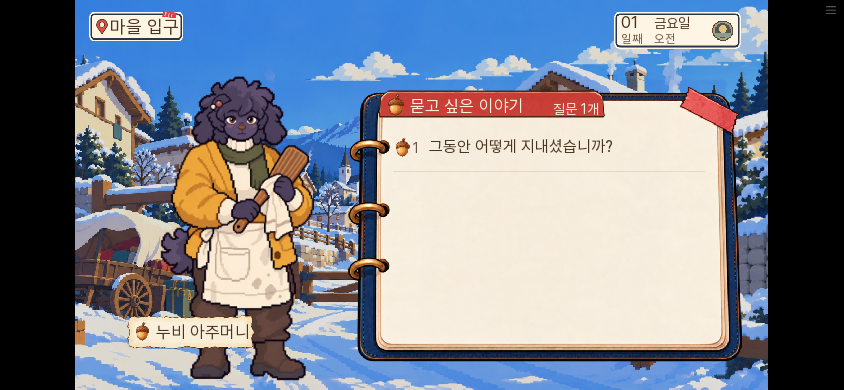

# 대화 시선·이미지 품질 검수 · 0.20.116

사용자 요청: ‘캐릭터 나를 보게 시선 바꾸고 이미지 퀄리티 체크’.

## 확인 범위와 변경

현재 일반 대화 그림 등록69개 키(미사용·이름 미등록 후보 포함)의 실행 프로필과 중립 그림을 대조했다. 소스에 ‘player’라고 적혀 있는 것과 실제 눈동자가 상대를 보는 것은 다르므로 이미지도 직접 확인했다. 옆 시선이 남은16명의6감정을 교정했다. 별도 정면표는 기존9명 중 너울·실룩을 교체하고14명을 추가해23명이 된다. 모든69역을 새로 그린 작업은 아니다.

| 문제 | 변경 | 유지한 것 |
|---|---|---|
| 고개·눈동자가 옆을 보는 일반 대화 | 16명×6감정 정면 교정 | 현재 종족·옷·소품·체형 |
| 작은 원본의 큰 근접 확대 | 96장 독립1024×1536 원본 연결 | 기존840 기준의 보이는 키 |
| 질문창의 전신·발끝 잘림 | 실제 정면 프로필만560 크기, 실제 알파 발끝708px 이내 | 의자·작업·독서 자세의840 경로 |
| 기존 당황 표정의 소수점 좌표 | 픽셀 위치를 정수로 정규화 | 동일 표정과 원본 |
| 일반 감정 연출이 예전 시선으로 복귀 | 같은 정면 묶음으로 연출 | 명시적 문맥·작업·회의 전용 그림 |
| 1302 대사에서 문맥 표정 소실 | 프로필을 비율에 맞춰 선택 | 전용 감정·파일·바인딩 |
| 승인 원본이 있는데 작은 도트를 사용하고 눈은 옆을 봄 | 판설·아랫길 노인의 자세를 보존해 시선9장 교정 | 기존 현장·초상 원본, 감정·배치·발 기준 |

16명은 선생님, 누비, 너울, 할머니, 모모, 초롱, 토실, 부엉이 어르신, 부리, 달그락, 연이, 굴돌, 톡, 뿔, 네로, 실룩이다. 현장 도트는 현장용으로 유지한다. 새 일반 그림을 기존 작업·독서 자세에 무조건 덮어쓰지 않는다.

## 품질 기준과 반려

파일은 PNG 원본을 보존하고 WebP q95로 형식만 변환한다. 전신·귀·꼬리·소품·발끝 여백, 양눈·눈동자의 방향, 감정 구별, 몸과 소품 위치를 밝은 바탕과 실제 화면에서 확인한다. 생성 도구의 투명 옵션만으로 승인하지 않는다. 선생님·누비 일부 감정의 회색 배경 잔상, 달그락의 머리 상단 접촉, 너울 당황의 외곽 잔상을 발견해 재생성했다. 생성 원본과 반려본은 보존하며 반려본을 게임에 연결하지 않는다.

신규90장은 일반1302 표시에서도 원본을 축소한다. 달그락6장은 기존 표시 키와 전신 여백을 보존할 때 최대1.029배로, 자동 반입은1.05배를 상한으로 둔다. 원본 해상도만 크게 적고 저해상도 그림을 다시 늘린 파일은 쓰지 않는다.

## 독립 코드 검수

독립 검수에서 등록 여부만 보고 질문 크기를 바꾸면 세련의 의자 듣기 자세도 작아지는 문제를 발견했다. 실제 선택된 프로필과 pose를 확인하도록 고쳤다. 기존 정면 그림 일부는560에서도 발끝이2~3px 밖으로 나가 실제 알파 경계로 상단 위치를 보정했다. 재확인에서 의자·생각·회의 비집중 경로 보존과 기존9명 발끝708px 이내를 확인했다.

## 남은 품질 차이

공용 단역3벌(순찰·주민·아이)을 사용하는8역은 승인된 고해상도 원본을 확인하지 못했다. 현재 직접 보는 그림과 감정·역할을 유지하고 소스 메모에 남겼다. 전체 화풍의 차이나 모든 작업·문맥 그림의 해상도를 이번에 통일했다는 뜻은 아니다. 단역을 다른 사람 그림으로 임의 대체하지 않는다.

## 검증의 해석

아래 엔진 검사는 인물과 감정을 준비해 화면·복원을 검증하는 시험이다. 이야기의 자연 진행이나 초견 재미 검사가 아니다. 브라우저 화면 검사도 외형 검증을 위한 준비 상태와 실제 저장 불러오기를 구분한다. 게임 전체를 새 판으로 재주행한 보고는 아니다.

웹 휴대폰 검수에서 ‘누비 아주머니’ 이름이 고정 폭 이름표 밖으로 줄바꿈되는 것을 발견했다. 실제 글자 폭과 현재 타이포 단계로 이름표 너비를 계산해 고치고, 질문지와 겹치지 않는 최대 폭을 둔다. 이름표 안 세로 위치도 가운데에 맞춘다.

판설3장과 아랫길 노인6장도 기존 고해상도 원본을 직접 보니 시선이 위·옆으로 향해 별도 대화 원본으로 교정했다. 기존 현장·초상 파일은 바꾸지 않았다. 판설의 피곤한 표정은 중립으로 치환되지 않도록 별도 이름의 감정을 보존한다. 총18명105장의 알파 채널은 PNG와 WebP에서 바이트 단위로 동일함을 확인했다.

## 최종 검사

- 전체 단위 검사1368개 통과(98.623초), Ren’Py lint 구문·참조 오류 없음. 기존 미도달 문장과 속성 검사 설정 권고는 남아 있다.
- 최종 엔진 검사: 주 인물96표정(97검증), 추가2명9표정(9검증), 질문 화면16검증, 이전0.20.115 저장 복원4검증, 실제 이름 등록 키의 PC·휴대폰/일반·큰 글자 이름표4검증 통과.
- 기존 의자·생각 경로5검증과 회의4검증도 통과했다. 전체 이야기의 자연 진행·전체 화면 회귀는 이번 검사 범위가 아니다.
- 최종 웹 핵심17,325,414바이트, 시작 자료36,458,832바이트(엔진 제외), 지연 파일4731개. 새 그림105장을 시작 시 일괄 다운로드하지 않는다. 핵심 SHA256: 074eaea0dce23eadb74d5f9fcc724e8e6ecc5d53fcefd77ed2de5a17697e2473.

## 화면 비교

| 교정 전 | 교정 후 |
|---|---|
|  |  |
|  |  |
|  |  |
|  |  |

원본 크기·경계·해시는 [에셋 검수표](에셋검수.json)에 남겼다. 검수용 장면은 별도 임시 게임에서 실행하며 실행 게임에는 포함하지 않는다.

최종 빌드의 실제 브라우저에서 새 게임 첫 돌목 대화와 저장·불러오기,18명 대사,8명 질문 화면의 PC1280×720·휴대폰844×390 표시를 확인했다. 브라우저 오류0건. 표정·질문은 준비한 검수 상태이며14일 자연 진행을 뜻하지 않는다. [브라우저 결과](브라우저검수.json).

