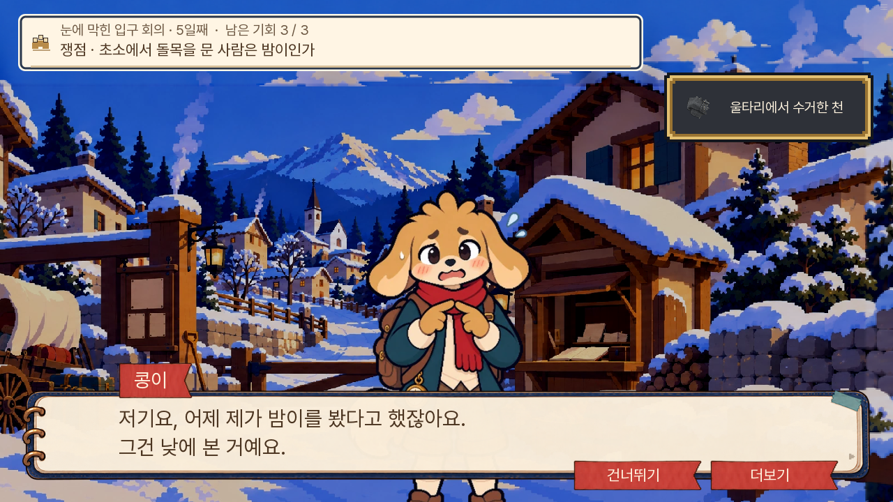
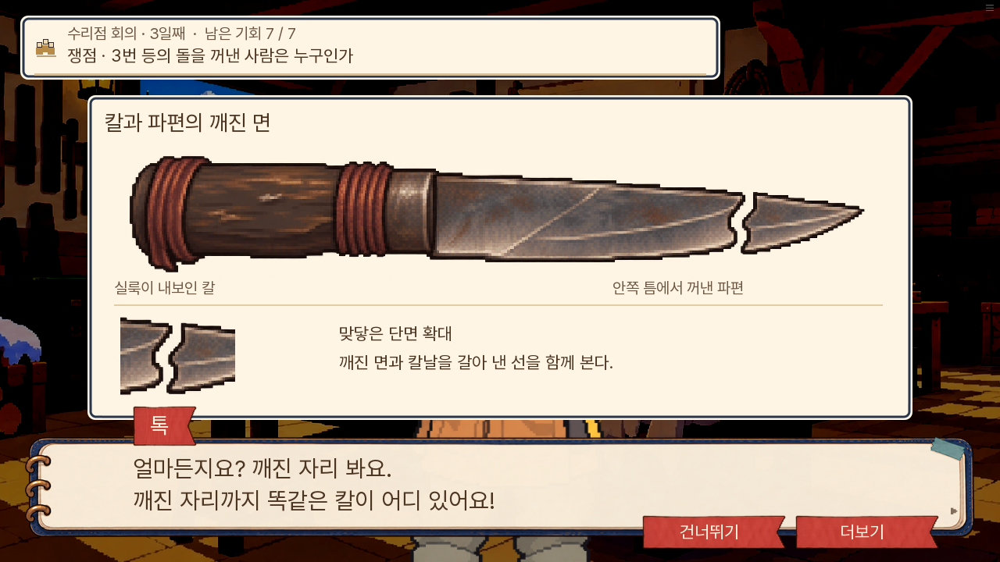
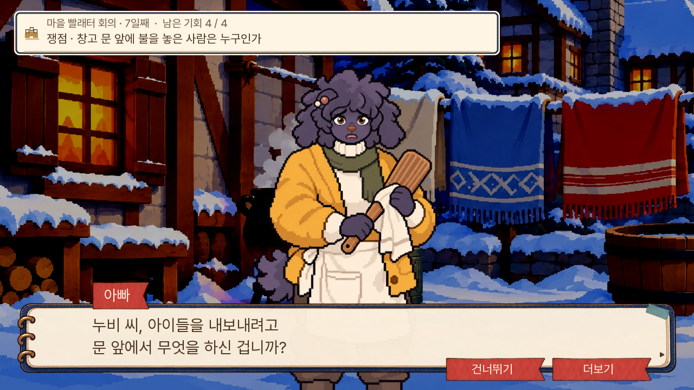

# 1부 회의 개선 적용 검수 — 0.20.125

2026-11-08. 회의 검토에서 승인받은 인물 배치, 증거 확대, 5일차 문답, 7일차 반복 확인을 수정했다. 진상·원본 records·정답 조합·기회 총수·생사·결말은 변경하지 않았다. 새 질문 세 갈래는 서로 다른 사실을 확인하는 접근이며 새로운 결말 분기는 아니다.

| 항목 | 적용 | 확인 |
|---|---|---|
| 콩이 얼굴 가림 | 원본의 실제 발끝으로 배치하고 크기·주민 키 차이는 유지 | 실제 5일차 첫 발언, 웹 PC·휴대폰 |
| 배경의 거울 반복 | 실내·현장 한 사람 회의는 실제 장소 그림 안에서만 이동 | 입구·수리점·빨래터 |
| 칼끝 대조 | 대조 선택 뒤 전체 칼·파편·단면 확대. 자료함도 같은 원화 사용 | 대조 전 미노출·다음 쟁점 복귀·PC·휴대폰 |
| 3일차 이중 입력 | 대조 방향 메뉴를 생략하고 기존 자료 제출로 검증 | 오답 뒤 남긴 자료·재제출·무동의 칼 대조 |
| 제출과 답변의 강약 | 제출 자료의 짧은 강조, 저자가 지정한 반응 프레임, 명암·볼륨 연결 | 입구 정답·오답·회의 종료 후 볼륨 복구 |
| 5일차 자동 알리바이 해설 | 얼굴 목격·착용 여부·당시 위치를 직접 질문하고 나비가 답함 | 세 접근, 기본 자료·초상화 대체 경로, 승리·기회 유지 |
| 7일차 확인 반복 | 연결판에서 바로 질문. 출처는 선택 열람. 관찰 재낭독 제거 | 질문별 실제 응답·출처 변경·현장 복귀 |
| 자백 전 재대조 | 한 가지면 실제 질문으로 진행, 흔적·들은 말 두 가지면 선택 보존 | 단일 경로·복수 경로·저장 복원 |
| 질문 상대의 표정 | 누비를 부르는 말과 불안한 듣는 표정 명시 | 아빠의 추궁·새로고침 후 이어하기 |

**웹에서 추가로 발견해 수정한 문제.** 네이티브의 이미지 Surface는 불투명 영역을 측정했지만 웹은 빈 경계 `[0,0]`을 반환했다. 첫 수정은 웹에서 이전 위치로 돌아갔다. 제작 단계에서 측정한 1,338개 프레임의 `source_alpha_bounds`를 크기표에 함께 넣어 웹에서도 같은 좌표를 쓴다. 크기·기존 offset·원화 파일은 바뀌지 않았다. [수정 전 측정](web-geometry-before.json)과 [수정 후 측정](web-geometry-after.json)에서 콩이의 배치값은 108에서 -136으로 바뀌었다.

5일차의 기존 나비 증언 뒤에서 재개하는 구 저장은 새 질문 변수가 없어도 이어진다. 겉옷을 이미 묻거나 옛 증언을 재생한 뒤 같은 설명을 다시 요구하지 않는다. 에셋 도구함에 새 그림을 등록하면서 기존 마차 파일의 실제 캔버스 크기 정보만 맞췄으며 마차 그림은 교체하지 않았다.

**검증 결과.** 전체 단위 1,474개 통과, lint의 새 오류 없음, 대사 논리 A/B/C 각 0건. 관련 네이티브 화면 16개 통과([목록](native-results.json)). 최종 수정 뒤에도 누비 추궁과 복수 재대조 저장 경로를 다시 통과했다. 웹 5개 항목은 [기록](web-results.json)을 따른다. 기본 글자 속도 55·모션 켜짐에서 PC 1280×720과 휴대폰 가로 844×390을 확인했다. 실제 저장칸에 저장한 뒤 페이지를 새로고침하고 이어하기로 같은 대사·회의·질문 상대를 복원했다. 공개 묶음 검증도 통과했다.

검수는 회의 시작 상태를 준비한 뒤 실제 화면을 조작한 것이다. 새 게임부터 7일까지의 연속 완주나 14일 모든 분기·모든 구 저장 파일의 검증은 아니다. 오디오 채널·볼륨 복구는 확인했으며 청취 품질 평가는 포함하지 않는다. 재미와 리듬 평가는 자동 검사 통과만으로 보증하지 않는다.

**실제 화면.**

콩이 — [수정 전](screenshots/kongi-before.png), [수정 후 PC](screenshots/kongi-after.png), [휴대폰](screenshots/kongi-mobile.png).

칼끝 실물 대조 — [휴대폰](screenshots/knife-mobile.png).

5일차 — [플레이어 질문](screenshots/day5-question.png), [나비의 직접 증언](screenshots/day5-witness.png). 기존 검토의 정답 뒤 55페이지 연속 읽기 구간을 끊고, 이번 기본 경로는 정답 뒤 5페이지에서 질문을 고른다. 밤이의 이름 확인과 종이 접기는 남겼다.

7일차 — [바로 질문하는 연결판](screenshots/fire-board.png), [추궁 상대 수정 전](screenshots/fire-listener-before.png), [수정 후](screenshots/fire-listener-after.png), [새로고침 후 복원](screenshots/save-reload-mobile.png).

제출 강조 — [실제 전환 프레임](screenshots/submit-accent.jpg). 고른 자료만 보여 주며 새 사실이나 정답 개수를 먼저 알려주지 않는다.
