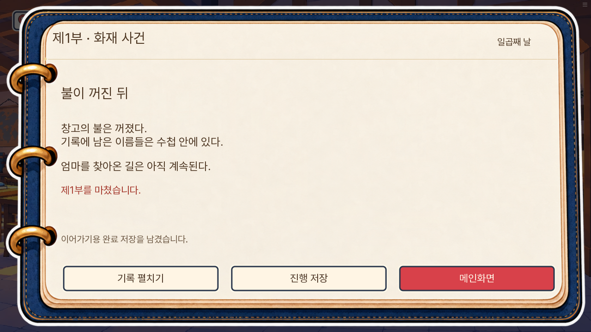
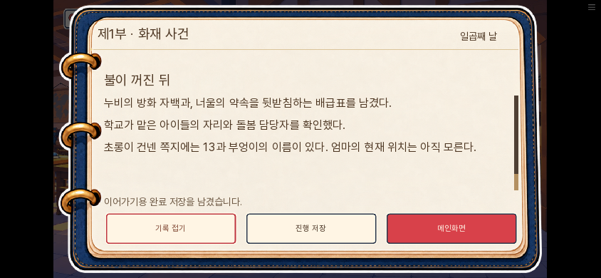
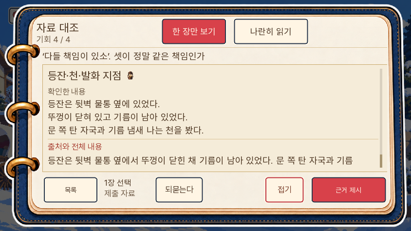
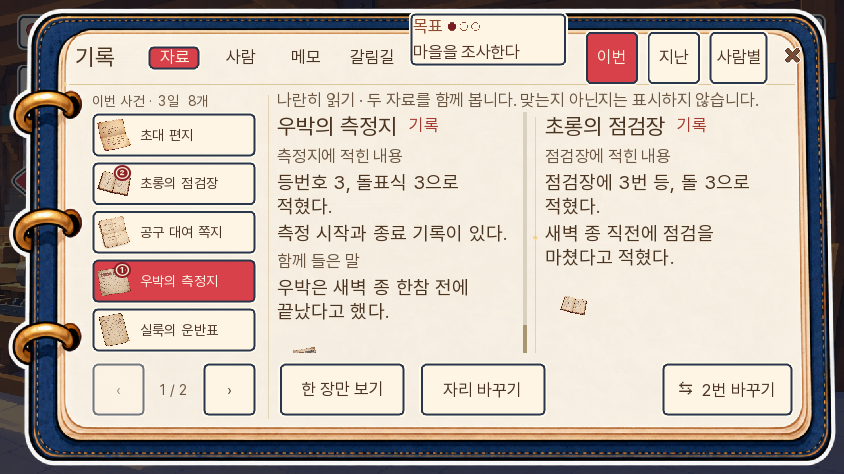
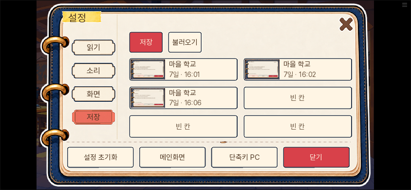

# 제1부 · 화재 사건 검수

2026-11-06 · 0.20.114. 제1부의 끝은 7일 오후 후속 행동 뒤이며, 기존 7일 저녁의 13호실 사건은 다음 편이다.

## 구현 확인

`r13_part1_ready`는 7일, 화재 판정 확정, 학교 인수 완료, 연락 쪽지 수령을 모두 요구한다. 불완전한 중간 저장·검수 fixture는 완성으로 기록하지 않는다. `r13_part1_finish`를 기존 `free_evening7` 첫 지문 앞에 호출한다. 다음 사건 라벨·생사·판정 데이터는 유지한다.

종료 대화는 화재 결과별 아빠의 생각과, 현재 학교에 함께 있는 다람의 가족 대화로 나눈다. 결과 기록은 자동으로 펼치지 않는다. 성공 판의 문서 입증은 실제 `neoul_promise_proven`이 있어야 하며, 부분 성공·실패에서 보리의 기록을 지우지 않는다. 학교가 아이들을 맡았다는 사실과 미래의 저녁·숙박 완료를 혼동하지 않는다.

별도 `part1-clear` 저장에 기존 호출 스택·자료·선택을 남긴다. 엔진에서 저장·불러오기·메인 이어하기를 실행했다. 후속판 설정으로 바꾸었을 때 8일로 뛰지 않고 원래 7일 저녁 장면에 들어가는 것도 확인했다. 터치 완료 화면은 함수를 교체하지 않고 실제 창 높이를 줄여 검사했다. 초기 검수 fixture의 화면 판정 함수를 덮어쓴 탓에 저장이 실패했으며, fixture를 고쳐 원래 함수 참조가 저장되도록 했다.

## 화면

## 검사 한계

중간 상태를 준비한 분기별 엔진 시험과 새 게임 연속 입력은 구분한다. 자동 진행은 정답 계획을 사용하는 기능 검증이며, 처음 보는 독자의 난도·재미를 측정한 시험이 아니다. 8~14일 전체 재주행과 외부 이용자 평가는 이번 범위가 아니다.

## 엔진·정적 검사 결과

전체 단위1347개와 최종 변경 관련34개가 통과했다. 대사 논리 검사 A(소개 전 이름), B(생사 조건 없는 발화), C(같은 결과 조건 지문 중복)는 각각0건이다. 자동 대본 추출 실패9곳은 기존 범위와 같다.

엔진에서23개 고유 시험을 통과했다. 완료 경계5개, 추가 자료 읽기5개, 5일 판정2개, 등 미수판3개, 화재 가설·재조사2개, 화재 실패·부분 성공2개, 화재 대승리·일반 승리2개, 휴대폰·큰 글씨 읽기2개다. 수정한5일 판정 시험은 E21이 다음 쪽에 있어 첫 쪽에서 누르던 구동기를 실제 쪽 넘김으로 고쳐 재통과했다.

## 웹 연속 주행

새 Chromium 프로필에서 새 게임부터 7일 화재·학교 인수·오후 후속 행동 뒤 1부 완료까지611초 동안 연속 입력했다. 정답 계획과 대화 건너뛰기를 사용했고, 시작/중간 상태를 주입하지 않았다. 캡처161장, 페이지 오류0이다. 이 판은 피코 사망, 꼬미 사전 대피, 화재 대승리, 배급표 입증, 난로 돌 교체를 거쳤다. 종료 시점은 학교·7일 오후이고, `route7=uncommitted`, 다람 구금 없음, 다음 13호실 사건 진입 없음이다. 요약은 [연속주행](연속주행.json)에 있다.

이후 복원 검사에서 화면 Action 안에서 바꾼 완료 표식이 저장 복원 때 유지되지 않아 자동 저장이 다시 쓰이는 것을 발견했다. `retain_after_load`로 완료 표식과 오류 초기화를 보존했다. 최종 엔진 시험에서 복원 뒤1초 기다려도 완료 저장의 생성 시각이 바뀌지 않고, 후속판의 원래 저녁 장면으로 이어지는 것을 재통과했다. 관련 단위14개도 통과했다. 연속 주행은 이 저장 보완 직전 코드였으며, 최종 웹판에서는 저장·복원 경로를 별도로 재검증해 통과했다.

## 최종 웹 저장 확인

실제 연속 주행이 만든 완료 저장을 최종 빌드에서 불러왔다. PC1280×720과 휴대폰844×390, 메인 이어하기, ‘1부 완료’ 불러오기, 브라우저 새로고침 뒤 불러오기를 통과했다. 7일·학교·모든 분기 값·보유 증거·현재 장면이 같으며, 완료 저장의 생성 시각이 바뀌지 않았다. 수동 저장도 실제 빈 칸에 남겼다. 페이지 오류0. [저장 복원 결과](저장복원.json).

휴대폰 설정 저장칸은 높이94, 내부 그림131×74로 확인했다.

공개 ZIP의 원본 일치·두 전송 조각 해시·검수 fixture 제외를 확인했다. 첫 로딩36,386,260바이트로 전판보다11,833바이트 늘었고 선로딩33·원격4626·예열107개는 유지했다.
