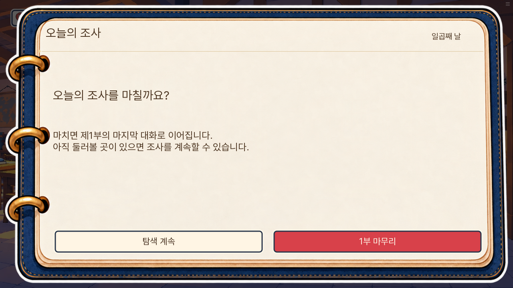
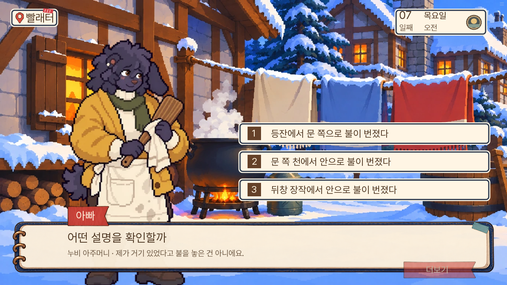
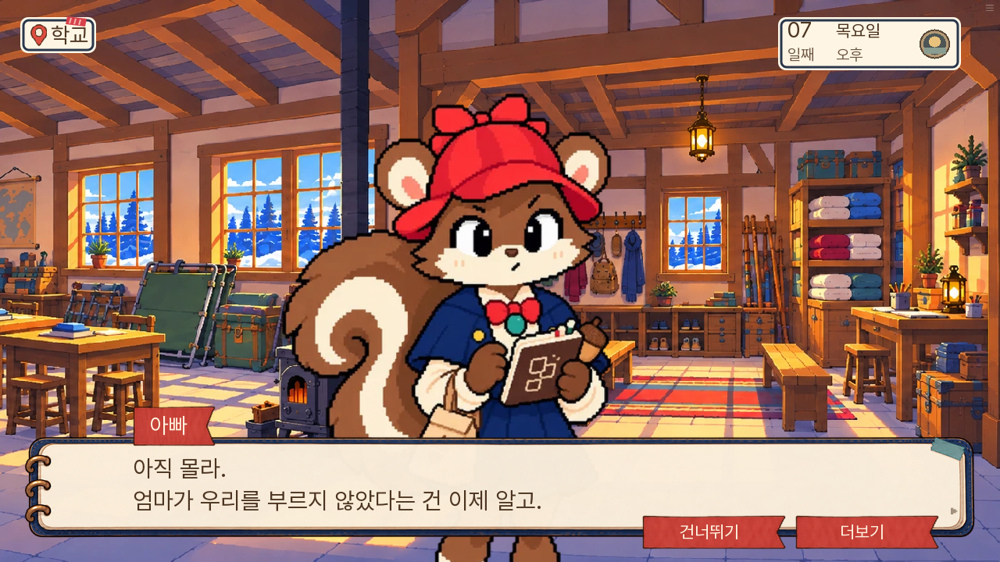
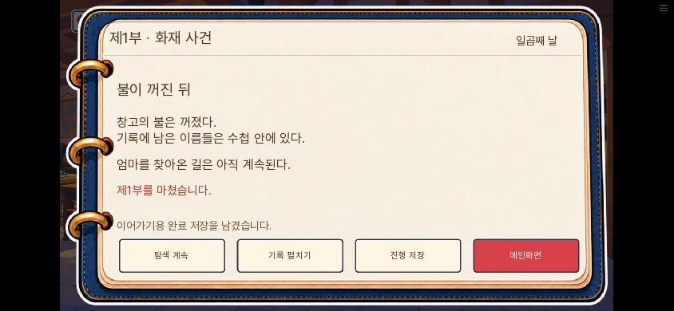

# 제1부 리뷰 보완 검수 · 0.20.115

소유자 승인: ‘그부분 개선해줘’. 0.20.114의 1부 리뷰 다섯 항목을 대상으로 한다.

| 문제 | 반영 | 보존 기준 |
|---|---|---|
| 평범한 대화가 갑자기 종료됨 | 명확한 마무리 제목, 종료 전 탐색 계속, 완료 후 탐색 복귀 | 기존 사건·오후 행동 보존, 재마무리 저장 갱신 |
| 정답만 신중한 말투 | 칼날 자국/부러진 칼끝, 세 발화·확산 가설 | 원래 선택 순서·정답·기회·판정 |
| 엄마 찾기의 다음 계획이 흐림 | 6일 물자·연락 의도와 마지막 가족의 질문 연결 | 엄마 위치·안전·편지 작성자 미확정 |
| 인물이 반복해서 추리를 가르침 | 아빠의 확인 행동, 다람의 감정·기억, 너울의 처분 유지 | 실제 들은 사실·알리바이·처분 결과 |
| 마지막 감정의 분기 차이 부족 | 꼬미 생사·보리 혐의별 대화와 누비의 사망 소식 반응 | 생사 미상에 새 사실 없음, 기존 결과 불변 |

## 독립 검수 반영

두 독립 검수자가 대사와 종료 복귀 코드를 별도로 읽었다. 6일에 한 말을 7일의 ‘오늘’로 부르던 문장을 ‘어제’로 고쳤다. E27 소지와 전문 청취·대조 완료를 구별했다. 너울의 약속이 앞으로 지워질 수 없다는 보장은 현재 기록 사실로 고쳤다. 누비의 자기방어 문답 뒤에 사망 결과를 듣는 정적이 남도록 배치했다.

## 확인 범위

중간 상태를 준비한 엔진 시험과 실제 저장에서 이어 진행한 웹 검사를 구분한다. 정답을 아는 개발 검증이며, 초견 이용자의 재미·난도를 측정한 시험은 아니다. 8~14일 변경·전체 재주행은 이번 범위가 아니다.

## 검증 결과

- 단위 검사 1,354개 통과. 자동 발화가 다른 주민의 위치를 바꾸지 않는지, 사망·떠남 조건과 구 저장의 다람 표시를 확인하는 회귀 검사를 포함한다.
- 엔진 시험 15개 고유 경로 통과: 마무리 취소, 완료 후 복귀·재저장, 완료 저장 복원, 성공·부분 성공·실패·추가 입증, 후속판 연결, 구 저장의 미청취 편지, 칼 대조 정답·오답, 화재 가설·재시도, 5일 추가 자료, 6일 두 주민 반응 경로. 자동 발화 수정 후 핵심 4개를 재통과했다.
- 최초 취소 시험은 화면 밖 다람을 누르려 했고, 복귀 시험은 일반 대화의 정상 경과 시간까지 취소 효과로 비교했다. 실제 구역 이동과 선택창 직전 상태 비교로 시험 구동기를 바로잡아 재통과했다.
- 대사 검사 A/B/C 각 0건. lint는 기존 도달 불가 경고 17곳이 남고 오류는 없다. 공개 검사 통과. 묶음 내부 원본 일치·파트 및 전체 SHA-256·QA 파일 제외를 확인했다.
- 이전 실제 7일 시작 저장에서 화재 기본 성공까지 웹 UI를 연속 진행했다. 새 가설, 학교 인수, 종료 전 선택, 꼬미 생존 및 엄마 편지 대조를 반영한 가족 대화를 확인했다. 페이지 오류 0건. 새 게임부터 7일까지의 전체 재주행은 하지 않았다.

## 웹 검사에서 발견한 위치 오류

학교에서 공방으로 가서 부리와 대화하면, 자동 발화 합류가 이전 주민 명단 전체를 현재 장소로 다시 배치했다. 지도에서 돌아온 뒤에도 다람의 위치가 공방으로 남아 마지막 가족 대화가 생략됐다. 자동 발화의 합류 범위를 말하는 주민 한 명으로 줄였다. 이미 오염된 구 저장도 학교 화면에 실제 보이는 다람과 대화할 수 있도록 복구한다. 이때 다른 주민의 위치를 소급 변경하거나 죽은 인물·떠난 인물·구금된 다람을 불러오지 않는다.

## 기존 완료 저장과 모바일

0.20.114의 실제 완료 저장을 불러와 탐색 복귀 → 종료 취소 → 공방에서 집게 빌리기 → 학교 복귀 → 가족 대화 → 재완료 저장 → 새로고침 후 불러오기를 UI로 진행했다. 취소 시 상태 불변, 학교 주민 위치 보존, 가족의 엄마 계획·과자 대사 재생, 증거·판정 보존, 새 완료 저장 갱신을 확인했다. 불러오기만으로 완료 저장 시각이 다시 바뀌지 않는다. 844×390에서도 복귀·취소 조작이 통과했다. 페이지 오류 0건. [요약 결과](웹검수-구완료저장.json).

## 화면

종료 전에 선택한다. 취소하면 그 자리에서 계속 조사한다.

화재 선택지는 같은 수준의 세 설명을 제시한다. 뒤에 자료와 반박으로 가린다.

편지를 실제 읽고 대조한 판에서만 가족이 그 차이를 다음 질문으로 이어 간다.

완료 화면의 탐색 복귀·기록·저장·메인 동작은 모바일 가로 화면에서도 유지한다.

위치 오류를 실제로 담은 이전 웹 완료 저장도 별도로 불러와 탐색 → 취소 → 재마무리 → 새로고침·복원을 확인했다. 엄마 계획과 과자 대사가 실제 이력에 모두 남았고, 기존 집게·증거·판정·다른 주민 위치를 보존했다. 모바일 복귀·취소와 페이지 오류 0건도 재확인했다. 이 경로에서는 집게를 새로 빌리지 않고 이전 저장의 행동을 유지했다. [복구 결과](웹검수-위치오류저장복구.json).

최종 묶음은 17,257,250바이트이며 첫 로드 예정량은 36,390,668바이트다. 이번 수정에는 새 이미지·음향을 게임에 추가하지 않았다. 신규 캡처는 검수 문서에만 두며 게임 초기 로드 대상이 아니다.
