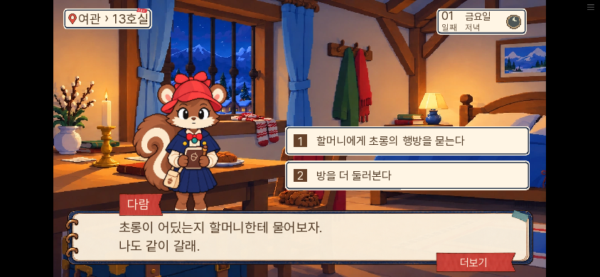
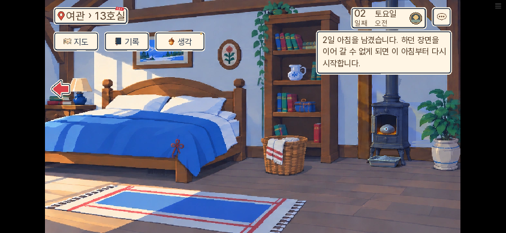
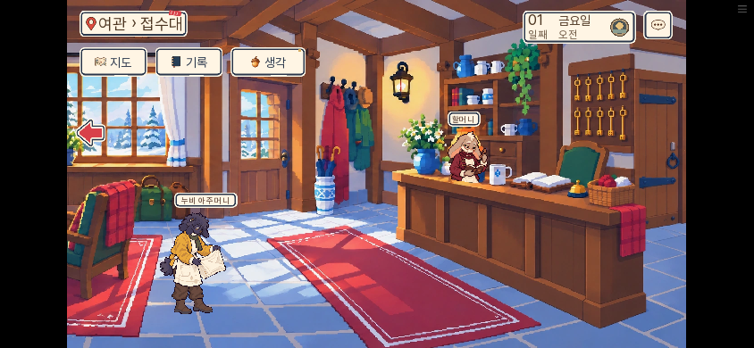

# 0.20.133 실행 부담 절감과 첫 플레이 검수

2026-11-09. 소유자의 “게임 가볍게 하고 처음 플레이하는 사람이라고 생각하고 리뷰하고 체크” 요청에 따른 작업이다.

## 바꾼 것

- 대사가 모두 나온 뒤에도 .02초마다 남아 있던 타이핑 음향 확인을 제거했다. 글자가 실제 나오는 동안에만 타이머를 두고, 무음·즉시표시·메뉴에서도 반복을 줄인다. 설정 복귀나 저장 복원 시 이미 나온 글자 소리를 밀려 재생하지 않도록 했다.
- 같은 승인 인물의 정적 그림을 매번 조립하던 경로에 최대48개 캐시를 뒀다. 파일·표정·크기·좌표·배율·픽셀 설정·도구함 revision을 구분한다. 시작 시각·진행 상태가 있는 동적 놀람 반응은 별도로 유지한다.
- 첫 플레이에서 돌목의 앞뒤 대사를 대조했다. “원본에 아이 이름이 있으면 고치겠다” 뒤에 다시 어느 서류가 맞는지 모른다고 하던 `MS14_D01_S03_L0010`을 “그렇다면 신청서와 명단을 나란히 보겠소.”로 바꿨다. 제출 전에 서류를 확인하겠다는 태도로 연결했다.

자료 ID·정답 조합·기회·생사·결말·공개 1부 경계는 변경하지 않았다. 원화의 해상도·표시 크기도 같다.

## 성능 측정

동일 로컬 Chromium·소프트웨어 그래픽·PC1280×720에서 완료된 같은 첫 대사를 확인했다. 본문 속도55, 타이핑 음향 켜짐이다. 다른 게임 탭은 일시 정지했다. 브라우저 기기 자체가 사용자의 PC·휴대폰 실기기는 아니다.

| 확인 | 0.20.132 | 0.20.133 |
|---|---:|---:|
| 글자가 끝난 8초의 타이핑 확인 호출 | 403 | 0 |
| 같은 원화100회 요청 때 서로 다른 조립 결과 | 100 | 1 |
| 원화100회 요청의 순수 호출 시간 | 약13.8ms | 약7.2ms |

마지막 행은 짧은 함수 측정이며 실제 클릭 지연의 개선률이 아니다. [이전 기록](before-idle.json) · [수정 뒤](after-idle.json) · [캐시 연결](cache-probe.json).

같은133 장면에서 완료된 글자의 옛 .02초 타이머만 복원해 **제거→복원→제거**로 각각8초 측정했다. 스크립트 시간은0.538→1.063→0.527초였다. 불필요한 타이머의 처리 비용은 줄었다. 종합 브라우저 작업 시간은3.090→3.321→2.699초로 흔들렸고, 별도132/133 비교에서도2.126→2.469초여서 전체 렉 감소율로 사용하지 않는다. [분리 비교 전체 기록](timer-ab.json).

첫 로딩 파일 용량은36,689,308바이트로 이전 판보다1,641바이트 증가했다. 이번 대상은 실행 중 반복 처리다. 다운로드가 크게 줄었다거나 모든 기기의 클릭 지연이 해결됐다는 뜻은 아니다. [최종 빌드](build.txt).

## 기능 확인

- 관련 단위199개 통과. 대사 수정 후 원문 교체28개·동적 연결12개도 별도로 통과했다. [단위](unit.txt) · [대사 연결](dialogue-unit.txt)
- SDK4개 통과: 글자 출력/실제 타이핑 음원/첫 클릭 즉시 완성/두 번째 클릭 다음 페이지/중간 대기 태그/무음·완료 저장 복원/스킵 후 일반 속도, 마차 건너뛰기, 초롱 특수 작업과 일반 그림 분리. [결과](native-results.json)
- SDK 저장 시험의 첫 시도는 예상 문자열을 시험 store에만 둬 불러오기 때 사라졌다. 비교 기준을 저장 대상 밖의 시험 모듈에 보관한 재검사에서 통과했다. 게임 저장 코드를 우회해 고친 것은 아니다.
- 대사 논리 A/B/C0건, lint에 새 구문 오류 없음. 기존 도달 불가 문장 안내는 남아 있다. [논리](dialogue-check.txt) · [lint](lint.txt)

## 처음 플레이하는 사람으로 읽은 결과

0.20.132 새 브라우저 프로필에서 “처음부터”를 눌렀고 마차를 건너뛰지 않았다. 여관에서 실제 저장칸을 눌러 저장한 뒤 새로고침해0.20.133으로 불러왔고, 자료·일차·장소·게이트·서사 진행값이 모두 같음을 확인했다. [저장 호환](저장호환.json). 진행 값·자료·정답을 주입하지 않고 실제 화면을 클릭했다. 명단 확인, 요일 칸의 오답 후 재선택, 신청 원본 읽기, 두 서류 비교, 두 자료 제출 성공, 여관 이동을 확인했다. 자료 선택은 화면에 나온 내용으로 했으며 자동 정답 제출 드라이버는 사용하지 않았다. 서사 검수 때는 코드/공략을 읽지 않은 별도 독자도 실제 대사 기록과 그림을 읽었다.

실무 의견으로는 부녀 관계와 첫 목적은 읽힌다. 과자 한 개를 엄마 몫으로 남기고,13호실 편지를 읽으며 같이 잘 자리를 정한 다음, 입구에서 딸 이름이 빠져 막힌다. “나 때문에 못 들어가는 거야?”가 서류 조사에 감정을 붙인다. 여관에서 엄마가 없다는 말을 들은 다람은 외투를 잡고 “기다린댔는데”라고 반응하며, 아빠도 마지막 목격을 묻는다.

13호실에서는 실제 침대 클릭의 빈 반응, 책상 흰 종이 클릭, 엄마 메모·가족 그림 발견 대사, 초대 편지/메모의 끝부분 짚기, 비교 마무리와 다음 목표까지 진행했다. “이 차이만으로는 편지를 누가 썼는지 모르겠다” 뒤 초롱에게 메모를 보여 묻는 목적이 나와, 관찰만 하고 갈 곳을 알 수 없는 상태는 이 경로에서 없었다. [읽은233개 표시 대사](실제읽은대사.jsonl).

선택지에서 실제로 할머니에게 초롱의 행방을 물었다. “내일 아침 광장” 안내와 밤 가족 대화를 거쳐, 방 오른쪽 구역의 침대를 눌러2일차 오전으로 진행했다. 비교 창에 갇히거나1일차에서 진행이 멈추는 현상은 이 경로에서 없었다. 독립 독자 검수는232개 대사, 루트 실제 클릭 기록은 침대 밑 관찰을 포함한233개 대사와2일차 진입까지다. [최종 웹 상태](final-web.json).

실무 의견으로는 첫 논증은 새로운 진상을 발견하는 추리보다 두 서류를 선택해 제출하는 조작 연습이다. 이미 아빠가 차이를 말한 뒤 내기 때문에 이 장면만으로 추리 전체가 재미있다고 판단하긴 이르다.

남은 검토 항목:

- 첫 조사 전 표시 대사가72개다. 가족 관계는 쌓이지만 조작이 시작되기까지 기다리는 인상은 남는다.
- 등록 성공 뒤 이름을 적음·기다림·맞음 확인이 반복돼 해결 뒤 리듬이 느려진다.
- 이미 마차에서 내린 뒤 “발판이 얼었소, 붙잡고 내리시오”라는 말은 어느 발판인지 화면에서 확인하기 어렵다.
- 엄마의 도토리 습관 소개가 메모 발견과 끝부분 재비교 때 비슷한 말로 반복된다.
- 장식용 침대를 누르면 아빠의 “(침대)” 한 줄만 나와 다음 클릭을 요구한다. 새 정보가 없는 반응이 조사의 리듬을 끊는다.
- 자료 대조의 “변경” 버튼은 자료를 바꿔 읽는 조작이지만, 문서 내용이 바뀌었다는 표시로 오해할 여지가 있다.
- “같은 도착일”이라는 문서 표현은 무엇과 같은 날인지 기준이 모호하다. 요일 재선택은 가능했고 진행 불능은 아니었다.

[독립 첫 독자 검수](독립첫독자검수133.json)의 확인 범위와 의견을 구분한다. 이번 기록을1~7일 새 연속 완주나 모든 분기 검증으로 세지 않는다.

## 한국어 윤문 도구 설정

추가 요청에 따라 [slop-rewrite](https://github.com/byungjunjang/slop-rewrite)를 고정 소스에서 설치하고 Codex·Claude Code의 전역/프로젝트 진입점을 연결했다. 대사·소설은 가이드없음, 기존 대화에서 확인한 네 취향을 사용한다. 개인 취향과 코멘트 원문은 공개 저장소 밖에 있다. [운용 안내](../../../../../docs/writing/SLOP_REWRITE.md) · [설치 영수증](../../../../../docs/writing/slop-rewrite-install-20261109.json).

검사 통과는 문장의 자연스러움·게임 재미를 대신하지 않는다. 이번 설치는 전체 대사를 자동 교체한 작업이 아니다.
