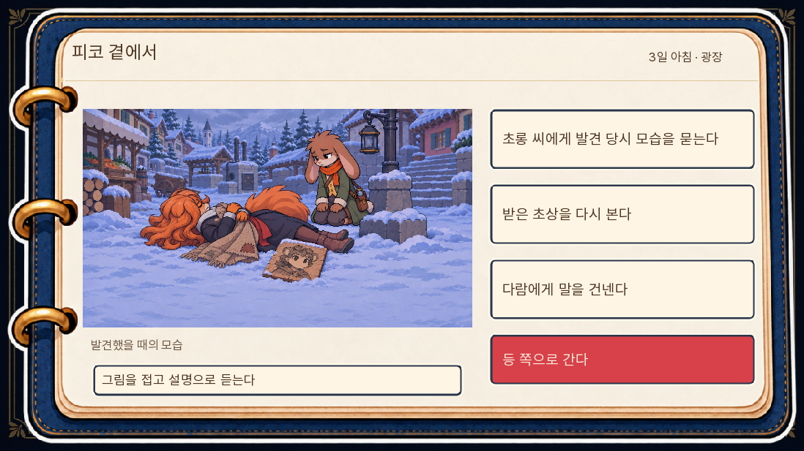
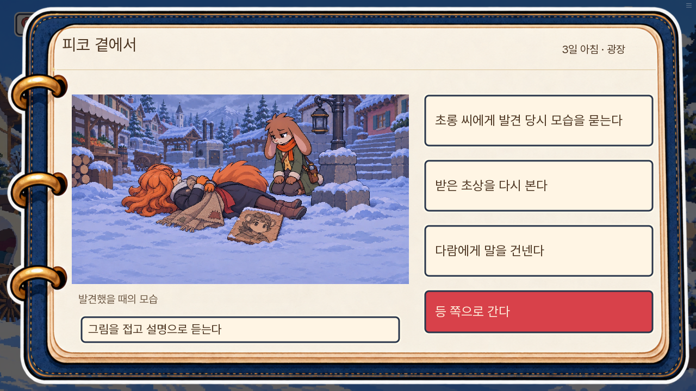
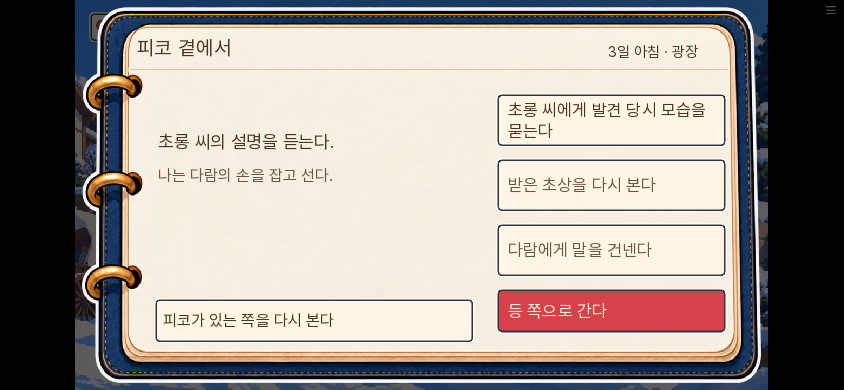

# 피코와 주민 반응 본편 적용 검수

2026-11-06 · 0.20.106. 소유자는 종합 리뷰의 본편 적용·3일차 연결 점검에 ‘해보자’, 실제 피코 현장 시안에 ‘응 시안 적용’으로 승인했다.

## 적용한 장면

| 구간 | 이전 문제 | 실행에서 바꾼 것 |
| --- | --- | --- |
| 2일 초상 약속 | 관계 보강이 원고에만 있음 | 피코가 아빠의 서툰 그림을 받아치며 다람을 감독으로 세우는 짧은 주고받기. 식당 이동 경로에는 담요 한쪽을 아빠에게 맡기는 행동 |
| 3일 초상 인수 | 사망 확인 뒤 부녀의 행동이 짧음 | 다람이 아빠의 외투를 붙잡고, 아빠가 다시 앉아 초롱에게 판자를 받음 |
| 사망 현장 | 발견 대화 뒤 곧바로 등 조사로 넘어감 | 인수 완료 뒤 승인한 수첩 화면에서 초롱 질문·소지 초상 확대·다람 대화를 선택. 그림을 접고 설명만 듣기·바로 떠나기 가능 |
| 보호생존 식당 | 정리가 선택 결과 설명에 머묾 | 나비가 그림·포대·아이의 역할을 배정하고 부녀와 실제 정리. 그림 인수는 그 뒤 |
| 톡의 답변 | 기술 설명과 의심이 정보로만 흐름 | 다른 공구 가능성을 인정한 뒤 자기 공구를 넣고 다음 질문을 받는 행동 |
| 부리의 답변 | 대여 자료 획득으로만 끝남 | 자기 말이 어떻게 적혔는지 확인하고 집게 반환을 부탁 |
| 사건 뒤 주민 | 사망을 알게 된 과정과 반응이 연결되지 않음 | 3일 나비·부리 실제 대면에서 아빠가 사망 확인만 전달. 대화 정상 반환 뒤 해당 주민 청취 표시. 3·4일 잔향은 현재 업무·필수 질문·큰 사건보다 뒤 |
| 발견 질문 | 사망 시각을 묻는 듯하지만 등 점검 시각으로 답함 | 질문 대상을 등 소등 시점으로 명시. 언제 숨졌는지는 모른다고 현장에서 확인 |
| 조사 동선 | 점검장 확인 전 공방 이동을 권함 | 톡은 공방 집게의 위치·둥근 끝만 설명. 현재 점검장 순서를 거스르는 이동 권유 제거 |

별편 전문과 주민 속마음을 게임에 넣지 않았다. 원고 03·06 전문 열람, 14일 전 주민의 반응 구현은 이번 적용 범위가 아니다. 사망 분기의 부리는 이제 화면 안 보고를 듣기 때문에 이전 별편07의 미인지 독백을 실행 대화 전체로 취급하지 않는다.

## 실제 화면

## 상태·조작 확인

- 사망 확정·E09 미완 초상 인수와 L9101 뒤에만 새 화면을 연다. 생존·미수는 기존 경로다. 피코를 대화 가능한 배우로 세우지 않는다.
- 세 질문을 다른 순서로 읽거나 재질문해도 자료·분·회의 기회·생사·초상 상태가 같았다. 하나도 읽지 않고 떠나도 기존 lamp_inspect3에 도착한다.
- 현장 질문의 읽음은 정상 대화 반환 뒤 기록한다. 그림을 접으면 질문 중에도 시신 컷을 강제로 다시 띄우지 않는다. 소지 초상은 기존 확대 화면을 쓰며 자료를 다시 획득하지 않는다.
- 확대 화면은 기존 Show 호출에서는 Hide, 새 call screen 호출에서는 Return으로 닫는다. 새 현장과 확대 화면에서 대화 건너뛰기가 멈춘다.
- 첫 사망 보고와 같은 클릭에서 잔향 인사를 다시 읽지 않으며, 기존 필수 질문이 있으면 질문지 처리는 계속한다. 정보 조회·화면 예측만으로 청취 표시를 만들지 않는다.
- 웹 검수에서 초상 획득 알림이 첫 질문을 덮는 것을 발견해 수첩·자료 화면의 기존 방식처럼 현장/확대 화면 동안 숨겼다. 획득 내용과 타이머는 바꾸지 않았다.

## 검증 결과

- 전체 단위 1,254개와 lint 통과. 통합 뒤 관련 단위 12개 및 최종 현장·소식·건너뛰기 검사도 통과. 대사 자동 검사 A/B/C 각0.
- 관련 네이티브 화면 8개 통과. 각 장면의 시작 상태를 준비한 부분 검증이며 1일부터 자연 진행한 시험으로 세지 않는다. `네이티브검수.json` 참조.
- 최종 웹 묶음의 PC1280×720·휴대폰844×390 큰 글씨에서 실제 질문·초상 닫기·그림 접기·떠나기를 실행했다. 버튼 본문은 안쪽 폭382px·높이84px 안에 들어왔다. 휴대폰 그림 접기 버튼도 높이88px로 맞춰 화면 축소 뒤44px 이상의 터치 범위를 확보했다.
- 브라우저를 새로고침해 메인 화면에서 실제 저장을 불러오고 거리 선택·두 질문 읽음·E09 소유·시간·기회·생사를 비교해 동일함을 확인했다. pageerror0. `웹검수.json` 참조. 이는 같은 판의 저장 검증이며 구버전 저장 변환 전체 검사는 아니다.

## 연속 진행 확인

새 게임으로 1일차를 진행하고 실제로 저장한 `br-piko_lost-day2`를 불러와 2~3일을 마친 뒤4일차에 도착했다. 주민 소식·현장 질문·자료 획득·회의 제출은 화면 버튼으로 진행했다. 사망/도난 한 경로이며 14일 전체 무중단 플레이는 아니다.

최종 상태는 피코 사망, 초상 미완성, 현장 질문3개 읽음, 부리의 사망 소식 청취, 측정/반출 구분 완료, 등 회의 승리다. 원래의 돌 반환·처분·추모·저녁·수면도 지나 다음 날로 넘어갔다. pageerror0. `연속진행.json`과 두 진행 로그에 근거를 남겼다.

도중 테스트 서버가 종료되어 서버 유지 방식을 고쳤고, 검수 도구가 유일 자료 제시에서 바로 열린 책을 닫기만 하는 문제 및 분기 저장 이름 대신 공통 저장 이름을 찾는 문제를 수정했다. 이 재시작은 실제2일 저장에서 이어 갔으며 임의3일 상태를 주입해 자연 진행으로 세지 않았다.

## 공개 묶음과 경량화

원본 records.json·정답 조합·승패·생사·사인·그림 상태/획득 순서를 보존했다. 새 그림·음악 파일은 추가하지 않았다. .105의 예열 직렬화·날짜별 준비·경로 조회 개선을 유지했다. 고정 엔진을 제외한 시작 게임 자료는36,365,844바이트로 이전36,352,192바이트보다13,652바이트 늘었다. 이 수치로 프레임 속도나 기기별 체감 속도를 판단하지 않는다.

공개 묶음 SHA-256: `5a3b19418e92d1729c61446022318d17679bb8c7950fe050e0231502cc2d7928`. `check_release.py`의 원본/공개 판 번호·묶음 검사 통과.

14일 전체 연속 플레이, 모든 후반 분기의 자연 주행, 인간 초면 독자의 재미 실험은 하지 않았다.
