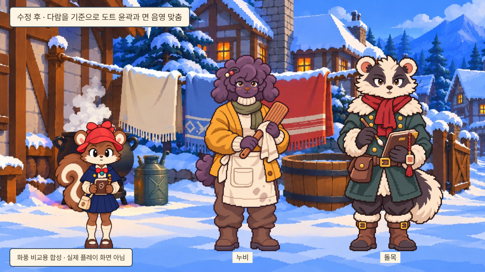
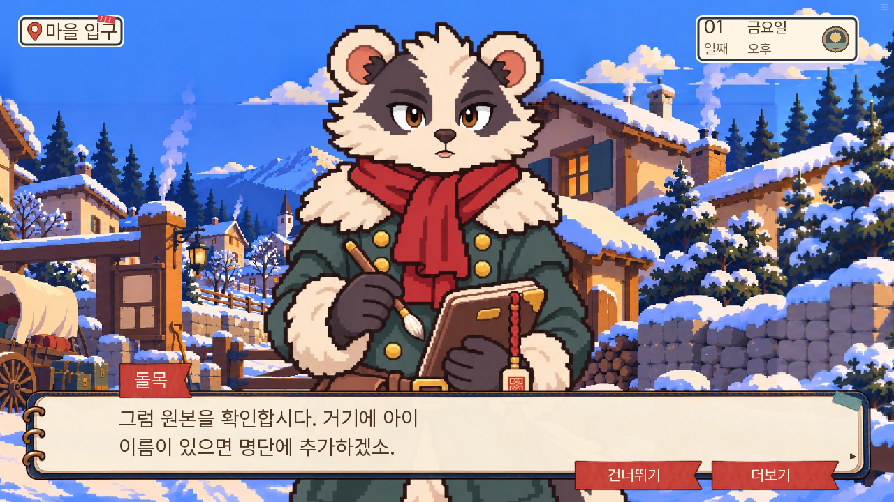
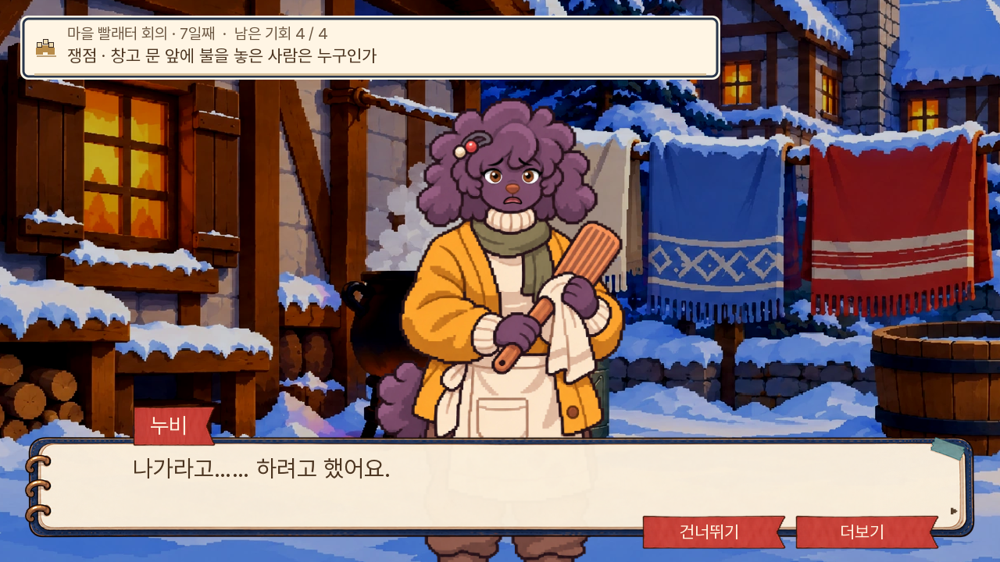

# 돌목·누비 도트 화풍 교정 — 0.20.127

2026-11-08. 소유자의 기존 도트 그림체와 새 누비 등의 차이 지적을 반영했다. 0.20.126의 누비를 매끈한 만화선으로 만든 방향은 잘못이었다. 기존 돌목도 털 붓질·연속적인 명암이 있는 별도 일러스트였다. 이번에는 **기존 다람의 작은 계단·색 덩어리·면 음영과 빨래터 배경**을 기준으로 삼았다.

## 전후 비교

[수정 전](screenshots/style-before.png) — 다람은 도트, 누비는 매끈한 만화, 돌목은 붓질 일러스트로 표현 방식이 갈렸다.

이 그림은 같은 배경·같은 비교 크기로 원본을 얹은 **화풍 검수용 합성**이다. 실제 플레이 화면이나 세 인물이 동시에 등장하는 새 장면이 아니다. 다람과 배경 원화는 교체하지 않았다.

## 적용

- 돌목·누비 각각 일반 여섯 표정을 독립적인 도트 원화로 다시 제작했다. 매끈한 벡터 곡선·털 붓질·천의 잔질감을 걷고 작은 계단형 윤곽과 제한된 명암면을 썼다.
- 외형·정면 시선·의상·소품·손자세·기존 표시 키·질문 전신 발선을 유지한다. 현재 정면 등록표와 크기표에서 바뀐 인물은 두 명뿐이다.
- 누비의 행주 근접 컷도 같은 의상색·도트 표현으로 교체했다. 기존 대사·행동·구도·다음 발언에서 얼굴로 복귀하는 흐름은 유지한다.
- 원본 PNG12장과 컷 원본을 보존한다. 기계적인 픽셀 필터·저해상도 단순 확대는 사용하지 않는다. 전역 확대 필터나 다른 인물·배경의 화풍도 바꾸지 않는다.
- 이전 가져오기 도구가 새 원화를 되돌리지 않게 보호하고 전용 재가져오기 명령·중앙 납품 기록을 갱신했다. 126 누비 원본은 이전 납품으로 남기고 현재 연결에서 제외한다.

실무 의견으로는, 수정 후 합성에서 두 사람이 기존 다람과 같은 도트 캐릭터군으로 읽히며 배경과의 충돌이 줄었다. 근접 행주 컷의 손 음영은 전신보다 조금 부드럽다. 모든 에셋의 픽셀 격자가 정확히 같거나 전체 주민의 작화 통일을 마쳤다는 뜻은 아니다.

## 실제 게임 화면

돌목 — [PC](screenshots/guard-pc.png), [휴대폰](screenshots/guard-mobile.png).

누비 — [PC](screenshots/nubi-pc.png), [휴대폰](screenshots/nubi-mobile.png).

질문 전신 — [돌목 PC](screenshots/guard-question-pc.png)·[휴대폰](screenshots/guard-question-mobile.png), [누비 PC](screenshots/nubi-question-pc.png)·[휴대폰](screenshots/nubi-question-mobile.png). 질문은 대사·무대를 내린 뒤 기존 질문 UI의 표시를 별도로 검사했으며 새로운 회화 경로로 세지 않는다.

원화 표정·알파 비교 — [돌목6표정](screenshots/guard-six.png), [누비6표정](screenshots/nubi-six.png). 이 두 그림도 원화 비교 합성이다.

## 검증 범위

전체 단위1,475개·lint 통과([기록](checks.txt)). [엔진 관련2경로](native-results.json)는 마차 건너뛰기·입구 도착과 7일 누비 자백·컷 해제·기존 자료 획득을 확인했다. 대사·판정·자료·생사·결말·공개 1부 경계의 소스 변경은 없다.

[웹 검사](web-results.json)는 0.20.126에서 저장했던 행주 장면을 0.20.127에서 이어하기로 불러와 새 컷과 다음 누비 도트 얼굴을 확인했다. 이어서 돌목 대사에서 새 저장→새로고침→이어하기도 확인했다. [기존 저장 복원 컷](screenshots/old-save-fold.png)은 자료 카드가 열린 저장 상태이며 새 그림으로 복원됐다. JavaScript pageerror와 Ren’Py 예외 화면은 없었다.

로컬 웹 PC1280×720·휴대폰 가로844×390, 기본 글자 속도55·모션 켜짐을 사용했다. 준비한 상태의 실제 대사·저장 UI와 별도 질문 표시 검사를 조합한 부분 시험이며 새 게임부터 7일까지의 연속 완주나 모든 주민·분기 검수는 아니다. 첫 로딩은 36,617,037바이트로 126 대비6,447바이트 증가했고 추가 표정은 지연 로딩을 유지한다.

## 원본·재현

- [돌목 납품](../../../art/pixel-consistency-20261108/guard/manifest.json): `python3 dev/import_guard_pixel.py --apply`
- [누비 납품](../../../art/pixel-consistency-20261108/resident_nubi/manifest.json): `python3 dev/import_nubi_consistency.py --apply`
- [행주 컷 납품](../../../art/pixel-consistency-20261108/cuts/delivery.json)
- [도트 참조 기준](../../design/PIXEL_STYLE_REFERENCE.md)
