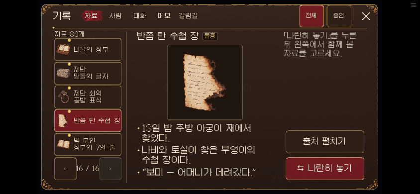
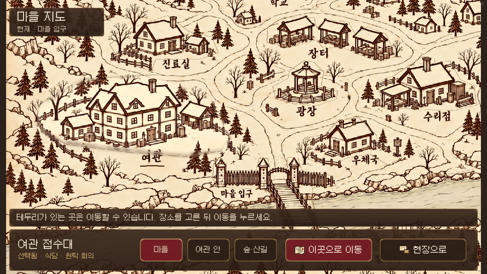

# 다람탐정 실제 플레이 보고서 반영 · 0.20.14

소유자가 전달한 [실제 플레이 보고서](SOURCE.md)와 자료 아이콘·한글 줄바꿈·지도 톤 요청을 함께 반영했다. 원본 Page 식별자는 `page_5dfa237a184c8191bb9b4e1ffc5c653f`다. 보고서의 실행판은 0.20.11이며, 이번 기준 소스는 0.20.13이다. 최종 검증은 [VALIDATION.md](VALIDATION.md)에 보관한다.

## 가장 크게 바뀐 화면

자료마다 이미 제작된 그림이 있었지만, 목록은 공통 종이·두루마리로 표시하고 있었다. 전용 원화 68종, 상태별 그림 3종, 증언자 초상 9종을 연결해 80종 모두 실제 내용에 맞는 그림을 사용한다. 그림 원본은 추가 생성하지 않았다. 전체 이름을 그림 옆에 표시하고 어절 단위로 줄을 나눠 ‘수첩 장’의 마지막 한 글자가 따로 떨어지는 문제를 줄였다.

목록은 한 페이지 5행이다. 한 화면의 개수보다 전체 이름과 터치 영역을 확보했고, 새 자료를 뒤에 추가해 기존 자료의 위치를 유지한다. 저장에 남은 선택 자료는 키를 기준으로 해당 페이지에 다시 연다.

지도 그림은 유지하면서 제목·안내·지역 탭·여관 목록·이동 버튼을 기존 갈색·금색 재질로 통일했다. 아직 갈 수 없는 일반 장소를 누르면 짧은 안내가 나온다. 숨은 장소와 이동 해금 조건은 바꾸지 않았다.

## 보고서 항목 대조

| 항목 | 반영 내용 | 보존한 것 |
| --- | --- | --- |
| U01 | ‘선택 마치기 · N개’, X와 같은 복귀 동작 | 고른 자료 유지 |
| U02 | ‘선택한 근거 제출’, 무료 편집·오답 기회 차감 설명 | 기존 기회 수·정답 판정 |
| U03 | 첫 현장 조작 안내, 사실과 입장 기준을 구별하는 질문형 힌트 | 정답 자료명·위치 자동 표시 없음 |
| U04 | 주요 터치 영역 88px, 설정·질문 페이지·하단 잘림 정리 | PC 기본 크기, 기존 디자인 |
| U05 | 이름표의 머리·HUD·카메라 좌표를 같은 배율로 계산 | 인물 크기·표식 없는 현장 |
| U06 | 자료별 그림·전체 이름·안정된 획득순·기억 페이지 복구 | 자료 획득과 본문 |
| U07 | 인물 제시·근거 선택·자기 비교 문맥 분리 | 공통 자료 화면과 제시 결과 |
| U08 | 반복 조사 읽음 표시, 유사 질문의 범위 구별 | 질문 순서·해금 조건·추가 정보 |
| U09 | 잠긴 장소 클릭 안내, 현재·선택·확정 상태 구분, 드래그 후 첫 터치 누락 수정 | 이동·시간·비밀 장소 조건 |
| U10 | 첫 입실 맥락 한 줄, 메모 터치 영역 확대 | 침대 감정 장면·메모→보따리 조건 |
| U11 | 내부 출처 ID 대신 장소·자료명·화자 표시 | 저장된 원본 출처 ID |
| U12 | 마차 선택지를 왼쪽에 배치하고 기존 다람 좌석 그림 유지 | 인물 크기·대사·선택 결과 |
| U13 | 실행 버전·원본 기준·archive SHA·검수 범위 기록 | 웹 빌더 단일 배포 경로 |

## 작업과 검수

주 개발자가 자료 화면과 통합을 맡고, 별도 Codex 에이전트가 지도, 제출 흐름, 현장·모바일 UI, 자산 대조, 독립 코드 검수를 나눠 수행했다. 각 담당 기록은 [자료 자산](audit-art.md), [지도](map-audit.md), [제출](audit-proof.md), [현장](audit-field.md), [독립 검수](audit-integration.md)에 있다.

자동 화면 시험 뒤에도 캡처를 직접 보았다. 그 과정에서 지도 패널의 여백으로 인한 글자 잘림, 마차 선택 화면의 다람 누락, 까로 이름표의 월드 높이 제한을 추가로 고쳤다. 지도 하단을 실제 손가락으로 드래그한 뒤 첫 탭이 빠지는 문제도 발견해 터치와 마우스의 호버 처리를 분리했다. 단위 시험 통과를 시각 검토의 대체로 취급하지 않았다.

보유 자료 전체와 후반 화면은 명시적인 검수용 상태를 사용한다. 이를 자연 플레이로 획득한 결과라고 주장하지 않는다. 실물 기기, 사용자 참여 시험, 전체 14일 수동 플레이는 이번 검증 범위에 포함하지 않는다.

## 화면 비교용 최종 캡처

[PC 자료 목록](screens/desktop-normal-burnt-page.png) · [휴대폰 큰 글씨 자료](screens/mobile-large-burnt-page.png) · [자료 나란히 비교](screens/mobile-large-pair.png) · [마차 선택](screens/carriage-small-phone-large.png) · [휴대폰 대사](screens/dialogue-small-phone-large.png)

[잠긴 장소 안내](screens/touch740-locked.png) · [지도 하단 솜이네 선택](screens/touch740-large-somi.png) · [첫 입실 맥락](screens/room-arrival-fixture.png) · [작은 화면의 설정](screens/settings-small-phone-large.png)
