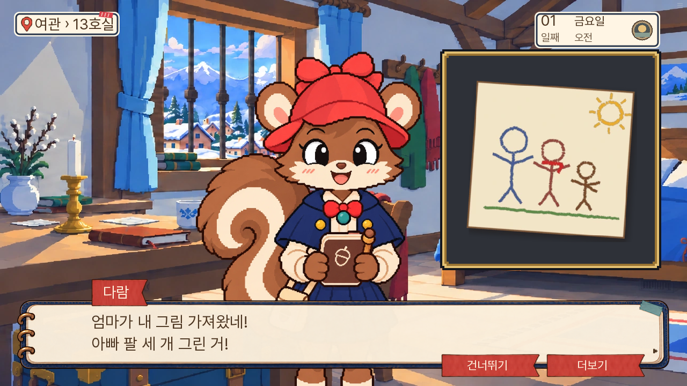

# 0.20.130 실 플레이 검수 — 논리와 디자인 통일성

2026-11-08, 기준 커밋 `c4756a1e49ae9542980d53c79a3949a59d5fb673`.

확정한 조사 오작동 1건, 그림과 대사의 불일치 1건이 있다. 실무 의견으로는 첫 방의 추리 참여와 화면 간 버튼·인물 화풍도 더 다듬어야 한다. 현재 확인만으로 1부 전체의 논리·작화 통일이 완료됐다고 판단할 수 없다.

## 직접 확인한 범위

- 현재 공개본과 같은 웹 묶음 0.20.130을 새 브라우저 프로필에서 실행했다.
- 새 게임부터 마차 → 입구 → 장부 클릭 → 돌목에게 명단 요청 → 틀린 요일·맞는 요일 → 규칙·신청서 → 입구 논증 → 너울 대화 → 여관 → 13호실 → 메모·가족 그림 → 두 편지 비교 → 초롱의 행방을 묻는 선택지까지 상태를 건너뛰지 않고 연속 진행했다.
- 3일차 피코 사망 현장·다람에게 말 걸기와 7일차 화재의 관찰 연결·후속 질문은 해당 상태를 준비해 별도로 진행했다. [3일차 준비 조건](piko-fixture.json), [7일차 준비 조건](fire-fixture.json).
- PC 1280×720, 휴대폰 크기 844×390에서 편지 대조와 화재 연결 화면을 비교했다. 이번 휴대폰 검수는 화면 배치 비교이며 실제 단말·터치 전체 검증은 아니다.
- 7일 전체 연속 완주나 모든 승패·예방 분기 검증은 수행하지 않았다. 실제로 누른 경로의 대사와 화면을 소스·활성 에셋 경로에 대조했다. [읽은 대사](실제_읽은_대사.txt).
- 이번 작업은 검수 기록이다. 게임 대사·정답·생사·에셋·UI 구현은 변경하지 않았다.

## 1. 장부를 눌렀는데 서류 선반 반응이 나온다 — 확인된 오작동

첫 입구에서 화면상 장부의 중앙 `(752, 491)`을 누르면 명단을 읽는 대신 다음 독백이 나온다.

> (서류 선반. 신청서를 찾기 전에, 돌목 씨 명단에 우리가 어떻게 적혔는지부터 보자.)

사용자는 명단으로 보이는 장부를 누르고 있는데 게임은 명단부터 보라고 돌려보낸다. 실제로 돌목을 눌러 「명단을 보여 주십시오」 경로로 들어가면 진행된다. 따라서 전체 진행 불능은 아니지만, 첫 조사부터 클릭이 잘못 먹는 듯 느껴지는 원인이다.

[입구 화면](01-gate.png) · [클릭 뒤 반응](02-ledger-wrong-response.png)

원인은 영역 중첩이다. 현행 월드 좌표에서 장부 `[1700,640,126,30]` 전체가 큰 서류 `[1661,583,201,98]` 안에 들어간다. 큰 서류가 나중에 등록·배치되어 클릭을 받는다. 위 화면 좌표는 자동 카메라 위치와 축척을 반영한 값이다. [실행 시 읽은 좌표와 순서](gate-geometry.json).

근거: [field-bindings.json](../../../game/v111/field-bindings.json)의 `gate_request`는 `ledger`를 목표로 둔다. [room13_gate_inspection.rpy](../../../game/room13_gate_inspection.rpy)에서 `gate_documents`를 뒤에 추가하고, [room13_screens.rpy](../../../game/room13_screens.rpy)의 `r13_world_contents`가 객체 순서대로 버튼을 쌓는다. 돌목만 눌러야 하는 의도된 제약으로 볼 근거는 없다.

실무 의견으로는, 장부 영역을 큰 서류 영역에서 분리하고 장부 클릭도 명단을 건네받는 대화로 연결하는 것이 먼저다. 접근성 이름으로 버튼을 찾는 시험만으로는 부족하고, 실제 보이는 물건의 중앙을 눌러 같은 물건이 반응하는지 확인해야 한다.

## 2. 「아빠 팔 세 개」와 가족 그림이 다르다 — 확인된 불일치

다람은 「엄마가 내 그림 가져왔네! 아빠 팔 세 개 그린 거!」라고 말하고, 아빠는 남는 팔로 설거지를 하라는 농담을 잇는다.

실제 게임에 뜨는 그림에서는 왼쪽의 큰 파란 인물 팔이 두 개다. 팔처럼 보이는 세 갈래 선은 오른쪽의 작은 갈색 인물 쪽에 있다. 가족이 알아보는 특징을 대사와 그림이 다르게 보여 준다.

근거: [d01.json](../../../game/v111/newworld/d01.json)의 `MS14_D01_S05_L0023`, `L0024`, 현재 `focus:D01_FAMILY_DRAWING`, [실제 그림](../../../game/assets/evidence/D01_FAMILY_DRAWING.webp). 이 그림은 E30 자료 상세에도 연결되어 있다.

실무 의견으로는, 이 농담은 가족 관계를 보여 주므로 보존하고 그림 속 아빠의 팔을 세 개로 맞추는 편이 좋다. 그림을 바꾼 뒤 컷·자료 상세 모두 같은 파일을 쓰는지 확인해야 한다.

## 3. 첫 방은 차이를 발견하지 않아도 비교가 끝난다 — 추리 참여에 대한 의견

실제로 「문서 짚기」를 한 번도 누르지 않고, 처음 펼쳐진 두 편지에서 「이 두 장 비교」만 눌렀다. 비교는 성공하고, 이후 다람이 메모에는 도토리가 있지만 편지에는 없다고 설명했다.

확인 상태: `letter_tail_observed`는 전후 모두 미설정, `proof_given:두 편지를 나란히 본다`는 미설정에서 E01/E06으로 바뀐다. [전후 상태](compare-result.json).

[PC 대조](07-room-comparison.png) · [휴대폰 대조](08-room-mobile.png)

이것은 정답 판정 오류나 캐릭터의 근거 없는 지식 획득은 아니다. 직접 관찰하지 않은 경우를 보완하는 대사가 실제로 나온다. 다만 실무 의견으로는 플레이어가 발견하고 판단할 단계가 약하다. 지난 수정에서 방의 진행을 편하게 만든 대신, 정답 쌍까지 먼저 펼쳐져 확인 버튼 하나로 장면이 끝나는 구조가 됐다.

두 글을 함께 펼치는 편의와 보따리 클릭 제거는 유지하면서, 글 끝을 직접 짚거나 어떤 차이를 발견했는지 고르는 짧은 행동을 주는 것이 좋다. 같은 자료를 다시 찾아 고르게 하는 번거로움을 되돌릴 필요는 없다.

## 4. 질문창과 자료창의 보조 버튼 외형이 다르다 — 통일성에 대한 의견

[질문창](04-question-buttons.png)의 하단 버튼은 가는 갈색 테두리와 둥근 모서리다. [자료창](05-proof-buttons.png)은 굵은 남색 테두리와 더 작은 모서리를 사용한다. 같은 보조 행동도 화면을 바꾸면 버튼의 무게와 모양이 달라진다.

실제 활성 부품도 다르다. 질문창은 `r13_notebook_topic_action` → `question_flat_standard` → `R13SoftButtonSurface`, 자료창은 `r13_control` → `R13ControlSurface` 경로다.

질문창의 부드러운 버튼은 눈 피로를 줄이려는 기존 승인 결과다. 실무 의견으로는 질문창을 다시 진하게 만들기보다 자료창의 보조 버튼을 같은 부드러운 계열로 맞추는 편이 좋다. 주요 제출의 빨강과 화면 역할에 따른 버튼 폭 차이는 유지할 수 있다.

## 5. 너울의 묘사 밀도가 다른 주연과 다르다 — 화풍에 대한 의견

[실제 너울 대사](06-neoul.png)에서는 선이 가늘고 매끈하며, 코트와 머리카락의 작은 명암이 많다. [현재 다람](03-family-drawing.png)·[돌목](04-question-buttons.png)의 굵은 계단형 윤곽과 큰 색면과 번갈아 보면 묘사 밀도 차이가 보인다.

활성 일반 대사 경로는 `assets/dialogue-player-facing/gaze116/neoul/*.webp`이며 최근 교정된 다람·돌목과 다른 원화 묶음이다. 오래된 파일이 디스크에 남아 있다는 이유가 아니라 현재 실제 선택된 대사 그림과 화면으로 비교했다.

실무 의견으로는 너울의 윤곽 굵기·명암 단계·도트 단위를 현행 다람 기준에 맞추는 검수가 필요하다. 의상 색과 인물 고유 얼굴 비율을 모두 같게 만드는 작업은 아니다.

## 정상으로 확인한 부분

- 마차 대화는 과자 → 엄마 몫 → 편지·방 번호 → 잠자리 기대 → 마을의 등과 엄마의 조사로 이어졌다. 예전의 「아흔일곱 번째거든」 식의 엇갈린 대화는 현재 경로에서 나오지 않았다.
- 엄마가 보이지 않는다는 말을 듣고 다람이 외투를 잡고 「기다린댔는데」라고 말한다. 아빠도 마지막으로 본 때와 목적지를 묻는다. 검수한 이 구간에서는 인물이 플레이어의 의문을 따라 묻는다.
- 너울은 인사와 자기소개 후 등장한다. 아빠가 「누가 그런 부탁을, 제 아내를 왜 찾느냐」고 되묻기 때문에 의문의 연락을 모두 당연하게 알아듣는 흐름은 아니었다.
- 현재 다람의 마차·현장·일반 대화·검토한 특수 자세는 남색 옷, 적색 모자·리본, 청록 브로치로 일치했다. 옛 적색 코트 캡처를 현행 오류로 세지 않았다.
- 피코 현장에는 [발견 당시 그림과 관찰·초상·다람 대화](09-piko-scene.png)가 연결된다. 초롱은 진료소에서 확인했다는 출처를 말하고, 다람은 「아빠는 여기서 자지 마」라고 반응한다. 검수한 이 장면의 태도는 사건과 연결됐다. 주민 전체 반응을 검증했다는 뜻은 아니다.
- 7일차에는 [관찰 둘과 후속 질문을 연결](10-fire-links.png)한 뒤 보리의 장작 이동 진술과 [누비의 답변](11-fire-reply.png)을 들었다. 장작을 가져온 잘못과 방화를 단정하는 일을 아빠가 구분한다. [휴대폰 화면](12-fire-mobile.png)도 확인했다. 회의 전체 승패 검증은 아니다.
- 확인한 대화·자료·질문 화면에서 글자와 버튼 잘림은 보이지 않았다. 공통 종이·남색·빨강 재질과 대사판·이름 리본은 유지됐다.

## 수정 순서에 대한 의견

실무 의견으로는 **장부 클릭 영역 → 가족 그림 매칭 → 첫 방의 발견·판단 단계 → 보조 버튼 통일 → 너울 화풍** 순서가 좋다. 큰 설정을 더 넣기보다, 지금 화면에서 보고 누르고 이해하는 내용이 서로 맞게 만드는 것이 우선이다.
