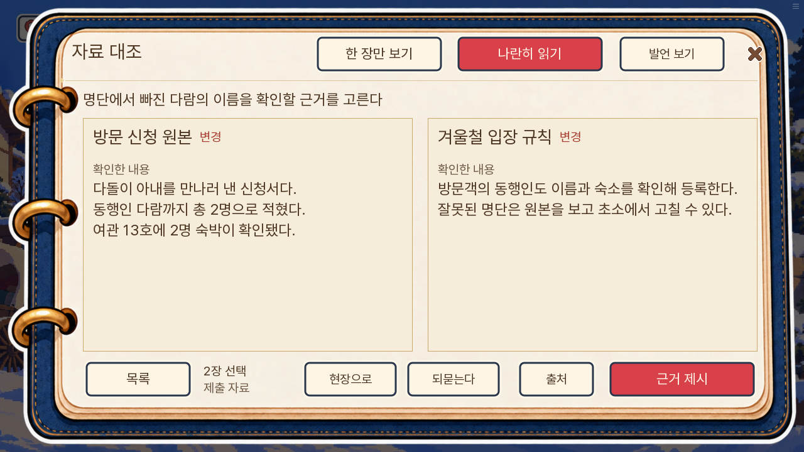
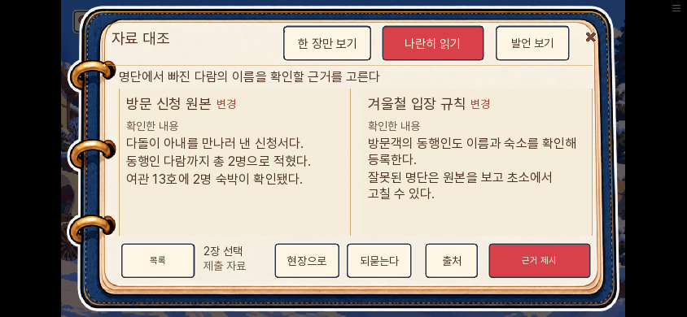
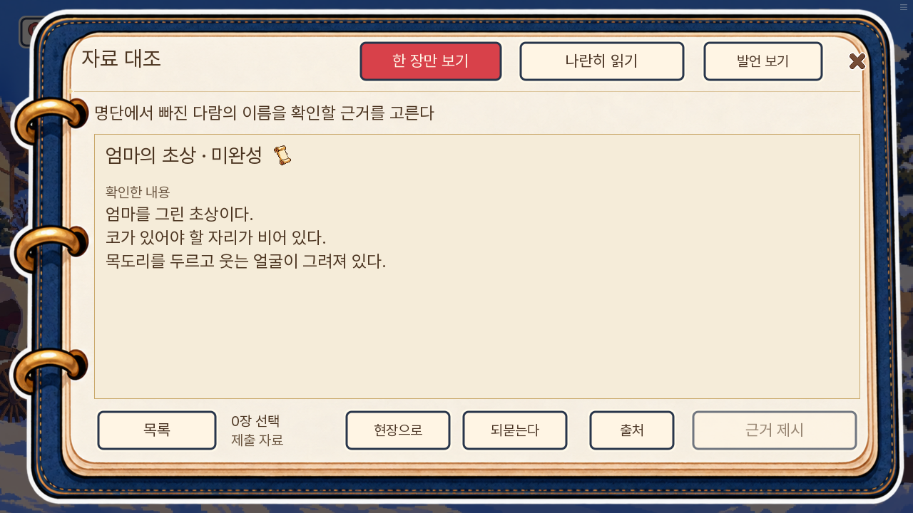

# 일반 유저 검토 개선 — 0.20.124

## 적용 범위

0.20.123의 새 게임부터 7일차까지 한 경로를 연속 진행한 검토에서 확인한 조작·문답 문제를 수정했다. 이번 수정 검수는 변경 장면의 상태를 준비해 실제 입력을 확인하는 부분 검사다. 1~7일의 두 번째 연속 완주나 모든 분기 검사로 계산하지 않는다.

| 검토에서 확인한 문제 | 변경 |
|---|---|
| 부상 직후 돌목 클릭이 일반 인사로 막힘 | 돌목에게 부상을 물어 기존 밝은 자리 조사로 연결 |
| 발자국·보급판·명부와 클릭 이름이 다름 | 현재 단계 이름 표시, 담당자 접근으로도 같은 행동 시작 |
| 깡통을 관찰한 뒤 같은 안내 반복 | 함께 이동 요청 뒤 관찰·회수 연결, 이전 관찰 저장의 행동 이름·안내 갱신 |
| 한 개짜리 진행 질문을 다시 선택 | 명시한 세 구간만 인물 클릭 뒤 바로 진행, 복수 질문·자료 선택 유지 |
| 두 장을 체크하고 나란히 읽기에서 다시 고름 | 직접 체크한 두 장을 읽기 칸에 반영, 제출 선택·기회 불변 |
| 5일 편지 비교가 현재 자료만 보여 줌 | 처음에는 전체 목록, 기존 저장의 탭 기억은 보존 |
| 초상 그림에 없는 손·바늘을 설명 | 실제 얼굴·목도리 묘사와 자료 사실·후속 덧붙임 일치 |
| 화재 발견 전환이 짧고 질문·설명이 반복 | 대피 경로의 연기 발견 추가, 질문 호응·중복 설명 정리 |
| 현재 대화에 늦은 사망 알림이 끼어듦 | 현재 활동의 참여자는 보류, 3일 첫 보고·자유 탐색 반응 유지 |

## 검증

- 최종 전체 단위 1,462개 통과, lint 통과.
- 대사 논리 검사 A 이름 소개 전 사용 / B 생존 조건 없는 대사 / C 결과 지문 중복 모두 0건.
- 관련 엔진 화면 17개 최종 통과. PC·휴대폰 모드 체크 자료 펼치기, 돌목 접근, 깡통 회수, 초상 후속 덧붙임, 학교 인계, 화재 질문·오답·저장 복원·구 저장·대피 두 경로를 확인했다. [항목별 결과](엔진검수.json).
- 기존 자백 검수 fixture는 실제 논증 성공 상태와 새 재확인 입력을 반영하도록 정정했다. 화재 문구 확인도 변경된 문답에 맞췄다. 자료만 가지고 자백 라벨에 진입하는 경로가 성공하지 않는 검사는 별도로 통과했다.
- 원본 records와 기존 조사 options/index 순서는 불변이다. 사건 정답·생사·결말을 바꾸는 수정은 포함하지 않았다.

- 최종 웹 묶음 0.20.124에서 변경 7항목 실제 입력 검수 통과, pageerror 0건. PC 1280×720 / 휴대폰 크기 844×390에서 자료 읽기 캡처 확인. 실물 휴대폰 검사는 아니다.
- 웹 시작에서는 마차를 건너뛰고, 이후 각 수정 장면의 상태를 준비했다. 돌목 클릭, 보급 담당자 접근과 사망 알림 보류, 깡통 회수, 학교 인계·출석, 초상 설명을 확인했다. [웹 결과](웹검수.json).
- 기존 전송 크기 옵션 `--part-mb 10`의 두 부분 파일을 유지했다. 공개 묶음 검사 통과.

지도 전체 구조 변경과 1부 결말의 새 보상·새 사건 추가는 이번 범위에 포함하지 않았다.
