# 첫 회의 난도·세 번의 오답: 전체 검수 기록

2026-10-18 · 공개 판 0.19.60. 물증·거래·증언과 오답·복원을 모두 논증 확정 규칙이 적용된 동일 0.19.60 웹 빌드에서 검수했다. 0.19.59의 자료 필터 변경도 병합되어 있다. 정확한 빌드 해시는 [build.log](build.log)에 보관했다.

## 어떤 느낌으로 바뀌었나

너울이 톡을 지목하는 첫 발언에 내가 어떤 반박을 할지 선택한다. 이 선택이 끝까지 밀고 갈 논증이 된다. 자료를 읽고 돌아오는 것은 자유롭지만, 방향을 확정한 뒤에는 그 논증의 연결을 끝까지 완성해야 한다. 선택 전 기록창을 열고 닫으면 반박 선택으로 돌아오는 것도 확인했다. 회의 상단에 현재 논증이 남는다. 여러 경로에서 쉬운 반박만 골라 성공 상태를 모으던 구조에서, 내가 내세운 설명을 책임지는 구조로 바뀌었다.

물증 경로에서는 끈이 맞는다는 사실로 곧바로 범인이 나오지 않는다. 그 끈이 언제 남았는지와 누가 썼는지를 좁힌 다음, 반출 행동까지 연결한다. 첫 순찰과 새벽의 잔열을 구별하는 반론 때문에 ‘관련된 자료를 찾았다’에서 한 번 더 생각하게 된다.

거래 경로는 원장과 대금 쪽지를 맞추는 데서 끝나지 않는다. 돈을 받았다는 사실과 자기 물건으로 팔았다는 주장을 나누고, 그 물건을 어떻게 얻었는지 따진다. 판매자라는 이유만으로 절도범이라고 할 수 없다는 반론이 이 경로의 중심이다.

증언 경로는 얼굴을 본 사람과 조각을 본 사람을 연결한다. 두 사람이 같은 장소를 봤다는 답으로는 부족하다. 수레를 돕던 사건과 그 뒤 작업자가 바뀌지 않았다는 관찰을 함께 주장해야 한다. 이전처럼 자료 두 개를 내는 순간 대사가 연결을 대신 완성하지 않는다.

세 경로에서 공통으로 수리 작업표가 나온다. 범인을 지목한 뒤 ‘그런데 정식으로 맡긴 일이었다면?’이라는 방어를 다시 넘어야 한다. 덮개 수리와 조각 처분의 권한을 구분하게 되어, 증거가 부족한 다른 경로를 택했다고 끝부분이 생략되지 않는다.

## 오답과 재시도에서 실제로 확인한 것

해석 선택에서 철회하거나 확정창에서 돌아가면 오답이 생기지 않았다. 잘못된 자료를 제시하면 한 번, 잘못된 해석을 확정하면 한 번이 같은 예산에 쌓였다. 세 번째에서 실패했고, 실제 ‘같은 자료로 회의를 다시 한다’ 버튼으로 회의 직전 상태를 불러왔다. 조사 자료 세 개와 돈 7냥은 그대로이며, 선택한 논증·오답·입증·실패 깃발은 남지 않았다. 처음에는 두 목격을 연결하는 논증을 골랐고, 재시작 뒤에는 끈의 사용 경로를 선택할 수 있었다. 발언을 듣는 도중 끼어드는 제시에서도 세 번째에 회의를 끝냈다.

입증 전 올바른 범인 이름을 최종 결론으로 내는 경우도 오답 한 번이었다. 회의를 이기려면 이름과 논증이 함께 맞아야 한다. 단위 검사에서는 두 번 틀린 뒤에도 선택한 논증을 끝까지 완성하면 성공할 수 있음을 확인했다. 다른 논증으로 바꾸는 함수 호출은 거부했고, 다른 경로의 입증 상태가 남아 있어도 현재 경로의 빈 단계를 채우지 못했다.

## 검수 방법과 한계

제작자가 정답을 아는 상태에서 실제 웹 버튼으로 진행한 기능·대사 검수다. 처음부터 끝까지 처음 보는 사용자처럼 플레이한 블라인드 평가가 아니다. 각 경로는 조사 시작 위치와 기본 자료를 준비한 테스트 상태에서 출발했다. 추가 증언과 거래 자료는 실제 대화·창고 방문·자료 제시로 얻었고, 회의의 입증 상태를 강제로 성공 처리하지 않았다.

단위 검사 467개와 Ren'Py lint를 통과했다. 그중 새 난도·논증 고정 검사는 18개다. 회의·재판 공통 흐름의 네이티브 화면 검사 10개도 통과했다. 이 10개는 논증 고정 추가 전의 공통 처리 검사이며, 최종 논증 선택·통과·재시작은 아래 네 차례의 웹 실행으로 확인했다. 최초 웹 검수에서 L21/L22의 미등록 자료 분류 때문에 자료창이 멈추는 오류를 발견했고, 기존 ‘기록’ 분류로 고쳐 경로를 다시 검수했다.

이것으로 초회 난도가 같아졌다고 단정하지 않는다. 설명을 고른 뒤 한 번 더 확정하는 과정은 실수를 줄이지만 대화의 속도를 늦출 수 있다. 블라인드 검수에서는 경로별 첫 시도 성공률과 함께 이 확인 과정의 피로도도 봐야 한다. 작가가 지정한 논증 조합을 검사하는 시스템이며 자유문장 의미 판정기는 아니다.

공개 URL은 이 실행 환경의 네트워크 정책으로 직접 열 수 없어 동일 생성물을 로컬 HTTP로 실행했다. GitHub Pages 배포 완료 여부는 별도로 확인한다.

[정확한 분기·자료·오답 규칙](../../design/Q1_HARD_ARGUMENTS.md) · [전체 단위 검사](all-unit.log) · [lint](checks.log) · [논증 고정 검사](argument-unit.log) · [네이티브 결과](native-results.json) · [전체 결과](result.json)

아래는 요약을 위해 덜어내지 않은 전체 캡처와 관찰 대사다. 대사 로그는 화면에 표시된 페이지 단위이며 같은 문장이 연속 표시될 때만 중복을 제거했다. 선택지는 각 캡처의 JSON에도 보관했다.

## 물증 경로

[physical 실행 결과](physical/result.json) · [선택·화면 로그](physical/play.log) · [원문 대사 JSON](physical/dialogue.json)

### physical-removal-observation

[화면 상태](physical/physical-removal-observation.json)

### physical-topics-resident_lamplighter

[화면 상태](physical/physical-topics-resident_lamplighter.json)

### physical-before-commit-records

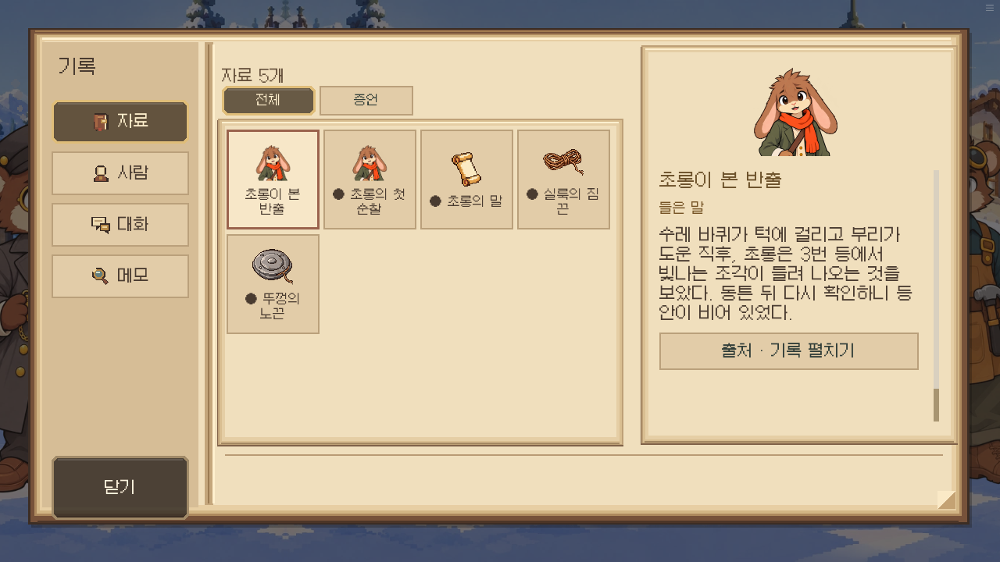

[화면 상태](physical/physical-before-commit-records.json)

### physical-thesis-options

[화면 상태](physical/physical-thesis-options.json)

### physical-thesis-commit

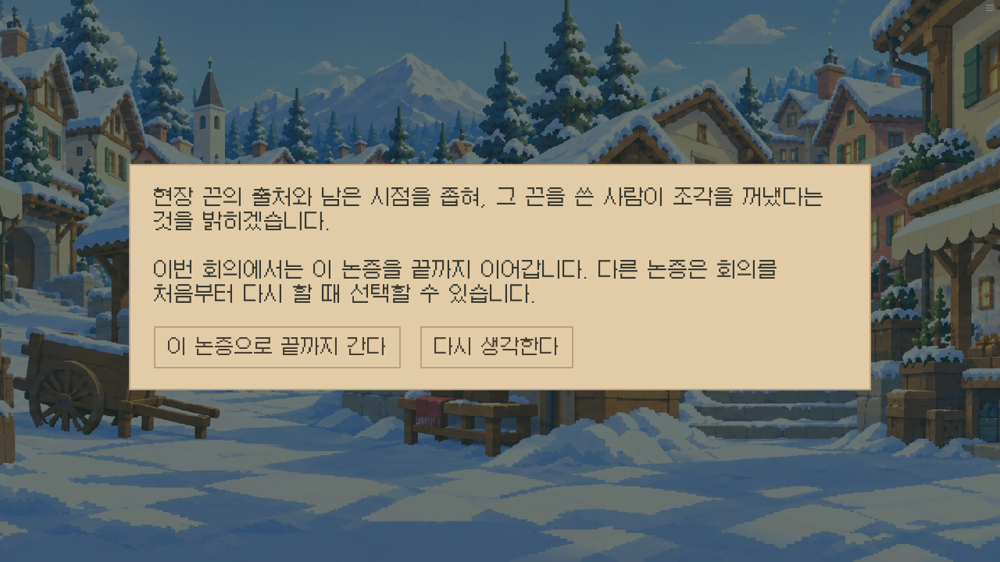

[화면 상태](physical/physical-thesis-commit.json)

### physical-counter-1

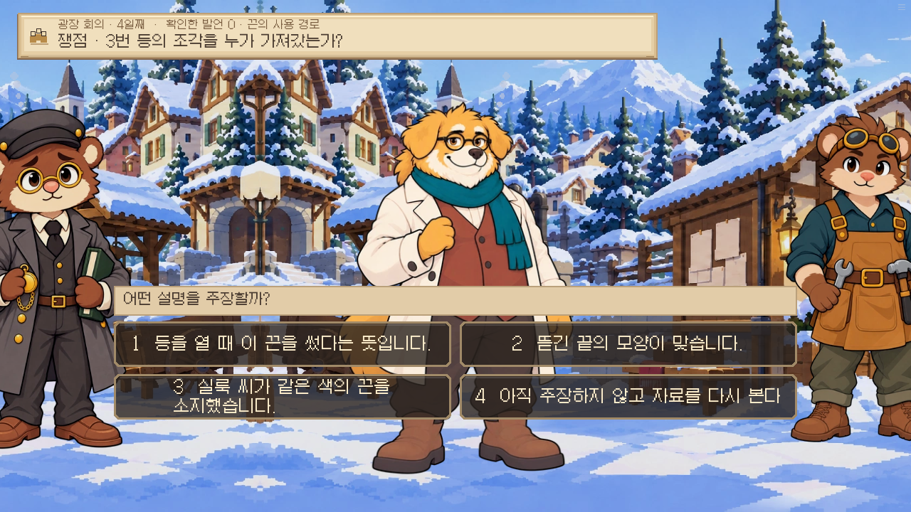

[화면 상태](physical/physical-counter-1.json)

### physical-mobile-large-counter

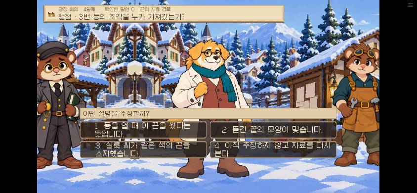

[화면 상태](physical/physical-mobile-large-counter.json)

### physical-commit-3

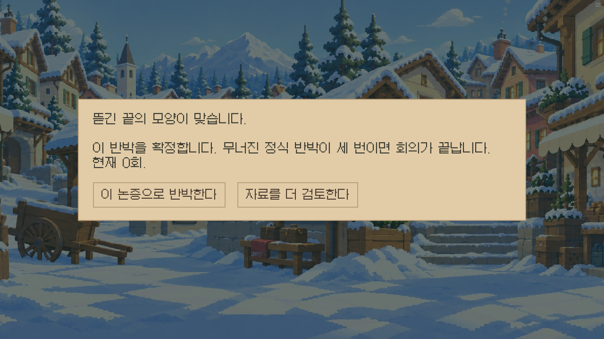

[화면 상태](physical/physical-commit-3.json)

### physical-counter-4

[화면 상태](physical/physical-counter-4.json)

### physical-counter-5

[화면 상태](physical/physical-counter-5.json)

### physical-commit-6

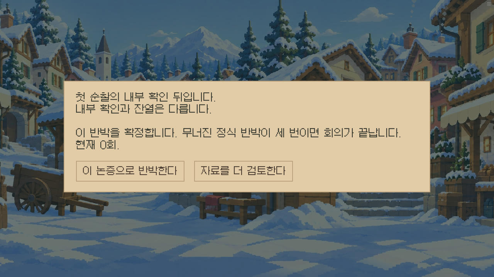

[화면 상태](physical/physical-commit-6.json)

### physical-counter-7

[화면 상태](physical/physical-counter-7.json)

### physical-commit-8

[화면 상태](physical/physical-commit-8.json)

### physical-work-order

[화면 상태](physical/physical-work-order.json)

### physical-counter-9

[화면 상태](physical/physical-counter-9.json)

### physical-counter-10

[화면 상태](physical/physical-counter-10.json)

### physical-commit-11

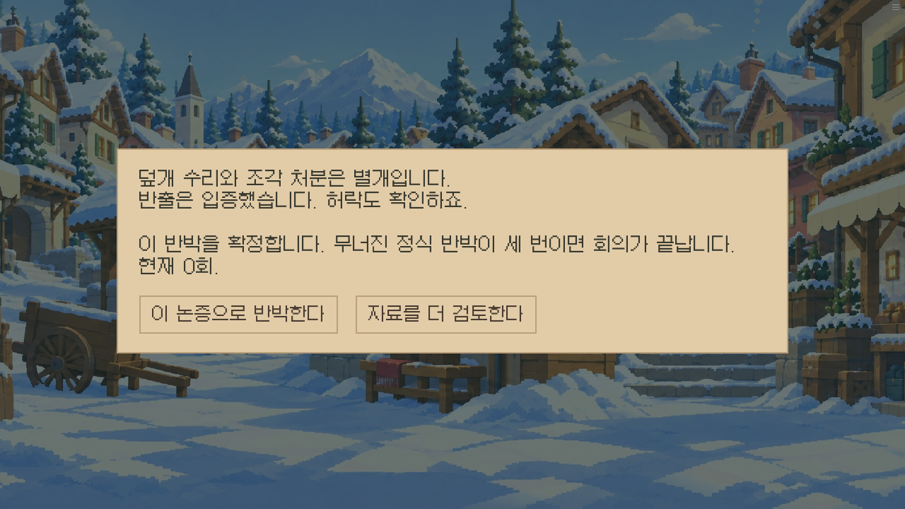

[화면 상태](physical/physical-commit-11.json)

### physical-before-conclusion

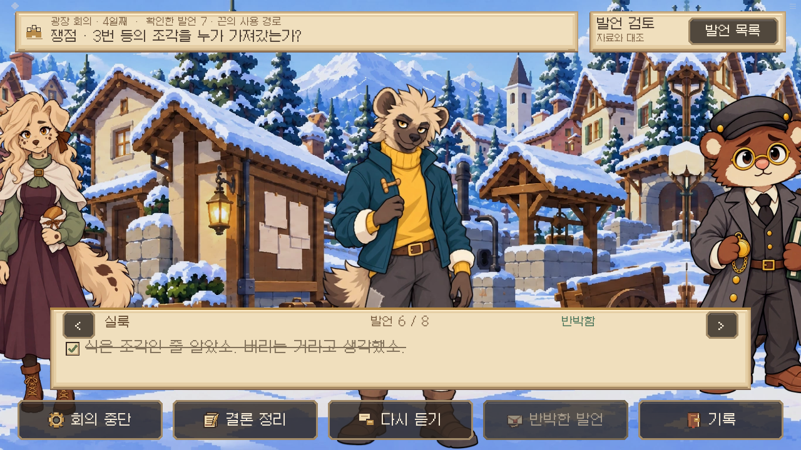

[화면 상태](physical/physical-before-conclusion.json)

### physical-finding

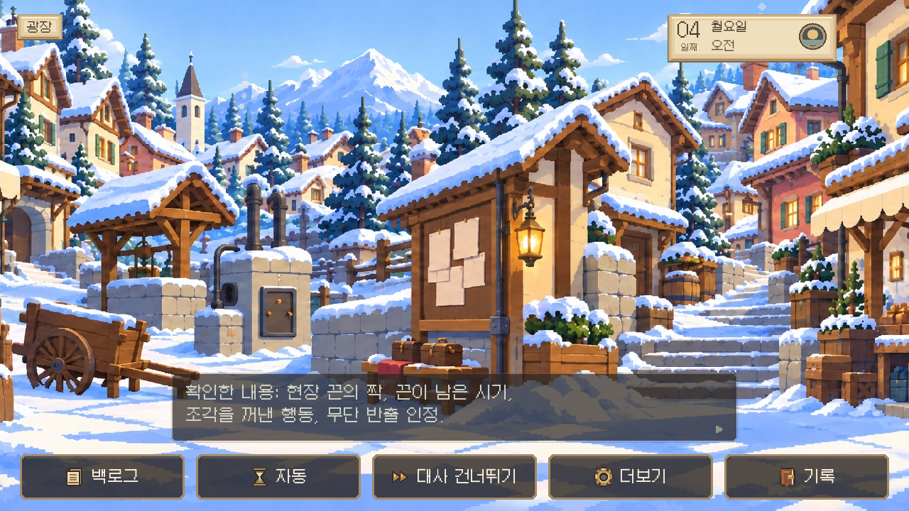

[화면 상태](physical/physical-finding.json)

### physical-result

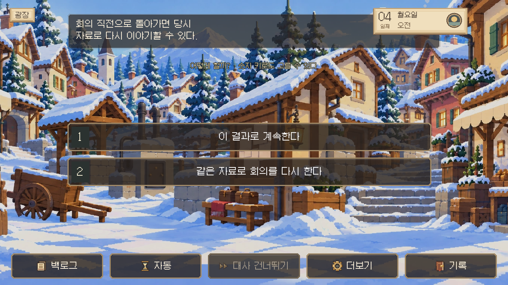

[화면 상태](physical/physical-result.json)

### 관찰한 대사 전체

1. **physical**

> 까로가 눈을 털며 다가왔다.
> 마차 이야기를 하러 온 얼굴이었다.

2. **physical**

> 그럼 마차는 언제 다시 출발합니까?

3. **physical**

> 바퀴 축도 고쳐야 하고,
> 고개를 넘는 정기 마차도 겨울에는 쉬어요.

4. **physical**

> 그래서 제 마차로는 당장 돌아가실 수 없습니다.

5. **physical**

> 하루 이틀만 머물 생각이었는데…….
> 고개 말고 다른 길 사정도 아십니까?

6. **physical**

> 다른 길은 직접 알아보셔야 해요.
> 제가 다니던 고개 길과는 사정이 다르거든요.

7. **physical**

> 필요한 물건은 장터 은호 사장네서 살 수 있어요.

8. **physical**

> 이 마을은 서로 도우면 꼭 갚는 데라,
> 일을 풀어 주시면 사례도 들어올 거예요.

9. **physical**

> 아내 소식부터 알아보겠습니다.

10. **physical**

> 그러세요.
> 누구네 짐인지는 꼭 짐표와 같이 확인하고요.

11. **physical**

> 광장에서 사람들이 수군거렸다.
> 어제 백 부인 창고에서 약초 꾸러미가 사라졌다고 했다.

12. **physical**

> 범인은 아직 못 잡았다고 했다.

13. **physical**

> 미지근했다고 하셨지요.
> 등 안도 직접 보셨습니까?

14. **physical**

> 2일 밤 첫 순찰 때 받침이 흔들려서 뚜껑을 열었어요.
> 조각은 안에 있었어요.

15. **physical**

> 틈에 끈도 없었고요.

16. **physical**

> 따뜻했다는 것과 직접 확인한 것은 따로 적겠습니다.

17. **physical**

> 다음 순찰 때는 어땠습니까?

18. **physical**

> 그날 밤 마지막 순찰에서, 맞은편을
> 보니 짐수레 바퀴가 턱에 걸렸어요.

19. **physical**

> 부리가 도왔고요.
> 곧 등 위로 빛나는 조각이 들려 나왔어요.

20. **physical**

> 얼굴은 안 보였어요.
> 수리하나 보다 하고 지나쳤죠.

21. **physical**

> 동튼 뒤 다시 가 보니 등 안이 비었어요.
> 그때 피코를 발견했어요.

22. **physical**

> 얼굴을 본 건 아니군요.
> 직접 보신 움직임과 순서를 적겠습니다.

23. **physical**

> 자료 열람과 질문은 자유롭다.

24. **physical**

> 발언에 맞지 않는 자료를 근거로 내거나,
> 상대의 반론에 잘못된 답을 확정하면 오답이 된다.

25. **physical**

> 회의에서 내세운 논증은 끝까지 이어야 한다.
> 오답 세 번이면 이번 회의가 끝난다.

26. **physical**

> 같은 자료로 다시 시작할 때는 다른 논증을 고를 수 있다.

27. **physical**

> 회의에서는 지금 가진 자료로 이야기한다.
> 회의는 4일 오후가 끝나기 전까지 열 수 있다.

28. **physical**

> 조사나 추리가 끝나지 않았어도 들어갈 수 있다.

29. **physical**

> 톡이 묶인 채 돌 앞에 서 있었다.
> 사람들 틈에 실룩의 아이 둘이 빵 봉지를 쥐고 서 있었다.

30. **physical**

> 백 부인은 맨 앞줄에 앉았다.

31. **physical**

> 그림쟁이가 쓰러졌소.
> 기록실 선생도 죽었소.

32. **physical**

> 오늘 끝냅시다.

33. **physical**

> 등을 돌보는 톡이 조각을 가져간 것 아니오?
> 다르게 본다면 그 근거를 말해 보시오.

34. **physical**

> 그 자료 하나로는 두 기록이 이어지는지 알 수 없어요.
> 함께 대조해 주세요.

35. **physical**

> 색도 굵기도 흔한 물건이오.
> 무엇이 같다는 거요?

36. **physical**

> 같은 색의 끈이라면 다른 집에도 있지 않소?

37. **physical**

> 뚜껑에 남은 끈과 실룩 씨의 끈은 뜯긴 끝이 맞습니다.
> 한 끈에서 떨어진 조각입니다.

38. **physical**

> 2일 밤 첫 순찰에서 받침을 바로잡으며 뚜껑도 봤어요.
> 그때는 틈에 끈이 없었어요.

39. **physical**

> 첫 순찰의 관찰로 흔적이 남은
> 때를 어디까지 좁힐 수 있소?

40. **physical**

> 초롱은 새벽에도 미지근했다고 했소.
> 그러면 그때까지 조각이 있었던 것 아니오?

41. **physical**

> 끈은 첫 순찰에서 뚜껑을 확인한 뒤에 남았습니다.
> 잔열로 그보다 정확한 시각까지 정하지는 않겠습니다.

42. **physical**

> 2일 늦은 밤, 그 끈을 누가 쓰고 있었습니까?

43. **physical**

> 내가 썼소.
> 수레가 턱에 걸려 부리가 도와준 뒤에 올라갔소.

44. **physical**

> 느슨한 뚜껑을 고쳤을 뿐이오.

45. **physical**

> 부리가 수레 바퀴를 도와준 직후였어요.
> 등에서 빛나는 조각이 들려 나왔어요.

46. **physical**

> 동튼 뒤 다시 가 보니 안이 비어 있었어요.

47. **physical**

> 조각이 사라졌다는 결과와 직접
> 본 움직임을 나눠 말하시오.

48. **physical**

> 이 증언으로 확인한 건 반출 행동입니다.
> 얼굴과 같은 시각인지는 따로 연결하겠습니다.

49. **physical**

> 맡긴 일과 조각의 처리 내역을 함께 확인하겠습니다.

50. **physical**

> 톡의 서명이 있소.
> 나 혼자 멋대로 등을 만진 게 아니란 말이오.

51. **physical**

> 덮개가 흔들린다고 해서 점검을 맡겼어요.
> 이건 작업표, 이쪽은 자재 대장이에요.

52. **physical**

> 작업표에는 덮개, 나사 두 개,
> 조각 교체 0, 회수 예정 0이 적혀 있었다.

53. **physical**

> 대장의 광장 3 조각은 사용 중인 마을 자재였다.

54. **physical**

> 그 자료 하나로는 두 기록이 이어지는지 알 수 없어요.
> 함께 대조해 주세요.

55. **physical**

> 톡이 일을 맡긴 건 분명하오.
> 조각을 다룬 일도 그 작업으로 봐야 하지 않겠소?

56. **physical**

> 작업표와 대장을 함께 놓으면 어떤 범위가 확인되오?

57. **physical**

> 대장에 양도 기록이 없으면
> 그것만으로 절도가 확정되는 것이오?

58. **physical**

> 실룩 씨의 반출은 앞서 연결했습니다.
> 이 작업표로 조각까지 넘겨받았다는 해명은 성립하지 않습니다.

59. **physical**

> 별도의 허락을 받았습니까?

60. **physical**

> 덮개 점검과 별개로,
> 조각을 가져가도 된다고 허락받았습니까?

61. **physical**

> 덮개 점검만 맡겼어요.

62. **physical**

> 조각을 교체하거나 폐기하라고 한 적도,
> 실룩 씨에게 넘긴 적도 없어요.

63. **physical**

> …따로 허락받지는 않았소.
> 내가 꺼내 팔았소.

64. **physical**

> 식었으니 버려도 되는 줄 알았소.

65. **physical**

> 빚이 열두 냥이오.
> 못 갚으면 아이들을 일꾼으로 보내야 했소.

66. **physical**

> 돌려놓을 생각도 못 했소.

67. **physical**

> 톡이 가져갔다는 혐의는 거두겠소.
> 실룩이 허락 없이 꺼내 팔았다는 것으로 정리하겠소.

68. **physical**

> 고맙습니다.
> 하지만 그 등 밑에 있던 사람을 생각하면…

69. **physical**

> 마음이 편하지는 않네요.

70. **physical**

> 이제 톡이 그랬다는 말에 동의하지 않아요.

71. **physical**

> 팔았다는 조각이 지금 어디에 있습니까?

72. **physical**

> 백 부인 창고에 있소.
> 밑에 광장 3이라는 이름표가 있소.

73. **physical**

> …확인만 하세요.

74. **physical**

> 사람들이 보는 앞에서 조각을 꺼냈다.
> 톡이 이름표와 장부를 대조했다.

75. **physical**

> 제가 3번 등에 넣은 조각이 맞아요.

76. **physical**

> 톡은 풀어 주겠소.
> 실룩은 내가 데려가오.

77. **physical**

> 너울이 실룩의 팔을 잡아끌었다.
> 실룩의 아이들이 따라가려다 넘어졌다.

78. **physical**

> 애들은……
> 애들은 건드리지 마시오!

79. **physical**

> 내 돈으로 산 거예요!

80. **physical**

> 사람들이 창고 쪽으로 움직였다.

81. **physical**

> 이 마을에서 오래 살 생각은 없으신가 보군요.

82. **physical**

> 톡이 돌려받은 ‘광장 3’ 조각을 등에 다시 넣었다.
> 등이 데워졌다.

83. **physical**

> 그런데 숨 몇 번 사이에 온기가 옅어졌다.

84. **physical**

> 이 조각, 가을엔 밤새 따뜻했어요.
> 지금은…….

85. **physical**

> (조각을 훔친 사람은 밝혔다.

86. **physical**

> 하지만 이 겨울에 사람들이 온기를
> 잃는 일까지 끝난 것은 아니다.)

87. **physical**

> 다람이가 품에 넣어 둔 그림책을 펼쳤다.

88. **physical**

> 「아침이 되자, 아저씨는 엄마 코를
> 다 못 그린 채 잠들어 있었어요.」

89. **physical**

> ……아빠.
> 이 책, 이제 안 읽을래.

90. **physical**

> 응.
> 지금은 덮어 두자.

91. **physical**

> 다람이가 책을 닫았다.
> 나는 아이의 손을 잡고 잠시 곁에 서 있었다.

92. **physical**

> 수첩을 펼쳤다.
> 확인한 사실과 아직 답하지 못한 의문을 나누어 적었다.

93. **physical**

> 선택한 논증: 끈의 사용 경로.

94. **physical**

> 확인한 내용: 현장 끈의 짝, 끈이 남은 시기,
> 조각을 꺼낸 행동, 무단 반출 인정.

95. **physical**

> 이 근거들을 연결해 실룩의 무단 반출을 밝혔다.
> 다른 조사 방법까지 모두 거칠 필요는 없었다.

96. **physical**

> 톡은 풀려났다.

97. **physical**

> 회의 직전으로 돌아가면 당시
> 자료로 다시 이야기할 수 있다.

## 거래 경로

[trade 실행 결과](trade/result.json) · [선택·화면 로그](trade/play.log) · [원문 대사 JSON](trade/dialogue.json)

### trade-trade-record

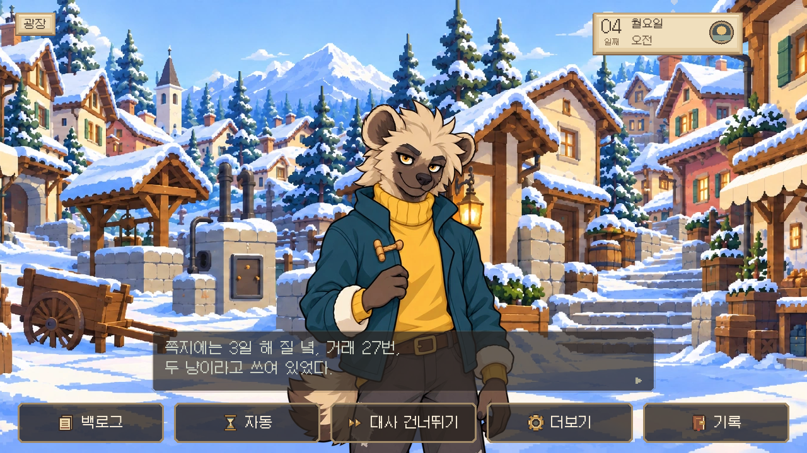

[화면 상태](trade/trade-trade-record.json)

### trade-topics-resident_siluk

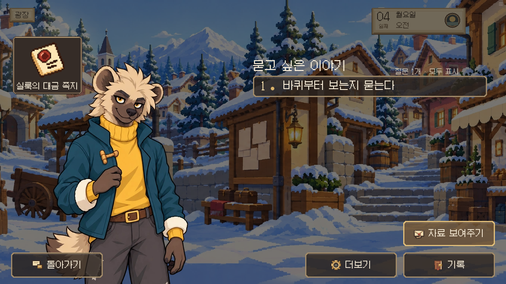

[화면 상태](trade/trade-topics-resident_siluk.json)

### trade-topics-resident_madam

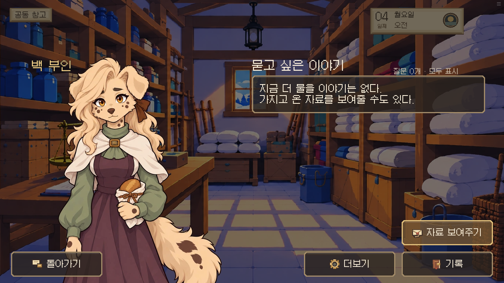

[화면 상태](trade/trade-topics-resident_madam.json)

### trade-thesis-options

[화면 상태](trade/trade-thesis-options.json)

### trade-thesis-commit

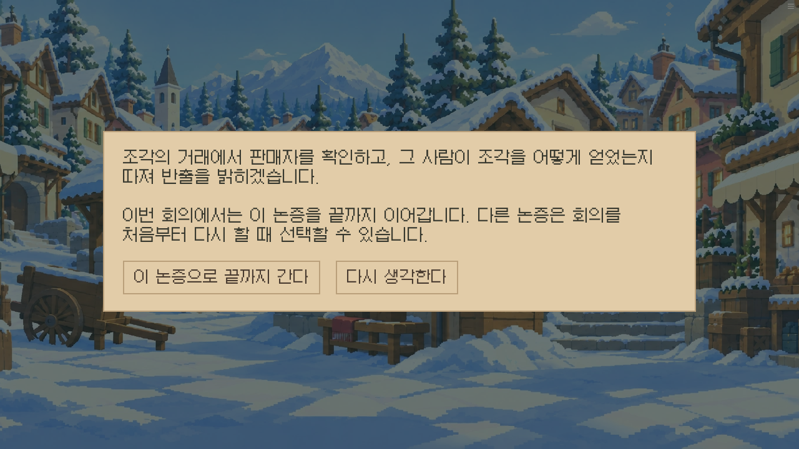

[화면 상태](trade/trade-thesis-commit.json)

### trade-counter-1

[화면 상태](trade/trade-counter-1.json)

### trade-commit-2

[화면 상태](trade/trade-commit-2.json)

### trade-counter-3

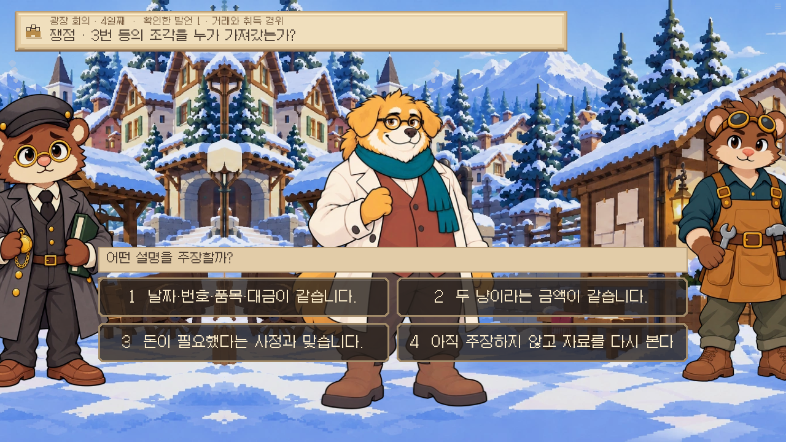

[화면 상태](trade/trade-counter-3.json)

### trade-commit-4

[화면 상태](trade/trade-commit-4.json)

### trade-counter-5

[화면 상태](trade/trade-counter-5.json)

### trade-counter-6

[화면 상태](trade/trade-counter-6.json)

### trade-commit-7

[화면 상태](trade/trade-commit-7.json)

### trade-counter-8

[화면 상태](trade/trade-counter-8.json)

### trade-commit-9

[화면 상태](trade/trade-commit-9.json)

### trade-admission

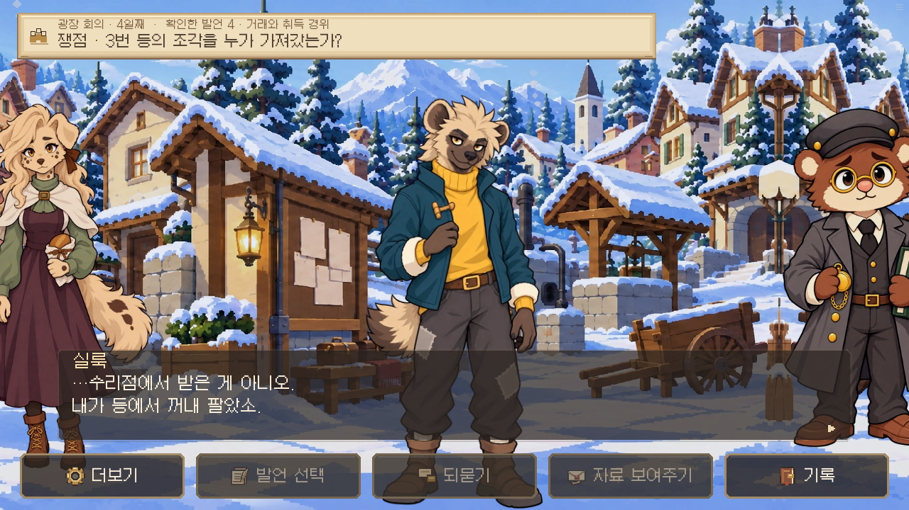

[화면 상태](trade/trade-admission.json)

### trade-work-order

[화면 상태](trade/trade-work-order.json)

### trade-counter-11

[화면 상태](trade/trade-counter-11.json)

### trade-counter-12

[화면 상태](trade/trade-counter-12.json)

### trade-commit-13

[화면 상태](trade/trade-commit-13.json)

### trade-before-conclusion

[화면 상태](trade/trade-before-conclusion.json)

### trade-finding

[화면 상태](trade/trade-finding.json)

### trade-result

[화면 상태](trade/trade-result.json)

### 관찰한 대사 전체

1. **trade**

> 까로가 눈을 털며 다가왔다.
> 마차 이야기를 하러 온 얼굴이었다.

2. **trade**

> 그럼 마차는 언제 다시 출발합니까?

3. **trade**

> 바퀴 축도 고쳐야 하고,
> 고개를 넘는 정기 마차도 겨울에는 쉬어요.

4. **trade**

> 그래서 제 마차로는 당장 돌아가실 수 없습니다.

5. **trade**

> 하루 이틀만 머물 생각이었는데…….
> 고개 말고 다른 길 사정도 아십니까?

6. **trade**

> 다른 길은 직접 알아보셔야 해요.
> 제가 다니던 고개 길과는 사정이 다르거든요.

7. **trade**

> 필요한 물건은 장터 은호 사장네서 살 수 있어요.

8. **trade**

> 이 마을은 서로 도우면 꼭 갚는 데라,
> 일을 풀어 주시면 사례도 들어올 거예요.

9. **trade**

> 아내 소식부터 알아보겠습니다.

10. **trade**

> 그러세요.
> 누구네 짐인지는 꼭 짐표와 같이 확인하고요.

11. **trade**

> 광장에서 사람들이 수군거렸다.
> 어제 백 부인 창고에서 약초 꾸러미가 사라졌다고 했다.

12. **trade**

> 범인은 아직 못 잡았다고 했다.

13. **trade**

> 아이들 빵값은 어디서 마련하셨습니까?

14. **trade**

> 백 부인에게 물건을 팔았소.
> 빚부터 갚으라 할 줄 알았는데 돈을 주더군.

15. **trade**

> 정산한 기록을 봐도 되겠습니까?

16. **trade**

> 여기 있소.
> 제값 받고 판 거요.

17. **trade**

> 쪽지에는 3일 해 질 녘, 거래 27번,
> 두 냥이라고 쓰여 있었다.

18. **trade**

> 자기 소유 조각 한 점을 판다는 조건도 있었다.

19. **trade**

> 창고 안쪽 상자에서 초록빛이 새어 나왔다.
> 손을 대니 사람 손처럼 따뜻했다.

20. **trade**

> 등 조각들이다.

21. **trade**

> 사고판 것뿐이에요.
> 요즘 온기가 얼마나 귀한지 아세요?

22. **trade**

> 조각 하나를 뒤집어 보니 밑에 작은 이름표.
> 톡의 글씨로 '광장 3'.

23. **trade**

> (톡은 고친 조각마다 이름표를 붙인다.
> 이건 피코가 잠든 그 등의 조각이다.)

24. **trade**

> 광장 3번 등의 이름표입니다.
> 언제 누구에게서 사셨습니까?

25. **trade**

> 어제 해 질 녘이에요.
> 값을 치렀다는 기록도 있어요.

26. **trade**

> 얼굴은 못 봤지만, 여기 돈을 받았다는 표시가 있잖아요.

27. **trade**

> 원장에 3일, 거래 27번,
> 조각 한 점, 두 냥이라고 적혀 있었다.

28. **trade**

> 자료 열람과 질문은 자유롭다.

29. **trade**

> 발언에 맞지 않는 자료를 근거로 내거나,
> 상대의 반론에 잘못된 답을 확정하면 오답이 된다.

30. **trade**

> 회의에서 내세운 논증은 끝까지 이어야 한다.
> 오답 세 번이면 이번 회의가 끝난다.

31. **trade**

> 같은 자료로 다시 시작할 때는 다른 논증을 고를 수 있다.

32. **trade**

> 회의에서는 지금 가진 자료로 이야기한다.
> 회의는 4일 오후가 끝나기 전까지 열 수 있다.

33. **trade**

> 조사나 추리가 끝나지 않았어도 들어갈 수 있다.

34. **trade**

> 톡이 묶인 채 돌 앞에 서 있었다.
> 사람들 틈에 실룩의 아이 둘이 빵 봉지를 쥐고 서 있었다.

35. **trade**

> 백 부인은 맨 앞줄에 앉았다.

36. **trade**

> 그림쟁이가 쓰러졌소.
> 기록실 선생도 죽었소.

37. **trade**

> 오늘 끝냅시다.

38. **trade**

> 등을 돌보는 톡이 조각을 가져간 것 아니오?
> 다르게 본다면 그 근거를 말해 보시오.

39. **trade**

> 이름표에 광장 3이라고 쓰여 있습니다.
> 톡 씨, 폐기한 조각입니까?

40. **trade**

> 아니에요.
> 제 장부에도 지금 3번 등에 넣어 둔 조각으로 적혀 있어요.

41. **trade**

> 바꾸거나 버리라고 한 적 없어요.

42. **trade**

> 어제, 3일 해 질 녘에 샀어요.
> 얼굴은 못 봤지만 원장에 받은 표시가 있어요.

43. **trade**

> 창고 이름표에서 확인할 수 있는 것은 무엇이오?

44. **trade**

> 이름표에 광장 3이라고 쓰여 있습니다.
> 톡 씨, 폐기한 조각입니까?

45. **trade**

> 아니에요.
> 제 장부에도 지금 3번 등에 넣어 둔 조각으로 적혀 있어요.

46. **trade**

> 바꾸거나 버리라고 한 적 없어요.

47. **trade**

> 어제, 3일 해 질 녘에 샀어요.
> 얼굴은 못 봤지만 원장에 받은 표시가 있어요.

48. **trade**

> 그 자료 하나로는 두 기록이 이어지는지 알 수 없어요.
> 함께 대조해 주세요.

49. **trade**

> 제 원장과 그 쪽지가 같은 거래라는 근거부터 대세요.

50. **trade**

> 같은 금액의 거래는 여럿일 수 있소.
> 두 기록은 무엇으로 이어집니까?

51. **trade**

> 부인의 원장과 실룩 씨가 내놓은 쪽지는 거래
> 27번, 조각 한 점, 두 냥으로 같습니다.

52. **trade**

> 돈을 대신 받아 왔을 뿐이오.
> 판 사람까지 나라는 건 아니오.

53. **trade**

> 돈을 받아 왔다는 쪽지요.
> 그걸로 내 심부름이라는 말을 뒤집을 수 있소?

54. **trade**

> 쪽지에서 심부름이라는 설명과 부딪히는 부분은 무엇이오?

55. **trade**

> 그 조건을 받아들였다면, 실룩이 훔쳤다는 뜻이오?

56. **trade**

> …내 물건이라고 팔았소.
> 톡이 버린다기에 받은 거요.

57. **trade**

> 어디에서 어떻게 받으셨습니까?

58. **trade**

> 수리점에서 손에 쥐여 줬소.

59. **trade**

> 그런 적 없어요.
> 그 조각은 3번 등에 있었어요.

60. **trade**

> 버릴 거랬잖소.
> 등 받침에 걸려서 끄집어내느라 손이…

61. **trade**

> 내가 한 말이오.
> 어느 부분이 앞뒤가 맞지 않는다는 거요?

62. **trade**

> 실룩의 두 설명 중 어느 부분이 함께 성립할 수 없소?

63. **trade**

> 건네받았다는 말과 직접 꺼냈다는 말이 다릅니다.
> 실룩 씨, 직접 꺼낸 겁니까?

64. **trade**

> …수리점에서 받은 게 아니오.
> 내가 등에서 꺼내 팔았소.

65. **trade**

> 맡긴 일과 조각의 처리 내역을 함께 확인하겠습니다.

66. **trade**

> 톡의 서명이 있소.
> 나 혼자 멋대로 등을 만진 게 아니란 말이오.

67. **trade**

> 덮개가 흔들린다고 해서 점검을 맡겼어요.
> 이건 작업표, 이쪽은 자재 대장이에요.

68. **trade**

> 작업표에는 덮개, 나사 두 개,
> 조각 교체 0, 회수 예정 0이 적혀 있었다.

69. **trade**

> 대장의 광장 3 조각은 사용 중인 마을 자재였다.

70. **trade**

> 그 자료 하나로는 두 기록이 이어지는지 알 수 없어요.
> 함께 대조해 주세요.

71. **trade**

> 톡이 일을 맡긴 건 분명하오.
> 조각을 다룬 일도 그 작업으로 봐야 하지 않겠소?

72. **trade**

> 작업표와 대장을 함께 놓으면 어떤 범위가 확인되오?

73. **trade**

> 대장에 양도 기록이 없으면
> 그것만으로 절도가 확정되는 것이오?

74. **trade**

> 실룩 씨의 반출은 앞서 연결했습니다.
> 이 작업표로 조각까지 넘겨받았다는 해명은 성립하지 않습니다.

75. **trade**

> 별도의 허락을 받았습니까?

76. **trade**

> 덮개 점검과 별개로,
> 조각을 가져가도 된다고 허락받았습니까?

77. **trade**

> 덮개 점검만 맡겼어요.

78. **trade**

> 조각을 교체하거나 폐기하라고 한 적도,
> 실룩 씨에게 넘긴 적도 없어요.

79. **trade**

> …따로 허락받지는 않았소.
> 내가 꺼내 팔았소.

80. **trade**

> 식었으니 버려도 되는 줄 알았소.

81. **trade**

> 빚이 열두 냥이오.
> 못 갚으면 아이들을 일꾼으로 보내야 했소.

82. **trade**

> 돌려놓을 생각도 못 했소.

83. **trade**

> 톡이 가져갔다는 혐의는 거두겠소.
> 실룩이 허락 없이 꺼내 팔았다는 것으로 정리하겠소.

84. **trade**

> 고맙습니다.
> 하지만 그 등 밑에 있던 사람을 생각하면…

85. **trade**

> 마음이 편하지는 않네요.

86. **trade**

> 이제 톡이 그랬다는 말에 동의하지 않아요.

87. **trade**

> 팔았다는 조각이 지금 어디에 있습니까?

88. **trade**

> 백 부인 창고에 있소.
> 밑에 광장 3이라는 이름표가 있소.

89. **trade**

> …확인만 하세요.

90. **trade**

> 사람들이 보는 앞에서 조각을 꺼냈다.
> 톡이 이름표와 장부를 대조했다.

91. **trade**

> 제가 3번 등에 넣은 조각이 맞아요.

92. **trade**

> 톡은 풀어 주겠소.
> 실룩은 내가 데려가오.

93. **trade**

> 너울이 실룩의 팔을 잡아끌었다.
> 실룩의 아이들이 따라가려다 넘어졌다.

94. **trade**

> 애들은……
> 애들은 건드리지 마시오!

95. **trade**

> 내 돈으로 산 거예요!

96. **trade**

> 사람들이 창고 쪽으로 움직였다.

97. **trade**

> 이 마을에서 오래 살 생각은 없으신가 보군요.

98. **trade**

> 톡이 돌려받은 ‘광장 3’ 조각을 등에 다시 넣었다.
> 등이 데워졌다.

99. **trade**

> 그런데 숨 몇 번 사이에 온기가 옅어졌다.

100. **trade**

> 이 조각, 가을엔 밤새 따뜻했어요.
> 지금은…….

101. **trade**

> (조각을 훔친 사람은 밝혔다.

102. **trade**

> 하지만 이 겨울에 사람들이 온기를
> 잃는 일까지 끝난 것은 아니다.)

103. **trade**

> 다람이가 품에 넣어 둔 그림책을 펼쳤다.

104. **trade**

> 「아침이 되자, 아저씨는 엄마 코를
> 다 못 그린 채 잠들어 있었어요.」

105. **trade**

> ……아빠.
> 이 책, 이제 안 읽을래.

106. **trade**

> 응.
> 지금은 덮어 두자.

107. **trade**

> 다람이가 책을 닫았다.
> 나는 아이의 손을 잡고 잠시 곁에 서 있었다.

108. **trade**

> 수첩을 펼쳤다.
> 확인한 사실과 아직 답하지 못한 의문을 나누어 적었다.

109. **trade**

> 선택한 논증: 거래와 취득 경위.

110. **trade**

> 확인한 내용: 창고 조각의 출처, 실룩의 거래,
> 실룩의 설명 속 모순, 무단 반출 인정.

111. **trade**

> 이 근거들을 연결해 실룩의 무단 반출을 밝혔다.
> 다른 조사 방법까지 모두 거칠 필요는 없었다.

112. **trade**

> 톡은 풀려났다.

113. **trade**

> 회의 직전으로 돌아가면 당시
> 자료로 다시 이야기할 수 있다.

## 증언 경로

[testimony 실행 결과](testimony/result.json) · [선택·화면 로그](testimony/play.log) · [원문 대사 JSON](testimony/dialogue.json)

### testimony-removal-observation

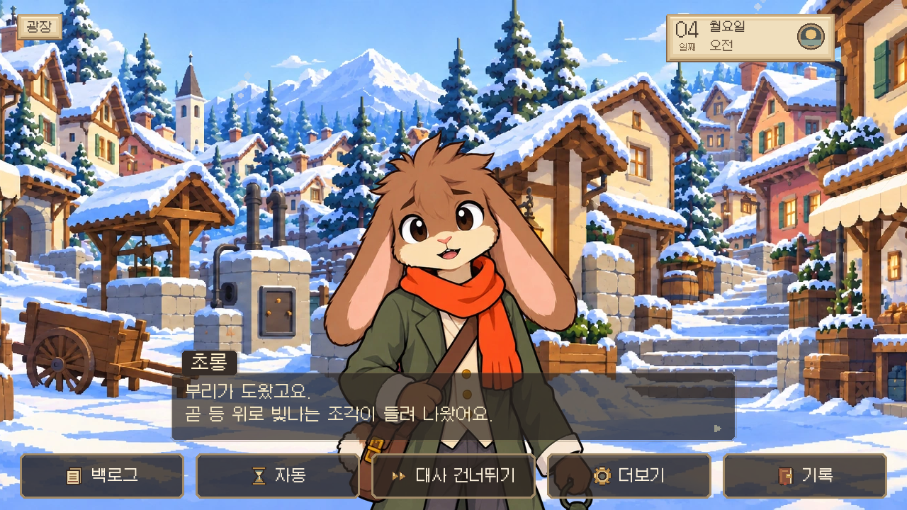

[화면 상태](testimony/testimony-removal-observation.json)

### testimony-topics-resident_lamplighter

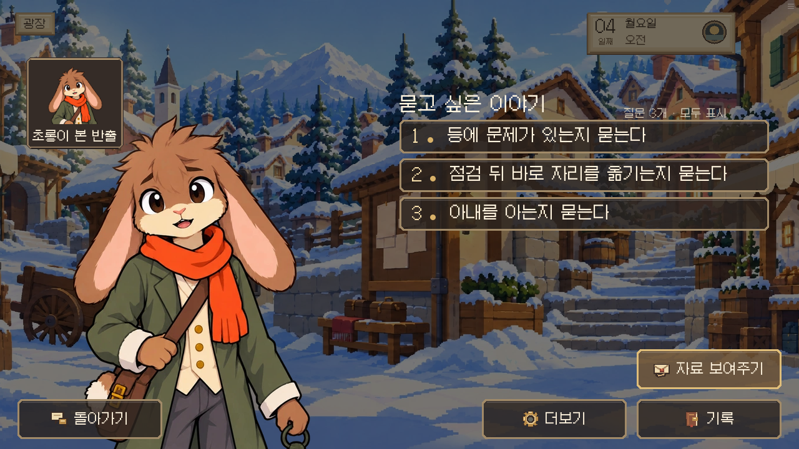

[화면 상태](testimony/testimony-topics-resident_lamplighter.json)

### testimony-topics-buri

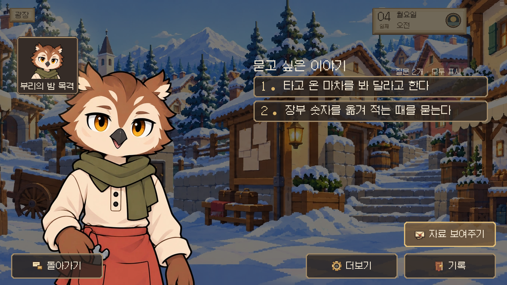

[화면 상태](testimony/testimony-topics-buri.json)

### testimony-thesis-options

[화면 상태](testimony/testimony-thesis-options.json)

### testimony-thesis-commit

[화면 상태](testimony/testimony-thesis-commit.json)

### testimony-counter-1

[화면 상태](testimony/testimony-counter-1.json)

### testimony-commit-2

[화면 상태](testimony/testimony-commit-2.json)

### testimony-counter-3

[화면 상태](testimony/testimony-counter-3.json)

### testimony-commit-4

[화면 상태](testimony/testimony-commit-4.json)

### testimony-counter-5

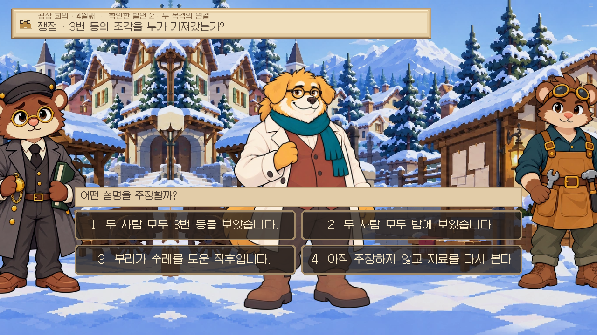

[화면 상태](testimony/testimony-counter-5.json)

### testimony-counter-6

[화면 상태](testimony/testimony-counter-6.json)

### testimony-commit-7

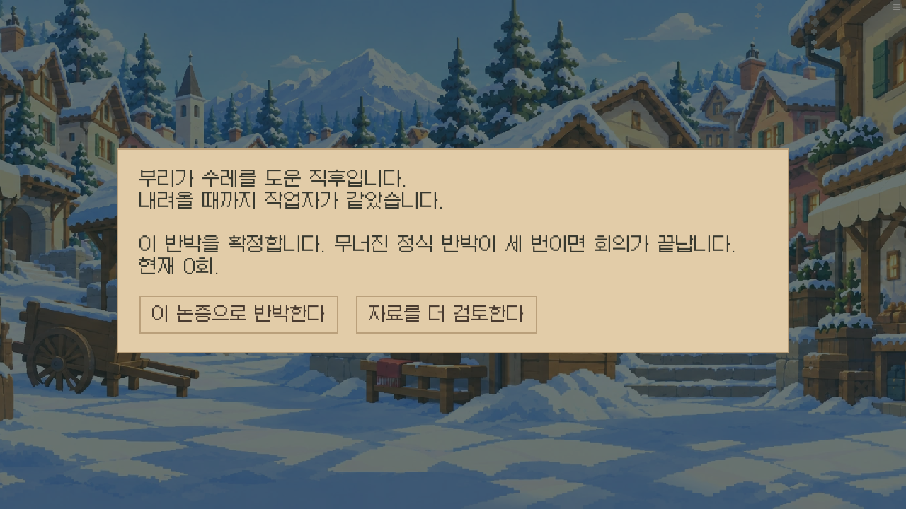

[화면 상태](testimony/testimony-commit-7.json)

### testimony-work-order

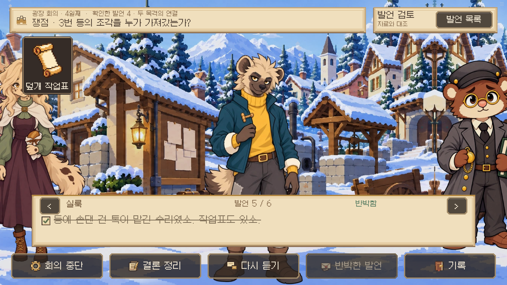

[화면 상태](testimony/testimony-work-order.json)

### testimony-counter-8

[화면 상태](testimony/testimony-counter-8.json)

### testimony-counter-9

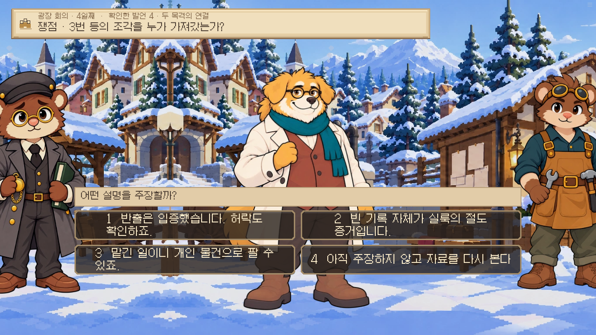

[화면 상태](testimony/testimony-counter-9.json)

### testimony-commit-10

[화면 상태](testimony/testimony-commit-10.json)

### testimony-before-conclusion

[화면 상태](testimony/testimony-before-conclusion.json)

### testimony-finding

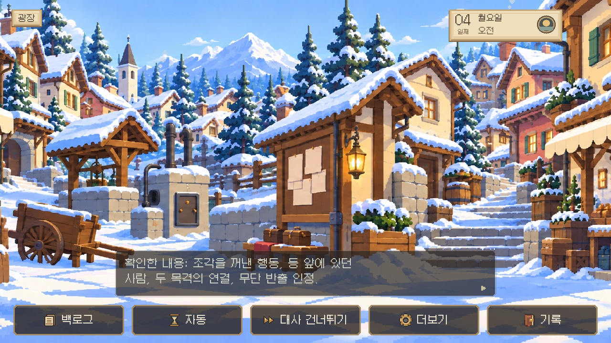

[화면 상태](testimony/testimony-finding.json)

### testimony-result

[화면 상태](testimony/testimony-result.json)

### 관찰한 대사 전체

1. **testimony**

> 까로가 눈을 털며 다가왔다.
> 마차 이야기를 하러 온 얼굴이었다.

2. **testimony**

> 그럼 마차는 언제 다시 출발합니까?

3. **testimony**

> 바퀴 축도 고쳐야 하고,
> 고개를 넘는 정기 마차도 겨울에는 쉬어요.

4. **testimony**

> 그래서 제 마차로는 당장 돌아가실 수 없습니다.

5. **testimony**

> 하루 이틀만 머물 생각이었는데…….
> 고개 말고 다른 길 사정도 아십니까?

6. **testimony**

> 다른 길은 직접 알아보셔야 해요.
> 제가 다니던 고개 길과는 사정이 다르거든요.

7. **testimony**

> 필요한 물건은 장터 은호 사장네서 살 수 있어요.

8. **testimony**

> 이 마을은 서로 도우면 꼭 갚는 데라,
> 일을 풀어 주시면 사례도 들어올 거예요.

9. **testimony**

> 아내 소식부터 알아보겠습니다.

10. **testimony**

> 그러세요.
> 누구네 짐인지는 꼭 짐표와 같이 확인하고요.

11. **testimony**

> 광장에서 사람들이 수군거렸다.
> 어제 백 부인 창고에서 약초 꾸러미가 사라졌다고 했다.

12. **testimony**

> 범인은 아직 못 잡았다고 했다.

13. **testimony**

> 미지근했다고 하셨지요.
> 등 안도 직접 보셨습니까?

14. **testimony**

> 2일 밤 첫 순찰 때 받침이 흔들려서 뚜껑을 열었어요.
> 조각은 안에 있었어요.

15. **testimony**

> 틈에 끈도 없었고요.

16. **testimony**

> 따뜻했다는 것과 직접 확인한 것은 따로 적겠습니다.

17. **testimony**

> 다음 순찰 때는 어땠습니까?

18. **testimony**

> 그날 밤 마지막 순찰에서, 맞은편을
> 보니 짐수레 바퀴가 턱에 걸렸어요.

19. **testimony**

> 부리가 도왔고요.
> 곧 등 위로 빛나는 조각이 들려 나왔어요.

20. **testimony**

> 얼굴은 안 보였어요.
> 수리하나 보다 하고 지나쳤죠.

21. **testimony**

> 동튼 뒤 다시 가 보니 등 안이 비었어요.
> 그때 피코를 발견했어요.

22. **testimony**

> 얼굴을 본 건 아니군요.
> 직접 보신 움직임과 순서를 적겠습니다.

23. **testimony**

> 그날 밤, 광장에서 무얼 봤니?

24. **testimony**

> 수리점 공구를 치우고 돌아가던 길이었어요.
> 수레 바퀴가 턱에 걸렸어요.

25. **testimony**

> 제가 밀어 드렸어요.
> 실룩 씨였어요.

26. **testimony**

> 얼굴을 직접 봤니?

27. **testimony**

> 네.
> 바로 앞에서요.

28. **testimony**

> 그 뒤 실룩 씨가 3번 등 앞에서 일하고 내려올 때까지 봤어요.

29. **testimony**

> 중간에 다른 사람이 올라갔을 수도 있을까?

30. **testimony**

> 아니요.
> 자리를 비우지 않았어요.

31. **testimony**

> 그런데 몸하고 뚜껑에 가려 손 안은 안 보였어요.

32. **testimony**

> 자료 열람과 질문은 자유롭다.

33. **testimony**

> 발언에 맞지 않는 자료를 근거로 내거나,
> 상대의 반론에 잘못된 답을 확정하면 오답이 된다.

34. **testimony**

> 회의에서 내세운 논증은 끝까지 이어야 한다.
> 오답 세 번이면 이번 회의가 끝난다.

35. **testimony**

> 같은 자료로 다시 시작할 때는 다른 논증을 고를 수 있다.

36. **testimony**

> 회의에서는 지금 가진 자료로 이야기한다.
> 회의는 4일 오후가 끝나기 전까지 열 수 있다.

37. **testimony**

> 조사나 추리가 끝나지 않았어도 들어갈 수 있다.

38. **testimony**

> 톡이 묶인 채 돌 앞에 서 있었다.
> 사람들 틈에 실룩의 아이 둘이 빵 봉지를 쥐고 서 있었다.

39. **testimony**

> 백 부인은 맨 앞줄에 앉았다.

40. **testimony**

> 그림쟁이가 쓰러졌소.
> 기록실 선생도 죽었소.

41. **testimony**

> 오늘 끝냅시다.

42. **testimony**

> 등을 돌보는 톡이 조각을 가져간 것 아니오?
> 다르게 본다면 그 근거를 말해 보시오.

43. **testimony**

> 제가 바퀴를 풀어 드렸잖아요.
> 바로 앞에서 얼굴을 봤어요.

44. **testimony**

> 실룩 씨가 등 앞에서 일하고 내려올 때까지 지켜봤어요.

45. **testimony**

> 부리의 관찰로 확인된 사람과 행동은 어디까지요?

46. **testimony**

> 얼굴과 그 자리에 있던 사람은 확인했습니다.
> 뚜껑에 가린 손 안은 보지 못했습니다.

47. **testimony**

> 부리가 수레 바퀴를 도와준 직후였어요.
> 등에서 빛나는 조각이 들려 나왔어요.

48. **testimony**

> 동튼 뒤 다시 가 보니 안이 비어 있었어요.

49. **testimony**

> 조각이 사라졌다는 결과와 직접
> 본 움직임을 나눠 말하시오.

50. **testimony**

> 이 증언으로 확인한 건 반출 행동입니다.
> 얼굴과 같은 시각인지는 따로 연결하겠습니다.

51. **testimony**

> 그 자료 하나로는 두 기록이 이어지는지 알 수 없어요.
> 함께 대조해 주세요.

52. **testimony**

> 한 사람은 얼굴을, 한 사람은 물건을 보았소.
> 두 기록을 함께 냈다는 것만으로 같은 작업이 되지는 않소.

53. **testimony**

> 두 사람은 각자 다른 곳에서 보았소.
> 관찰을 묶을 기준은 무엇이오?

54. **testimony**

> 그때 부리가 본 실룩과,
> 초롱이 본 손의 주인이 달랐을 가능성은?

55. **testimony**

> 같은 수레를 도운 직후입니다.
> 부리는 그 뒤 사람이 바뀌지 않은 것까지 확인했습니다.

56. **testimony**

> 맡긴 일과 조각의 처리 내역을 함께 확인하겠습니다.

57. **testimony**

> 톡의 서명이 있소.
> 나 혼자 멋대로 등을 만진 게 아니란 말이오.

58. **testimony**

> 덮개가 흔들린다고 해서 점검을 맡겼어요.
> 이건 작업표, 이쪽은 자재 대장이에요.

59. **testimony**

> 작업표에는 덮개, 나사 두 개,
> 조각 교체 0, 회수 예정 0이 적혀 있었다.

60. **testimony**

> 대장의 광장 3 조각은 사용 중인 마을 자재였다.

61. **testimony**

> 그 자료 하나로는 두 기록이 이어지는지 알 수 없어요.
> 함께 대조해 주세요.

62. **testimony**

> 톡이 일을 맡긴 건 분명하오.
> 조각을 다룬 일도 그 작업으로 봐야 하지 않겠소?

63. **testimony**

> 작업표와 대장을 함께 놓으면 어떤 범위가 확인되오?

64. **testimony**

> 대장에 양도 기록이 없으면
> 그것만으로 절도가 확정되는 것이오?

65. **testimony**

> 실룩 씨의 반출은 앞서 연결했습니다.
> 이 작업표로 조각까지 넘겨받았다는 해명은 성립하지 않습니다.

66. **testimony**

> 별도의 허락을 받았습니까?

67. **testimony**

> 덮개 점검과 별개로,
> 조각을 가져가도 된다고 허락받았습니까?

68. **testimony**

> 덮개 점검만 맡겼어요.

69. **testimony**

> 조각을 교체하거나 폐기하라고 한 적도,
> 실룩 씨에게 넘긴 적도 없어요.

70. **testimony**

> …따로 허락받지는 않았소.
> 내가 꺼내 팔았소.

71. **testimony**

> 식었으니 버려도 되는 줄 알았소.

72. **testimony**

> 빚이 열두 냥이오.
> 못 갚으면 아이들을 일꾼으로 보내야 했소.

73. **testimony**

> 돌려놓을 생각도 못 했소.

74. **testimony**

> 톡이 가져갔다는 혐의는 거두겠소.
> 실룩이 허락 없이 꺼내 팔았다는 것으로 정리하겠소.

75. **testimony**

> 고맙습니다.
> 하지만 그 등 밑에 있던 사람을 생각하면…

76. **testimony**

> 마음이 편하지는 않네요.

77. **testimony**

> 이제 톡이 그랬다는 말에 동의하지 않아요.

78. **testimony**

> 팔았다는 조각이 지금 어디에 있습니까?

79. **testimony**

> 백 부인 창고에 있소.
> 밑에 광장 3이라는 이름표가 있소.

80. **testimony**

> …확인만 하세요.

81. **testimony**

> 사람들이 보는 앞에서 조각을 꺼냈다.
> 톡이 이름표와 장부를 대조했다.

82. **testimony**

> 제가 3번 등에 넣은 조각이 맞아요.

83. **testimony**

> 톡은 풀어 주겠소.
> 실룩은 내가 데려가오.

84. **testimony**

> 너울이 실룩의 팔을 잡아끌었다.
> 실룩의 아이들이 따라가려다 넘어졌다.

85. **testimony**

> 애들은……
> 애들은 건드리지 마시오!

86. **testimony**

> 내 돈으로 산 거예요!

87. **testimony**

> 사람들이 창고 쪽으로 움직였다.

88. **testimony**

> 이 마을에서 오래 살 생각은 없으신가 보군요.

89. **testimony**

> 톡이 돌려받은 ‘광장 3’ 조각을 등에 다시 넣었다.
> 등이 데워졌다.

90. **testimony**

> 그런데 숨 몇 번 사이에 온기가 옅어졌다.

91. **testimony**

> 이 조각, 가을엔 밤새 따뜻했어요.
> 지금은…….

92. **testimony**

> (조각을 훔친 사람은 밝혔다.

93. **testimony**

> 하지만 이 겨울에 사람들이 온기를
> 잃는 일까지 끝난 것은 아니다.)

94. **testimony**

> 다람이가 품에 넣어 둔 그림책을 펼쳤다.

95. **testimony**

> 「아침이 되자, 아저씨는 엄마 코를
> 다 못 그린 채 잠들어 있었어요.」

96. **testimony**

> ……아빠.
> 이 책, 이제 안 읽을래.

97. **testimony**

> 응.
> 지금은 덮어 두자.

98. **testimony**

> 다람이가 책을 닫았다.
> 나는 아이의 손을 잡고 잠시 곁에 서 있었다.

99. **testimony**

> 수첩을 펼쳤다.
> 확인한 사실과 아직 답하지 못한 의문을 나누어 적었다.

100. **testimony**

> 선택한 논증: 두 목격의 연결.

101. **testimony**

> 확인한 내용: 조각을 꺼낸 행동, 등 앞에 있던
> 사람, 두 목격의 연결, 무단 반출 인정.

102. **testimony**

> 이 근거들을 연결해 실룩의 무단 반출을 밝혔다.
> 다른 조사 방법까지 모두 거칠 필요는 없었다.

103. **testimony**

> 톡은 풀려났다.

104. **testimony**

> 회의 직전으로 돌아가면 당시
> 자료로 다시 이야기할 수 있다.

## 오답·실패·재도전

[errors 실행 결과](errors/result.json) · [선택·화면 로그](errors/play.log) · [원문 대사 JSON](errors/dialogue.json)

### premature-conclusion-thesis-options

[화면 상태](errors/premature-conclusion-thesis-options.json)

### premature-conclusion-thesis-commit

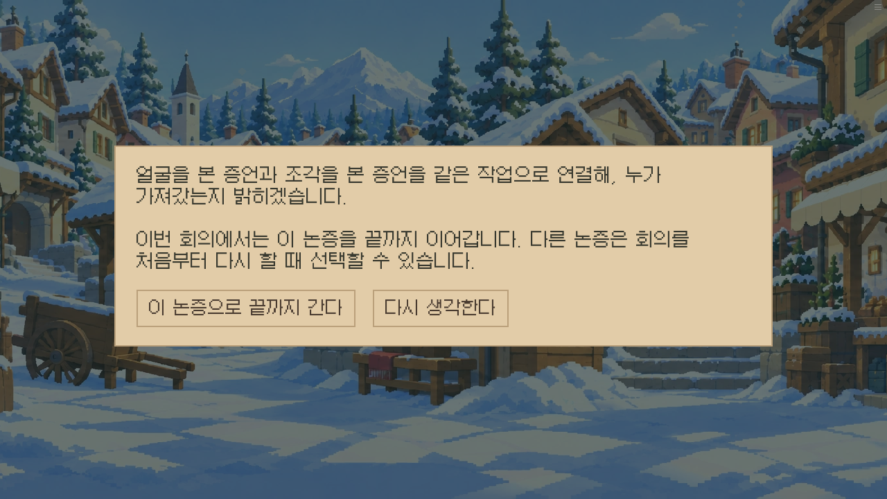

[화면 상태](errors/premature-conclusion-thesis-commit.json)

### premature-conclusion-one-error

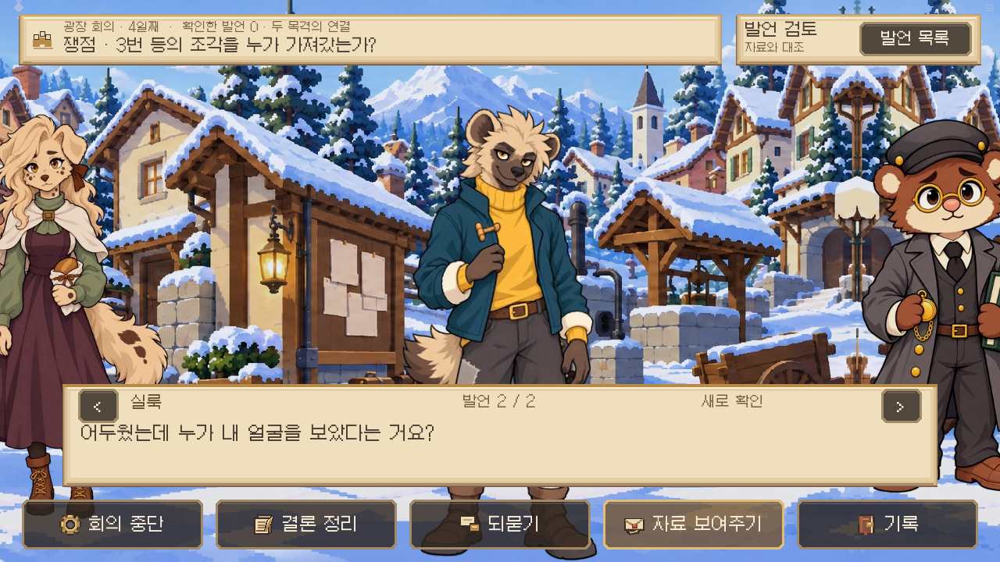

[화면 상태](errors/premature-conclusion-one-error.json)

### three-errors-thesis-options

[화면 상태](errors/three-errors-thesis-options.json)

### three-errors-thesis-commit

[화면 상태](errors/three-errors-thesis-commit.json)

### three-errors-counter-0

[화면 상태](errors/three-errors-counter-0.json)

### three-errors-counter-1

[화면 상태](errors/three-errors-counter-1.json)

### three-errors-commit-2

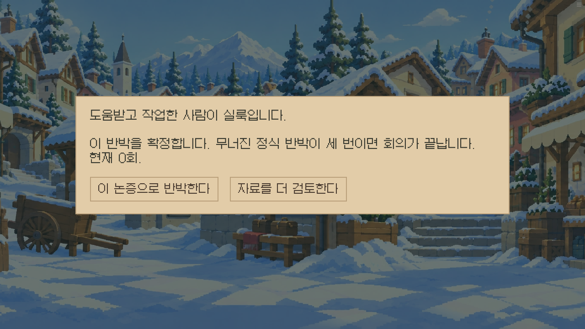

[화면 상태](errors/three-errors-commit-2.json)

### three-errors-counter-3

[화면 상태](errors/three-errors-counter-3.json)

### three-errors-commit-4

[화면 상태](errors/three-errors-commit-4.json)

### three-errors-counter-5

[화면 상태](errors/three-errors-counter-5.json)

### three-errors-commit-6

[화면 상태](errors/three-errors-commit-6.json)

### three-errors-result

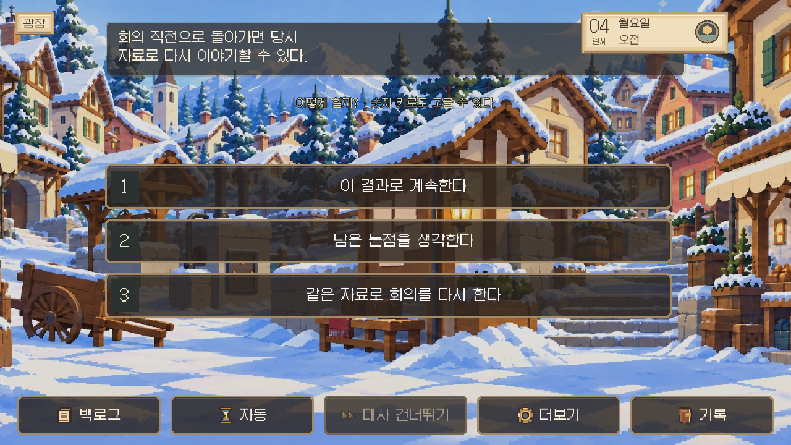

[화면 상태](errors/three-errors-result.json)

### native-meeting-restart

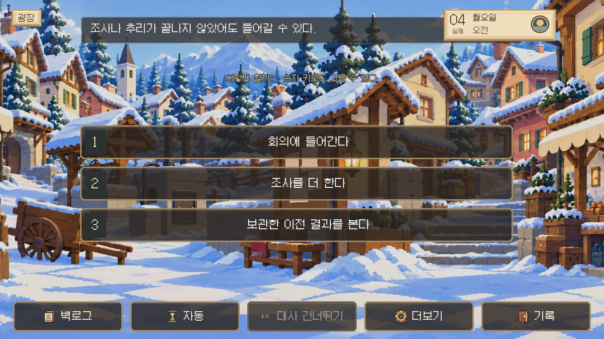

[화면 상태](errors/native-meeting-restart.json)

### live-errors-thesis-options

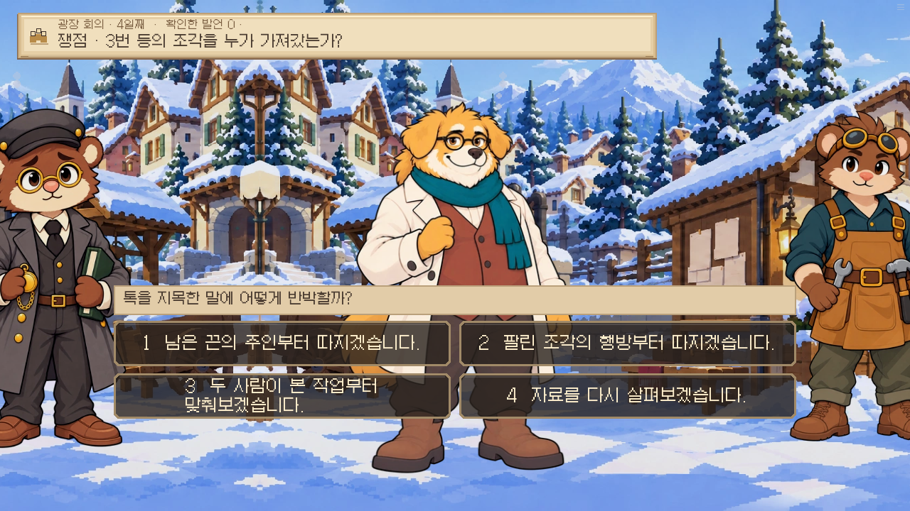

[화면 상태](errors/live-errors-thesis-options.json)

### live-errors-thesis-commit

[화면 상태](errors/live-errors-thesis-commit.json)

### live-third-error-result

[화면 상태](errors/live-third-error-result.json)

### 관찰한 대사 전체

1. **premature-conclusion**

> 까로가 눈을 털며 다가왔다.
> 마차 이야기를 하러 온 얼굴이었다.

2. **premature-conclusion**

> 그럼 마차는 언제 다시 출발합니까?

3. **premature-conclusion**

> 바퀴 축도 고쳐야 하고,
> 고개를 넘는 정기 마차도 겨울에는 쉬어요.

4. **premature-conclusion**

> 그래서 제 마차로는 당장 돌아가실 수 없습니다.

5. **premature-conclusion**

> 하루 이틀만 머물 생각이었는데…….
> 고개 말고 다른 길 사정도 아십니까?

6. **premature-conclusion**

> 다른 길은 직접 알아보셔야 해요.
> 제가 다니던 고개 길과는 사정이 다르거든요.

7. **premature-conclusion**

> 필요한 물건은 장터 은호 사장네서 살 수 있어요.

8. **premature-conclusion**

> 이 마을은 서로 도우면 꼭 갚는 데라,
> 일을 풀어 주시면 사례도 들어올 거예요.

9. **premature-conclusion**

> 아내 소식부터 알아보겠습니다.

10. **premature-conclusion**

> 그러세요.
> 누구네 짐인지는 꼭 짐표와 같이 확인하고요.

11. **premature-conclusion**

> 광장에서 사람들이 수군거렸다.
> 어제 백 부인 창고에서 약초 꾸러미가 사라졌다고 했다.

12. **premature-conclusion**

> 범인은 아직 못 잡았다고 했다.

13. **premature-conclusion**

> 자료 열람과 질문은 자유롭다.

14. **premature-conclusion**

> 발언에 맞지 않는 자료를 근거로 내거나,
> 상대의 반론에 잘못된 답을 확정하면 오답이 된다.

15. **premature-conclusion**

> 회의에서 내세운 논증은 끝까지 이어야 한다.
> 오답 세 번이면 이번 회의가 끝난다.

16. **premature-conclusion**

> 같은 자료로 다시 시작할 때는 다른 논증을 고를 수 있다.

17. **premature-conclusion**

> 회의에서는 지금 가진 자료로 이야기한다.
> 회의는 4일 오후가 끝나기 전까지 열 수 있다.

18. **premature-conclusion**

> 조사나 추리가 끝나지 않았어도 들어갈 수 있다.

19. **premature-conclusion**

> 톡이 묶인 채 돌 앞에 서 있었다.
> 사람들 틈에 실룩의 아이 둘이 빵 봉지를 쥐고 서 있었다.

20. **premature-conclusion**

> 백 부인은 맨 앞줄에 앉았다.

21. **premature-conclusion**

> 그림쟁이가 쓰러졌소.
> 기록실 선생도 죽었소.

22. **premature-conclusion**

> 오늘 끝냅시다.

23. **premature-conclusion**

> 등을 돌보는 톡이 조각을 가져간 것 아니오?
> 다르게 본다면 그 근거를 말해 보시오.

24. **premature-conclusion**

> 그 결론까지 이어지는 근거를 듣지 못했소.
> 확인한 사실만으로 그 주장이 성립하는지 다시 따져 보시오.

25. **premature-conclusion**

> 그 반박은 받아들이지 않겠소.
> 지금까지 1번이오.

26. **premature-conclusion**

> 자료와 주장을 다시 살피시오.

27. **three-errors**

> 까로가 눈을 털며 다가왔다.
> 마차 이야기를 하러 온 얼굴이었다.

28. **three-errors**

> 그럼 마차는 언제 다시 출발합니까?

29. **three-errors**

> 바퀴 축도 고쳐야 하고,
> 고개를 넘는 정기 마차도 겨울에는 쉬어요.

30. **three-errors**

> 그래서 제 마차로는 당장 돌아가실 수 없습니다.

31. **three-errors**

> 하루 이틀만 머물 생각이었는데…….
> 고개 말고 다른 길 사정도 아십니까?

32. **three-errors**

> 다른 길은 직접 알아보셔야 해요.
> 제가 다니던 고개 길과는 사정이 다르거든요.

33. **three-errors**

> 필요한 물건은 장터 은호 사장네서 살 수 있어요.

34. **three-errors**

> 이 마을은 서로 도우면 꼭 갚는 데라,
> 일을 풀어 주시면 사례도 들어올 거예요.

35. **three-errors**

> 아내 소식부터 알아보겠습니다.

36. **three-errors**

> 그러세요.
> 누구네 짐인지는 꼭 짐표와 같이 확인하고요.

37. **three-errors**

> 광장에서 사람들이 수군거렸다.
> 어제 백 부인 창고에서 약초 꾸러미가 사라졌다고 했다.

38. **three-errors**

> 범인은 아직 못 잡았다고 했다.

39. **three-errors**

> 자료 열람과 질문은 자유롭다.

40. **three-errors**

> 발언에 맞지 않는 자료를 근거로 내거나,
> 상대의 반론에 잘못된 답을 확정하면 오답이 된다.

41. **three-errors**

> 회의에서 내세운 논증은 끝까지 이어야 한다.
> 오답 세 번이면 이번 회의가 끝난다.

42. **three-errors**

> 같은 자료로 다시 시작할 때는 다른 논증을 고를 수 있다.

43. **three-errors**

> 회의에서는 지금 가진 자료로 이야기한다.
> 회의는 4일 오후가 끝나기 전까지 열 수 있다.

44. **three-errors**

> 조사나 추리가 끝나지 않았어도 들어갈 수 있다.

45. **three-errors**

> 톡이 묶인 채 돌 앞에 서 있었다.
> 사람들 틈에 실룩의 아이 둘이 빵 봉지를 쥐고 서 있었다.

46. **three-errors**

> 백 부인은 맨 앞줄에 앉았다.

47. **three-errors**

> 그림쟁이가 쓰러졌소.
> 기록실 선생도 죽었소.

48. **three-errors**

> 오늘 끝냅시다.

49. **three-errors**

> 등을 돌보는 톡이 조각을 가져간 것 아니오?
> 다르게 본다면 그 근거를 말해 보시오.

50. **three-errors**

> 제가 바퀴를 풀어 드렸잖아요.
> 바로 앞에서 얼굴을 봤어요.

51. **three-errors**

> 실룩 씨가 등 앞에서 일하고 내려올 때까지 지켜봤어요.

52. **three-errors**

> 부리의 관찰로 확인된 사람과 행동은 어디까지요?

53. **three-errors**

> 제가 바퀴를 풀어 드렸잖아요.
> 바로 앞에서 얼굴을 봤어요.

54. **three-errors**

> 실룩 씨가 등 앞에서 일하고 내려올 때까지 지켜봤어요.

55. **three-errors**

> 부리의 관찰로 확인된 사람과 행동은 어디까지요?

56. **three-errors**

> 미지근했다는 것만으로 조각이 남아 있었다고 할 수는 없어요.
> 온기와 직접 본 것은 나눠 말할게요.

57. **three-errors**

> 그 반박은 받아들이지 않겠소.
> 지금까지 1번이오.

58. **three-errors**

> 자료와 주장을 다시 살피시오.

59. **three-errors**

> 제가 바퀴를 풀어 드렸잖아요.
> 바로 앞에서 얼굴을 봤어요.

60. **three-errors**

> 실룩 씨가 등 앞에서 일하고 내려올 때까지 지켜봤어요.

61. **three-errors**

> 부리의 관찰로 확인된 사람과 행동은 어디까지요?

62. **three-errors**

> 부리는 손 안이 가렸다고 했소.
> 보지 못한 물건을 보았다고 바꿀 수는 없소.

63. **three-errors**

> 그 반박은 받아들이지 않겠소.
> 지금까지 2번이오.

64. **three-errors**

> 자료와 주장을 다시 살피시오.

65. **three-errors**

> 제가 바퀴를 풀어 드렸잖아요.
> 바로 앞에서 얼굴을 봤어요.

66. **three-errors**

> 실룩 씨가 등 앞에서 일하고 내려올 때까지 지켜봤어요.

67. **three-errors**

> 부리의 관찰로 확인된 사람과 행동은 어디까지요?

68. **three-errors**

> 부리는 손 안이 가렸다고 했소.
> 보지 못한 물건을 보았다고 바꿀 수는 없소.

69. **three-errors**

> 반박이 세 번 무너졌소.
> 이 회의의 반론은 여기까지 받겠소.

70. **three-errors**

> 이 회의에서 톡의 처분을 바꾸지는 않겠소.

71. **three-errors**

> 톡이 끌려가며 수리점 쪽을 돌아보았다.

72. **three-errors**

> 톡이 끌려간 뒤에도 3번 등은 식어 있었다.
> 부리가 빈 작업대를 바라보았다.

73. **three-errors**

> 등도 그대로고, 선생님도 안 돌아왔어요.

74. **three-errors**

> (밝힌 것과 밝히지 못한 것이 남았다.
> 내가 모르는 일을 안다고 말할 수는 없다.)

75. **three-errors**

> 다람이가 품에 넣어 둔 그림책을 펼쳤다.

76. **three-errors**

> 「아침이 되자, 아저씨는 엄마 코를
> 다 못 그린 채 잠들어 있었어요.」

77. **three-errors**

> ……아빠.
> 이 책, 이제 안 읽을래.

78. **three-errors**

> 응.
> 지금은 덮어 두자.

79. **three-errors**

> 다람이가 책을 닫았다.
> 나는 아이의 손을 잡고 잠시 곁에 서 있었다.

80. **three-errors**

> 수첩을 펼쳤다.
> 확인한 사실과 아직 답하지 못한 의문을 나누어 적었다.

81. **three-errors**

> 선택한 논증: 두 목격의 연결.
> 회의에서 근거로 확정한 내용은 없었다.

82. **three-errors**

> 확정한 반박이 세 번 무너져 회의가 끝났다.

83. **three-errors**

> 톡의 처분을 바꾸지는 못했다.

84. **three-errors**

> 회의 직전으로 돌아가면 당시
> 자료로 다시 이야기할 수 있다.

85. **three-errors**

> 자료 열람과 질문은 자유롭다.

86. **three-errors**

> 발언에 맞지 않는 자료를 근거로 내거나,
> 상대의 반론에 잘못된 답을 확정하면 오답이 된다.

87. **three-errors**

> 회의에서 내세운 논증은 끝까지 이어야 한다.
> 오답 세 번이면 이번 회의가 끝난다.

88. **three-errors**

> 같은 자료로 다시 시작할 때는 다른 논증을 고를 수 있다.

89. **three-errors**

> 회의에서는 지금 가진 자료로 이야기한다.
> 회의는 4일 오후가 끝나기 전까지 열 수 있다.

90. **three-errors**

> 조사나 추리가 끝나지 않았어도 들어갈 수 있다.

91. **live-errors**

> 톡이 묶인 채 돌 앞에 서 있었다.
> 사람들 틈에 실룩의 아이 둘이 빵 봉지를 쥐고 서 있었다.

92. **live-errors**

> 백 부인은 맨 앞줄에 앉았다.

93. **live-errors**

> 그림쟁이가 쓰러졌소.
> 기록실 선생도 죽었소.

94. **live-errors**

> 오늘 끝냅시다.

95. **live-errors**

> 등을 돌보는 톡이 조각을 가져간 것 아니오?
> 다르게 본다면 그 근거를 말해 보시오.

96. **live-errors**

> 그 자료로는 지금 말한 부분을 확인할 수 없어요.

97. **live-errors**

> 반박이 세 번 무너졌소.
> 이 회의의 반론은 여기까지 받겠소.

98. **live-errors**

> 등을 돌보는 톡이 조각을 가져간 것 아니오?

99. **live-errors**

> 이 회의에서 톡의 처분을 바꾸지는 않겠소.

100. **live-errors**

> 톡이 끌려가며 수리점 쪽을 돌아보았다.

101. **live-errors**

> 톡이 끌려간 뒤에도 3번 등은 식어 있었다.
> 부리가 빈 작업대를 바라보았다.

102. **live-errors**

> 등도 그대로고, 선생님도 안 돌아왔어요.

103. **live-errors**

> (밝힌 것과 밝히지 못한 것이 남았다.
> 내가 모르는 일을 안다고 말할 수는 없다.)

104. **live-errors**

> 다람이가 품에 넣어 둔 그림책을 펼쳤다.

105. **live-errors**

> 「아침이 되자, 아저씨는 엄마 코를
> 다 못 그린 채 잠들어 있었어요.」

106. **live-errors**

> ……아빠.
> 이 책, 이제 안 읽을래.

107. **live-errors**

> 응.
> 지금은 덮어 두자.

108. **live-errors**

> 다람이가 책을 닫았다.
> 나는 아이의 손을 잡고 잠시 곁에 서 있었다.

109. **live-errors**

> 수첩을 펼쳤다.
> 확인한 사실과 아직 답하지 못한 의문을 나누어 적었다.

110. **live-errors**

> 선택한 논증: 끈의 사용 경로.
> 회의에서 근거로 확정한 내용은 없었다.

111. **live-errors**

> 확정한 반박이 세 번 무너져 회의가 끝났다.

112. **live-errors**

> 톡의 처분을 바꾸지는 못했다.

113. **live-errors**

> 회의 직전으로 돌아가면 당시
> 자료로 다시 이야기할 수 있다.
