# 첫 사건 개선판: 조사·회의·실패·재시도 점검

2026-10-18. 기존 사용자 관점 플레이 리뷰에서 발견한 ‘덜 조사한 것인지, 가진 자료로 추리를 못 한 것인지 모호하다’는 문제를 개선한 작업 기록이다. 아래는 4일 오전의 명시적인 테스트 상태에서 시작해 실제 브라우저의 회의, 후일담, 저장·불러오기를 조작한 기록이다. 새 게임부터 14일 전체를 다시 자연스럽게 플레이한 리뷰는 아니다. 테스트는 소지 자료와 시작 위치를 지정하지만, 회의 반박과 결과를 성공 상태로 직접 바꾸지 않는다.

정본 판단은 [전체 서사 대조](../../Q1_CANON_REVIEW.md), 기능 계약은 [기획·구현 문서](../../Q1_REVIEW_DESIGN.md)에 남겼다. 실제 화면, 각 화면의 조작 대상과 게임 상태(JSON), 회의에서 읽은 대사 기록을 함께 저장한다. 대사 기록은 자동 조작 중 포착한 문장 모음이며 전체 원본 대사본을 대체하지 않는다.

## 조사 메모: 답보다 남은 의문

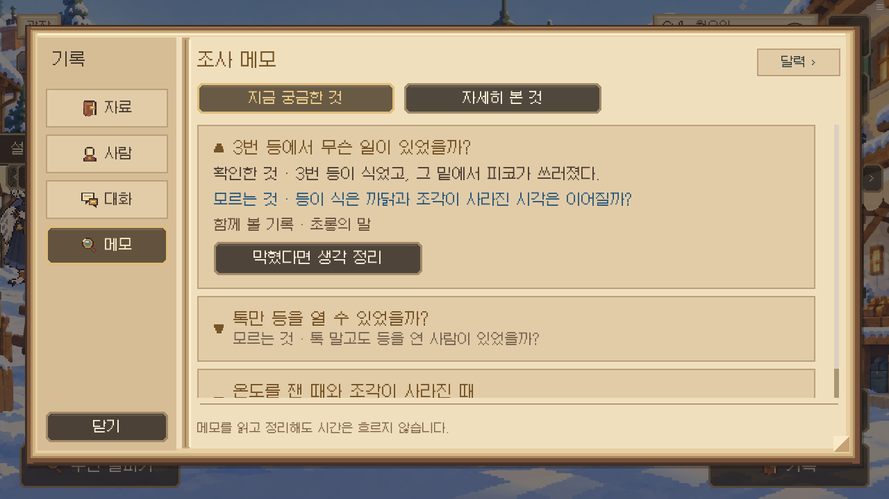

현재 ‘기록 → 메모’에서 읽는 화면이다. 첫 사건에서 확인한 사실과 아직 모르는 것을 나눴다. 가진 기록만 아래에 붙고, 조사하지 않은 인물의 이야기를 아빠가 이미 아는 것처럼 쓰지 않는다. 완료율을 채우는 느낌보다 ‘내가 무엇을 설명할 수 있고 무엇이 아직 비어 있는가’를 읽는 데 초점을 뒀다.

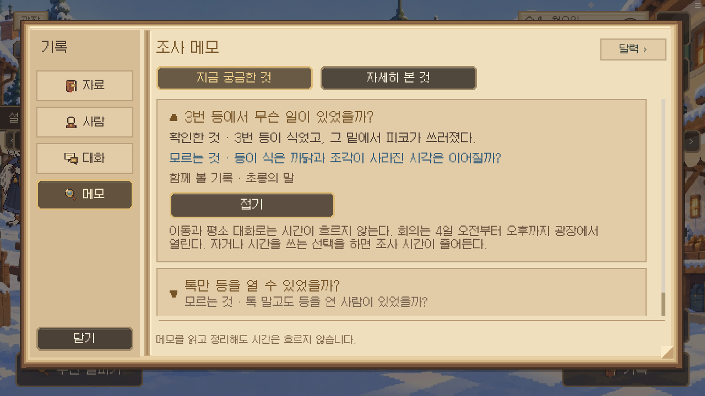

생각 정리는 누를 때만 열린다. 기본 의문만 보고 직접 생각할 수도 있다. 회고의 구체적 장소 힌트는 다시 별도로 골라야 한다.

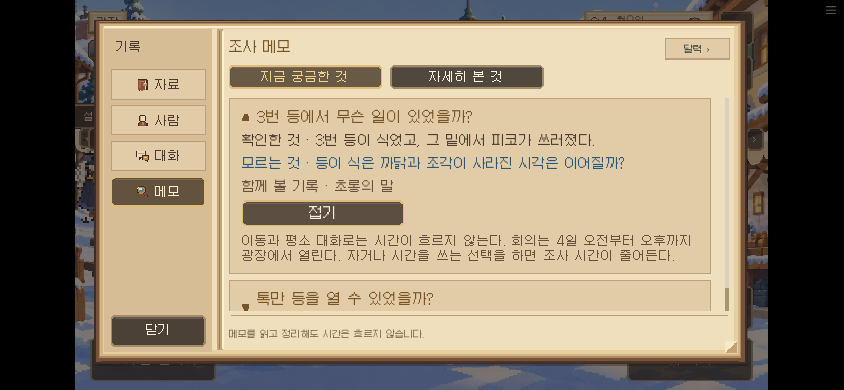

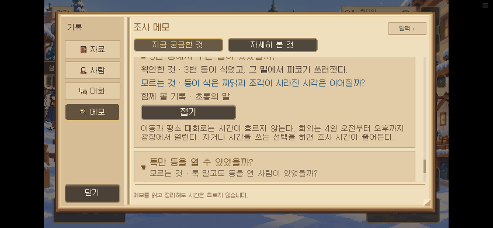

소유자가 지적한 어두운 추리 메모는 검토 중 직접 열었던 옛 화면이었다. 그 별도 화면을 현재 기록 메모로 통합했다. 배경과 글자색만 비슷하게 새로 만드는 대신 같은 화면을 사용한다.

## 덜 조사해도 회의는 열린다

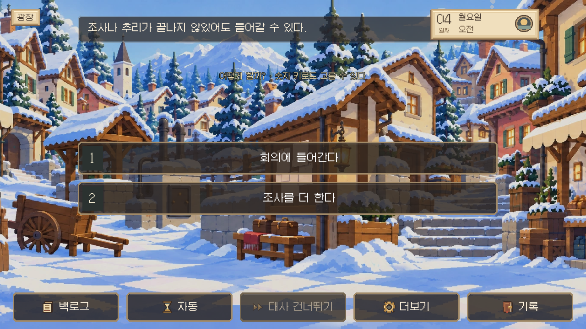

입장 전에는 지금 가진 자료로 이야기한다는 점과 4일 오후까지라는 기한을 알려 준다. 필수 증거를 모두 모아야 입장할 수 있는 잠금은 없다. 이 단계에서 ‘조사를 더 한다’를 고르면 회의 결과를 확정하지 않고 돌아온다.

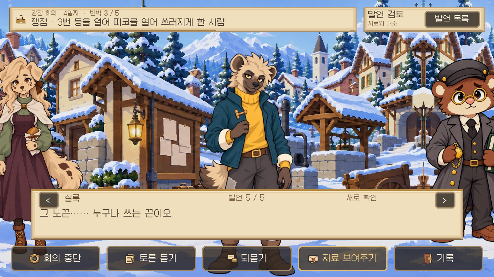

현장에 남은 노끈 하나만으로 실룩의 끈과 맞아 들어간다고 말할 수는 없다. 실룩의 반응은 ‘그게 무슨 상관인가’가 아니라 뜯긴 끝의 대조가 빠졌다는 점을 짚는다. 자료가 완전히 엉뚱한 것과 연결이 하나 부족한 것을 구별하려는 변화다.

## 실패가 어디에서 생겼는지 돌아본다

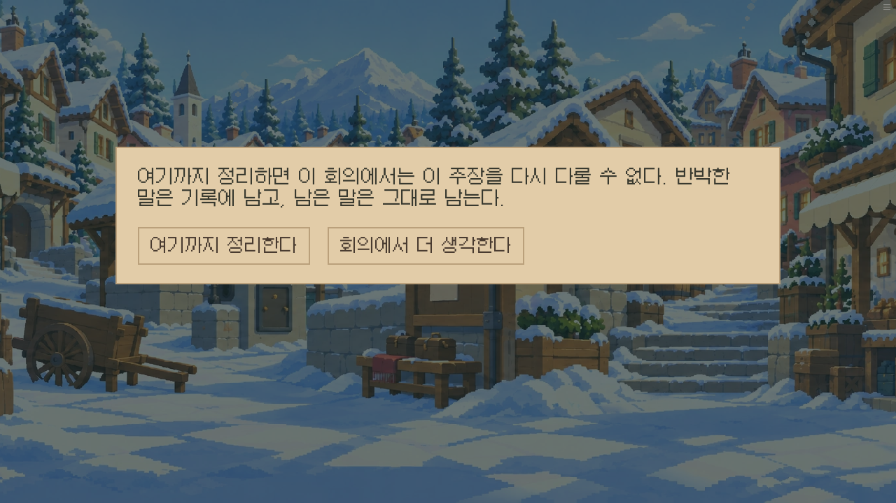

다섯 논점 중 세 개를 반박한 상태로 끝냈다. 이전 선택지 ‘더 찾아본다’는 회의 밖으로 나가 조사할 수 있다는 인상을 줬으므로 ‘회의에서 더 생각한다’로 바꿨다.

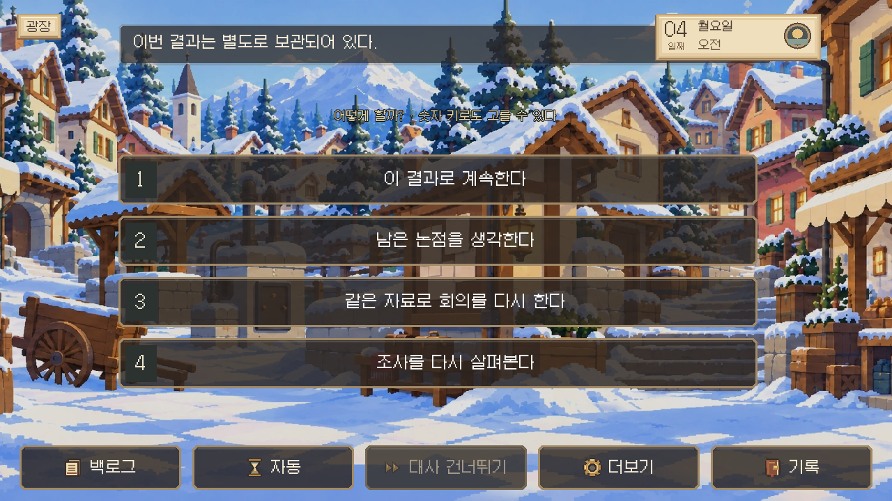

톡은 여전히 구금된다. 일부 반박을 성공했다고 의도된 손실을 없애지 않는다. 대신 뒤집은 논점과 입증하지 못한 논점을 분리해 설명하고, 가진 자료로 더 따질 수 있었던 부분과 조사가 더 필요한 부분을 구분한다. 구금된 톡이 다음 장면에서 나타나 등을 고치는 모순도 없앴다.

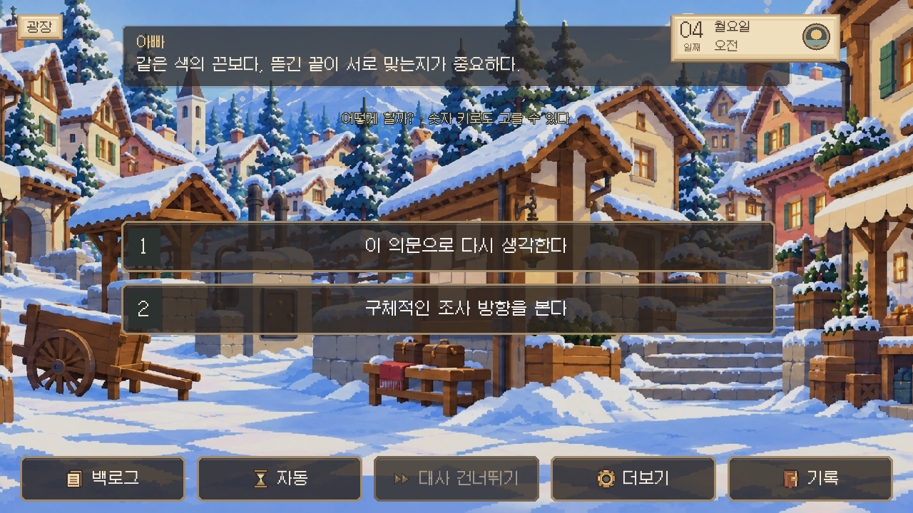

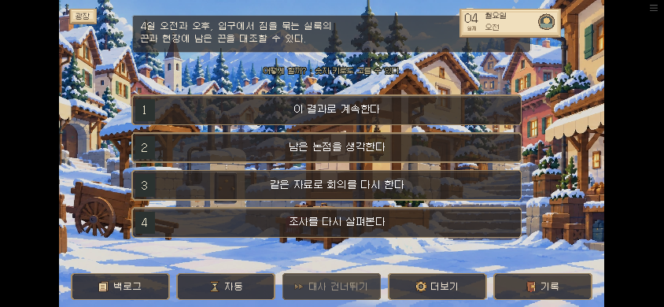

구체적인 정답이나 다음 사건에서 잃을 것을 기본 회고에 나열하지 않는다. 플레이어가 남은 논점을 고른 다음, 다시 구체적 조사 방향을 골랐을 때만 장소 안내가 나온다. 실패한 결과를 받아들이고 다음 이야기로 가는 선택은 계속 남아 있다.

## 반복할 때 되돌아가는 범위

‘같은 자료로 회의를 다시 한다’는 회의 직전의 실제 저장을 불러온다. 반박 진행과 결과는 초기화되지만 당시 가지고 있던 자료와 돈으로 시작한다. 재시도 전의 실패 결과는 따로 보관해 다시 돌아갈 수 있다.

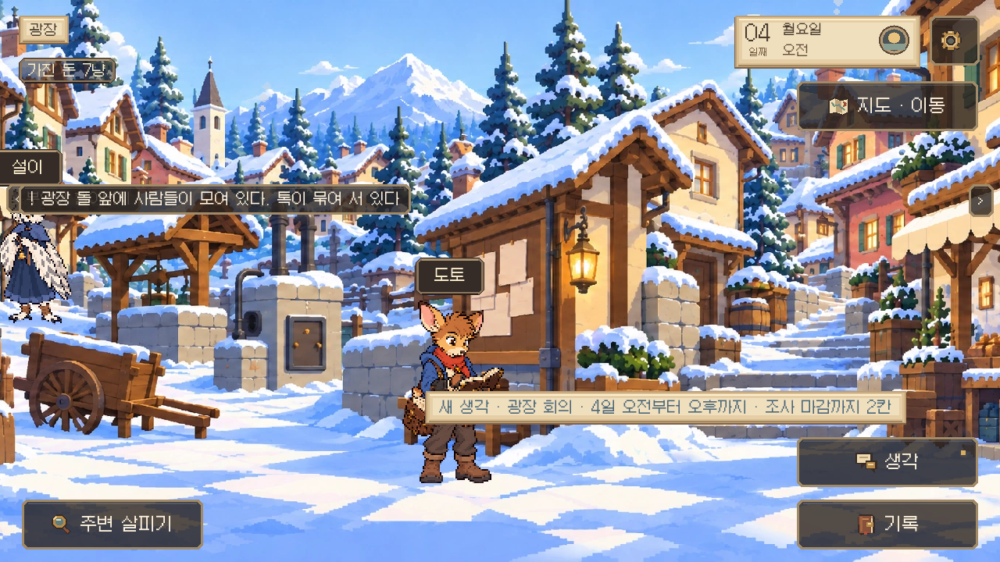

‘조사를 다시 살펴본다’는 아침 사건을 읽은 뒤의 저장으로 돌아간다. 죽음 장면을 다시 처음부터 읽게 하지 않는다. 당시의 시간, 소지품, 돈, 사건 상태 전체를 복원하므로 첫 시도의 증거나 보상만 골라 다음 시도에 누적하지 않는다. 복원 시점이 없는 기존 저장에서는 없는 선택지를 약속하지 않는다.

## 조사를 보완해 결론까지

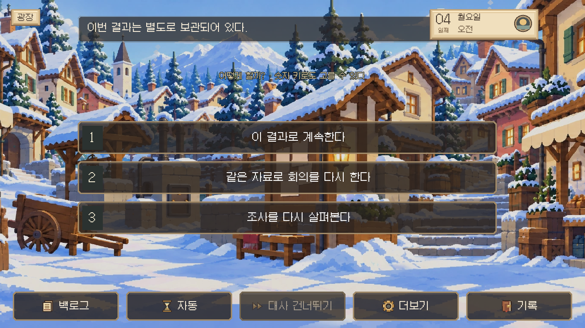

입구에서 실룩의 끈을 보고 창고에서 조각을 확인한 뒤 회의를 다시 열었다. 다섯 논점을 반박하고, 실룩이라는 결론과 결정적 자료를 직접 선택한 뒤 조각 반환까지 요구하는 흐름을 점검했다. 성공 후에도 피코의 죽음과 겨울의 위험이 사라지지는 않는다. ‘누가 가져갔는가’와 ‘사람들이 왜 계속 온기를 잃는가’를 구분한다.

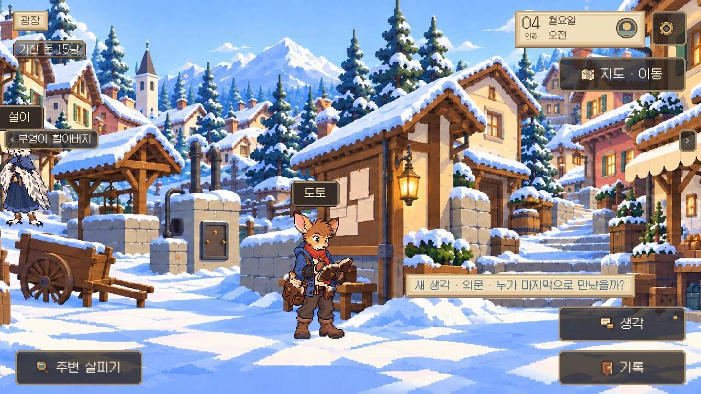

이번 개선의 목표는 성공을 보장하는 것이 아니다. 실패했을 때 자신이 무엇을 놓쳤는지 이해하고, 그 결과를 계속 살지 다시 시도할지 선택할 수 있게 하는 것이다. 전체 기획상 톡의 구금이 뒤의 증언과 결말에 미치는 영향은 그대로 유지했다.

## 검증 자료

- `browser-result.json`: 실제 UI 흐름의 검증 항목과 포착한 대사.
- `dialogue.md`: 같은 대사를 읽기 편하게 풀어 쓴 기록.
- `native-results.json`: 표준 128개 검사와 수정 후 해당 영역 재검사의 최종 상태·출처.
- `check.txt`, `native-*.txt`, `browser-run.txt`: 검사 실행 로그.
- 각 PNG와 같은 이름의 JSON: 캡처 당시 게임 상태와 조작 대상.

표준 128개 검사는 0.19.50 병합 전 구현 사본으로 시작했다. 이후 이름·현장 조작이 바뀐 검사와 첫 회의, 시간 흐름, 반론, 덮어쓰기 순서를 재검사했다. 0.19.51 후속 질문 개선을 병합한 최종 0.19.52에서도 첫 회의와 덮어쓰기 순서를 다시 검사했다. 작은 화면 캡처는 844×390 브라우저 뷰포트에서 확인했다. 전 사건을 수작업으로 다시 플레이했다는 의미는 아니다.

최종 배포는 0.19.54이다. 첫 사건 전체 브라우저 점검은 이 브랜치의 0.19.52 빌드(`f74d959afb53…`)에서 통과했다. 그 뒤 공개 main의 학교 대화·배치 개선을 병합했고, 0.19.53 빌드의 메모 실제 진입·펼치기·작은 화면·복귀를 다시 통과했다(`notebook-final-53/`). 마지막으로 공개 main의 대화 제목·질문 행 위치 조정도 보존했다. 메모 화면과 Q1 로직은 이 병합들에서 바뀌지 않았다. 최종 0.19.54 빌드의 단위+lint와 실제 브라우저 부팅·실행 버전을 통과했다(`final-build-54/`). 공개 주소 직접 실행은 이 환경의 네트워크 프록시가 차단하여, 공개 배포는 GitHub Pages 워크플로 [39088017034](https://github.com/kkhkkh20-bit/daaegame/actions/runs/39088017034)의 성공 상태로 확인했다.
