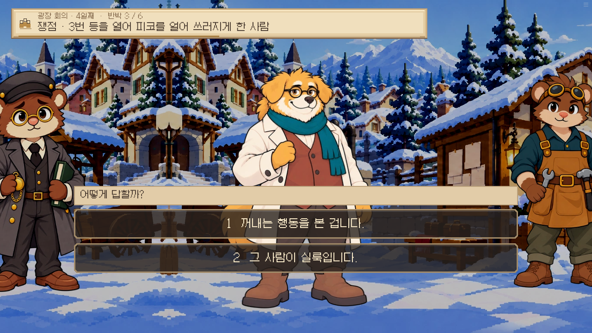
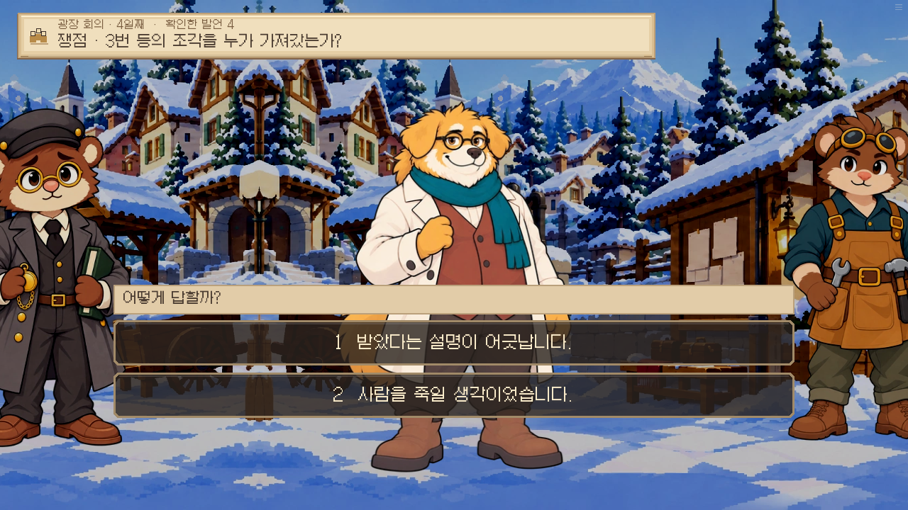

# 첫 사건: 세 가지 논증으로 회의 끝까지 — 0.19.58

“모든 자료를 찾았나?” 대신 “내가 낸 근거가 이 결론까지 이어지나?”를 시험한 검수다. 현장 물증, 거래 기록, 두 목격자의 증언으로 각각 승리했다. 어느 방법도 다른 방법의 자료를 모두 모으라고 요구하지 않는다. 반출 행동만 확인하고 범인을 단정한 경우와 살해 의도로 결론을 과장한 경우는 실패했다.

이번 기록은 **4일 오전 준비 상태를 주입한 경로별 브라우저 검증**이다. 인물 배치와 장소 이동 일부는 테스트 도구로 준비했다. 질문 선택, 자료 제시, 짝 맞추기, 재반박 답변, 결론 확정, 처분 선택과 재시도는 실제 화면으로 진행했다. 새 게임의 첫날부터 모든 이동을 자연스럽게 밟은 무공략 플레이나 독립적인 사용자 조사는 아니다. 별도 네이티브 검사에서 실제 일정에 따른 인물의 위치·대화 진입·질문 해금도 확인했다.

## 1. 현장 물증을 잇는 방법

처음 가진 자료는 현장 끈 L04, 실룩의 끈 L07, 초롱의 기존 말 L06이다. 초롱에게 등 안을 직접 봤는지, 다음 순찰에는 무엇을 봤는지를 실제로 물어 L15와 L16을 얻었다. 끈의 짝을 맞춘 뒤 첫 순찰 때에는 그 끈이 없었다는 관찰로 오래된 흔적이라는 해명을 반박했다. 누가 끈을 썼는지는 별도로 물었다.

초롱이 본 것은 조각이 들려 나오는 행동이다. 얼굴을 못 봤는데 실룩이라고 말하면 안 된다. 이 경로에서는 실룩이 자신이 올라갔다고 답한 앞선 발언과 연결한다. 허락 여부를 끝까지 물은 뒤에야 결론을 냈다. 창고 이름표나 거래 장부를 갖지 않은 상태에서도 승리했다.

플레이 감각상 이 경로는 물건에서 출발해 사람의 해명을 하나씩 좁히는 맛이 있다. 끈 한 번 내고 끝나지 않아서 “그 끈을 빌렸다면?”이라는 빈틈이 남지 않는다. 다만 반박 선택지는 1부의 첫 사건답게 범위 차이가 비교적 뚜렷하다. 이후 사건에서는 양쪽 모두 그럴듯한 가설을 더 다룰 여지가 있다.

## 2. 거래를 따라가는 방법

현장 끈과 목격 증언을 전혀 주지 않고 시작했다. 실룩에게 빵값 출처를 물어 정산 쪽지를 얻고, 그 계기로 창고에서 이름표를 확인했다. 백 부인에게 이름표를 직접 보여 줘 원장을 받았다.

회의에서 출처를 확인하고 거래 번호·물건·대금을 대조했다. 실룩은 돈만 대신 받았다고 해명한다. 쪽지의 거래 조건을 짚어 판매를 인정시킨 뒤에도 바로 절도 결론으로 넘어가지 않았다. 어디에서 어떻게 받았는지 묻자 “수리점에서 건네받았다”와 “등 받침에서 끄집어냈다”가 어긋난다. 이 모순을 제시하고 직접 반출을 인정받은 다음 허락 여부를 확인했다.

이 방법은 가장 말의 변화가 잘 느껴졌다. 처음 제출한 자료가 곧바로 범인의 자백이 되는 것이 아니라, 합법적인 거래였다는 설명 → 심부름이었다는 설명 → 받았다는 설명을 차례로 검토한다. 원장 둘을 갖고 있다는 이유만으로 독립된 목격 둘처럼 세지 않는다.

## 3. 두 목격을 합치는 방법

초롱은 반출 행동을 봤지만 얼굴을 못 봤다. 부리는 얼굴과 계속 같은 사람이 작업했다는 점을 봤지만 손 안의 물건은 못 봤다. 각각의 증언이 증명하는 범위부터 확인했다.

둘 다 밤에 봤다는 것만으로 같은 사람·같은 때라고 합치지 않았다. 수레 바퀴가 턱에 걸리고 부리가 도운 직후라는 공통 사건과 부리의 연속 관찰을 연결했다. 물증과 거래 기록 없이도 이 논증이 완성되면 같은 승리다.

이 경로는 필요한 자료 수가 적어서 체감상 가장 간결하다. 그 대신 한 증인의 말로 범인과 행동을 모두 주장할 수 없고, 두 관찰을 연결하는 반박이 필요하다. 반복 플레이에서 더 짧은 공략을 발견하는 재미는 있지만 세 방법의 난도가 완전히 같다는 검증까지 끝난 것은 아니다. 실제 초행 플레이에서 선택 비율과 막히는 지점을 볼 필요가 있다.

## 4. 같은 승리와 남겨 둔 실패

세 승리 모두 톡을 석방하고 같은 후속 처분 메뉴로 갔다. 검증에서는 ‘둘 다 요구한다’를 골랐다. 창고를 조사하지 않은 방법도 회의 뒤 공개 확인을 거쳐 조각을 돌려놓을 수 있다. 성공이 앞선 사망을 되돌리거나 후속 증언 부탁까지 자동 완료하지는 않는다.

반출 행동만 입증하고 “실룩이 가져갔다”고 결론을 확정한 사례는 실패했다. 회의 직전 저장으로 실제 복원하니 처분과 입증은 초기화되고 당시 자료 L16만 남았다. 이 재시도에서는 직전 시도의 입증과 처분이 남지 않았다.

별도의 결론 검사에서는 입증을 마친 상태를 준비하고 “사람을 죽이려 했다”를 실제로 선택했다. 너울은 가져갔다는 사실과 살해 의도는 다르다고 반박했다. 뒤이어 ‘결론을 듣지 못했다’는 모순된 문구가 나오지 않도록 실패 대사도 정리했다. 이 사례의 입증 준비는 테스트 주입이며, 앞선 세 승리처럼 과정을 전부 플레이한 것은 아니다.

## 5. 전체 대본과 맞추며 고친 부분

- 반출 목격은 2일 늦은 밤, 빈 등과 피코의 발견은 동튼 뒤로 나눴다. 반출 직후 곧바로 추위로 쓰러졌다는 인과가 되지 않도록 했다. 발견한 사람을 알면서도 방치한 것으로 쓰지 않았다.
- 초롱의 ‘미지근했다’는 잔열일 수 있으므로 조각이 남아 있었다는 증명으로 쓰지 않는다. 첫 순찰 때 내부를 직접 본 새 관찰과 구분한다.
- 4일의 ‘어젯밤’은 기록실 절도가 있었던 3일 밤이다. 2일 밤 광장 사건의 결정적 알리바이로 쓰지 않는다.
- 이미 진행 중인 구형 회의 저장은 기존 규칙으로 이어진다. 새 회의에만 이번 논증 구조를 적용한다.

## 6. 구현 범위와 검증

플레이어가 자유롭게 입력한 모든 문장을 판정하는 AI 시스템은 아니다. 작가가 정의한 주장·관찰·재반박을 조합하며, 어떤 사실을 실제 회의에서 입증했는지로 판정하는 첫 구현이다. 세 공략 중 하나를 메뉴에서 고르는 구조도 아니다. 서로 다른 방법의 자료와 입증을 섞을 수 있다.

- 단위 검사 449개와 Ren’Py lint 통과. 새 논증 전용 검사는 11개로, 다른 방법의 자료 없이 승리·혼합·순서·반복 자료·미소지 자료·관찰 범위·기존 저장·선택형 힌트를 확인했다.
- 표준 네이티브 129개 중 126개가 첫 실행에 통과했다. 두 개는 이미 없어진 ‘복도로’ 버튼과 물건을 선택한 뒤 따로 조사하던 동작을 요구한 오래된 테스트였다. 현재 지도 이동·직접 조사 동작으로 수정한 뒤 통과했다. 나머지 한 개는 시간 초과로 끝나 같은 검사를 단독 재실행해 통과했다. 최종 소스의 관련 검사 5개와 위 추가 재검사 2개가 모두 통과했다. 최초 실패 로그도 삭제하지 않고 보존했다.
- 최종 웹 빌드에서 세 승리, 불충분한 결론의 실패, 네이티브 저장 복원, 과장된 결론의 실패를 확인했다. 혼합 공략은 단위 판정으로 검증했고, 화면 완주는 기본 세 방법을 각각 진행했다. 상태와 전체 관찰 대사를 함께 저장했다.
- 공개 주소는 이 실행 환경의 네트워크 허용 목록 밖이어서 직접 열람하지 못했다. 동일하게 생성된 로컬 웹 빌드 검증과 GitHub Pages 배포 상태를 구분해 기록한다.

## 생략하지 않은 기록

- [관찰 대사 원문 전체](dialogue.md), [기계 판독 원본](browser/dialogue.json)
- [최종 빌드 스크린샷 전체](screenshots.md), [브라우저 판정 결과](browser/result.json)
- [표준 네이티브 결과](native/results.json), [최종 소스 추가 검사](targeted/results.json), [재검사 결과](retries/results.json)
- [단위·lint 로그](check.txt), [브라우저 로그](browser.txt), [최종 웹 빌드 해시](build-report.json)
- [구현된 설계서](../../design/Q1_MULTIPLE_ARGUMENTS.md)

대화 중 먼저 보여 준 아래 두 화면도 그대로 보존했다. 중간 검토 빌드이므로 최종 대사 시간표를 확인할 때는 위 최종 기록을 따른다.

