# 최종 빌드 화면 전체

검증 중 저장한 PNG를 생략하지 않고 나열했다. 같은 이름의 JSON에는 해당 화면의 버튼과 상태가 있다.

## incomplete-before-conclusion

[화면 상태](browser/incomplete-before-conclusion.json)

## incomplete-counter-13

[화면 상태](browser/incomplete-counter-13.json)

## incomplete-native-restore

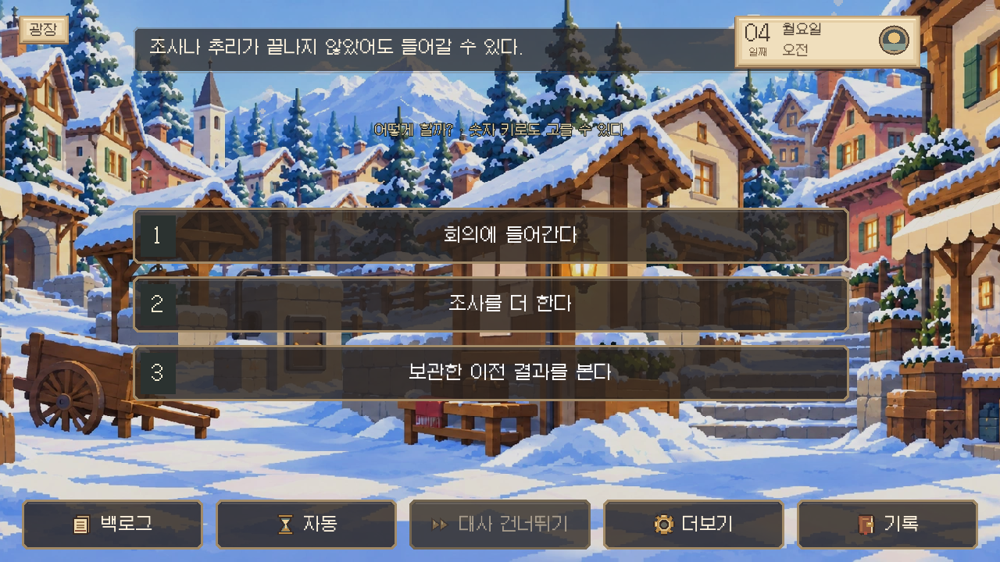

[화면 상태](browser/incomplete-native-restore.json)

## incomplete-removal-observation

[화면 상태](browser/incomplete-removal-observation.json)

## incomplete-result

[화면 상태](browser/incomplete-result.json)

## overreach-before-conclusion

[화면 상태](browser/overreach-before-conclusion.json)

## overreach-finding

[화면 상태](browser/overreach-finding.json)

## overreach-result

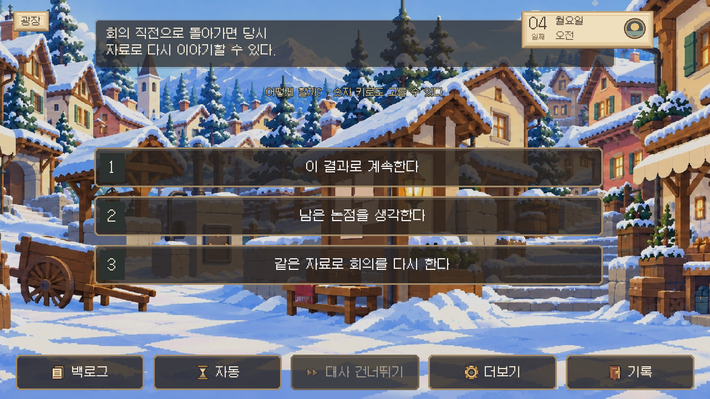

[화면 상태](browser/overreach-result.json)

## physical-before-conclusion

[화면 상태](browser/physical-before-conclusion.json)

## physical-counter-1

[화면 상태](browser/physical-counter-1.json)

## physical-finding

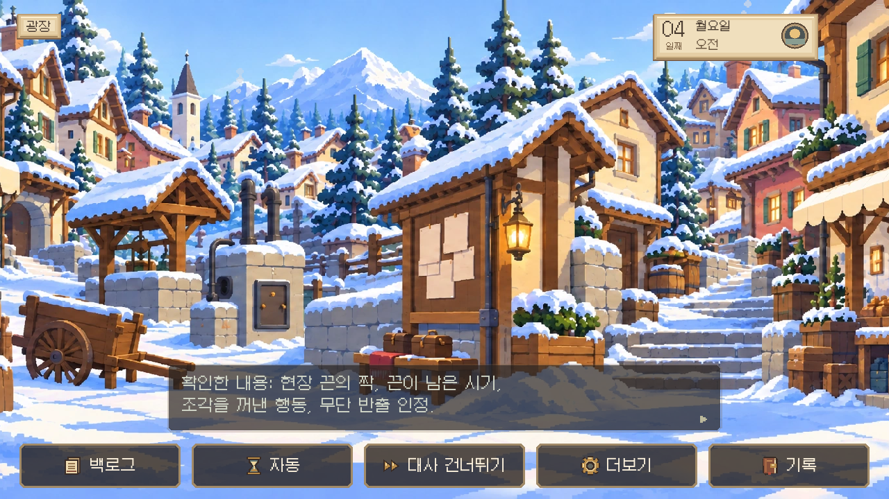

[화면 상태](browser/physical-finding.json)

## physical-removal-observation

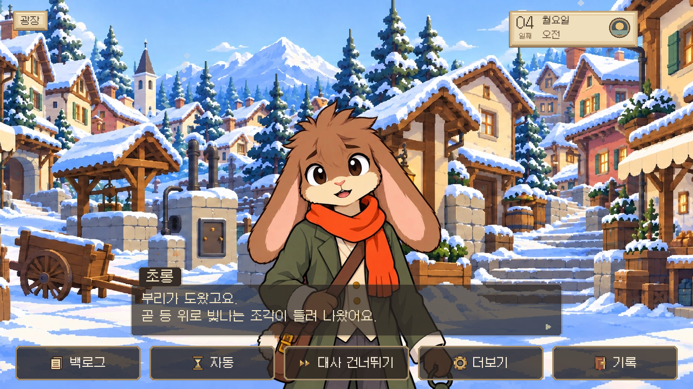

[화면 상태](browser/physical-removal-observation.json)

## physical-result

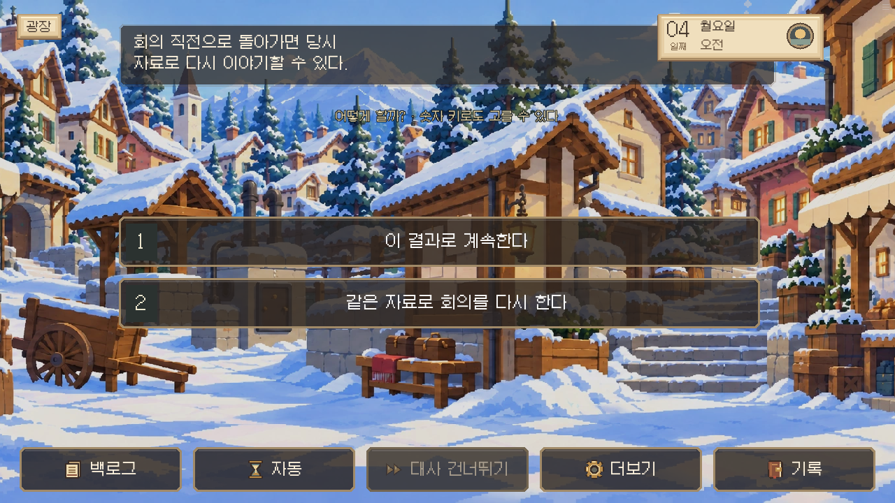

[화면 상태](browser/physical-result.json)

## physical-topics-resident_lamplighter

[화면 상태](browser/physical-topics-resident_lamplighter.json)

## testimony-before-conclusion

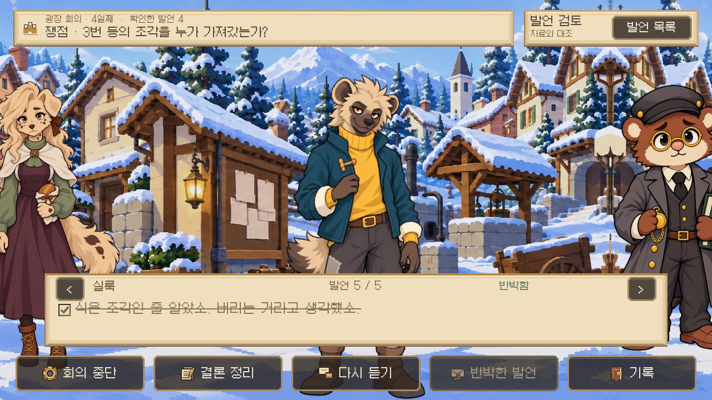

[화면 상태](browser/testimony-before-conclusion.json)

## testimony-counter-10

[화면 상태](browser/testimony-counter-10.json)

## testimony-counter-8

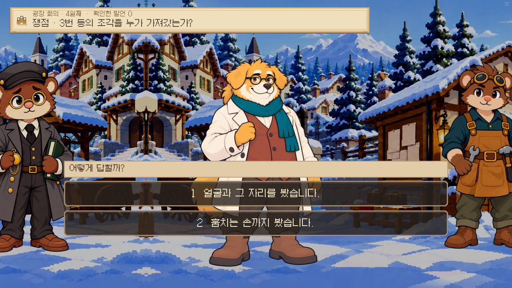

[화면 상태](browser/testimony-counter-8.json)

## testimony-counter-9

[화면 상태](browser/testimony-counter-9.json)

## testimony-finding

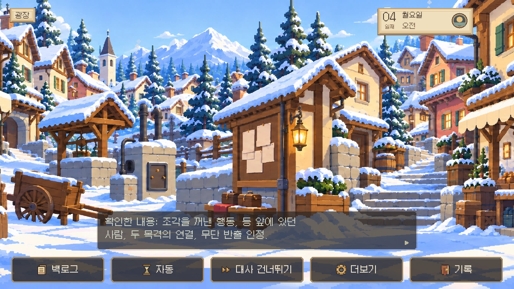

[화면 상태](browser/testimony-finding.json)

## testimony-removal-observation

[화면 상태](browser/testimony-removal-observation.json)

## testimony-result

[화면 상태](browser/testimony-result.json)

## testimony-topics-buri

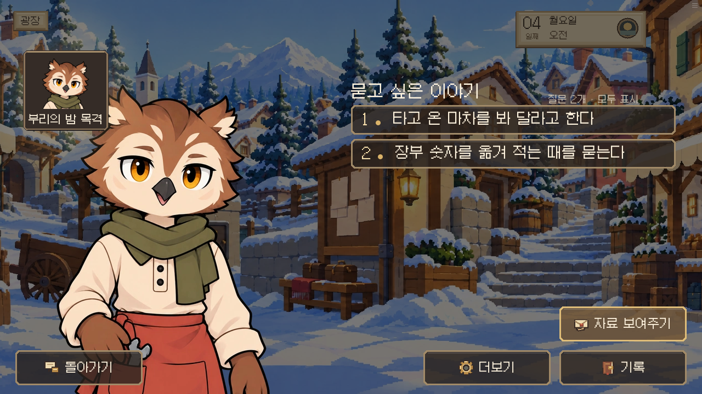

[화면 상태](browser/testimony-topics-buri.json)

## testimony-topics-resident_lamplighter

[화면 상태](browser/testimony-topics-resident_lamplighter.json)

## trade-admission

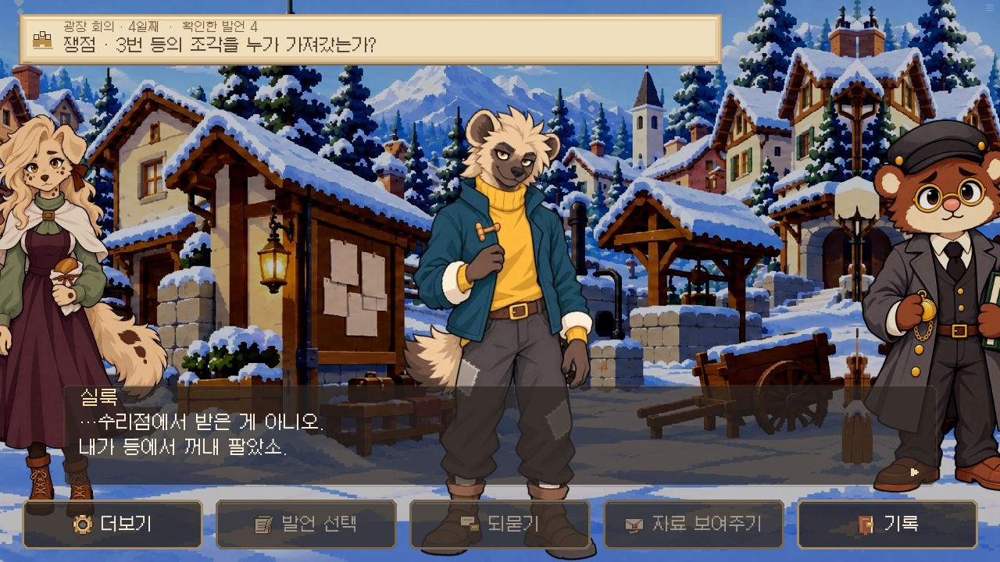

[화면 상태](browser/trade-admission.json)

## trade-before-conclusion

[화면 상태](browser/trade-before-conclusion.json)

## trade-counter-4

[화면 상태](browser/trade-counter-4.json)

## trade-finding

[화면 상태](browser/trade-finding.json)

## trade-result

[화면 상태](browser/trade-result.json)

## trade-topics-resident_madam

[화면 상태](browser/trade-topics-resident_madam.json)

## trade-topics-resident_siluk

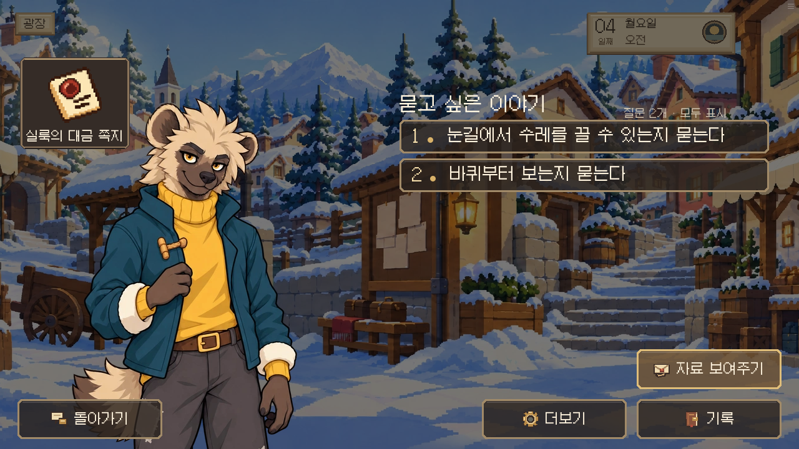

[화면 상태](browser/trade-topics-resident_siluk.json)

## trade-trade-record

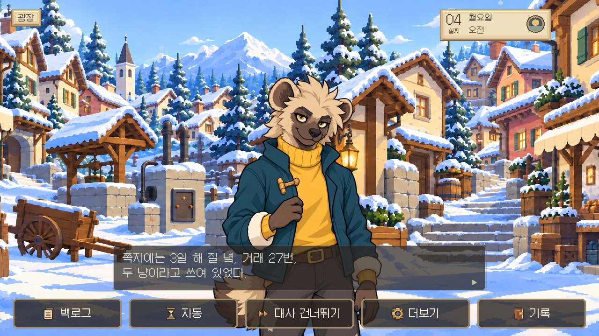

[화면 상태](browser/trade-trade-record.json)
