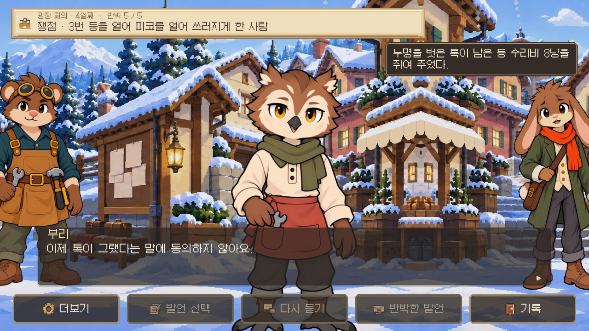
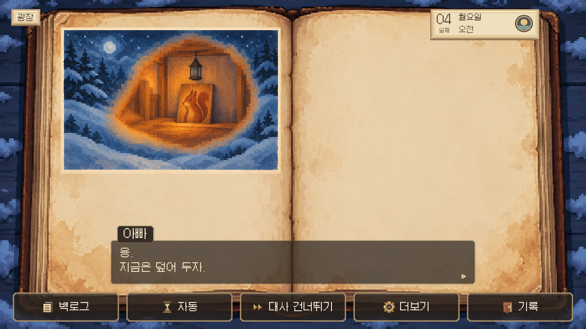
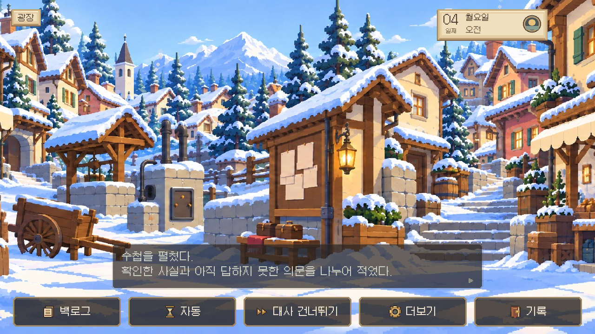

# 첫 사건 대화 연결 후속 검토 · 0.19.56

사용자 정정에 따라 화면 디자인이 아니라 이야기 담당 범위로 검토했다. 이전 실제 플레이 기록 `../q1-investigation-review-20261018/dialogue.md`와 현재 실행 대본, `Q1_CANON_REVIEW.md`, `EPISODE1_SCRIPT.md`, 최신 정본의 사건 연쇄를 대조했다.

## 이전 리뷰에서 놓친 연결

이전 성공 플레이의 124번째 대사는 “더는 사람을 희생하는 데 동의하지 않아요.”였다. 이때의 논점은 톡이 3번 등의 조각을 훔쳤는가였다. 아직 제단 회의가 아닌데 공통 함수가 재판 외 모든 회의를 제단으로 취급한 오류다. 작은 사건 ①~⑥의 입장 변화 대사를 각 사건의 논점에 맞췄다. 입장이 바뀐 근거 기록도 해당 사건에서 입증한 내용으로 연결한다. 표 수, 증거 판정, 결론 조건은 그대로다.

톡은 이미 결론에서 “내 탓이 아니라고 해도…… 편하진 않네요.”라고 말했다. 그 뒤 본인이 자신을 믿는다는 자동 반응을 다시 붙이지 않는다. 주민의 의견 변화는 톡의 석방 처분이나 조각 반환을 대신하지 않는다.

## 반박마다 끼어들던 반복 대사

이전 기록에는 다섯 반박마다 “정말요?”, “그렇다고요?”, “잠깐, 끝까지 들어봐요.” 같은 공통 대사가 반복되었다. 실룩의 고백과 아이가 빵을 떨어뜨리는 장면 뒤에도 같은 반응이 붙어 감정의 흐름이 끊겼다.

Q1은 각 근거에 너울·백 부인·실룩의 응답이 이미 작성되어 있다. 그 응답을 끝으로 다음 논점을 선택하게 했다. 증거 설명·당사자의 반박·고백은 생략하지 않는다. 다른 사건의 개별 연출을 이번에 일괄 삭제하지 않았다.

## 아이의 말에 답한 뒤 복기로

이전에는 다람이가 “이 책, 이제 안 읽을래.”라고 말한 뒤 아빠의 대답 없이 후일담과 회의 요약으로 넘어갔다. 피코가 죽은 경로에는 다음 응답을 넣었다.

> 다람: ……아빠. 이 책, 이제 안 읽을래.  
> 아빠: 응. 지금은 덮어 두자.  
> 다람이가 책을 닫았다. 나는 아이의 손을 잡고 잠시 곁에 서 있었다.

피코가 살아 있으면 기존의 담요 결말과 “아빠, 이번엔 끝이 바뀌었어.”를 유지하며, “그러네. 담요를 덮어 준 사람이 있었구나.”로 받는다. 회의 성공이 피코의 생사를 바꾸지는 않는다.

회의 복기 앞에는 “수첩을 펼쳤다. 확인한 사실과 아직 답하지 못한 의문을 나누어 적었다.”를 넣었다. 감정 장면 뒤의 목록이 갑작스러운 새 대화처럼 보이지 않게, 지금부터 아빠가 기록을 정리한다는 전환을 둔다. 이후 다람이에게 회의를 돌아보는 주제를 골라도 같은 전환이 자연스럽게 성립한다.

## 플레이 경로와 검증 범위

첫 사건 시작 상태는 테스트용으로 설정했다. 이후 실제 버튼으로 불충분한 조사에서 입장을 취소하고, 3/5 반박 후 실패하고, 힌트를 선택하고, 저장된 회의·결과·조사 시점을 복원하고, 빠진 자료를 조사해 5/5 반박 및 결론·조각 반환까지 진행한다. 실제 확인한 대사와 캡처를 함께 저장한다. 이 검사는 첫날부터 모든 사건을 수동으로 완주한 리뷰가 아니다.

실패의 대가, 톡의 후속 증언 조건, 선택적 힌트와 재시도, 보상 중복 방지에 대한 기존 검증을 유지한다. 여섯 사건 전체의 모든 대사를 새로 고쳤거나 모든 경로가 완벽하다고 판단한 것은 아니다.

검증 결과와 실행 로그는 완료 후 아래에 기록한다.
