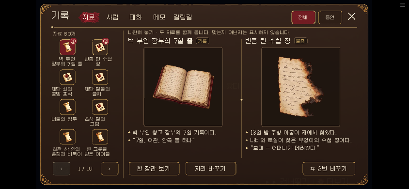
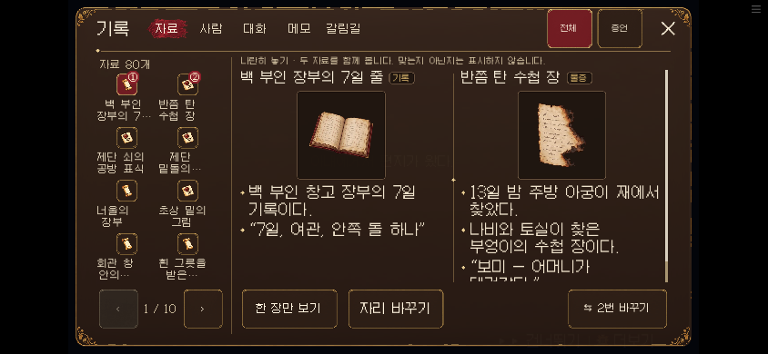
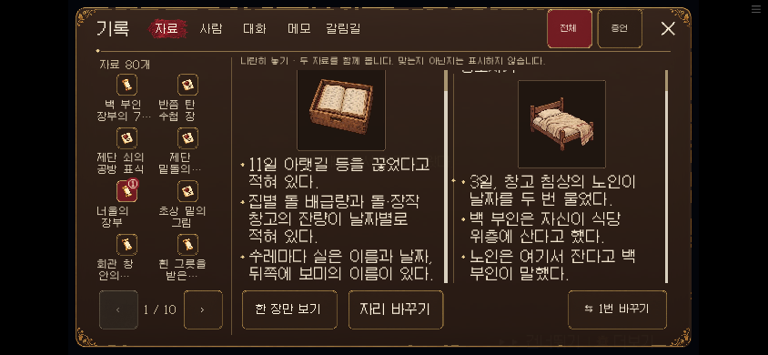

# 다람탐정 리뷰와 자료 화면 개선 — 2026-10-23

## 판단

겨울 마을의 그림, 갈색·금색·버건디 화면, 아빠와 다람의 대화는 일관성이 있다. 자료를 직접 선택해 제시하고 두 그림을 비교하는 방식도 추리 게임의 방향과 맞는다. 우선 고칠 문제는 휴대폰에서 그 자료를 읽고 조작하는 비용이었다.

이야기 쪽 다음 우선순위는 **자료 제시 후 자동으로 나오는 해설을 줄이고, 플레이어가 질문하거나 현장을 다시 확인하게 하는 것**이다. 이번에는 자료 화면의 가독성과 조작만 수정했다.

## 확인 범위

- 기준 소스: 원격 main `7d529de8`(0.20.12)와 이번 0.20.13 수정본.
- 초기 작업 환경에 있던 웹 빌드는 0.20.11이었다. 원본 0.20.12로 다시 실행해 남은 문제를 구분했다.
- 실제 브라우저 진입: 타이틀, 설정, 오프닝 대사, 편지 선택지.
- 자료 화면: 검수용으로 기존 자료 80개를 보유한 상태를 구성했다. 일반 한 회차의 보유량이나 입수 순서를 뜻하지 않는다.
- PC 1280×720, 휴대폰 크기 844×390, 세로 390×844. 기본·큰 글씨 모두 확인.
- 사건 전체 평가는 실행 소스와 기존 리뷰를 대조한 분석이다. 14일 전체를 사람이 연속 플레이한 리뷰는 아니다.

## 확인한 문제와 수정

| 문제 | 확인 근거 | 반영 |
|---|---|---|
| 모바일 관찰문이 작음 | 720 높이 화면을 390으로 줄이면 본문 20은 약 10.8 CSS px | 본문 30/32 → 약 16.3/17.3 CSS px |
| 주요 버튼이 작음 | 높이 56 → 약 30.3 CSS px | 높이 84 → 약 45.5 CSS px. 페이지 화살표·닫기·탭·분류도 터치 영역 확대 |
| 긴 관찰문이 고정 높이에 의존 | 한 장/비교의 관찰문은 아래 조작 영역과 독립된 읽기 영역이 없었음 | 읽기 영역을 제한하고 넘칠 때만 스크롤. 비교 두 열은 각각 스크롤 가능 |
| 글씨를 키우면 목록 마지막 행과 페이지 조작이 가까워짐 | 기존 4행 간격 114, 확대 버튼 상단 586이면 충돌 | 모바일 4행 간격 108, 그림 48, 이름 22/24. 마지막 행은 페이지 버튼 위에서 끝남 |
| 큰 글씨와 필터 5개가 겹침 | 필터 시작 x562, 마지막 탭 끝 x604 | 탭 공간을 먼저 남기고 필터 폭·글씨를 맞춤. 모바일 터치 폭 44px 이상 유지 |
| 고정 폭을 가정한 자료 종류 꼬리표 | 제목 폭 계산이 종류 길이에 관계없이 90을 뺐음 | 종류 글자 폭을 반영해 제목 공간 확보 |
| 소스 표시와 빌드 버전 불일치 | 기존 config.version=0.20.12, build.version=0.20.10 | 두 값을 0.20.13으로 통일 |

그림·관찰 사실·증거 입수·정답·생사·분기 조건은 변경하지 않았다. 자료 화면을 조작하는 동안 읽음 표시를 제외한 게임 상태가 유지되는지 검사했다. 휴대폰에서 그림 크기를 조정해 글씨 공간을 확보했으며, PC의 큰 그림 구성은 유지했다.

## 이미 해결돼 있던 항목

10월 22일 UI 리뷰의 제목과 탭 겹침, 자료가 없을 때의 선택 지시, 목록의 안 읽음 표시가 제목 폭을 차지하던 문제는 0.20.12에 이미 조치가 있었다. 해당 작업을 다시 구현하지 않았다. PC 자료명은 최신 기준인 최대 세 줄을 유지한다.

## 다음 개선 우선순위 — 이번에는 미수정

1. **자동 해설을 플레이어의 판단으로 바꾸기.** `game/room13_v111_days123.rpy`의 `r13_v111_trial_sale_ok`는 자료 제시 뒤 세 대사를 재생하고 바로 칼 대조로 넘어간다. ‘팔았다’와 ‘훔쳤다’의 차이를 플레이어가 질문하는 단계가 있으면 쟁점이 더 또렷해진다.
2. **비교를 실제 입력으로 만들기.** `game/room13_v111_days610.rpy`의 `r13_v111_pocket_answer10`은 L0049~L0054를 연속 재생하고 L0055를 반영한다. 종이의 수량·날짜를 직접 대조하게 하는 것이 다음 후보이다.
3. **새 증언이 재조사로 이어지게 하기.** `game/room13_v111_days1114.rpy`의 `r13_v111_handling12`는 별도 조사 대기 없이 후속 대사로 이어진다. 물통·약장 확인을 기존 조사 기능과 연결할 여지가 있다.

이 세 항목은 기존 `docs/design/PLAN_20261023_NEXT.md`의 방향과도 일치한다. 자료가 부족한 경로, 질문 순서, 돌아올 장소를 함께 검증해야 하므로 이번 화면 수정에 섞지 않았다.

## 검증

최종 검사 결과는 같은 폴더의 `VALIDATION.md`에 기록한다. 브라우저 재현 스크립트는 `dev/qa_evidence_readability.py`, 단위 검사는 `dev/test_evidence_view.py`다.

실제 휴대폰 기기·네트워크·음향 체감은 별도 검수가 필요하다. 브라우저 크기와 터치 에뮬레이션 결과를 실제 기기 결과로 표현하지 않는다.

## 화면 비교

수정 전(0.20.12), 844×390 가로 화면:

수정 후(0.20.13), 같은 화면 크기:

긴 관찰문의 아래쪽을 터치로 읽은 상태:

