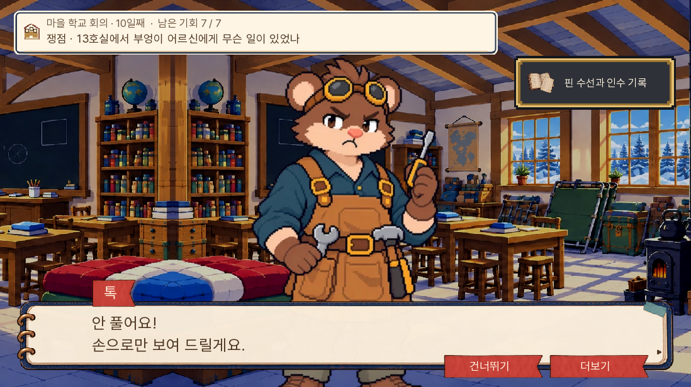
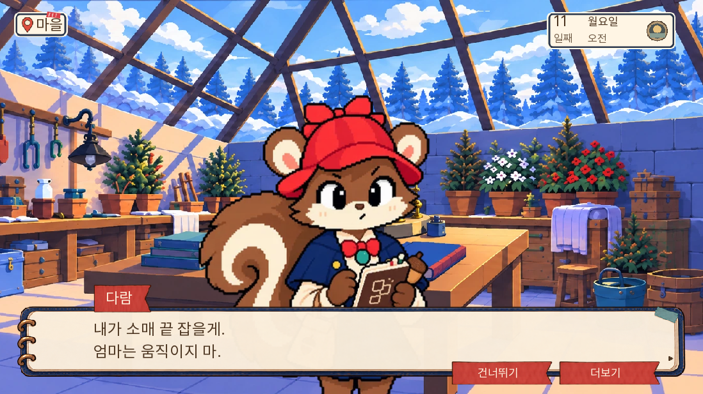
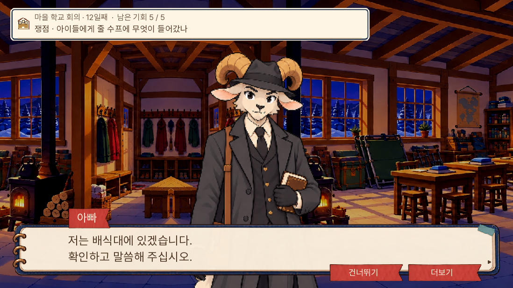

# 0.20.109 — 10~12일 주민 별편 검수

2026-11-06. 여덟 인물의 아홉 장면을 쓰고 본편 반응 27행을 연결했다. 나비는 11일 아침과 12일 저녁 두 장면에 등장한다. 전체 본편은 14일이며 이번 확장은 그중 사흘이다.

## 변경과 독립 원고 검토

[원고·시간·정보·분기 매칭](../../design/resident-reactions-day101112-20261106/README.md)에 원고 전문과 짧은 본편 발췌를 구별해 기록했다. 본편에 주민의 속마음 전문을 넣지 않았다.

| 날짜 | 시점 인물 | 자기 목적과 행동 |
|---|---|---|
| 10일 | 부리·톡·부엉이 | 당장 사과를 받아 주지 않음·증거를 풀지 않고 손으로 수선을 설명함·조건 없이 넘긴 종이를 다시 통제하려는 버릇을 멈춤 |
| 11일 | 나비·엄마·굴돌 | 토실의 밥자리를 지킴·단추를 다는 동안 다람이 잡은 소매를 둠·모두가 흔적을 보도록 등 앞을 비킴 |
| 12일 | 서리·나비·돌목 | 약병보다 아이의 몸을 먼저 살핌·냄비 보존을 맡기고 새미의 책을 꺼냄·무효로 고쳐 적은 칸을 너울에게 보임 |

독립 원고 검토에서 오늘 가족에게 준 인수표와 부엉이의 기존 서류철을 구별하도록 고쳤다. 다시 돌려달라는 말의 주어도 부엉이 자신의 통제 버릇으로 명확히 했다. 반환 주체가 확인되지 않는 곳에 할머니가 어제 돌려줬다고 새로 단정하지 않았다. 엄마의 수선 장면은 실이 저절로 끊어진 듯 보이지 않도록 남편이 실을 끊는 행동을 명시했다.

실무 의견으로는, 나비의 두 장면은 토실에게 식사 외의 일을 떠맡기지 않는 경계와 자기가 건넨 냄비를 보존하면서 책 한 권부터 맡는 책임으로 구별된다. 서리의 병 표식 확인은 내용물 확정이나 장부 밖 약 고백을 앞당기지 않는다. 돌목의 칸 무효는 이미 떠난 사람의 귀환을 뜻하지 않는다. 이 평가는 원고 대조이며 인간 초견 독자의 재미 실험은 아니다.

## 검사 범위

- 전체 단위 1,306개·관련 단위 16개 통과. lint 통과. 대사 A/B/C 0/0/0.
- 네이티브 고유 14개 통과: 새 반응 9개와 살인회의 패배·부분 성공, 문서회의 부분 성공, 국 사건 실패·일반 승리 5개. 시작 상태를 준비한 장면 검사다. 실제 행위 뒤의 자료·인수 반영과 그 전 경계를 함께 확인했다. [화면 결과](화면결과.json).
- QA 시작 상태에 필수 자료가 빠진 첫 실행을 수정했고, 준비 상태가 이전 배경을 남기지 않도록 실제 장소 표시도 호출해 새 반응 9개를 다시 검사했다. 본편 코드를 바꾼 게임 오류 수정은 아니다. 아래 캡처는 최종 실행본이다.
- 새 Chromium에서 0.20.109 메뉴, 코어 두 부분 HTTP 200, 이번 반응 27행과 브라우저 오류 없음 확인. [첫 로딩 결과](웹_첫로딩.json).

- 실제 0.20.108의 9일차 저장에서 9일을 다시 진행하고 10~12일을 거쳐 13일차에 도착했다. 기존 같은 브라우저 프로필·같은 로컬 주소의 저장을 사용했다. 이동·선택·자료 제출은 웹 화면 조작이며 대사는 건너뛰기, 자료 조합은 알려진 정답표를 사용했다. 상태·증거를 주입하지 않았다.
- 이 웹 경로는 부엉이·꼬미 생존, 다람 비구금, 10일 문서회의 승리, 11일 토실 실제 인수·가족 재회·굴돌 관찰·가설회의 승리·아랫길 세 사람 학교 인수, 12일 배식 전 중단·의료진 귀환·국 회의 대승리·해당 명단 칸 무효·나비의 책 약속까지 확인했다. 종료 pageerrors는 빈 목록이다. [웹 결과](웹_이어가기.json), [실행 기록](웹_이어가기.txt). 살인·섭취 후·회의 실패의 확인은 앞의 네이티브 준비 상태 검사와 구별한다.

14일 전체 무중단 플레이, 새 모바일 기기 검사, 인간 초견 독자 실험은 포함하지 않는다. 공개 github.io 주소는 현재 허용된 네트워크 대상에 없어 직접 브라우저 검사를 하지 않는다. 공개 반영은 원격 파일 해시·배포 커밋·Pages 결과로 별도 확인한다.

## 보존과 용량

[원본 대조](원본보존.json): 이번 27행을 빼면 d10/11/12 원본과 구조가 정확히 일치한다. records·6~10일/11~14일 실행 라벨·규칙·조건 정의도 원본 바이트와 일치한다. 정답·기회·자료 획득·생사·구금·결말은 유지했다. 새 UI·그림·음원은 없다.

[빌드 검증](빌드검증.json): 초기 로딩은 36,369,125바이트로 전판 대비 941바이트 증가했다. 핵심 합본 SHA256은 `67bff7c9f4d022f43d5a9383d7423a03dd4dafa07386b1b92091f4a21b617362`다. 묶음 안 날짜별 소스 일치, 판 번호, QA 파일 제외를 확인했다. 별도 추가 경량화 성과를 주장하지 않는다.

## 대표 화면

다음 신규 별편 대상은 13~14일이다.
