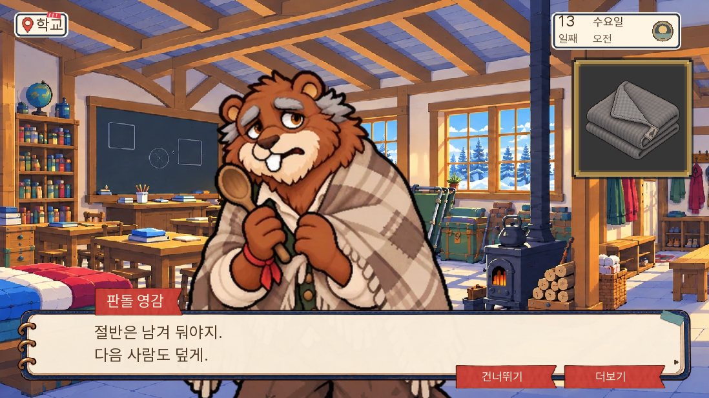
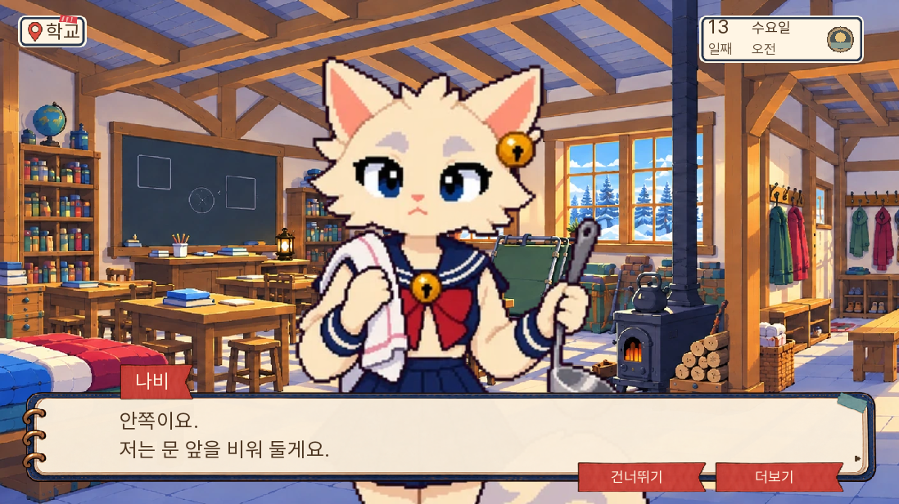
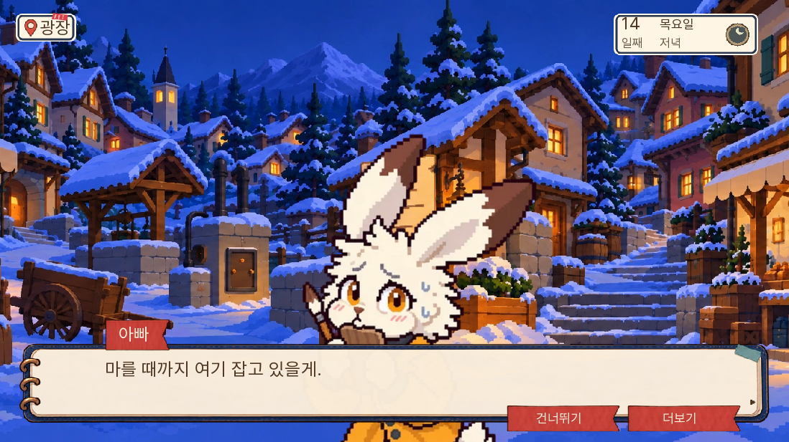
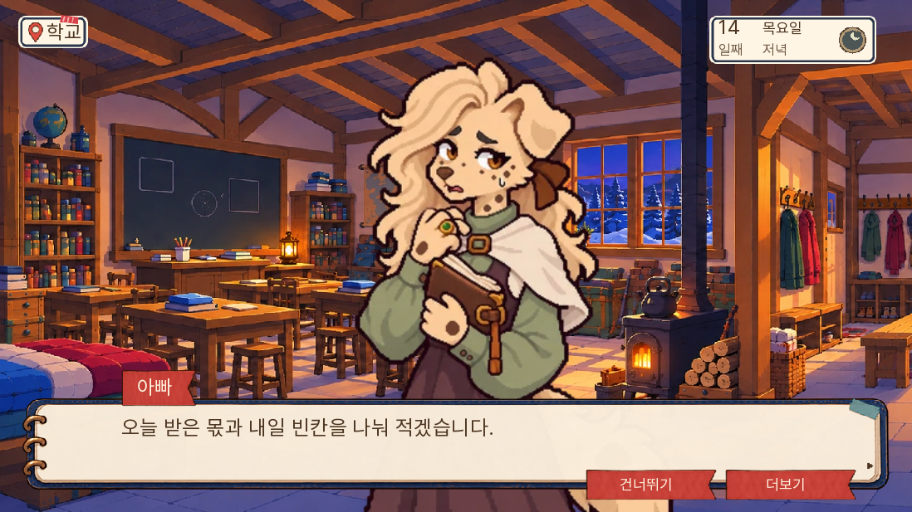
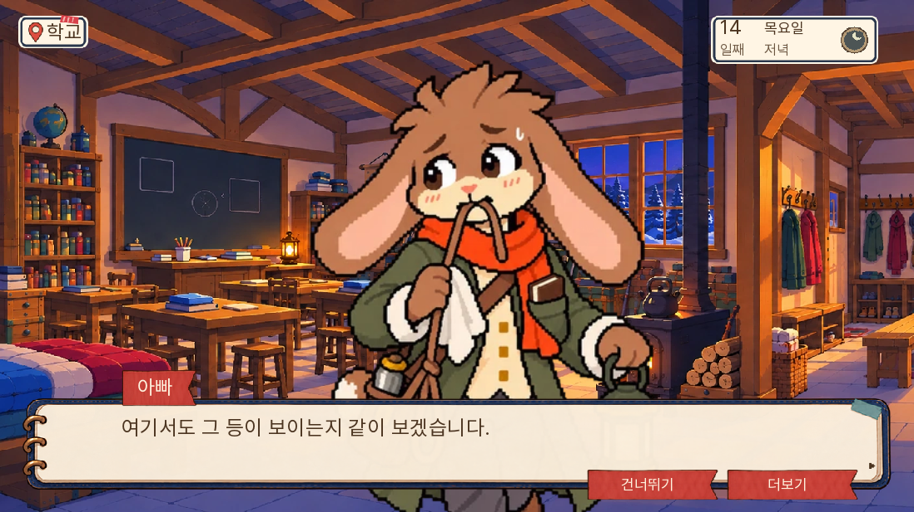
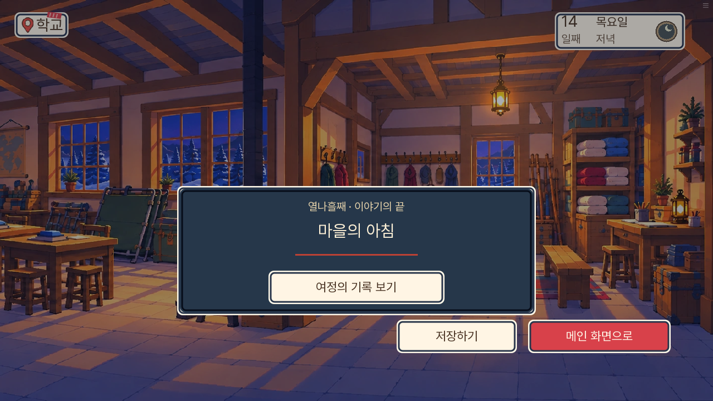

# 0.20.110 — 마지막 13~14일 주민 별편 검수

2026-11-06. 주민 여섯 명의 여섯 장면을 쓰고 본편 반응 18행을 연결했다. [원고·시간·분기·정보 매칭](../../design/resident-reactions-day1314-20261106/README.md), [구간별 읽기 안내](../../../../../docs/reading/README.md)에서 피코 사건부터 마지막날까지의 선택한 별편을 찾을 수 있다.

## 반영과 원고 검수

| 날짜 | 주민 | 자기 목적과 행동 |
|---|---|---|
| 13일 | 판돌 | 한 장을 다 덮기 어려워하며 옆 사람이 함께 덮을 끝을 남기려 함 |
| 13일 | 나비 | 학교 안쪽에 담요를 펴고 문 앞 인수 통로를 비움 |
| 13일 | 까로 | 빈 수레 고삐를 주인 은호의 손에 직접 주려 함 |
| 14일 | 토실 | 엄마 보미의 이름을 직접 쓰고 잉크가 마르기를 기다림 |
| 14일 | 백 부인 | 오늘 받은 물자와 없는 내일 몫을 중복 계산하지 못하게 확인 |
| 14일 | 초롱 | 등을 줄이면서 학교 문과 사람의 신호가 보이는지 확인 |

검수에서 판돌의 한 장 담요가 반쪽을 떼어 새로 기부하는 물자처럼 보이던 표현을 고쳤다. 백 부인은 실제 참관자이며, 오늘 자기 창고의 장작을 기부했다는 근거가 없어 그 전제를 원고·본편·매칭에서 제거했다. 수정한 두 장면은 화면 검사를 다시 통과했다.

실무 의견으로는 인물의 목적이 받기 어려워하는 양보, 실제로 사람을 받을 자리, 재차 동원되지 않으려는 반환, 이름 쓰기를 마칠 시간, 수량의 정확성, 사람이 보이는 길로 나뉜다. 주민 독백 전문은 별편에 두고 게임에는 아빠가 보고 듣는 발췌만 연결했다. 원고의 독립 대조이며 인간 초견 독자의 재미 실험은 아니다.

## 갈래 보존

- 담요 수량·기부·인수 효과를 새로 만들지 않는다. 준비·하차·학교 인수·반환·명령 중지·이미 떠난 사람은 각기 다르다.
- 까로의 반환은 기존 주인 은호에게 실제 돌려주는 입력에서만 나온다. 반환 장면만으로 호송·명령·중계 전체 중지를 가정하지 않는다.
- 14일 세 발췌는 실제 아침 줄기에만 있다. 일반 아침은 무사망·진엔딩·희생 운영 완전 종료와 같지 않다. 가족 우선·부분·군중폭력·남겨진 이름·얼어붙은 마을·불타는 밤의 기존 결과를 바꾸지 않는다.
- 토실이 밖에서 기다린 판은 못 들은 자백을 인용하지 않는다. 이름 쓰기를 미루는 선택에는 해당 새 별편이 없다. 백 부인·초롱도 실제 출석 조건 안에서만 발췌한다. 초롱 부재 시 엄마의 기존 등 관리가 남는다.
- 개별 인수 후 운반 거부·반환 등 이송 중지 절차가 미완료인 아침 경로도 유효하다. 운반 거부는 반환으로 이어지므로 다른 절차를 전부 마치고 반환만 빠졌다는 판을 가정하지 않는다. 이 경우 본편의 미완 운영 안내가 남는다.

## 검사 결과와 범위

- 전체 단위 1,318개·관련 단위 12개, lint 통과. 대사 A/B/C 0/0/0.
- 고유 네이티브 검사 11개 통과. 새 반응 여섯 장면을 검사 5개로 확인하고 수레 출발·폭동·가족 결말·남겨진 이름·부분 구조·진후일담 6개를 추가 확인했다. 준비 상태에서 실제 본편 라벨·선택을 진행한 검사다. [화면 결과](화면결과.json).
- 새 Chromium에서 0.20.110 메뉴, 코어 두 부분 HTTP 200, 추가 반응 18행, 브라우저 오류 없음 확인. [첫 로딩](웹_첫로딩.json).

- 실제 0.20.109의 12일차 저장에서 12일을 다시 진행한 뒤 13~14일을 거쳐 ‘마을의 아침’ 결말 카드와 메인 메뉴 복귀까지 확인했다. 같은 브라우저 프로필·같은 로컬 주소의 실제 저장이다. 상태·증거를 주입하지 않고 이동·선택·자료 제출을 화면으로 조작했으며 대사는 건너뛰기, 조합은 알려진 정답표를 사용했다.
- 이 경로는 개별 학교 인수, 빈 수레·장비 반환, 현재 이송 연결 중지, 장치 공동통제, 학교 물자 실인수, 현재 희생 운영 종료를 모두 확인했다. 초롱이 실제 등 관리자가 되었고, 미완 초상은 가족과 보는 장면 뒤 child_completed로 바뀌었다. 토실은 어른 문답 밖에서 기다린 판이다. 피코 사망이 남아 있어 진후일담이 아닌 일반 아침으로 끝나는 것이 맞다.
- 종료 story14_completed=True, ending14=morning, pageerrors는 빈 목록이다. [최종 결말 상태](웹_결말.json), [웹 실행 기록](웹_이어가기.txt). 실제 저장은 피코 상실 경로이며 진후일담·가족·부분·폭동·남겨진 이름의 확인은 위 네이티브 준비 상태 검사와 구별한다.

14일 전체 새 게임 무중단 플레이, 새 모바일 검사, 인간 초견 독자 실험은 포함하지 않는다. 공개 github.io 주소는 현재 네트워크 허용 대상에 없어 직접 브라우저 검사를 하지 않는다. 배포 커밋·Pages 상태·원격 파일 해시로 공개 반영을 확인한다.

## 원본과 용량

[원본 대조](원본보존.json): 추가 18행을 제거하면 d13/14 원본과 구조가 정확히 일치한다. records·11~14일 실행 라벨·규칙·조건 정의도 원본 바이트와 같다. 정답·기회·자료 획득·생사·구금·결말과 기존 그림·음원을 유지했다.

[빌드 검증](빌드검증.json): 초기 로딩 36,369,514바이트, 전판 대비 389바이트 증가. 핵심 합본 SHA256은 `1677eab12d6ffa7b06d73ac3da66e2978673ee5251f2100178e442d501c24730`다. 묶음 안 원본 일치·판 번호·QA 파일 제외를 확인했다. 새 경량화 성과를 주장하지 않는다.

## 대표 화면

이번 구간으로 마지막날까지의 선택한 주민 별편 확장을 마쳤다. 새 날짜나 모든 주민의 매일 대사를 추가한 작업은 아니다.
