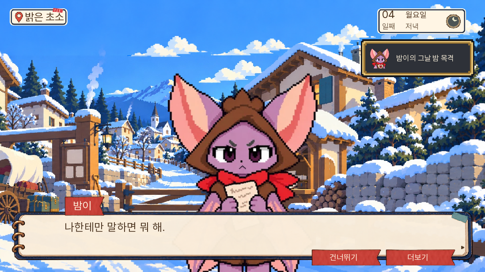
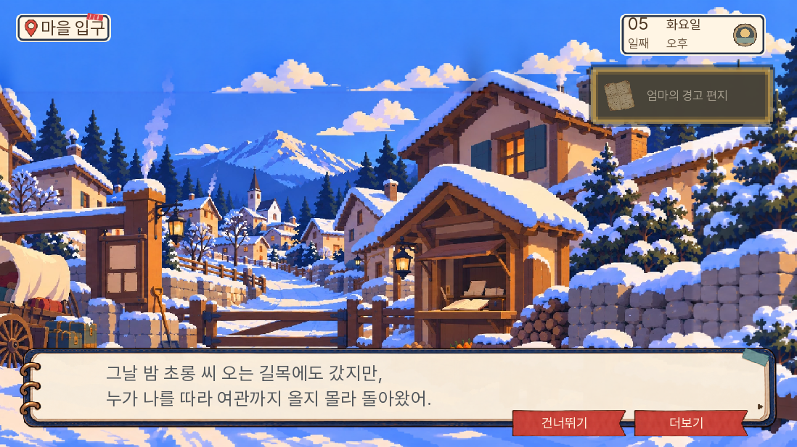
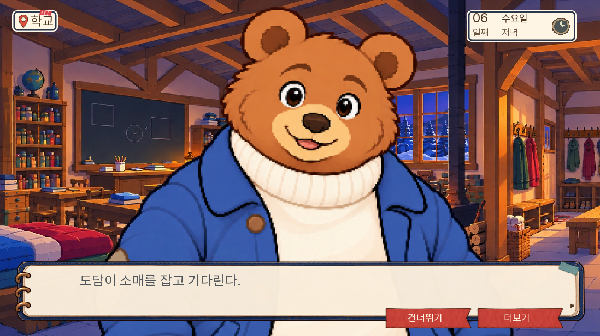
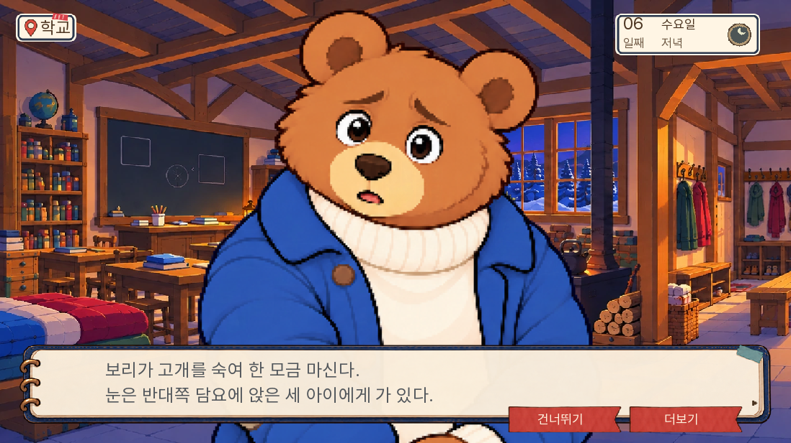

# 4~6일 주민 별편·본편 반응 검수

2026-11-06 · 0.20.107. 소유자의 다음 날짜 진행 요청에 따라 4~6일을 다뤘다. 기존 14일 본편·소설을 새로 사흘짜리 게임으로 줄인 작업이 아니다. 이번 주민 별편 확장 범위가 사흘이다.

## 적용 결과

주민 5명(돌목·밤이·나비·도토·보리)의 9장면을 썼다. 원고 전문은 [별편 폴더](../../design/resident-reactions-day456-20261106/README.md), 내려받는 경로별 파일은 [읽기 파일](../../../../../docs/reading/resident-days456-20261106/README.md)에 있다. 게임은 주민 속마음을 붙이지 않고 다돌이 직접 볼 수 있는 24개 신규 행동·대사 행과 기존 2행 개정을 사용한다. 그중 2행은 가족 편지 배달자 퇴장이다. 새 그림·음원·화면은 추가하지 않았다.

4일 돌목의 의자·문 고집과 밤이의 공개 정정 요구, 5일 나비의 직접 증언 출발·승리 후 밤이의 종이 보관·실패 후 기록 요구, 6일 도토의 실제 인계 확인·보리의 구조 지시·화상 후 도움 요청·빈 창고판의 별도 반응을 연결했다. 새 대사에는 피습·불안·항의 상황에 맞는 기존 표정을 지정했다.

실무 의견으로는 주민이 각자 지키려는 것이 구별된다. 돌목은 업무와 자기 체면, 밤이는 자기 이름과 말의 기록, 나비는 자기 목격을 남에게 맡기지 않는 일, 도토는 실제 인수, 보리는 아이들을 향한 손과 자기 책임을 붙든다. 독립 읽기 검수에서는 갈래 표기가 없을 때 밤이가 다시 잡히거나 꼬미가 되살아난 것처럼 읽힐 수 있음을 발견해 모든 장면의 시간·갈래와 네 읽기 경로를 제공했다. 돌목의 ‘놓친 건’은 ‘사람 놓친 건’으로 목적어를 밝혔다.

## 보존한 경계

- 얼굴을 못 본 목격과 낮의 목격 소문을 구별한다. 피코 생사·선택적 스케치를 공통 원고에서 확정하지 않는다.
- 나비의 출발 약속과 승리 때 실제 초소 합류를 구별한다.
- 엄마 편지는 초롱이 비켜난 뒤 가족만 읽는다. E27 소지, 전문 청취, 두 편지 대조를 구별한다.
- 학교 허락·담요 준비·네 아이 실제 인계를 구별한다. 아이 잔류판의 세 아이 구조는 꼬미 생존 결과가 아니다.
- 보리의 아이 도담과 꼬미를 구별한다. 장작 절도와 방화, 6일 관찰과 7일 범행 진술을 구별한다.
- 원본 records·증거 ID·획득·정답·기회·승패·생사·구금·명단 결과는 유지한다.

## 검증

전체 단위 1,272개, 관련 53개와 표정 지정 후 관련 43개, lint, 대사 자동 검사 A/B/C 0을 통과했다. 별편 HTML은 네 경로 각 6장면과 전체 9장면의 표시 수·순서를 Chromium으로 확인했다. PDF·Word를 내보내고 PDF의 한글·20쪽 전체본과 읽기 화면을 확인했다.

네이티브 화면 시험 8개를 통과했다. 시작 상태를 준비하는 시험이며 전체 날짜를 연속으로 했다는 뜻이 아니다.

| 시험 | 확인한 경계 |
|---|---|
| resident4_chair_and_correction | 피습 후 의자·비목격 인정 뒤 항의·원래 진술 획득/정정 시점 |
| v111_nw_d05_extra_e21_wins | 대체 유효 자료를 실제 제출해 승리·종이 보관 |
| v111_nw_d05_half_then_lost | 부분 제출·기회 소진·명단 유지 |
| novel_d05_letter_read_commit | 초롱 퇴장·가족 배치·봉투와 전문 청취 구분 |
| v111_nw_d06_afternoon_today | 허락·담요 차용·창고 재방문·실제 인계 |
| resident6_safe_hands | 학교에 실제 이동한 뒤 빈 창고판 손·네 아이 유지 |
| resident6_burned_hands | 학교에 실제 이동한 뒤 화상판 도움 요청·셋 구조/꼬미 사망 유지 |
| v111_d456_fire_escort_daram_stays | 학교에 아이를 보낸 뒤 아빠 혼자 구조 현장에 복귀 |

초기 새 단위 시험은 추가 대사에 원문 line_id가 있다고 가정해 비교에 실패했다. 실제 출력 문장을 기준으로 고친 뒤 관련·전체 검사를 통과했다. 첫 4일 화면 시험은 준비 상태에 E19·낮 방문 거절을 빠뜨려 진입 검사에서 실패했고, 해당 사전 조건을 명시한 뒤 통과했다. 학교 반응 캡처는 이동 생략 때 앞 배경이 남아, 실제 지도 이동을 거친 화면으로 다시 확인했다. 이 실패들을 게임의 실제 연속 진행 불능으로 세지 않는다.

## 웹 이어가기

동일 origin·프로필의 실제 저장을 사용했다. 0.20.106에서 플레이하며 만든 3일 시작 저장 `br-piko_lost-day3`을 0.20.107에서 불러와, 기존 대사에는 실제 건너뛰기 버튼을 사용하고 이동·선택·자료 제출을 눌러 4일 시작 저장을 만들었다. 그 실제 `br-piko_lost-day4`부터 4~6일을 진행해 7일 오전 학교에 도착했다. 대사 일부는 건너뛰었다. 정답표를 아는 자동화이며 인간 초견 추리/재미 평가가 아니다. 시작 상태·자료·생사를 새로 주입하지 않았다.

최종 값은 피코 사망·미완 초상, 밤이 냉기 경험·5일 회의 승리·혐의 해소, 엄마 첫 연락 전문 청취·초대장 대조, 담요 차용·네 아이 인계 완료·빈 창고 화재·꼬미 생존이다. E20/E21/E25/E26/E27 보유도 검사했다. 브라우저 pageerror와 Ren’Py 예외 화면은 없었다. 전체 상태·입력은 `웹_4-6일_결과.json`, `웹_4-6일_조작.txt`에 있다.

자동화 중에는 새 행이 든 대화 묶음만 읽는 선별을 시도했지만, 건너뛰기는 뒤의 대화 묶음에도 이어지므로 새 본문 전체를 읽은 검증으로 세지 않았다. 나비 출발 본문의 표시 대사 12개는 기록했으나, 새 대사의 전체 노출·표정·분기 확인은 위 네이티브 8개와 별도로 구분한다. 선별 코드는 제거했고, 공개된 도구에는 `ROOM13_SKIP_BEFORE_DAY`의 실제 건너뛰기 버튼 사용만 남겼다. 첫 재생의 중단과 자동화 스냅샷 키 불일치 수정 후 저장부터 재개한 것이므로 새 게임부터의 무중단 1~6일 주행으로 세지 않는다.

## 화면

## 빌드와 범위

공개 묶음은 0.20.107이며 source options·d04/05/06과 실제 ZIP을 대조했다. qa_tests와 임시 시험은 공개 묶음에 없다. SHA-256은 `05d61ed9956258da767de10e2c5556fa9e4ecd6fcd30da331f005d91055fd2fb`다. 첫 로딩 자료 36,366,724바이트로 0.20.106보다 895바이트 늘었으며, preload 33·prefetch 107·원격 자료 4,626개는 같다. 읽기 문서는 게임의 첫 로딩 대상에 넣지 않았다.

14일 무중단 주행·인간 초견 독자 실험·새 휴대폰 실측은 이번 결과에 포함하지 않는다. 새 주민 별편의 다음 날짜 대상은 7~9일이며 이번 판에서는 확장하지 않았다.

## 공개 전송 분할

공개 직전에 셸의 기존 GitHub 토큰이 만료되어 연결된 동일 계정의 GitHub 앱 인증으로 전환했다. 앱의 단일 요청 크기 한도에 맞추기 위해 빌드 도구의 기존 `--part-mb 10` 기능으로 코어 ZIP을 두 전송 파일로 나눴다. 판정·본문·그림은 바꾸지 않았다. `check_release.py`도 두 부분을 합쳐 판 번호를 읽도록 고쳤으며, 단일/분할/끝부분 누락 시험 3개와 전체 단위 1,272개·lint를 통과했다.

앞선 4~6일 경로 시험은 단일 전송본에서 했다. 최종 분할본과 ZIP 항목을 전부 비교해 실행 소스·JSON·그림·엔진 자료가 같고 컴파일 캐시 `.rpyc`만 달라졌음을 확인했다. SDK 재빌드로 코어 ZIP은 175바이트 늘었다. 이 문서의 위 SHA와 용량은 최종 두 부분을 합친 값이다. 경로 시험을 최종 파일로 처음부터 다시 했다는 뜻은 아니다.

최종 분할본은 캐시 없는 새 Chromium에서 두 부분 모두 HTTP 200으로 내려받고 0.20.107 메인 화면에 진입했다. 새 편지 블록 2행도 원시 대사표에서 확인했고 pageerror는 없었다. 결과는 `분할전송_웹.json`이다. 첫 보조 검사에서 웹 모듈에 없는 화면 조회 API를 사용했던 오류는 `renpy.display.screen.get_screen`으로 바로잡았다.
