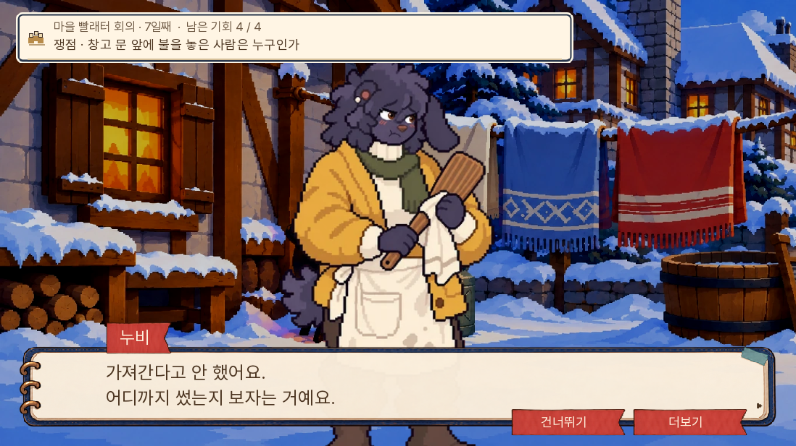
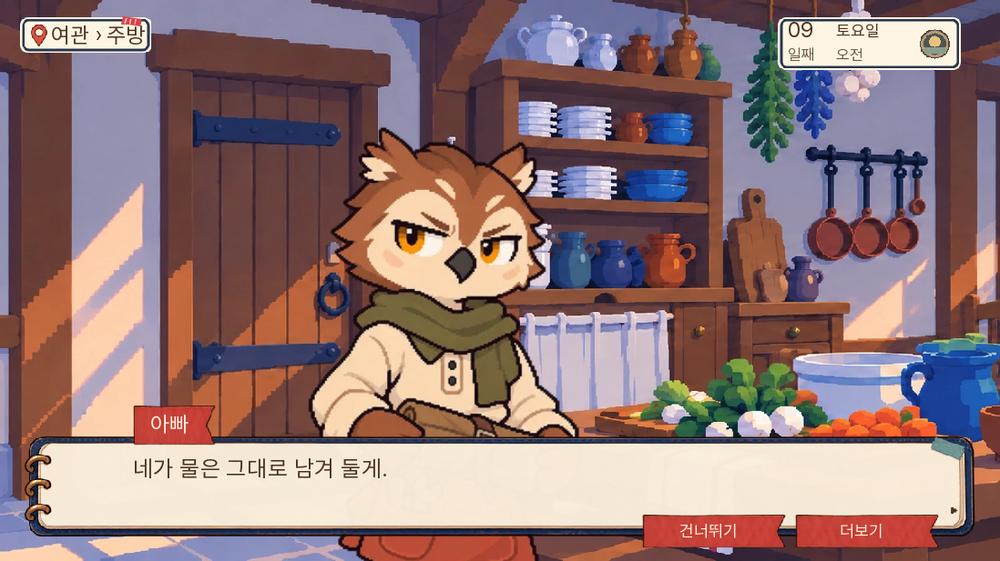
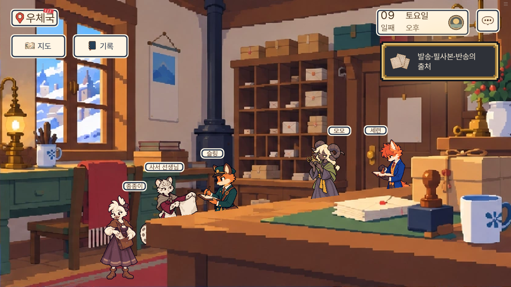

# 0.20.108 — 7~9일 주민 별편 검수

2026-11-06. 4~6일 다음으로 7~9일 주민 9명의 별편 9장면을 완성하고, 본편에 추가 27행·기존 지문 1행 개정을 연결했다. 전체 이야기는 14일이다. 이번 확장은 그중 사흘이다.

## 반영 내용

| 날짜 | 주민 | 본편에서 드러나는 행동 |
|---|---|---|
| 7일 | 사자 선생님·누비·보리 | 막내의 대답을 기다림·자백의 기록 범위를 확인함·생존 꼬미에게 빈 그릇부터 맡김 |
| 8일 | 서리·부엉이·초롱 | 아이가 옷을 정리할 시간을 줌·치료 뒤 종이를 직접 들고 있음·봉투 인수를 확인함 |
| 9일 | 부리·톡·세련 | 유족의 질문을 지킴·사람 대신 수리품을 보게 함·접수표의 칸 이름을 구별함 |

[원고와 시간·분기 매칭](../../design/resident-reactions-day789-20261106/README.md)에 별편과 본편 앵커, 등장인물의 지식 범위를 기록했다. 꼬미 생사, 부엉이 사망·치료 생존·돌 제거 예방, 다람 구금, 톡의 실제 출석을 구별한다. 원고 다섯 경로와 비교본을 PDF·Word·HTML로 내보냈고 장면 순서와 연속 장 번호를 검사했다.

실무 의견으로는, 주민마다 아빠의 수사에 협력하는 이유와 지키려는 대상을 다르게 준 점이 이번 변화의 중심이다. 독립 원고 검수에서는 톡의 수리용 여분 철사와 봉인 증거, 누비의 주장과 입증된 사실, 초롱의 봉투 인수와 편지 내용 인지를 명확히 나눴다. 재미에 관한 인간 초견 독자 실험은 실시하지 않았다.

## 검증 결과와 한계

- 전체 단위 1,290개, 이번 관련 단위 18개 통과. lint 통과. A/B/C 검사 0/0/0.
- 네이티브 화면 검사 11개 통과: 이번 주민 장면 7개와 화재 상실·부분 성공·대승리·돌 예방 4개. 상태를 준비한 장면 검사이며 14일 연속 플레이가 아니다.
- 새 Chromium에서 0.20.108 메뉴 로딩, 분할 파일 두 개의 HTTP 200, 추가 대사 27행, 브라우저 오류 없음 확인. [첫 로딩 결과](웹_첫로딩.json).
- 실제 0.20.107의 6일차 저장에서 이어 6일을 다시 진행하고 7~9일을 거쳐 10일차에 도착했다. 이동·선택·자료 제출은 웹 화면 조작으로 수행했고 대사는 건너뛰기를 사용했다. 상태나 증거를 주입하지 않았다. 꼬미 생존·돌 제거 예방·부엉이 생존·다람 비구금 경로이며 화재 회의 대승리를 확인했다. 종료 시 pageerrors는 빈 목록이다. [웹 결과](웹_이어가기.json), [실행 기록](웹_이어가기.txt).
- 살인·구금 및 치료 생존 분기는 네이티브 준비 상태 검사로 확인했다. 새 모바일 기기 검사, 1~14일 무중단 주행, 공개 github.io 주소의 직접 브라우저 검사는 실시하지 않았다. 공개 반영 여부는 배포 커밋·Pages 빌드 결과와 원격 파일 해시로 별도 확인한다.

## 보존과 용량

[원본 보존 결과](원본보존.json): 추가 주민 행을 제거하고 개정 지문을 되돌리면 날짜별 원본과 일치한다. records·실행 라벨·규칙·조건 원본 바이트도 일치한다. 정답·기회·자료 획득·생사·구금 판정은 유지했다.

[빌드 검증](빌드검증.json): 초기 로딩 36,368,184바이트로 전판 대비 1,460바이트 증가했다. 새 그림·음원은 없다. 코어 합본 SHA256은 `4df25bd4a34db2a02c29362231369208f33c3a556d01dcacd8aed70a91168ae4`다. 빌드의 날짜별 원본 일치와 QA 파일 제외를 확인했다. 이 판은 주민 반응 확장이며 별도의 추가 경량화 성과를 주장하지 않는다.

## 대표 화면

다음 작업 범위는 10~12일 주민 별편과 같은 시점의 본편 반응이다.
